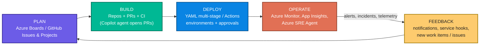
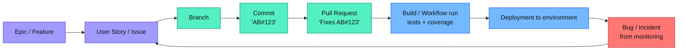

# Day 1 (Tue 24 Nov 2026): Flow of work & traceability

**Domain 1: Design and implement processes and communications (15–20%)**
Study-guide bullets covered today ([source](https://learn.microsoft.com/en-us/credentials/certifications/resources/study-guides/az-401)):
- Design a structure for the flow of work, including plan, build, deploy, and operate phases
- Design a strategy for feedback cycles, including notifications
- Design a strategy for tracking work using Azure Boards
- Design traceability, including repositories, bugs, and quality

Time box: about 2.5 h (30 min concepts, 90 min lab, 30 min cheat sheet + questions).

---

## 0. Exam orientation (10 min)

| Fact | Value | Source |
|---|---|---|
| Exam | AZ-401 (beta), *Designing and Implementing Microsoft Agentic DevOps Solutions* | [exam page](https://learn.microsoft.com/en-us/credentials/certifications/exams/az-401/) |
| Certification | Microsoft Certified: Agentic DevOps Engineer Expert (beta) | [exam page](https://learn.microsoft.com/en-us/credentials/certifications/exams/az-401/) |
| Pass mark | 700. Beta results come later | [exam page](https://learn.microsoft.com/en-us/credentials/certifications/exams/az-401/) |
| Biggest domain | Build & release pipelines, 35–40% | [study guide](https://learn.microsoft.com/en-us/credentials/certifications/resources/study-guides/az-401) |
| Languages you're expected to know | YAML, KQL, Bicep | [study guide](https://learn.microsoft.com/en-us/credentials/certifications/resources/study-guides/az-401) |
| Preview features | Mostly GA, but commonly used Preview features can appear | [study guide](https://learn.microsoft.com/en-us/credentials/certifications/resources/study-guides/az-401) |

What's new compared with AZ-400: every domain now has an **AI-assisted** angle (Copilot, MCP servers, agentic workflows, SRE Agent). On every topic, ask yourself: *how would I do this with Copilot + MCP, and what guardrails would I put on it?*

---

## 1. Concepts

### 1.1 Flow of work: plan → build → deploy → operate, then feedback



- **Plan:** pick a process template for the Azure Boards project (Basic / Agile / Scrum / CMMI). Choose by how you track work, e.g. Agile = User Story/Bug/Task, Scrum = PBI/Bug/Task, CMMI = Requirement + formal change requests. ([choose a process](https://learn.microsoft.com/en-us/azure/devops/boards/work-items/guidance/choose-process?view=azure-devops))
- **Build/Deploy:** every change travels as a PR that links back to a work item. Branch policies enforce that (Section 1.3).
- **Operate → Feedback:** notifications (subscriptions per user/team/project) and **service hooks** (push events to Teams, Slack, webhooks, and others) close the loop. ([notifications](https://learn.microsoft.com/en-us/azure/devops/organizations/notifications/about-notifications?view=azure-devops), [service hooks](https://learn.microsoft.com/en-us/azure/devops/service-hooks/overview?view=azure-devops))
- **Flow metrics** (lead time = created → done, cycle time = started → done) come from Boards Analytics widgets. Day 2 and Day 15 go deeper. ([cycle & lead time](https://learn.microsoft.com/en-us/azure/devops/report/dashboards/cycle-time-and-lead-time?view=azure-devops))

### 1.2 Traceability chain



**Azure Boards ↔ GitHub** works through the **Azure Boards app for GitHub** ([install](https://learn.microsoft.com/en-us/azure/devops/boards/github/install-github-app?view=azure-devops), [connect](https://learn.microsoft.com/en-us/azure/devops/boards/github/connect-to-github?view=azure-devops)). Exam traps, all from the [AB# linking doc](https://learn.microsoft.com/en-us/azure/devops/boards/github/link-to-from-github?view=azure-devops):
- `AB#{ID}` creates a link when it's in a **commit message, PR description, or issue description**. It does **not** link from a PR **title** or a **comment**.
- `Fixes/Fixed/Fix AB#123` moves the work item to the first **Resolved**-category state, or **Completed** if the process has no Resolved category. `Closed AB#123` moves it to that named state.
- State transitions apply **only when the PR is merged into the default branch**.
- Connect a GitHub repo to **only one** Azure DevOps organization, because work item IDs aren't unique across orgs ([connect doc](https://learn.microsoft.com/en-us/azure/devops/boards/github/connect-to-github?view=azure-devops)).
- If `AB#` links silently fail, check that the *Azure Boards* identity has **View/Edit work items in this node** on the area path ([connect doc](https://learn.microsoft.com/en-us/azure/devops/boards/github/connect-to-github?view=azure-devops)).

### 1.3 Enforcing traceability
| Platform | Mechanism | Source |
|---|---|---|
| Azure Repos | Branch policy **"Check for linked work items"** (required or optional), via `az repos policy work-item-linking` | [branch policies](https://learn.microsoft.com/en-us/azure/devops/repos/git/branch-policies?view=azure-devops), [CLI](https://learn.microsoft.com/en-us/cli/azure/repos/policy/work-item-linking?view=azure-cli-latest) |
| GitHub | Rulesets / branch protection + a **required status check** (e.g. an Actions job that fails when the PR body has no `AB#` reference) | [rulesets](https://docs.github.com/en/repositories/configuring-branches-and-merges-in-your-repository/managing-rulesets/about-rulesets) |

### 1.4 The agentic angle (preview of Day 3)
- The **Azure DevOps remote MCP Server** is GA. It's hosted at `https://mcp.dev.azure.com/{organization}` over streamable HTTP with Entra ID auth, and needs an **Entra-backed org** (MSA-only orgs aren't supported). You can limit it with `X-MCP-Toolsets` (e.g. `wit,repos`) and `X-MCP-Readonly`. ([docs](https://learn.microsoft.com/en-us/azure/devops/mcp-server/remote-mcp-server?view=azure-devops), [GA blog](https://devblogs.microsoft.com/devops/azure-devops-remote-mcp-server-ga/))
- The **GitHub remote MCP server** is at `https://api.githubcopilot.com/mcp/` and supports toolsets, `/readonly`, and OAuth or PAT. ([remote-server.md](https://github.com/github/github-mcp-server/blob/main/docs/remote-server.md))
- With both servers in VS Code agent mode, Copilot can read a work item, create a branch and PR that cites `AB#id`, and report status back. That's how this exam frames "Boards↔GitHub via MCP". ([Copilot agent mode](https://docs.github.com/en/copilot/how-tos/copilot-in-your-ide/use-copilot-agents/use-agent-mode))

---

## 2. Hands-on lab (about 90 min, about ₹0)

> **Cost notes.** Azure DevOps includes the first 5 Basic users and 1 Microsoft-hosted parallel job (1,800 min/month) free ([billing FAQ](https://learn.microsoft.com/en-us/azure/devops/organizations/billing/billing-faq?view=azure-devops)). GitHub Free includes Actions minutes for private repos, and standard GitHub-hosted runners are free for public repos ([Actions billing](https://docs.github.com/en/billing/concepts/product-billing/github-actions)). This lab creates **no billable Azure resources**. The only Azure resource is an empty, tagged resource group, which costs nothing. Optionally set a budget alert now for the whole prep ([budgets tutorial](https://learn.microsoft.com/en-us/azure/cost-management-billing/costs/tutorial-acm-create-budgets)).

Replace `<org>` with your Azure DevOps org name wherever you see it. Use an **Entra-backed** org so the remote MCP server works in Lab D and on Day 3.

### Prerequisites

Do this once before Lab A. Later labs in this lesson reuse the same sign-in, tools, and `<org>`.

#### Accounts and licences

| Account | What you need | Why |
|---|---|---|
| **Azure subscription** | A subscription where you can create a resource group. A free or pay-as-you-go subscription is fine. | Lab A creates an empty, tagged resource group (`rg-az401-lab`) so later pipeline days have a place to put resources. The group itself is free. |
| **Azure DevOps organization** | An organization at `https://dev.azure.com/<org>`, connected to a **Microsoft Entra** tenant. Standalone Microsoft-account (MSA) orgs work for Boards and Repos today, but the **remote MCP server is Entra-only**. | You create the `az401-lab` project here. The remote MCP server in Lab D and Day 3 does not support MSA-only orgs ([remote MCP prerequisites](https://learn.microsoft.com/en-us/azure/devops/mcp-server/remote-mcp-server?view=azure-devops)). |
| **GitHub account** | A GitHub Free (or higher) personal account. The commands use `vijayraavi` as the owner; replace that if you are running the lab under a different login. | Lab C creates the private repo `az401-lab-app`, installs the Azure Boards app, and runs a GitHub Actions check. |
| **GitHub Copilot (Lab D only)** | A Copilot plan that can use **agent mode** in VS Code (Pro, Pro+, Business, or Enterprise; Copilot Free may include limited agent-mode access), plus the Copilot Chat extension. | Lab D is optional. It connects the remote Azure DevOps and GitHub MCP servers in agent mode ([agent mode](https://docs.github.com/en/copilot/how-tos/copilot-in-your-ide/use-copilot-agents/use-agent-mode)). |

If you do not already have an Azure DevOps organization, create one while signed in with your **work or school (Entra)** account at [dev.azure.com](https://dev.azure.com): **New organization**. That org is connected to that Entra directory automatically ([create an organization](https://learn.microsoft.com/en-us/azure/devops/organizations/accounts/create-organization?view=azure-devops)). To connect an existing org: **Organization settings → Microsoft Entra ID → Connect directory**, then sign out and back in with your work credentials ([connect an organization to Microsoft Entra ID](https://learn.microsoft.com/en-us/azure/devops/organizations/accounts/connect-organization-to-azure-ad?view=azure-devops)).

The first five Basic users in an Azure DevOps org are free ([billing FAQ](https://learn.microsoft.com/en-us/azure/devops/organizations/billing/billing-faq?view=azure-devops)). Use a **Basic** access level, not Stakeholder — Stakeholders cannot use Azure Repos.

#### Tools and minimum versions

| Tool | Minimum | Install (Windows / Ubuntu) |
|---|---|---|
| **Azure CLI** | 2.0.69 or later (required by the extension; any current 2.x is fine) | See Shell setup below, or [Install the Azure CLI](https://learn.microsoft.com/en-us/cli/azure/install-azure-cli) |
| **azure-devops extension** | Latest | `az extension add --name azure-devops` (or `az extension update --name azure-devops`) ([Azure DevOps CLI](https://learn.microsoft.com/en-us/azure/devops/cli/?view=azure-devops)) |
| **GitHub CLI (`gh`)** | Current stable 2.x | See Shell setup. If `apt` cannot find `gh`, use the [official Linux install](https://github.com/cli/cli/blob/trunk/docs/install_linux.md). |
| **Git** | 2.x | See Shell setup. |
| **PowerShell 7** (Windows) | 7.0 or later | `winget install -e --id Microsoft.PowerShell`. Windows PowerShell 5.1 does not support `&&`, and `>` there writes UTF-16, which breaks Git. These labs use `Set-Content` instead. |

The Azure DevOps CLI extension works only with **Azure DevOps Services** (cloud), not Azure DevOps Server ([CLI quickstart](https://learn.microsoft.com/en-us/azure/devops/cli/?view=azure-devops)).

Optional for Lab D: [Visual Studio Code](https://code.visualstudio.com/) 1.99 or later with the GitHub Copilot Chat extension, so `.vscode/mcp.json` is picked up.

#### Permissions and roles

| Surface | Role you need | Why |
|---|---|---|
| **Azure subscription** | **Contributor** or **Owner** at subscription scope | `az group create` creates a resource group at subscription scope. Contributor is enough; Owner also works. |
| **Azure DevOps organization** | **Project Collection Administrators**, or the collection-level **Create new projects** permission set to Allow. Organization owners have this automatically. | Required to run `az devops project create` ([create a project](https://learn.microsoft.com/en-us/azure/devops/organizations/projects/create-project?view=azure-devops)). After you create `az401-lab`, you are a **Project Administrator** of it. |
| **Azure Repos branch policies** | **Project Administrators**, or repository-level **Edit policies** | Required to create the "Check for linked work items" policy ([branch policies](https://learn.microsoft.com/en-us/azure/devops/repos/git/branch-policies?view=azure-devops)). |
| **Notifications** | **Project Administrators** for a project-level subscription | ([manage notifications](https://learn.microsoft.com/en-us/azure/devops/organizations/notifications/manage-team-group-global-organization-notifications?view=azure-devops)) |
| **Service hooks** | **Project Administrators** (default **Edit subscriptions** / **View subscriptions**) | ([service hooks](https://learn.microsoft.com/en-us/azure/devops/service-hooks/overview?view=azure-devops), [webhooks](https://learn.microsoft.com/en-us/azure/devops/service-hooks/services/webhooks?view=azure-devops)) |
| **GitHub repo** | Owner or **admin** on the account that will own `az401-lab-app` | Needed to create a private repo, install the Azure Boards app, and create a ruleset. |
| **Azure Boards ↔ GitHub** | **Project Collection Administrators** (and project member) on the Azure DevOps side; **administrator or owner** of the GitHub repo | ([connect to GitHub](https://learn.microsoft.com/en-us/azure/devops/boards/github/connect-to-github?view=azure-devops), [install the app](https://learn.microsoft.com/en-us/azure/devops/boards/github/install-github-app?view=azure-devops)) |
| **Remote MCP (Lab D)** | Project membership, plus access to the work items and repos you query | ([remote MCP prerequisites](https://learn.microsoft.com/en-us/azure/devops/mcp-server/remote-mcp-server?view=azure-devops)) |

Sign in to Azure CLI with the **same Entra identity** that is a member of the Azure DevOps org. `az boards` / `az repos` use that identity, not a separate Azure DevOps password.

#### Sign-in and environment

You will run these during Lab A and Lab C (they are repeated there with comments):

- `az login` — browser or device-code sign-in to Azure / Entra.
- `az account set --subscription "<subscription-id-or-name>"` — only if `az account show` is not the subscription you want.
- `az devops configure --defaults organization="https://dev.azure.com/<org>"` — so later `az boards` / `az repos` commands can omit `--organization`. After Lab B you also set `project=az401-lab`.
- `gh auth login` — sign in to `github.com`. The default `repo` scope is enough to create the repo and open PRs. Cleanup's `gh repo delete` needs the `delete_repo` scope: `gh auth refresh -s delete_repo`.
- Git user identity, if this machine has never committed: `git config --global user.name "Vijay Raavi"` and `git config --global user.email "you@example.com"`. Without these, `git commit` fails.

Placeholders used today:

| Placeholder / variable | Set in | Meaning |
|---|---|---|
| `<org>` | You replace this everywhere | Azure DevOps organization name (the segment after `dev.azure.com/`). |
| `$epic` / `$EPIC`, `$story` / `$STORY`, `$task` / `$TASK` | Lab B | Work item IDs. Lab C reuses `$story` / `$STORY` — keep the same shell, or set the variable again from the ID you printed. |

This is Day 1, so there is no earlier lab to reuse. Labs A–C **create** the Azure DevOps project `az401-lab` and the GitHub repo `vijayraavi/az401-lab-app`. Days 2–5 reuse both, so **skip Cleanup** if you are continuing tomorrow.

#### Verify prerequisites

Replace `<org>` first. A missing tool, a sign-in that expired, or an org you cannot see will fail here instead of halfway through Lab B.

**PowerShell**
```powershell
# Print Azure CLI and extension versions. You need Azure CLI 2.0.69+ and the azure-devops extension.
az version
# Confirm the azure-devops extension is installed and show its version (errors if it is missing).
az extension show --name azure-devops --query '{name:name, version:version}' -o table
# Confirm the active Azure subscription and the signed-in user (Contributor or Owner is required to create the RG).
az account show --query '{name:name, id:id, user:user.name}' -o table
# List projects in your org. An empty table is fine on Day 1; an auth error means the org name or identity is wrong.
az devops project list --organization "https://dev.azure.com/<org>" -o table
# Confirm GitHub CLI is signed in to github.com as the account that will own az401-lab-app.
gh auth status
# Confirm Git and PowerShell 7 are on the PATH. $PSVersionTable.PSVersion should start with 7.
git --version
$PSVersionTable.PSVersion
```

**Ubuntu (bash)**
```bash
# Print Azure CLI and extension versions. You need Azure CLI 2.0.69+ and the azure-devops extension.
az version
# Confirm the azure-devops extension is installed and show its version (errors if it is missing).
az extension show --name azure-devops --query '{name:name, version:version}' -o table
# Confirm the active Azure subscription and the signed-in user (Contributor or Owner is required to create the RG).
az account show --query '{name:name, id:id, user:user.name}' -o table
# List projects in your org. An empty table is fine on Day 1; an auth error means the org name or identity is wrong.
az devops project list --organization "https://dev.azure.com/<org>" -o table
# Confirm GitHub CLI is signed in to github.com as the account that will own az401-lab-app.
gh auth status
# Confirm Git is on the PATH.
git --version
```

If `az account show` fails, run `az login` (Lab A, step 1). If `az devops project list` fails with an authentication or "organization not found" error, check `<org>` and that this Entra user is a member of the org. If `gh auth status` says you are not logged in, run `gh auth login` (Lab C, step 1). If `az extension show` fails, run the Shell setup install below.

### Shell setup

Labs are shown for **Windows PowerShell** and **Ubuntu (bash)**. YAML, JSON, and other file contents are the same in both. Commands that are identical in both shells are shown once and marked **works in both**.

Install Azure CLI, GitHub CLI, Git, and the Azure DevOps CLI extension once if you don't already have them. PowerShell snippets are written for **PowerShell 7** (`winget install -e --id Microsoft.PowerShell`). Windows PowerShell 5.1 does not support `&&`, and `>` redirection there writes UTF-16, so these labs use `Set-Content` instead.

**PowerShell**
```powershell
# Install Azure CLI, GitHub CLI, and Git. winget -e is exact match; --id is the package ID.
winget install -e --id Microsoft.AzureCLI
winget install -e --id GitHub.cli
winget install -e --id Git.Git
# Adds az boards / az repos / az devops. Required for every Azure DevOps lab command.
az extension add --name azure-devops
```

**Ubuntu (bash)**
```bash
# Official Microsoft installer for Azure CLI on Debian/Ubuntu. -sL follows redirects quietly.
curl -sL https://aka.ms/InstallAzureCLIDeb | sudo bash
# Refresh apt indexes, then install GitHub CLI and Git. -y auto-confirms prompts.
sudo apt update && sudo apt install -y gh git
# If apt cannot find gh, follow https://github.com/cli/cli/blob/trunk/docs/install_linux.md
# Adds az boards / az repos / az devops. Required for every Azure DevOps lab command.
az extension add --name azure-devops
```

After a fresh install, close and reopen the terminal so `az`, `gh`, and `git` are on the PATH, then re-run **Verify prerequisites**.

---

### Lab A: Azure setup (2 min)

**Lab-specific prerequisites:** an Azure subscription and **Contributor** or **Owner** on it; Azure CLI installed; your Entra user is a member of the Azure DevOps org you will put in `<org>`.

#### Step 1: Sign in to Azure

**Why:** Every later `az` command (resource groups, Boards, Repos, and the Entra token on Day 2) uses this session. Sign in with the Entra account that belongs to your Azure DevOps org, not a different personal Microsoft account.

**PowerShell** and **Ubuntu (bash)** — **works in both**
```bash
# Sign in to Azure (browser or device code). Required before any az command against your subscription.
az login
```

**Expected result:** The CLI opens a browser (or prints a device code for https://aka.ms/devicelogin). After you sign in, it lists one or more subscriptions in JSON or a table.

**If something goes wrong:** `az: command not found` means the CLI is not on the PATH — reopen the terminal or redo Shell setup. If the browser cannot open, use `az login --use-device-code`.

#### Step 2: Confirm the active subscription

**Why:** Resource groups are created in whatever subscription is currently selected. A wrong subscription is a common way to "lose" the lab resource group.

**Works in both**
```bash
# Confirm the active subscription. --query is JMESPath; -o table prints a readable table (not raw JSON).
az account show --query "{sub:name, id:id}" -o table
```

In PowerShell you can also write the query with single quotes, which is what the snippet below uses so `$` is not expanded:

**PowerShell**
```powershell
# Confirm the active subscription. --query is JMESPath; -o table prints a readable table (not raw JSON).
az account show --query '{sub:name, id:id}' -o table
```

**Expected result:** One row with the subscription name and GUID you intend to use.

**Do it in the portal instead:** [Azure portal](https://portal.azure.com) → the subscription filter in the top bar, or **Subscriptions**.

**If something goes wrong:** If the wrong subscription is listed, run `az account set --subscription "<subscription-id-or-name>"` and show again. `AuthorizationFailed` later in step 3 means this identity is not Contributor or Owner on that subscription.

#### Step 3: Create the empty tagged resource group

**Why:** The group is empty today (no billable resources). Tags (`purpose`, `owner`, `expires`) make it easy to find and delete later, and they match how the exam talks about cost governance. Central India (`centralindia`) is the lab region.

**PowerShell**
```powershell
# Create an empty tagged RG in Central India (-n name, -l location). Tags help cost tracking; the RG itself is free.
az group create -n rg-az401-lab -l centralindia `
  --tags purpose=az401-study owner=vijayraavi expires=2026-12-13
```

**Ubuntu (bash)**
```bash
# Create an empty tagged RG in Central India (-n name, -l location). Tags help cost tracking; the RG itself is free.
az group create -n rg-az401-lab -l centralindia \
  --tags purpose=az401-study owner=vijayraavi expires=2026-12-13
```

**Expected result:** JSON for the new group with `"provisioningState": "Succeeded"` and the three tags. If the group already exists in that subscription and region, the command succeeds and returns the existing group (it is idempotent).

**Do it in the portal instead:** [Azure portal](https://portal.azure.com) → **Resource groups** → **Create** → pick the subscription → name `rg-az401-lab` → Region **Central India** → **Tags** (`purpose=az401-study`, `owner=vijayraavi`, `expires=2026-12-13`) → **Review + create**.

**If something goes wrong:** `AuthorizationFailed` / `Microsoft.Resources/subscriptions/resourceGroups/write` — you need Contributor or Owner at subscription scope. A typo in `-l` (use `centralindia`, no space) fails validation.

#### Step 4: Add the Azure DevOps CLI extension and set the default org

**Why:** `az boards`, `az repos`, and `az devops` come from this extension, not from core Azure CLI. Setting the default organization means later commands can omit `--organization` ([Azure DevOps CLI](https://learn.microsoft.com/en-us/azure/devops/cli/?view=azure-devops)).

**PowerShell**
```powershell
# Adds the Azure DevOps CLI extension if you skipped the setup block above.
az extension add --name azure-devops
# Set the default ADO org so later az boards/repos commands do not need --organization each time.
az devops configure --defaults organization="https://dev.azure.com/<org>"
```

**Ubuntu (bash)**
```bash
# Adds the Azure DevOps CLI extension if you skipped the setup block above.
az extension add --name azure-devops
# Set the default ADO org so later az boards/repos commands do not need --organization each time.
az devops configure --defaults organization="https://dev.azure.com/<org>"
```

**Expected result:** The `az extension add` line prints nothing if the extension is already installed, or a short "installed" message. `az devops configure` prints nothing on success. `az devops configure --list` should show `organization=https://dev.azure.com/<org>`.

**If something goes wrong:** Replace `<org>` with the org *name* only in the URL, not the word `<org>`. `az extension add` may ask you to enable an extension index; confirm yes.

#### Verify Lab A

**Works in both**
```bash
# Confirm the empty lab resource group exists in Central India and still has the study tags.
az group show -n rg-az401-lab --query '{name:name, location:location, tags:tags}' -o table
# Confirm the Azure DevOps CLI default org is set (project is still empty until Lab B).
az devops configure --list
```

**Expected result:** The resource group is listed in `centralindia` with the three tags, and the configuration shows your organization URL.

---

### Lab B: Azure DevOps: Boards + Repos traceability

**Lab-specific prerequisites:** Lab A is done (CLI extension installed, default org set). You need **Create new projects** (or Project Collection Administrators) on the org. After the project exists, you need **Edit policies** (or Project Administrators) to set the branch policy, and Project Administrators to create the notification and service hook.

#### Step 1: Create a private Agile project

**Why:** This is the lab project reused on Days 2–5. **Agile** gives you User Story / Bug / Task — the process the exam usually assumes. `--source-control git` creates a default Azure Repos Git repo with the same name. `--visibility private` keeps the lab off the public internet. Creating the project makes you a Project Administrator of it ([create a project](https://learn.microsoft.com/en-us/azure/devops/organizations/projects/create-project?view=azure-devops), [choose a process](https://learn.microsoft.com/en-us/azure/devops/boards/work-items/guidance/choose-process?view=azure-devops)).

**PowerShell**
```powershell
# 1. Create a private Agile project (User Story / Bug / Task — the process the exam usually assumes).
# --source-control git creates a default Azure Repos Git repo; --visibility private keeps the lab off the public internet.
az devops project create --name az401-lab --process Agile `
  --source-control git --visibility private
# Pin later az boards/repos commands to this org and project so you can omit those flags.
az devops configure --defaults organization="https://dev.azure.com/<org>" project=az401-lab
```

**Ubuntu (bash)**
```bash
# 1. Create a private Agile project (User Story / Bug / Task — the process the exam usually assumes).
# --source-control git creates a default Azure Repos Git repo; --visibility private keeps the lab off the public internet.
az devops project create --name az401-lab --process Agile \
  --source-control git --visibility private
# Pin later az boards/repos commands to this org and project so you can omit those flags.
az devops configure --defaults organization="https://dev.azure.com/<org>" project=az401-lab
```

**Expected result:** JSON describing the new project (name `az401-lab`, process Agile). The default team is `az401-lab Team`. `az devops configure --list` now shows both organization and `project=az401-lab`.

**Do it in the portal instead:** Sign in to `https://dev.azure.com/<org>` → select the Azure DevOps logo (Projects page) → **New project** → name `az401-lab` → Visibility **Private** → Advanced: Version control **Git**, Work item process **Agile** → **Create**. If you do not see **New project**, you do not have Create new projects permission.

**If something goes wrong:** `TF400813` / access denied — you are not allowed to create projects. `VS402392` or "already exists" — reuse the existing project and only run the `az devops configure` line. Project names cannot contain `/ : \ ~ & % ; @ ' " ? < > | # $ * } { , + = [ ]`.

#### Step 2: Create the Epic → User Story → Task hierarchy

**Why:** The exam tests the traceability chain: a Task is child of a User Story, which is child of an Epic. Linking with `--relation-type parent` from the child is what Boards uses to show the hierarchy. You will reuse the story ID on the pull request in step 5 and in Lab C ([`az boards work-item`](https://learn.microsoft.com/en-us/cli/azure/boards/work-item?view=azure-cli-latest)).

**PowerShell**
```powershell
# 2. Work item hierarchy: Epic -> User Story -> Task (the traceability chain the exam tests).
# --query id -o tsv returns only the new ID as plain text; .Trim() strips a trailing newline PowerShell would otherwise keep.
$epic = (az boards work-item create --type Epic --title "AZ-401 lab: traceability" --query id -o tsv).Trim()
$story = (az boards work-item create --type "User Story" --title "Add health endpoint" --query id -o tsv).Trim()
$task = (az boards work-item create --type Task --title "Write /health handler" --query id -o tsv).Trim()
# Link child -> parent so Boards shows the Epic / Story / Task hierarchy.
az boards work-item relation add --id $story --relation-type parent --target-id $epic
az boards work-item relation add --id $task  --relation-type parent --target-id $story
# Print the IDs; you reuse $story later with --work-items on the PR.
Write-Output "EPIC=$epic STORY=$story TASK=$task"
```

**Ubuntu (bash)**
```bash
# 2. Work item hierarchy: Epic -> User Story -> Task (the traceability chain the exam tests).
# --query id -o tsv returns only the new ID as plain text (no JSON).
EPIC=$(az boards work-item create --type Epic --title "AZ-401 lab: traceability" --query id -o tsv)
STORY=$(az boards work-item create --type "User Story" --title "Add health endpoint" --query id -o tsv)
TASK=$(az boards work-item create --type Task --title "Write /health handler" --query id -o tsv)
# Link child -> parent so Boards shows the Epic / Story / Task hierarchy.
az boards work-item relation add --id $STORY --relation-type parent --target-id $EPIC
az boards work-item relation add --id $TASK  --relation-type parent --target-id $STORY
# Print the IDs; you reuse $STORY later with --work-items on the PR.
echo "EPIC=$EPIC STORY=$STORY TASK=$TASK"
```

**Expected result:** Three numeric IDs printed as `EPIC=… STORY=… TASK=…`. Opening the story in Boards shows the Epic as parent and the Task as a child.

**Do it in the portal instead:** **Boards → Work items → New Work Item** (or **Boards → Backlogs**). Create an Epic, a User Story, and a Task. On the story, **Links → Add link → Parent** and pick the Epic; on the task, add a Parent link to the story. Note the story ID from the work item form.

**If something goes wrong:** `--type "User Story"` must be quoted because of the space. If defaults were not set, add `--org https://dev.azure.com/<org> --project az401-lab`. Keep this terminal open so `$story` / `$STORY` stays set.

#### Step 3: Seed the default repo

**Why:** A new Azure Repos project often has an empty repo with no commits and no `main` branch. Branch policies and pull requests both need a default branch to exist, so you add a README and push it to `main`.

**PowerShell**
```powershell
# 3. Seed the default repo, then require linked work items on main.
git clone "https://dev.azure.com/<org>/az401-lab/_git/az401-lab"
Set-Location az401-lab
# Write README as UTF-8. Use Set-Content, not >, so Windows PowerShell does not write UTF-16 (which breaks Git).
Set-Content -Path README.md -Value "# az401-lab" -Encoding utf8
git add .
git commit -m "init"
# Push HEAD to origin/main and set upstream (-u). HEAD:main creates main if it does not exist yet.
git push -u origin HEAD:main
```

**Ubuntu (bash)**
```bash
# 3. Seed the default repo, then require linked work items on main.
git clone "https://dev.azure.com/<org>/az401-lab/_git/az401-lab" && cd az401-lab
# Create README, commit, and push to origin/main. -u sets upstream; HEAD:main creates main if needed.
echo "# az401-lab" > README.md && git add . && git commit -m "init" && git push -u origin HEAD:main
```

**Expected result:** The clone succeeds, `git commit` creates one commit, and `git push` sets `origin/main` as the default branch. In the portal, **Repos → Files** shows `README.md` on `main`.

**Do it in the portal instead:** **Repos → Files → Initialize** (or **Add a README**) and commit to `main`.

**If something goes wrong:** `git commit` rejected because `user.name` / `user.email` is unset — configure them as in Prerequisites. `git clone` prompts for credentials: sign in with the Entra account (Git Credential Manager on Windows), or pass a short-lived Entra token as a header:

**Works in both** (run from the directory *above* the clone)
```bash
# Optional: clone with a 1-hour Entra token if the HTTPS prompt fails. --resource 499b84ac-... is the Azure DevOps app ID.
git -c http.extraheader="AUTHORIZATION: bearer $(az account get-access-token --resource 499b84ac-1321-427f-aa17-267ca6975798 --query accessToken -o tsv)" \
  clone "https://dev.azure.com/<org>/az401-lab/_git/az401-lab"
```

If `az401-lab` already exists as a local folder from a previous attempt, `cd` into it and `git pull` instead of cloning again.

#### Step 4: Require linked work items on `main`

**Why:** This is the Azure Repos way to enforce traceability — the exam skill "design traceability, including repositories, bugs, and quality." `--blocking true` makes the policy **Required**: a pull request into `main` cannot be completed unless at least one work item is linked. The policy API needs the repo **GUID**, not the name ([branch policies](https://learn.microsoft.com/en-us/azure/devops/repos/git/branch-policies?view=azure-devops), [`az repos policy work-item-linking`](https://learn.microsoft.com/en-us/cli/azure/repos/policy/work-item-linking?view=azure-cli-latest)).

**PowerShell**
```powershell
# The work-item-linking policy needs the repo GUID, not the name. --query id -o tsv returns only that GUID.
$repoId = (az repos show --repository az401-lab --query id -o tsv).Trim()
# Branch policy "Check for linked work items". --blocking true fails the PR if none is linked; --enabled true turns it on.
az repos policy work-item-linking create --repository-id $repoId `
  --branch main --blocking true --enabled true
```

**Ubuntu (bash)**
```bash
# The work-item-linking policy needs the repo GUID, not the name. --query id -o tsv returns only that GUID.
REPO_ID=$(az repos show --repository az401-lab --query id -o tsv)
# Branch policy "Check for linked work items". --blocking true fails the PR if none is linked; --enabled true turns it on.
az repos policy work-item-linking create --repository-id $REPO_ID \
  --branch main --blocking true --enabled true
```

**Expected result:** JSON for the new policy with `"isEnabled": true` and `"isBlocking": true`, scoped to `main`. A policy icon appears next to `main` under **Repos → Branches**.

**Do it in the portal instead:** **Project settings → Repositories** → select `az401-lab` → open **Branch policies** for `main` (or **Repos → Branches** → **…** on `main` → **Branch policies**). Set **Check for linked work items** to **On**, and choose **Required** (not Optional). Optional only warns; it still allows you to complete the PR ([secure repositories](https://learn.microsoft.com/en-us/azure/devops/repos/git/secure-repositories-pull-requests?view=azure-devops)).

**If something goes wrong:** Access denied — you need Edit policies or Project Administrators. "Policy already exists" — skip this step; the previous run already created it. Setting the policy on `feature/*` instead of `main` would not apply, because branch policies are evaluated against the **target** branch of the PR.

#### Step 5: Open a feature-branch PR that links the story

**Why:** A commit message or PR title alone does **not** satisfy the Azure Repos linked-work-item policy. `--work-items` on `az repos pr create` (or adding the work item on the PR form) is what creates the link. This is the ADO-side counterpart of the GitHub `AB#` mention you will use in Lab C.

**PowerShell**
```powershell
# 4. Feature branch + PR linked to the story (this is how the new policy is satisfied).
# -b creates the branch and switches to it.
git checkout -b feature/health
Set-Content -Path health.py -Value 'print("ok")' -Encoding utf8
git add .
git commit -m "Add health handler"
git push -u origin feature/health
# Open a PR into main. --work-items links the story; a title or commit message alone does not satisfy the ADO policy.
az repos pr create --source-branch feature/health --target-branch main `
  --title "Add /health" --description "Implements the story" --work-items $story
```

**Ubuntu (bash)**
```bash
# 4. Feature branch + PR linked to the story (this is how the new policy is satisfied).
# -b creates the branch and switches to it.
git checkout -b feature/health
echo 'print("ok")' > health.py && git add . && git commit -m "Add health handler"
git push -u origin feature/health
# Open a PR into main. --work-items links the story; a title or commit message alone does not satisfy the ADO policy.
az repos pr create --source-branch feature/health --target-branch main \
  --title "Add /health" --description "Implements the story" --work-items $STORY
```

**Expected result:** The command prints the new PR ID and URL. On the PR page, **Check for linked work items** is **green / passing**, and the story is listed under related work items.

**Do it in the portal instead:** **Repos → Files** (on `feature/health` after you push) or **Repos → Pull requests → New pull request** → source `feature/health`, target `main` → **Add work item** and pick the story → **Create**.

**If something goes wrong:** `$story` / `$STORY` empty because you opened a new terminal — set it to the ID you printed in step 2, for example `$story = "123"` or `STORY=123`. If `git checkout` fails because you are not inside the clone, `cd` into `az401-lab`.

#### Step 6: Confirm the policy blocks a PR with no work item

**Why:** This is the negative test the exam expects you to understand. Without `--work-items`, the required policy is **not satisfied** and you cannot complete the PR ([secure repositories](https://learn.microsoft.com/en-us/azure/devops/repos/git/secure-repositories-pull-requests?view=azure-devops)).

Create a second branch, make a tiny commit, push, and open a PR **without** `--work-items`. You can abandon that PR afterwards.

**PowerShell**
```powershell
# Negative test: a PR with no linked work item must not be completable while the policy is Required.
git checkout main
git checkout -b feature/no-link
Set-Content -Path nopolicy.txt -Value "no work item" -Encoding utf8
git add nopolicy.txt
git commit -m "WIP without a work item"
git push -u origin feature/no-link
# Deliberately omit --work-items so the linked-work-item policy fails.
az repos pr create --source-branch feature/no-link --target-branch main `
  --title "No work item" --description "Should be blocked by policy"
```

**Ubuntu (bash)**
```bash
# Negative test: a PR with no linked work item must not be completable while the policy is Required.
git checkout main
git checkout -b feature/no-link
echo "no work item" > nopolicy.txt && git add nopolicy.txt && git commit -m "WIP without a work item"
git push -u origin feature/no-link
# Deliberately omit --work-items so the linked-work-item policy fails.
az repos pr create --source-branch feature/no-link --target-branch main \
  --title "No work item" --description "Should be blocked by policy"
```

**Expected result:** The PR is created, but **Check for linked work items** is **red / not satisfied**, and **Complete** is disabled (or it warns and refuses). You can abandon this PR: **Repos → Pull requests** → the PR → **… → Abandon**, or `az repos pr update --id <PR-ID> --status abandoned`.

Leave the **Add /health** PR from step 5 open or complete it; Day 2 does not depend on it being merged. Completing it in the portal is **Repos → Pull requests** → open the PR → **Complete**. From the CLI: `az repos pr update --id <PR-ID> --status completed`.

#### Step 7: Create a work-item-changed notification

**Why:** Feedback cycles are a listed exam skill. A project notification subscription emails the team when work items change, which closes the plan → build → operate → **feedback** loop ([about notifications](https://learn.microsoft.com/en-us/azure/devops/organizations/notifications/about-notifications?view=azure-devops), [manage notifications](https://learn.microsoft.com/en-us/azure/devops/organizations/notifications/manage-team-group-global-organization-notifications?view=azure-devops)).

**Do it in the portal (this step is UI-only):**

1. Open the `az401-lab` project.
2. Go to **Project settings → Notifications**.
3. Select **New subscription**.
4. Category **Work**, template **A work item is changed** → **Next**.
5. Add a description (for example, `Lab: work item changed`).
6. **Deliver to:** **Members of az401-lab Team** (or **Team preference**).
7. Under **Filter criteria**, restrict to the `az401-lab` area path if you want to avoid noise from other areas.
8. **Finish**.

**Expected result:** The new subscription appears in the project Notifications list, State **On**. Changing a work item's title or state sends an email to the team (check junk mail; **Skip initiator** may hide mail from your own edits).

**If something goes wrong:** You need Project Administrators to create a project-level subscription. Team-level subscriptions can be created by a team administrator instead.

#### Step 8: (Optional) Send the same event to a webhook

**Why:** Service hooks are the integration form of the same feedback cycle. The exam distinguishes email notifications from service hooks that POST JSON to an HTTPS endpoint ([service hooks overview](https://learn.microsoft.com/en-us/azure/devops/service-hooks/overview?view=azure-devops), [webhooks](https://learn.microsoft.com/en-us/azure/devops/service-hooks/services/webhooks?view=azure-devops)).

**Do it in the portal:**

1. Open [webhook.site](https://webhook.site) in a new tab and copy your unique HTTPS URL. (HTTP and `localhost` are rejected.)
2. In Azure DevOps: **Project settings → Service hooks** (`https://dev.azure.com/<org>/az401-lab/_settings/serviceHooks`).
3. **Create subscription** (or the **+** icon) → **Web Hooks** → **Next**.
4. Trigger: **Work item updated** (or **Work item created**) → **Next**.
5. Action: paste the webhook.site HTTPS URL. Leave resource details as **All** for the first test.
6. Select **Test**. When the test succeeds, close the notification and select **Finish**.

**Expected result:** webhook.site shows a JSON POST for the test event (and later for real work-item updates). The subscription is listed under Service hooks.

**If something goes wrong:** You need **Edit subscriptions** (Project Administrators have it). A `http://` URL or a loopback address is rejected. If the test hangs, check that the unique webhook.site URL is complete.

#### Verify Lab B

In the portal, open the **Add /health** PR: the **linked work item** policy is passing, and the story's **Development** section shows the branch, commit, and PR. The abandoned no-link PR still shows the policy as not satisfied. The notification subscription (and optional service hook) is listed under Project settings.

---

### Lab C: GitHub: Boards app + Actions traceability gate

**Lab-specific prerequisites:** Lab B is done — you need the story ID (`$story` / `$STORY`) and the Azure DevOps project `az401-lab`. You also need a GitHub account with permission to create a private repo, plus **admin** on that repo to install the Azure Boards app and create a ruleset. Keep the same shell so the story variable is still set, or assign it again (`$story = "<id>"` / `STORY=<id>`).

If you switched terminals:

**PowerShell**
```powershell
# Restore the story ID printed in Lab B, step 2, if this is a new PowerShell session.
$story = "<STORY_ID>"
```

**Ubuntu (bash)**
```bash
# Restore the story ID printed in Lab B, step 2, if this is a new shell.
STORY="<STORY_ID>"
```

#### Step 1: Sign in to GitHub and create the lab repo

**Why:** Days 1–5 use a GitHub repo in parallel with Azure Repos so you can practise both surfaces the exam covers. `--private` keeps the lab off the public internet; `--clone` runs `git clone` for you. The first commit on `main` is required before a branch ruleset can target the default branch.

**PowerShell**
```powershell
# Sign in to GitHub (browser or token). Required before any gh repo or gh pr command.
gh auth login
# Create a private repo and clone it here. --private keeps the lab off the public internet; --clone runs git clone for you.
gh repo create vijayraavi/az401-lab-app --private --clone
Set-Location az401-lab-app
# Write README as UTF-8 (avoid > which can write UTF-16 in Windows PowerShell).
Set-Content -Path README.md -Value "# az401-lab-app" -Encoding utf8
# Stage, commit, and push so the repo has a default branch (needed later for the ruleset).
git add .
git commit -m "init"
git push -u origin master
```

**Ubuntu (bash)**
```bash
# Sign in to GitHub (browser or token). Required before any gh repo or gh pr command.
gh auth login
# Create a private repo and clone it here. --private keeps the lab off the public internet; --clone runs git clone for you.
gh repo create vijayraavi/az401-lab-app --private --clone && cd az401-lab-app
# Create README, commit, and push so the repo has a default branch (needed later for the ruleset).
echo "# az401-lab-app" > README.md && git add . && git commit -m "init" && git push -u origin master
```

**Expected result:** `gh auth login` shows you signed in as the intended account (hostname `github.com`). The repo exists at `https://github.com/vijayraavi/az401-lab-app`, you are inside the clone, and `main` has one commit with `README.md`.

**Do it in the portal instead:** [github.com/new](https://github.com/new) → name `az401-lab-app` → **Private** → do **not** add a README (so the CLI/Git steps stay simple) → **Create repository**. Then `git clone` the URL and run the README commit and push above.

**If something goes wrong:** Replace `vijayraavi` with your GitHub login if you are not that user. `Name already exists on this account` — `cd` into an existing clone, or pick a different name and use it consistently. `git push` rejected because `main` already exists from a web-created README — `git pull --rebase origin main` then push. `gh auth login` should use **GitHub.com** and **HTTPS**.

#### Step 2: Install the Azure Boards app and connect the repo

**Why:** `AB#` mentions in GitHub commit messages, PR descriptions, and issue descriptions only create Boards links after this connection exists. A GitHub repo should connect to projects in **one** Azure DevOps organization; connecting the same repo to two orgs makes `AB#` IDs ambiguous ([connect to GitHub](https://learn.microsoft.com/en-us/azure/devops/boards/github/connect-to-github?view=azure-devops), [install the Azure Boards app](https://learn.microsoft.com/en-us/azure/devops/boards/github/install-github-app?view=azure-devops), [AB# linking](https://learn.microsoft.com/en-us/azure/devops/boards/github/link-to-from-github?view=azure-devops)).

**Do it in the portal:**

1. In the `az401-lab` project, go to **Project settings → GitHub connections**.
2. For a first-time connection, select **Connect your GitHub account** and sign in with a GitHub account that is an **administrator** of `az401-lab-app`.
3. Choose the GitHub account or organization, select the `az401-lab-app` repository (clear any others you do not want), and select **Save**.
4. On the GitHub page, select **Approve, Install, & Authorize**, then confirm.

Alternative install path: the [Azure Boards app in the GitHub Marketplace](https://github.com/marketplace/azure-boards) → **Install** (Free) → choose only `az401-lab-app` → pick the Azure DevOps organization and the `az401-lab` project.

If the repository list is empty, the GitHub organization may be restricting third-party apps: **GitHub org → Settings → OAuth app policy** (or **Third-party access**) and approve **Azure Boards**. Then **GitHub → Settings → Applications → Authorized GitHub Apps → Azure Boards** and grant organization access if a request is pending ([install doc](https://learn.microsoft.com/en-us/azure/devops/boards/github/install-github-app?view=azure-devops)).

**Expected result:** **Project settings → GitHub connections** lists `az401-lab-app`. The Azure Boards GitHub App is installed on that repo (**GitHub repo → Settings → GitHub Apps**, or **Settings → Applications** on your account).

**If something goes wrong:** You must be Project Collection Administrator on the Azure DevOps side and admin of the GitHub repo. If the repo is already connected with OAuth or a PAT, remove that connection first, then reconnect with the GitHub App. Do not connect this repo to a second Azure DevOps organization.

#### Step 3: Add the Actions traceability gate and push it to `main`

**Why:** Azure Repos enforced "a PR must link a work item" with a branch policy. On GitHub, you build the same gate as a required status check. The job name `require-ab-link` is what the ruleset will require. The workflow reads the PR **body** (not the title): `AB#` in a title or comment does not create a Boards link ([AB# doc](https://learn.microsoft.com/en-us/azure/devops/boards/github/link-to-from-github?view=azure-devops)). Passing the body through an environment variable, not inlined in `run:`, avoids script injection.

You must commit this file to `main` (or merge it via a PR) so later pull-request runs can see it.

**PowerShell** (run inside `az401-lab-app`, on `main`)
```powershell
# Create the Actions workflows folder. -Force is safe if it already exists.
New-Item -ItemType Directory -Force -Path .github/workflows | Out-Null
# Literal here-string keeps ${{ }} and $PR_BODY untouched. YAML is the same on Windows and Ubuntu.
@'
# GitHub Actions gate: fail the PR unless the description mentions AB#<id> (GitHub-side traceability).
name: traceability-gate
on:
  # Re-run when the PR is opened, the body is edited, new commits are pushed, or it is reopened.
  pull_request:
    types: [opened, edited, synchronize, reopened]
permissions:
  contents: read          # least privilege for GITHUB_TOKEN (this job only reads the PR body)
jobs:
  require-ab-link:        # this job name is the status check you add to the branch ruleset
    runs-on: ubuntu-latest
    steps:
      - name: Require AB#<id> in PR description
        env:
          # Pass the body through env, never inline ${{ }} in run:, to avoid script injection.
          PR_BODY: ${{ github.event.pull_request.body }}
        run: |
          # grep -E (extended regex) -q (quiet). AB# in the description creates the Boards link; a title does not.
          if printf '%s' "$PR_BODY" | grep -Eq 'AB#[0-9]+'; then
            echo "Linked to Azure Boards"
          else
            echo "::error::PR description must reference a work item, e.g. 'Fixes AB#123'"
            exit 1
          fi
'@ | Set-Content -Path .github/workflows/traceability.yml -Encoding utf8
# Commit the workflow on main so pull_request runs can see it before you open the test PR.
git add .github/workflows/traceability.yml
git commit -m "Add traceability-gate workflow"
git push origin main
```

**Ubuntu (bash)** (run inside `az401-lab-app`, on `main`)
```bash
# Create the Actions workflows folder, then write the same YAML as on Windows.
mkdir -p .github/workflows
cat > .github/workflows/traceability.yml <<'YAML'
# GitHub Actions gate: fail the PR unless the description mentions AB#<id> (GitHub-side traceability).
name: traceability-gate
on:
  # Re-run when the PR is opened, the body is edited, new commits are pushed, or it is reopened.
  pull_request:
    types: [opened, edited, synchronize, reopened]
permissions:
  contents: read          # least privilege for GITHUB_TOKEN (this job only reads the PR body)
jobs:
  require-ab-link:        # this job name is the status check you add to the branch ruleset
    runs-on: ubuntu-latest
    steps:
      - name: Require AB#<id> in PR description
        env:
          # Pass the body through env, never inline ${{ }} in run:, to avoid script injection.
          PR_BODY: ${{ github.event.pull_request.body }}
        run: |
          # grep -E (extended regex) -q (quiet). AB# in the description creates the Boards link; a title does not.
          if printf '%s' "$PR_BODY" | grep -Eq 'AB#[0-9]+'; then
            echo "Linked to Azure Boards"
          else
            echo "::error::PR description must reference a work item, e.g. 'Fixes AB#123'"
            exit 1
          fi
YAML
# Commit the workflow on main so pull_request runs can see it before you open the test PR.
git add .github/workflows/traceability.yml
git commit -m "Add traceability-gate workflow"
git push origin main
```

The YAML file contents are the same in both shells:

```yaml
# GitHub Actions gate: fail the PR unless the description mentions AB#<id> (GitHub-side traceability).
name: traceability-gate
on:
  # Re-run when the PR is opened, the body is edited, new commits are pushed, or it is reopened.
  pull_request:
    types: [opened, edited, synchronize, reopened]
permissions:
  contents: read          # least privilege for GITHUB_TOKEN (this job only reads the PR body)
jobs:
  require-ab-link:        # this job name is the status check you add to the branch ruleset
    runs-on: ubuntu-latest
    steps:
      - name: Require AB#<id> in PR description
        env:
          # Pass the body through env, never inline ${{ }} in run:, to avoid script injection.
          PR_BODY: ${{ github.event.pull_request.body }}
        run: |
          # grep -E (extended regex) -q (quiet). AB# in the description creates the Boards link; a title does not.
          if printf '%s' "$PR_BODY" | grep -Eq 'AB#[0-9]+'; then
            echo "Linked to Azure Boards"
          else
            echo "::error::PR description must reference a work item, e.g. 'Fixes AB#123'"
            exit 1
          fi
```

**Expected result:** `main` has a second commit. **GitHub → the repo → Actions** lists the `traceability-gate` workflow (it will not run until a pull request event).

**If something goes wrong:** Make sure you are on `main` inside `az401-lab-app`, not inside the Azure Repos clone. Actions must be enabled: **Settings → Actions → General → Allow all actions and reusable workflows**.

#### Step 4: Make `require-ab-link` a required status check

**Why:** A workflow that fails does not, by itself, block a merge. A **ruleset** (or classic branch protection) that requires the check does. This is the GitHub equivalent of the Azure Repos blocking policy ([creating rulesets](https://docs.github.com/en/repositories/configuring-branches-and-merges-in-your-repository/managing-rulesets/creating-rulesets-for-a-repository), [about rulesets](https://docs.github.com/en/repositories/configuring-branches-and-merges-in-your-repository/managing-rulesets/about-rulesets)).

**Do it in the portal:**

1. In `az401-lab-app`, go to **Settings**. If the tab is hidden, use the **…** menu.
2. In the left sidebar, under **Code, planning, and automation**, open **Rules → Rulesets** (the docs label this **Rulesets**).
3. **New ruleset → New branch ruleset**.
4. Ruleset name: `main-traceability`. Enforcement status: **Active**.
5. **Target branches:** **Add a target → Include default branch** (or include by pattern `main`).
6. Enable **Require a pull request before merging**. Set **Required approvals** to **0**. A solo maintainer cannot approve their own PR, so a value of 1 would block every merge today.
7. Enable **Require status checks to pass**. Do **not** require the branch to be up to date unless you want stricter behaviour.
8. Add the check named **`require-ab-link`** (the job name, not the workflow name `traceability-gate`). You can type the name even if the picker is empty. If the picker has no matches, open the test PR in step 5 first so the check runs once, then come back and add it.
9. **Create**.

**Expected result:** An active ruleset targets `main`. Direct pushes to `main` that bypass a pull request are rejected once "Require a pull request" is on. (You already pushed the workflow in step 3, before this ruleset existed.)

**If something goes wrong:** You need admin on the repo. If merge is blocked by "required approval," the approval count is too high — edit the ruleset and set it to 0. The check name must match the **job** id `require-ab-link`.

#### Step 5: Open a PR with no `AB#` in the body, then fix it and merge

**Why:** This is the exam trap: a PR **title** of `Docs AB#123` does not create a Boards link and should not satisfy the gate. Only the **description** (body) is used. `Fixes AB#<id>` creates the link immediately, but the story moves to **Resolved** only when the PR **merges into the default branch**. `fix` / `fixes` / `fixed` target the first state in the Resolved category (Agile: Resolved). `Closed AB#n` would move it to Closed ([AB# doc](https://learn.microsoft.com/en-us/azure/devops/boards/github/link-to-from-github?view=azure-devops)).

**PowerShell**
```powershell
# New branch for the docs change that will test the Actions gate and the AB# merge transition.
git checkout -b feature/readme
# Append a line as UTF-8 (Add-Content, not >> , so the file stays UTF-8).
Add-Content -Path README.md -Value "health docs" -Encoding utf8
# -am stages tracked-file edits and commits. AB# in a commit message creates a link, but does not change state.
git commit -am "Docs for health endpoint AB#$story"
git push -u origin feature/readme
# Open a PR with no AB# in the body so the required status check fails (exam trap: a title is not enough).
gh pr create --title "Docs" --body "No link"
# Put Fixes AB# in the description: the gate passes and the Boards link appears. State does not change yet.
gh pr edit --body "Fixes AB#$story"
# Squash-merge to the default branch and delete the feature branch. Only this merge moves the story to Resolved.
gh pr merge --squash --delete-branch
```

**Ubuntu (bash)**
```bash
# New branch and a docs edit that will test the Actions gate and the AB# merge transition.
git checkout -b feature/readme && echo "health docs" >> README.md
# -am stages tracked-file edits and commits. AB# in a commit message creates a link, but does not change state.
git commit -am "Docs for health endpoint AB#$STORY" && git push -u origin feature/readme
# Open a PR with no AB# in the body so the required status check fails (exam trap: a title is not enough).
gh pr create --title "Docs" --body "No link"
# Put Fixes AB# in the description: the gate passes and the Boards link appears. State does not change yet.
gh pr edit --body "Fixes AB#$STORY"
# Squash-merge to the default branch and delete the feature branch. Only this merge moves the story to Resolved.
gh pr merge --squash --delete-branch
```

**Expected result:**

1. After `gh pr create`, the `require-ab-link` check is **red**, and merge is blocked if the ruleset is active.
2. After `gh pr edit`, the check re-runs (`edited` is in the workflow `types`) and goes **green**. The story's **Development** section in Boards lists the GitHub commit and PR. The state is still unchanged.
3. After `gh pr merge`, the PR is merged to `main`, the feature branch is deleted, and the story state becomes **Resolved**.

**Do it in the portal instead:** Create the branch and commit in the GitHub UI or on the command line, then **Pull requests → New** with body `No link`. Wait for the red check. Edit the description to `Fixes AB#<story-id>` → wait for green → **Squash and merge**.

**If something goes wrong:** `$story` / `$STORY` empty — restore it from Lab B. Merge blocked by approvals — set required approvals to 0 (step 4). Check never appears in the ruleset picker — it appears after the first run; type the job name, or add it after this PR's first (failing) run and then `gh pr comment` / re-edit the body to re-run. `AB#` in the **commit message** already created a link, but that does not change state and does not satisfy a body-only Actions gate. If the state does not change after merge, confirm you merged into the **default** branch (`main`), not a release branch, and that the body still contains `Fixes AB#<id>` at merge time.

#### Verify Lab C

The story's **Development** section lists the GitHub commit and PR, and the state is **Resolved**. That only happens because the PR merged into the default branch. On GitHub, **Actions** shows a failed `require-ab-link` run (the "No link" body) and a later successful run. **Settings → Rules → Rulesets** still shows `main-traceability` as Active.

---

### Lab D (optional, 10 min): preview of agentic traceability with MCP

**Lab-specific prerequisites:** an **Entra-backed** Azure DevOps org (MSA-only orgs are not supported), membership in `az401-lab`, VS Code (1.99+) or another MCP-capable IDE, and a GitHub Copilot plan that can use **agent mode**. No Node.js install is required for the *remote* servers ([remote MCP prerequisites](https://learn.microsoft.com/en-us/azure/devops/mcp-server/remote-mcp-server?view=azure-devops), [GitHub remote MCP](https://github.com/github/github-mcp-server/blob/main/docs/remote-server.md), [agent mode](https://docs.github.com/en/copilot/how-tos/copilot-in-your-ide/use-copilot-agents/use-agent-mode)).

#### Step 1: Add a read-only MCP configuration

**Why:** Agentic traceability is the AZ-401 angle on this domain. Scoping the Azure DevOps server to `wit,repos` and forcing **read-only** on both servers is least privilege — a habit the exam expects. JSON cannot contain comments, so the meaning of each field is explained here: `type: http` uses the remote streamable-HTTP transport; `X-MCP-Toolsets: wit,repos` limits the Azure DevOps server to work items and repos; `X-MCP-Readonly: true` and the GitHub `/readonly` URL keep the agent from writing. Replace `<org>` with your Entra-backed Azure DevOps org.

In VS Code, create `.vscode/mcp.json` (in the repo or in a workspace folder):

```json
{
  "servers": {
    "ado": { "type": "http", "url": "https://mcp.dev.azure.com/<org>",
             "headers": { "X-MCP-Toolsets": "wit,repos", "X-MCP-Readonly": "true" } },
    "github": { "type": "http", "url": "https://api.githubcopilot.com/mcp/readonly" }
  }
}
```

**Expected result:** VS Code offers to start the MCP servers. The Azure DevOps server triggers a Microsoft Entra sign-in; the GitHub server uses your Copilot/GitHub login.

**If something goes wrong:** Authentication fails — confirm the org is Entra-backed and the URL is `https://mcp.dev.azure.com/{organization}` with no trailing typo ([troubleshooting](https://learn.microsoft.com/en-us/azure/devops/mcp-server/remote-mcp-server?view=azure-devops)). Claude Desktop and some other clients cannot do Entra OAuth against the remote server; use VS Code / Copilot, or the local MCP server, for those. "No data returned" usually means the signed-in identity is not a member of the project.

#### Step 2: Ask Copilot in agent mode

**Why:** This is a preview of Day 3. The agent should use the MCP tools (not a guessed answer) to walk the work-item hierarchy and the GitHub PRs that reference the story.

In Copilot Chat **agent mode**, ask: *"List the child tasks of user story <STORY> in az401-lab and the GitHub PRs that reference it."* Leaving both servers read-only today is a good habit: least privilege for agents.

**Expected result:** The agent lists the Task you created in Lab B ("Write /health handler") and the GitHub PR from Lab C (and any Azure Repos PR from Lab B). If it cannot see GitHub links, confirm step 2 of Lab C (the Boards app connection) succeeded.

#### Verify Lab D

The Copilot chat shows tool calls against the Azure DevOps and GitHub MCP servers, and the answer matches what you see in Boards (**Links** / **Development**) and on GitHub.

---

### Cleanup (run these yourself when you're done; nothing here is deleted for you)

Keep `az401-lab` and `az401-lab-app` if you want to reuse them on Days 2–5, since both are free. **Skip this section if you are continuing tomorrow.** To remove them:

#### Step 1: Delete the Azure DevOps project

**Why:** `az devops project delete` requires the project **GUID**, not the name. This permanently deletes the project's repos, boards, wikis, and policies. `--yes` skips the confirmation prompt.

**PowerShell**
```powershell
# Look up the project GUID. az devops project delete requires --id, not the name. --query id -o tsv returns plain text.
$id = (az devops project show -p az401-lab --query id -o tsv).Trim()
# Permanently delete the ADO project (repos, boards, wikis). --yes skips the confirmation prompt.
az devops project delete --id $id --yes
```

**Ubuntu (bash)**
```bash
# Look up the project GUID in the $() subshell, then delete the ADO project (repos, boards, wikis). --yes skips confirm.
# az devops project delete requires --id, not the name. --query id -o tsv returns only that GUID.
az devops project delete --id $(az devops project show -p az401-lab --query id -o tsv) --yes
```

**Expected result:** The project no longer appears in `az devops project list` or on the organization's Projects page.

**Do it in the portal instead:** **Organization settings → Projects** → `az401-lab` → **… → Delete**, type the project name to confirm.

#### Step 2: Delete the GitHub lab repo

**Why:** This removes `az401-lab-app` and its Actions history. `--yes` skips confirm. The default `gh auth login` scope does **not** include delete; refresh it first if you get a scope error ([`gh repo delete`](https://cli.github.com/manual/gh_repo_delete)).

**Works in both**
```bash
# Delete the GitHub lab repo. --yes skips confirm. Needs the delete_repo scope: gh auth refresh -s delete_repo.
gh repo delete vijayraavi/az401-lab-app --yes
```

**Expected result:** `https://github.com/vijayraavi/az401-lab-app` returns 404. If you skipped `gh auth refresh -s delete_repo` and it failed, run that command, re-approve in the browser, and retry.

**Do it in the portal instead:** GitHub repo → **Settings → General** (scroll to **Danger zone**) → **Delete this repository**, type the repo name.

#### Step 3: Delete the empty resource group

**Why:** The group is empty, but deleting it keeps the subscription tidy. `--yes` skips confirm; `--no-wait` returns immediately while Azure finishes the delete in the background.

**Works in both**
```bash
# Delete the empty lab resource group. --yes skips confirm; --no-wait returns immediately (delete continues in Azure).
az group delete -n rg-az401-lab --yes --no-wait
```

**Expected result:** The command returns at once. After a minute or two, `az group show -n rg-az401-lab` fails with `ResourceGroupNotFound`.

**Do it in the portal instead:** [Azure portal](https://portal.azure.com) → **Resource groups** → `rg-az401-lab` → **Delete resource group**, type the name to confirm.

#### Step 4: Remove leftover connections

These are not deleted by the commands above.

- GitHub → **Settings → Applications** → *Azure Boards*: remove repo access if you deleted the repo (or uninstall the app if you no longer need it).
- If you already deleted the Azure DevOps project, its service hook subscription is gone with it. If you kept the project but want to drop the hook: **Project settings → Service hooks** → the subscription → **… → Delete**.

---

## 3. Key takeaways
1. Flow of work is **plan → build → deploy → operate**, and feedback (notifications, service hooks, monitoring → new work items) closes the loop.
2. `AB#` links only from **commit messages, PR descriptions, and issue descriptions**. State transitions need `fix/fixes/fixed` or a state name, plus a **merge to the default branch**.
3. Enforce traceability with the ADO **linked work items** policy and a GitHub **ruleset + required status check**.
4. One GitHub repo connects to **one** ADO org.
5. Agentic traceability means ADO remote MCP + GitHub MCP in agent mode. Scope them with toolsets and read-only.

## Sources
- AZ-401 study guide: https://learn.microsoft.com/en-us/credentials/certifications/resources/study-guides/az-401
- AZ-401 exam page: https://learn.microsoft.com/en-us/credentials/certifications/exams/az-401/
- Link GitHub to work items (AB#): https://learn.microsoft.com/en-us/azure/devops/boards/github/link-to-from-github?view=azure-devops
- Connect Boards to GitHub: https://learn.microsoft.com/en-us/azure/devops/boards/github/connect-to-github?view=azure-devops
- Install Azure Boards app: https://learn.microsoft.com/en-us/azure/devops/boards/github/install-github-app?view=azure-devops
- Choose a process: https://learn.microsoft.com/en-us/azure/devops/boards/work-items/guidance/choose-process?view=azure-devops
- Branch policies: https://learn.microsoft.com/en-us/azure/devops/repos/git/branch-policies?view=azure-devops
- `az repos policy work-item-linking`: https://learn.microsoft.com/en-us/cli/azure/repos/policy/work-item-linking?view=azure-cli-latest
- `az boards work-item`: https://learn.microsoft.com/en-us/cli/azure/boards/work-item?view=azure-cli-latest
- Notifications: https://learn.microsoft.com/en-us/azure/devops/organizations/notifications/about-notifications?view=azure-devops
- Service hooks: https://learn.microsoft.com/en-us/azure/devops/service-hooks/overview?view=azure-devops
- Cycle/lead time: https://learn.microsoft.com/en-us/azure/devops/report/dashboards/cycle-time-and-lead-time?view=azure-devops
- GitHub rulesets: https://docs.github.com/en/repositories/configuring-branches-and-merges-in-your-repository/managing-rulesets/about-rulesets
- ADO remote MCP server: https://learn.microsoft.com/en-us/azure/devops/mcp-server/remote-mcp-server?view=azure-devops
- GitHub remote MCP server: https://github.com/github/github-mcp-server/blob/main/docs/remote-server.md
- Copilot agent mode: https://docs.github.com/en/copilot/how-tos/copilot-in-your-ide/use-copilot-agents/use-agent-mode
- Azure DevOps billing FAQ: https://learn.microsoft.com/en-us/azure/devops/organizations/billing/billing-faq?view=azure-devops
- GitHub Actions billing: https://docs.github.com/en/billing/concepts/product-billing/github-actions
- Create a project: https://learn.microsoft.com/en-us/azure/devops/organizations/projects/create-project?view=azure-devops
- Create an organization: https://learn.microsoft.com/en-us/azure/devops/organizations/accounts/create-organization?view=azure-devops
- Connect an organization to Microsoft Entra ID: https://learn.microsoft.com/en-us/azure/devops/organizations/accounts/connect-organization-to-azure-ad?view=azure-devops
- Azure DevOps CLI: https://learn.microsoft.com/en-us/azure/devops/cli/?view=azure-devops
- Entra tokens with Azure CLI: https://learn.microsoft.com/en-us/azure/devops/cli/entra-tokens?view=azure-devops
- Manage notifications: https://learn.microsoft.com/en-us/azure/devops/organizations/notifications/manage-team-group-global-organization-notifications?view=azure-devops
- Webhooks: https://learn.microsoft.com/en-us/azure/devops/service-hooks/services/webhooks?view=azure-devops
- Creating rulesets: https://docs.github.com/en/repositories/configuring-branches-and-merges-in-your-repository/managing-rulesets/creating-rulesets-for-a-repository
- Install the Azure CLI: https://learn.microsoft.com/en-us/cli/azure/install-azure-cli
