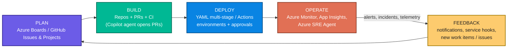
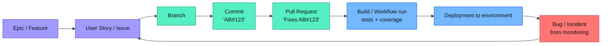

# Day 1 (Tue 24 Nov 2026): Flow of work & traceability

**Domain 1: Design and implement processes and communications (15–20%)**
Study-guide bullets covered today ([source](https://learn.microsoft.com/en-us/credentials/certifications/resources/study-guides/az-401)):
- Design a structure for the flow of work, including plan, build, deploy, and operate phases
- Design a strategy for feedback cycles, including notifications
- Design a strategy for tracking work using Azure Boards
- Design traceability, including repositories, bugs, and quality

Time box: about 2.5 h (30 min concepts, 90 min lab, 30 min cheat sheet + questions).

---

## 0. Exam orientation (10 min)

| Fact | Value | Source |
|---|---|---|
| Exam | AZ-401 (beta), *Designing and Implementing Microsoft Agentic DevOps Solutions* | [exam page](https://learn.microsoft.com/en-us/credentials/certifications/exams/az-401/) |
| Certification | Microsoft Certified: Agentic DevOps Engineer Expert (beta) | [exam page](https://learn.microsoft.com/en-us/credentials/certifications/exams/az-401/) |
| Pass mark | 700. Beta results come later | [exam page](https://learn.microsoft.com/en-us/credentials/certifications/exams/az-401/) |
| Biggest domain | Build & release pipelines, 35–40% | [study guide](https://learn.microsoft.com/en-us/credentials/certifications/resources/study-guides/az-401) |
| Languages you're expected to know | YAML, KQL, Bicep | [study guide](https://learn.microsoft.com/en-us/credentials/certifications/resources/study-guides/az-401) |
| Preview features | Mostly GA, but commonly used Preview features can appear | [study guide](https://learn.microsoft.com/en-us/credentials/certifications/resources/study-guides/az-401) |

What's new compared with AZ-400: every domain now has an **AI-assisted** angle (Copilot, MCP servers, agentic workflows, SRE Agent). On every topic, ask yourself: *how would I do this with Copilot + MCP, and what guardrails would I put on it?*

---

## 1. Concepts

### 1.1 Flow of work: plan → build → deploy → operate, then feedback



- **Plan:** pick a process template for the Azure Boards project (Basic / Agile / Scrum / CMMI). Choose by how you track work, e.g. Agile = User Story/Bug/Task, Scrum = PBI/Bug/Task, CMMI = Requirement + formal change requests. ([choose a process](https://learn.microsoft.com/en-us/azure/devops/boards/work-items/guidance/choose-process?view=azure-devops))
- **Build/Deploy:** every change travels as a PR that links back to a work item. Branch policies enforce that (Section 1.3).
- **Operate → Feedback:** notifications (subscriptions per user/team/project) and **service hooks** (push events to Teams, Slack, webhooks, and others) close the loop. ([notifications](https://learn.microsoft.com/en-us/azure/devops/organizations/notifications/about-notifications?view=azure-devops), [service hooks](https://learn.microsoft.com/en-us/azure/devops/service-hooks/overview?view=azure-devops))
- **Flow metrics** (lead time = created → done, cycle time = started → done) come from Boards Analytics widgets. Day 2 and Day 15 go deeper. ([cycle & lead time](https://learn.microsoft.com/en-us/azure/devops/report/dashboards/cycle-time-and-lead-time?view=azure-devops))

### 1.2 Traceability chain



**Azure Boards ↔ GitHub** works through the **Azure Boards app for GitHub** ([install](https://learn.microsoft.com/en-us/azure/devops/boards/github/install-github-app?view=azure-devops), [connect](https://learn.microsoft.com/en-us/azure/devops/boards/github/connect-to-github?view=azure-devops)). Exam traps, all from the [AB# linking doc](https://learn.microsoft.com/en-us/azure/devops/boards/github/link-to-from-github?view=azure-devops):
- `AB#{ID}` creates a link when it's in a **commit message, PR description, or issue description**. It does **not** link from a PR **title** or a **comment**.
- `Fixes/Fixed/Fix AB#123` moves the work item to the first **Resolved**-category state, or **Completed** if the process has no Resolved category. `Closed AB#123` moves it to that named state.
- State transitions apply **only when the PR is merged into the default branch**.
- Connect a GitHub repo to **only one** Azure DevOps organization, because work item IDs aren't unique across orgs ([connect doc](https://learn.microsoft.com/en-us/azure/devops/boards/github/connect-to-github?view=azure-devops)).
- If `AB#` links silently fail, check that the *Azure Boards* identity has **View/Edit work items in this node** on the area path ([connect doc](https://learn.microsoft.com/en-us/azure/devops/boards/github/connect-to-github?view=azure-devops)).

### 1.3 Enforcing traceability
| Platform | Mechanism | Source |
|---|---|---|
| Azure Repos | Branch policy **"Check for linked work items"** (required or optional), via `az repos policy work-item-linking` | [branch policies](https://learn.microsoft.com/en-us/azure/devops/repos/git/branch-policies?view=azure-devops), [CLI](https://learn.microsoft.com/en-us/cli/azure/repos/policy/work-item-linking?view=azure-cli-latest) |
| GitHub | Rulesets / branch protection + a **required status check** (e.g. an Actions job that fails when the PR body has no `AB#` reference) | [rulesets](https://docs.github.com/en/repositories/configuring-branches-and-merges-in-your-repository/managing-rulesets/about-rulesets) |

### 1.4 The agentic angle (preview of Day 3)
- The **Azure DevOps remote MCP Server** is GA. It's hosted at `https://mcp.dev.azure.com/{organization}` over streamable HTTP with Entra ID auth, and needs an **Entra-backed org** (MSA-only orgs aren't supported). You can limit it with `X-MCP-Toolsets` (e.g. `wit,repos`) and `X-MCP-Readonly`. ([docs](https://learn.microsoft.com/en-us/azure/devops/mcp-server/remote-mcp-server?view=azure-devops), [GA blog](https://devblogs.microsoft.com/devops/azure-devops-remote-mcp-server-ga/))
- The **GitHub remote MCP server** is at `https://api.githubcopilot.com/mcp/` and supports toolsets, `/readonly`, and OAuth or PAT. ([remote-server.md](https://github.com/github/github-mcp-server/blob/main/docs/remote-server.md))
- With both servers in VS Code agent mode, Copilot can read a work item, create a branch and PR that cites `AB#id`, and report status back. That's how this exam frames "Boards↔GitHub via MCP". ([Copilot agent mode](https://docs.github.com/en/copilot/how-tos/copilot-in-your-ide/use-copilot-agents/use-agent-mode))

---

## 2. Hands-on lab (about 90 min, about ₹0)

> **Cost notes.** Azure DevOps includes the first 5 Basic users and 1 Microsoft-hosted parallel job (1,800 min/month) free ([billing FAQ](https://learn.microsoft.com/en-us/azure/devops/organizations/billing/billing-faq?view=azure-devops)). GitHub Free includes Actions minutes for private repos, and standard GitHub-hosted runners are free for public repos ([Actions billing](https://docs.github.com/en/billing/concepts/product-billing/github-actions)). This lab creates **no billable Azure resources**. The only Azure resource is an empty, tagged resource group, which costs nothing. Optionally set a budget alert now for the whole prep ([budgets tutorial](https://learn.microsoft.com/en-us/azure/cost-management-billing/costs/tutorial-acm-create-budgets)).

Replace `<org>` with your Azure DevOps org name. Use an **Entra-backed** org so the remote MCP server works on Day 3.

### Shell setup

Labs are shown for **Windows PowerShell** and **Ubuntu (bash)**. YAML, JSON, and other file contents are the same in both. Commands that are identical in both shells are shown once and marked **works in both**.

Install Azure CLI, GitHub CLI, Git, and the Azure DevOps CLI extension once if you don't already have them. PowerShell snippets are written for **PowerShell 7** (`winget install -e --id Microsoft.PowerShell`). Windows PowerShell 5.1 does not support `&&`, and `>` redirection there writes UTF-16, so these labs use `Set-Content` instead.

**PowerShell**
```powershell
# Install Azure CLI, GitHub CLI, and Git. winget -e is exact match; --id is the package ID.
winget install -e --id Microsoft.AzureCLI
winget install -e --id GitHub.cli
winget install -e --id Git.Git
# Adds az boards / az repos / az devops. Required for every Azure DevOps lab command.
az extension add --name azure-devops
```

**Ubuntu (bash)**
```bash
# Official Microsoft installer for Azure CLI on Debian/Ubuntu. -sL follows redirects quietly.
curl -sL https://aka.ms/InstallAzureCLIDeb | sudo bash
# Refresh apt indexes, then install GitHub CLI and Git. -y auto-confirms prompts.
sudo apt update && sudo apt install -y gh git
# If apt cannot find gh, follow https://github.com/cli/cli/blob/trunk/docs/install_linux.md
# Adds az boards / az repos / az devops. Required for every Azure DevOps lab command.
az extension add --name azure-devops
```

### Lab A: Azure setup (2 min)
**PowerShell**
```powershell
# Sign in to Azure (browser or device code). Required before any az command against your subscription.
az login
# Confirm the active subscription. --query is JMESPath; -o table prints a readable table (not raw JSON).
az account show --query '{sub:name, id:id}' -o table
# Create an empty tagged RG in Central India (-n name, -l location). Tags help cost tracking; the RG itself is free.
az group create -n rg-az401-lab -l centralindia `
  --tags purpose=az401-study owner=vijayraavi expires=2026-12-13
# Adds the Azure DevOps CLI extension if you skipped the setup block above.
az extension add --name azure-devops
# Set the default ADO org so later az boards/repos commands do not need --organization each time.
az devops configure --defaults organization="https://dev.azure.com/<org>"
```

**Ubuntu (bash)**
```bash
# Sign in to Azure (browser or device code). Required before any az command against your subscription.
az login
# Confirm the active subscription. --query is JMESPath; -o table prints a readable table (not raw JSON).
az account show --query "{sub:name, id:id}" -o table
# Create an empty tagged RG in Central India (-n name, -l location). Tags help cost tracking; the RG itself is free.
az group create -n rg-az401-lab -l centralindia \
  --tags purpose=az401-study owner=vijayraavi expires=2026-12-13
# Adds the Azure DevOps CLI extension if you skipped the setup block above.
az extension add --name azure-devops
# Set the default ADO org so later az boards/repos commands do not need --organization each time.
az devops configure --defaults organization=https://dev.azure.com/<org>
```
([Azure DevOps CLI](https://learn.microsoft.com/en-us/azure/devops/cli/?view=azure-devops))

### Lab B: Azure DevOps: Boards + Repos traceability
**PowerShell**
```powershell
# 1. Create a private Agile project (User Story / Bug / Task — the process the exam usually assumes).
# --source-control git creates a default Azure Repos Git repo; --visibility private keeps the lab off the public internet.
az devops project create --name az401-lab --process Agile `
  --source-control git --visibility private
# Pin later az boards/repos commands to this org and project so you can omit those flags.
az devops configure --defaults organization="https://dev.azure.com/<org>" project=az401-lab

# 2. Work item hierarchy: Epic -> User Story -> Task (the traceability chain the exam tests).
# --query id -o tsv returns only the new ID as plain text; .Trim() strips a trailing newline PowerShell would otherwise keep.
$epic = (az boards work-item create --type Epic --title "AZ-401 lab: traceability" --query id -o tsv).Trim()
$story = (az boards work-item create --type "User Story" --title "Add health endpoint" --query id -o tsv).Trim()
$task = (az boards work-item create --type Task --title "Write /health handler" --query id -o tsv).Trim()
# Link child -> parent so Boards shows the Epic / Story / Task hierarchy.
az boards work-item relation add --id $story --relation-type parent --target-id $epic
az boards work-item relation add --id $task  --relation-type parent --target-id $story
# Print the IDs; you reuse $story later with --work-items on the PR.
Write-Output "EPIC=$epic STORY=$story TASK=$task"

# 3. Seed the default repo, then require linked work items on main.
git clone "https://dev.azure.com/<org>/az401-lab/_git/az401-lab"
Set-Location az401-lab
# Write README as UTF-8. Use Set-Content, not >, so Windows PowerShell does not write UTF-16 (which breaks Git).
Set-Content -Path README.md -Value "# az401-lab" -Encoding utf8
git add .
git commit -m "init"
# Push HEAD to origin/main and set upstream (-u). HEAD:main creates main if it does not exist yet.
git push -u origin HEAD:main
# The work-item-linking policy needs the repo GUID, not the name. --query id -o tsv returns only that GUID.
$repoId = (az repos show --repository az401-lab --query id -o tsv).Trim()
# Branch policy "Check for linked work items". --blocking true fails the PR if none is linked; --enabled true turns it on.
az repos policy work-item-linking create --repository-id $repoId `
  --branch main --blocking true --enabled true

# 4. Feature branch + PR linked to the story (this is how the new policy is satisfied).
# -b creates the branch and switches to it.
git checkout -b feature/health
Set-Content -Path health.py -Value 'print("ok")' -Encoding utf8
git add .
git commit -m "Add health handler"
git push -u origin feature/health
# Open a PR into main. --work-items links the story; a title or commit message alone does not satisfy the ADO policy.
az repos pr create --source-branch feature/health --target-branch main `
  --title "Add /health" --description "Implements the story" --work-items $story
```

**Ubuntu (bash)**
```bash
# 1. Create a private Agile project (User Story / Bug / Task — the process the exam usually assumes).
# --source-control git creates a default Azure Repos Git repo; --visibility private keeps the lab off the public internet.
az devops project create --name az401-lab --process Agile \
  --source-control git --visibility private
# Pin later az boards/repos commands to this org and project so you can omit those flags.
az devops configure --defaults organization=https://dev.azure.com/<org> project=az401-lab

# 2. Work item hierarchy: Epic -> User Story -> Task (the traceability chain the exam tests).
# --query id -o tsv returns only the new ID as plain text (no JSON).
EPIC=$(az boards work-item create --type Epic --title "AZ-401 lab: traceability" --query id -o tsv)
STORY=$(az boards work-item create --type "User Story" --title "Add health endpoint" --query id -o tsv)
TASK=$(az boards work-item create --type Task --title "Write /health handler" --query id -o tsv)
# Link child -> parent so Boards shows the Epic / Story / Task hierarchy.
az boards work-item relation add --id $STORY --relation-type parent --target-id $EPIC
az boards work-item relation add --id $TASK  --relation-type parent --target-id $STORY
# Print the IDs; you reuse $STORY later with --work-items on the PR.
echo "EPIC=$EPIC STORY=$STORY TASK=$TASK"

# 3. Seed the default repo, then require linked work items on main.
git clone https://dev.azure.com/<org>/az401-lab/_git/az401-lab && cd az401-lab
# Create README, commit, and push to origin/main. -u sets upstream; HEAD:main creates main if needed.
echo "# az401-lab" > README.md && git add . && git commit -m "init" && git push -u origin HEAD:main
# The work-item-linking policy needs the repo GUID, not the name. --query id -o tsv returns only that GUID.
REPO_ID=$(az repos show --repository az401-lab --query id -o tsv)
# Branch policy "Check for linked work items". --blocking true fails the PR if none is linked; --enabled true turns it on.
az repos policy work-item-linking create --repository-id $REPO_ID \
  --branch main --blocking true --enabled true

# 4. Feature branch + PR linked to the story (this is how the new policy is satisfied).
# -b creates the branch and switches to it.
git checkout -b feature/health
echo 'print("ok")' > health.py && git add . && git commit -m "Add health handler"
git push -u origin feature/health
# Open a PR into main. --work-items links the story; a title or commit message alone does not satisfy the ADO policy.
az repos pr create --source-branch feature/health --target-branch main \
  --title "Add /health" --description "Implements the story" --work-items $STORY
```
Check in the portal: the PR shows the **linked work item** policy as passing, and the story's *Development* section shows the branch, commit, and PR. Try creating a PR **without** `--work-items` and confirm the policy blocks it.

**Notifications (UI, 3 min):** Project settings → Notifications → New subscription → *Work item changed* → filter on the area path → deliver to the team. Then try **Service hooks** → *Web Hooks* (point it at https://webhook.site for a throwaway test). ([notifications](https://learn.microsoft.com/en-us/azure/devops/organizations/notifications/about-notifications?view=azure-devops), [service hooks](https://learn.microsoft.com/en-us/azure/devops/service-hooks/overview?view=azure-devops))

### Lab C: GitHub: Boards app + Actions traceability gate
**PowerShell**
```powershell
# Sign in to GitHub (browser or token). Required before any gh repo or gh pr command.
gh auth login
# Create a private repo and clone it here. --private keeps the lab off the public internet; --clone runs git clone for you.
gh repo create vijayraavi/az401-lab-app --private --clone
Set-Location az401-lab-app
# Write README as UTF-8 (avoid > which can write UTF-16 in Windows PowerShell).
Set-Content -Path README.md -Value "# az401-lab-app" -Encoding utf8
# Stage, commit, and push so the repo has a default branch (needed later for the ruleset).
git add .
git commit -m "init"
git push -u origin main
```

**Ubuntu (bash)**
```bash
# Sign in to GitHub (browser or token). Required before any gh repo or gh pr command.
gh auth login
# Create a private repo and clone it here. --private keeps the lab off the public internet; --clone runs git clone for you.
gh repo create vijayraavi/az401-lab-app --private --clone && cd az401-lab-app
# Create README, commit, and push so the repo has a default branch (needed later for the ruleset).
echo "# az401-lab-app" > README.md && git add . && git commit -m "init" && git push -u origin main
```
1. Install the **Azure Boards** app on the repo, then in Azure DevOps go to **Project settings → GitHub connections → Connect your GitHub account** and pick `az401-lab-app`. ([install](https://learn.microsoft.com/en-us/azure/devops/boards/github/install-github-app?view=azure-devops))
2. Add the traceability gate `.github/workflows/traceability.yml`:

```yaml
# GitHub Actions gate: fail the PR unless the description mentions AB#<id> (GitHub-side traceability).
name: traceability-gate
on:
  # Re-run when the PR is opened, the body is edited, new commits are pushed, or it is reopened.
  pull_request:
    types: [opened, edited, synchronize, reopened]
permissions:
  contents: read          # least privilege for GITHUB_TOKEN (this job only reads the PR body)
jobs:
  require-ab-link:        # this job name is the status check you add to the branch ruleset
    runs-on: ubuntu-latest
    steps:
      - name: Require AB#<id> in PR description
        env:
          # Pass the body through env, never inline ${{ }} in run:, to avoid script injection.
          PR_BODY: ${{ github.event.pull_request.body }}
        run: |
          # grep -E (extended regex) -q (quiet). AB# in the description creates the Boards link; a title does not.
          if printf '%s' "$PR_BODY" | grep -Eq 'AB#[0-9]+'; then
            echo "Linked to Azure Boards"
          else
            echo "::error::PR description must reference a work item, e.g. 'Fixes AB#123'"
            exit 1
          fi
```
3. Make that check required: **Settings → Rules → Rulesets → New branch ruleset**, target `main`, enable *Require a pull request before merging* and *Require status checks to pass*, then add `require-ab-link`. ([rulesets](https://docs.github.com/en/repositories/configuring-branches-and-merges-in-your-repository/managing-rulesets/about-rulesets))
4. Test it:
**PowerShell**
```powershell
# New branch for the docs change that will test the Actions gate and the AB# merge transition.
git checkout -b feature/readme
# Append a line as UTF-8 (Add-Content, not >> , so the file stays UTF-8).
Add-Content -Path README.md -Value "health docs" -Encoding utf8
# -am stages tracked-file edits and commits. AB# in a commit message creates a link, but does not change state.
git commit -am "Docs for health endpoint AB#$story"
git push -u origin feature/readme
# Open a PR with no AB# in the body so the required status check fails (exam trap: a title is not enough).
gh pr create --title "Docs" --body "No link"
# Put Fixes AB# in the description: the gate passes and the Boards link appears. State does not change yet.
gh pr edit --body "Fixes AB#$story"
# Squash-merge to the default branch and delete the feature branch. Only this merge moves the story to Resolved.
gh pr merge --squash --delete-branch
```

**Ubuntu (bash)**
```bash
# New branch and a docs edit that will test the Actions gate and the AB# merge transition.
git checkout -b feature/readme && echo "health docs" >> README.md
# -am stages tracked-file edits and commits. AB# in a commit message creates a link, but does not change state.
git commit -am "Docs for health endpoint AB#$STORY" && git push -u origin feature/readme
# Open a PR with no AB# in the body so the required status check fails (exam trap: a title is not enough).
gh pr create --title "Docs" --body "No link"
# Put Fixes AB# in the description: the gate passes and the Boards link appears. State does not change yet.
gh pr edit --body "Fixes AB#$STORY"
# Squash-merge to the default branch and delete the feature branch. Only this merge moves the story to Resolved.
gh pr merge --squash --delete-branch
```
Check: the story's Development section lists the GitHub commit and PR, and the state changed to **Resolved**. That only happens because the PR merged into the default branch. ([AB# doc](https://learn.microsoft.com/en-us/azure/devops/boards/github/link-to-from-github?view=azure-devops))

### Lab D (optional, 10 min): preview of agentic traceability with MCP
In VS Code, create `.vscode/mcp.json`. JSON cannot contain comments, so here's what each field does: `type: http` uses the remote streamable-HTTP transport; `X-MCP-Toolsets: wit,repos` limits the Azure DevOps server to work items and repos; `X-MCP-Readonly: true` and the GitHub `/readonly` URL keep the agent from writing (least privilege — a habit the exam expects). Replace `<org>` with your Entra-backed Azure DevOps org.
```json
{
  "servers": {
    "ado": { "type": "http", "url": "https://mcp.dev.azure.com/<org>",
             "headers": { "X-MCP-Toolsets": "wit,repos", "X-MCP-Readonly": "true" } },
    "github": { "type": "http", "url": "https://api.githubcopilot.com/mcp/readonly" }
  }
}
```
In Copilot Chat **agent mode**, ask: *"List the child tasks of user story <STORY> in az401-lab and the GitHub PRs that reference it."* Leaving both servers read-only today is a good habit: least privilege for agents. ([ADO remote MCP](https://learn.microsoft.com/en-us/azure/devops/mcp-server/remote-mcp-server?view=azure-devops), [GitHub remote MCP](https://github.com/github/github-mcp-server/blob/main/docs/remote-server.md))

### Cleanup (run these yourself when you're done; nothing here is deleted for you)
Keep `az401-lab` and `az401-lab-app` if you want to reuse them on Days 2–5, since both are free. To remove them:
**PowerShell**
```powershell
# Look up the project GUID. az devops project delete requires --id, not the name. --query id -o tsv returns plain text.
$id = (az devops project show -p az401-lab --query id -o tsv).Trim()
# Permanently delete the ADO project (repos, boards, wikis). --yes skips the confirmation prompt.
az devops project delete --id $id --yes
# Delete the GitHub lab repo. --yes skips confirm. Needs the delete_repo scope: gh auth refresh -s delete_repo.
gh repo delete vijayraavi/az401-lab-app --yes
# Delete the empty lab resource group. --yes skips confirm; --no-wait returns immediately (delete continues in Azure).
az group delete -n rg-az401-lab --yes --no-wait
```

**Ubuntu (bash)**
```bash
# Look up the project GUID in the $() subshell, then delete the ADO project (repos, boards, wikis). --yes skips confirm.
# az devops project delete requires --id, not the name. --query id -o tsv returns only that GUID.
az devops project delete --id $(az devops project show -p az401-lab --query id -o tsv) --yes
# Delete the GitHub lab repo. --yes skips confirm. Needs the delete_repo scope: gh auth refresh -s delete_repo.
gh repo delete vijayraavi/az401-lab-app --yes
# Delete the empty lab resource group. --yes skips confirm; --no-wait returns immediately (delete continues in Azure).
az group delete -n rg-az401-lab --yes --no-wait
```
Also: GitHub → Settings → Applications → *Azure Boards*: remove repo access if you deleted the repo. In Azure DevOps, remove the service hook subscription.

---

## 3. Key takeaways
1. Flow of work is **plan → build → deploy → operate**, and feedback (notifications, service hooks, monitoring → new work items) closes the loop.
2. `AB#` links only from **commit messages, PR descriptions, and issue descriptions**. State transitions need `fix/fixes/fixed` or a state name, plus a **merge to the default branch**.
3. Enforce traceability with the ADO **linked work items** policy and a GitHub **ruleset + required status check**.
4. One GitHub repo connects to **one** ADO org.
5. Agentic traceability means ADO remote MCP + GitHub MCP in agent mode. Scope them with toolsets and read-only.

## Sources
- AZ-401 study guide: https://learn.microsoft.com/en-us/credentials/certifications/resources/study-guides/az-401
- AZ-401 exam page: https://learn.microsoft.com/en-us/credentials/certifications/exams/az-401/
- Link GitHub to work items (AB#): https://learn.microsoft.com/en-us/azure/devops/boards/github/link-to-from-github?view=azure-devops
- Connect Boards to GitHub: https://learn.microsoft.com/en-us/azure/devops/boards/github/connect-to-github?view=azure-devops
- Install Azure Boards app: https://learn.microsoft.com/en-us/azure/devops/boards/github/install-github-app?view=azure-devops
- Choose a process: https://learn.microsoft.com/en-us/azure/devops/boards/work-items/guidance/choose-process?view=azure-devops
- Branch policies: https://learn.microsoft.com/en-us/azure/devops/repos/git/branch-policies?view=azure-devops
- `az repos policy work-item-linking`: https://learn.microsoft.com/en-us/cli/azure/repos/policy/work-item-linking?view=azure-cli-latest
- `az boards work-item`: https://learn.microsoft.com/en-us/cli/azure/boards/work-item?view=azure-cli-latest
- Notifications: https://learn.microsoft.com/en-us/azure/devops/organizations/notifications/about-notifications?view=azure-devops
- Service hooks: https://learn.microsoft.com/en-us/azure/devops/service-hooks/overview?view=azure-devops
- Cycle/lead time: https://learn.microsoft.com/en-us/azure/devops/report/dashboards/cycle-time-and-lead-time?view=azure-devops
- GitHub rulesets: https://docs.github.com/en/repositories/configuring-branches-and-merges-in-your-repository/managing-rulesets/about-rulesets
- ADO remote MCP server: https://learn.microsoft.com/en-us/azure/devops/mcp-server/remote-mcp-server?view=azure-devops
- GitHub remote MCP server: https://github.com/github/github-mcp-server/blob/main/docs/remote-server.md
- Copilot agent mode: https://docs.github.com/en/copilot/how-tos/copilot-in-your-ide/use-copilot-agents/use-agent-mode
- Azure DevOps billing FAQ: https://learn.microsoft.com/en-us/azure/devops/organizations/billing/billing-faq?view=azure-devops
- GitHub Actions billing: https://docs.github.com/en/billing/concepts/product-billing/github-actions
