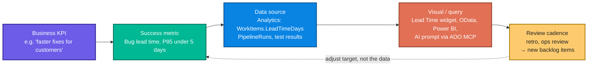
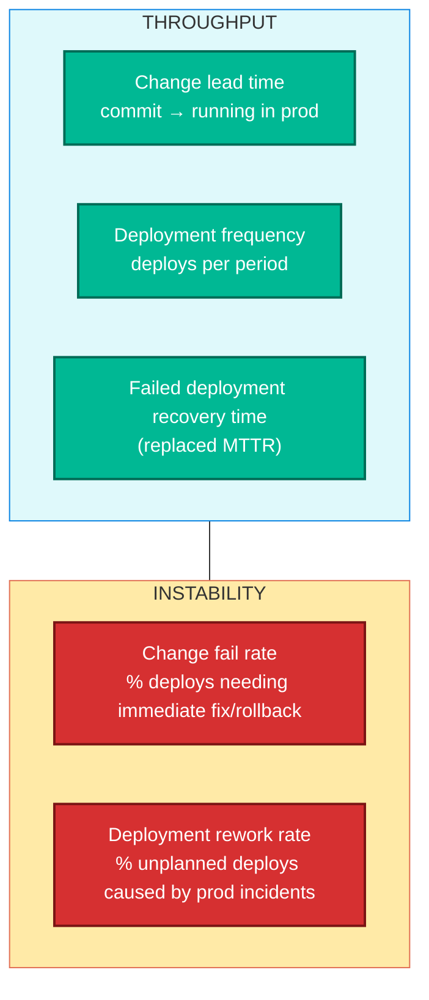
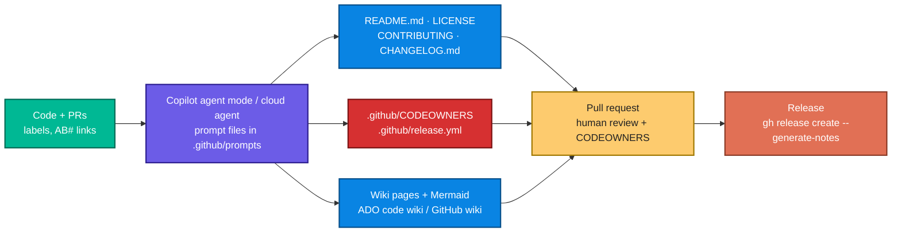

# Day 2 (Wed 25 Nov 2026): Success metrics, Analytics/OData & docs-as-code with Copilot

**Domain 1: Design and implement processes and communications (15–20%)**
Study-guide bullets covered today ([source](https://learn.microsoft.com/en-us/credentials/certifications/resources/study-guides/az-401)):
- Translate business KPIs into success metrics and standards for project planning, development, testing, delivery, operations, and security
- Implement queries to evaluate success metrics for DevOps by using AI-assisted tools
- Document a project, including wikis, readmes, change logs, releases, licenses, code owners, and process diagrams, by using AI-assisted tools

Time box: about 2.5 h (30 min concepts, 90 min lab, 30 min cheat sheet + questions).
Lab assets reused from Day 1: Azure DevOps project **`az401-lab`** (Agile process, repo `az401-lab`) and GitHub repo **`vijayraavi/az401-lab-app`** ([Day 1 lesson](../day-01/lesson.md)).

---

## 1. Concepts

### 1.1 KPI → metric → query/widget

A business **KPI** ("customers get fixes faster") isn't measurable by itself. Turn it into a **success metric** with a definition, a data source, and a target or standard, then show it on a **widget, report or query** that the team reviews regularly.



The study guide lists six areas. Here's one way to map them to metrics you can actually pull from Azure DevOps or GitHub:

| Area | Example KPI → metric | Where the data comes from |
|---|---|---|
| Planning | Predictable delivery → **velocity** (completed points per sprint), planned vs completed | Velocity widget ([docs](https://learn.microsoft.com/en-us/azure/devops/report/dashboards/team-velocity?view=azure-devops)) |
| Development | Flow efficiency → **cycle time**, WIP per column | Cycle Time widget, CFD ([cycle/lead](https://learn.microsoft.com/en-us/azure/devops/report/dashboards/cycle-time-and-lead-time?view=azure-devops), [CFD](https://learn.microsoft.com/en-us/azure/devops/report/dashboards/cumulative-flow?view=azure-devops)) |
| Testing | Quality → test **pass rate**, flaky tests, test duration | Test Results Trend (Advanced) widget, Pipelines Analytics ([widgets](https://learn.microsoft.com/en-us/azure/devops/report/dashboards/analytics-widgets?view=azure-devops), [sample reports](https://learn.microsoft.com/en-us/azure/devops/report/extend-analytics/quick-ref?view=azure-devops)) |
| Delivery | Speed and stability → **DORA** deployment frequency, change lead time, change fail rate | Pipeline runs / deployments ([DORA](https://dora.dev/guides/dora-metrics/), [PipelineRuns sample](https://learn.microsoft.com/en-us/azure/devops/report/powerbi/sample-pipelines-outcome-summary?view=azure-devops)) |
| Operations | Resilience → **failed deployment recovery time**, bug lead time | Incidents/bugs in Boards, Azure Monitor (Day 15–16) |
| Security | Exposure → open alerts by severity, time to remediate | GitHub security overview / GHAS ([docs](https://docs.github.com/en/code-security/security-overview/about-security-overview)) (Day 14) |

Velocity is for capacity planning. Microsoft's docs say not to confuse it with a KPI ([velocity docs](https://learn.microsoft.com/en-us/azure/devops/report/dashboards/team-velocity?view=azure-devops)). DORA warns against setting a metric itself as the goal (Goodhart's law), using one metric for everything, and comparing very different apps ([DORA pitfalls](https://dora.dev/guides/dora-metrics/)).

### 1.2 DORA: now **five** software delivery metrics

DORA moved from the original *four keys* to a **five-metric model**, and replaced MTTR with **failed deployment recovery time** ([DORA metrics guide](https://dora.dev/guides/dora-metrics/), last updated 5 Jan 2026). Many exam items and older docs still say "four keys", so know both.



- Speed and stability **aren't a trade-off**: top performers do well on all five ([DORA](https://dora.dev/guides/dora-metrics/)).
- Measure **per application/service**. Don't blend teams or compare a mobile app with a mainframe ([DORA](https://dora.dev/guides/dora-metrics/)).
- To set a baseline quickly, use the **DORA Quick Check** ([quickcheck](https://dora.dev/quickcheck/)). The usual first improvement is **smaller batch sizes** ([DORA](https://dora.dev/guides/dora-metrics/)).
- **Exam trap:** DORA *change lead time* starts at **commit**. The Azure Boards *Lead Time* widget starts when the **work item is created**. They're different metrics.

### 1.3 Flow metrics in Azure Boards (Analytics widgets)

| Widget | What it shows | Key facts |
|---|---|---|
| **Lead Time** | Created → Completed state category | Scatter plot. Shows average, moving average (window N = 20% of the days shown, rounded down to an odd number) and a std-dev band ([docs](https://learn.microsoft.com/en-us/azure/devops/report/dashboards/cycle-time-and-lead-time?view=azure-devops)) |
| **Cycle Time** | **First** entry into In Progress (or Resolved) → **final** Completed | Reactivated items: the clock covers the whole span, including time spent closed ([docs](https://learn.microsoft.com/en-us/azure/devops/report/dashboards/cycle-time-and-lead-time?view=azure-devops)) |
| **CFD** | Count of items per board column over time | Shows bottlenecks and WIP. The in-context report always uses the blue-green theme ([docs](https://learn.microsoft.com/en-us/azure/devops/report/dashboards/cumulative-flow?view=azure-devops)) |
| **Velocity** | Completed work per sprint (count or sum of points/effort/size) | Credit goes to the sprint where the item was **completed**, not where it was planned ([docs](https://learn.microsoft.com/en-us/azure/devops/report/dashboards/team-velocity?view=azure-devops)) |
| Burndown / Burnup / Sprint Burndown | Remaining or completed work over time | Analytics-based, across teams and sprints ([docs](https://learn.microsoft.com/en-us/azure/devops/report/dashboards/analytics-widgets?view=azure-devops)) |

Prerequisites: Lead/Cycle widgets only let you pick work item types that are **on a backlog**. To add one to a team dashboard you must be a **team member**. If **Boards is disabled**, no work-tracking Analytics widgets appear ([docs](https://learn.microsoft.com/en-us/azure/devops/report/dashboards/cycle-time-and-lead-time?view=azure-devops)). You can also add these widgets with the Dashboard Widgets REST API ([same doc](https://learn.microsoft.com/en-us/azure/devops/report/dashboards/cycle-time-and-lead-time?view=azure-devops)).

### 1.4 Analytics: OData, Analytics views, Power BI, AI-assisted queries

- **Endpoint:** `https://analytics.dev.azure.com/{org}/{project}/_odata/{version}/{EntitySet}`. Leave out `/{project}` to query across projects ([wit-analytics](https://learn.microsoft.com/en-us/azure/devops/report/extend-analytics/wit-analytics?view=azure-devops)).
- **Versions:** `v1.0`, `v2.0` (latest **released**), `v3.0-preview`, `v4.0-preview` (latest preview). Preview versions can include breaking changes ([versioning](https://learn.microsoft.com/en-us/azure/devops/report/extend-analytics/odata-api-version?view=azure-devops)). Microsoft's lead/cycle samples use `v3.0-preview` ([sample](https://learn.microsoft.com/en-us/azure/devops/report/powerbi/sample-boards-leadcycletime?view=azure-devops)).
- **Entity sets you'll meet:** `WorkItems` (has `LeadTimeDays`, `CycleTimeDays`, set only for **Completed** items), `WorkItemBoardSnapshot` (CFD), `PipelineRuns` (outcome counts) ([lead/cycle sample](https://learn.microsoft.com/en-us/azure/devops/report/powerbi/sample-boards-leadcycletime?view=azure-devops), [aggregation](https://learn.microsoft.com/en-us/azure/devops/report/extend-analytics/aggregated-data-analytics?view=azure-devops), [PipelineRuns](https://learn.microsoft.com/en-us/azure/devops/report/powerbi/sample-pipelines-outcome-summary?view=azure-devops)).
- **Aggregation:** `$apply=filter(...)/groupby((Field), aggregate(X with sum|min|max|average|countdistinct as Alias))`, plus `compute(... div ...)` for ratios. Aggregating on the server keeps Power BI refreshes small ([aggregation](https://learn.microsoft.com/en-us/azure/devops/report/extend-analytics/aggregated-data-analytics?view=azure-devops)).
- **Analytics views:** **Boards data only** (work items), a **flat list** with no hierarchy, **no pipelines**. **Stakeholder** users can't use them. Default views come in Today / Last 30 days / Last 26 weeks / All history by month ([about views](https://learn.microsoft.com/en-us/azure/devops/report/powerbi/what-are-analytics-views?view=azure-devops)).
- **Power BI:** use the *Azure DevOps (Boards only)* data connector for Analytics views, or an **OData feed** for anything else (pipelines, tests, aggregations). In the OData feed, set `[Implementation="2.0",OmitValues = ODataOmitValues.Nulls,ODataVersion = 4]` so nulls don't trigger extra requests and throttling ([OData + Power BI](https://learn.microsoft.com/en-us/azure/devops/report/powerbi/odataquery-connect?view=azure-devops), [connector](https://learn.microsoft.com/en-us/azure/devops/report/powerbi/data-connector-connect?view=azure-devops)).
- **AI-assisted queries:** with the **Azure DevOps MCP Server** in Copilot **agent mode**, you can ask things like *"Compare the average cycle time for user stories versus bugs over the last 90 days"* or *"Write an OData query that counts work items grouped by work item type"*. Microsoft's docs include these prompts ([cycle/lead AI prompts](https://learn.microsoft.com/en-us/azure/devops/report/dashboards/cycle-time-and-lead-time?view=azure-devops), [OData AI prompts](https://learn.microsoft.com/en-us/azure/devops/report/extend-analytics/wit-analytics?view=azure-devops)). The remote server (`https://mcp.dev.azure.com/{org}`, GA) supports toolsets `repos, advsec, wit, pipelines, wiki, work, testplan, elm` and `X-MCP-Readonly` ([remote MCP](https://learn.microsoft.com/en-us/azure/devops/mcp-server/remote-mcp-server?view=azure-devops), [Sprint 278 GA notes](https://learn.microsoft.com/en-us/azure/devops/release-notes/2026/sprint-278-update)). The MCP server is free ([overview](https://learn.microsoft.com/en-us/azure/devops/mcp-server/mcp-server-overview?view=azure-devops)).
- **Auth for scripts:** use a short-lived Entra token rather than a PAT: `az account get-access-token --resource 499b84ac-1321-427f-aa17-267ca6975798` (that's the Azure DevOps application ID, not a URI). The token lasts about an hour ([Entra tokens with Azure CLI](https://learn.microsoft.com/en-us/azure/devops/cli/entra-tokens?view=azure-devops)).

### 1.5 Documenting a project with AI assistance (docs-as-code)



| Artefact | Facts the exam can test | Source |
|---|---|---|
| **CODEOWNERS** | Location `.github/`, root, or `docs/`, searched **in that order** (first one wins). Must be on the PR's **base branch**. **Last matching pattern wins**. Several owners must go on the **same line**. Owners need **write** access. Invalid lines are skipped. Max size 3 MB. No `!` negation or `[ ]` ranges. Draft PRs don't auto-request owners. *Require review from Code Owners* needs approval from **any one** owner. Protect the file with `/.github/CODEOWNERS @owner` | [about code owners](https://docs.github.com/en/repositories/managing-your-repositorys-settings-and-features/customizing-your-repository/about-code-owners) |
| ADO equivalent | Branch policy **Automatically included reviewers** with `--path-filter` (`az repos policy required-reviewer create`) | [CLI](https://learn.microsoft.com/en-us/cli/azure/repos/policy/required-reviewer?view=azure-cli-latest) |
| **Release notes** | *Generate release notes* lists merged PRs, contributors, and a full-changelog link. Customise with **`.github/release.yml`**: `changelog.exclude.labels/authors`, `categories[*].title` + `labels` (required), `"*"` catch-all | [auto release notes](https://docs.github.com/en/repositories/releasing-projects-on-github/automatically-generated-release-notes) |
| CLI | `gh release create <tag> --generate-notes` (`--notes` text is **prepended**, `--notes-start-tag`, `--draft`, `--prerelease`, `--fail-on-no-commits`) | `gh release create --help` (gh 2.103.0) |
| **LICENSE** | Put `LICENSE`/`LICENSE.md` in the root. With no license, default copyright applies (all rights reserved). The license picker only appears **at repo creation**. Licensee detects it | [licensing a repo](https://docs.github.com/en/repositories/managing-your-repositorys-settings-and-features/customizing-your-repository/licensing-a-repository) |
| **GitHub wiki** | **Public** repos on GitHub Free; **private** repos need Pro/Team/Enterprise. Renders Mermaid. Soft limit 5,000 files. Search engines index it only with 500+ stars and public editing off | [about wikis](https://docs.github.com/en/communities/documenting-your-project-with-wikis/about-wikis), [diagrams](https://docs.github.com/en/get-started/writing-on-github/working-with-advanced-formatting/creating-diagrams) |
| **ADO wiki** | **Provisioned** (project wiki, one per project, revert in the UI) vs **published as code** (several wikis, **versioned** by branch, page order set by a **`.order`** file, edits go through PRs) | [provisioned vs code](https://learn.microsoft.com/en-us/azure/devops/project/wiki/provisioned-vs-published-wiki?view=azure-devops), [publish repo](https://learn.microsoft.com/en-us/azure/devops/project/wiki/publish-repo-to-wiki?view=azure-devops) |
| ADO wiki Mermaid | `::: mermaid` … `:::` **or** a ```` ```mermaid ```` fence. Limited syntax: use **`graph`** instead of `flowchart`, no `---->`, most HTML tags unsupported | [wiki Markdown guidance](https://learn.microsoft.com/en-us/azure/devops/project/wiki/markdown-guidance?view=azure-devops) |
| **Copilot for docs** | **Prompt files** (`.github/prompts/*.prompt.md`, run as `/name` in VS Code, preview); repo **custom instructions** (`.github/copilot-instructions.md`); **cloud agent** (formerly "coding agent"): assign an issue to Copilot → it opens a PR and asks you for review. It only sees comments made **before** assignment | [prompt files](https://docs.github.com/en/copilot/tutorials/customization-library/prompt-files/create-readme), [custom instructions](https://docs.github.com/en/copilot/how-tos/configure-custom-instructions/add-repository-instructions), [cloud agent](https://docs.github.com/en/copilot/how-tos/use-copilot-agents/cloud-agent/use-cloud-agent-on-github) |
| CHANGELOG | No GitHub-mandated format. *Keep a Changelog* is a common convention: `## [Unreleased]`, then Added/Changed/Deprecated/Removed/Fixed/Security | [keepachangelog.com](https://keepachangelog.com/en/1.1.0/) |

---

## 2. Hands-on lab (about 90 min, about ₹0)

> **Cost notes.** Everything today runs inside free tiers. Azure DevOps Analytics, dashboards, widgets, wiki and the MCP server cost nothing extra for Basic users (first 5 Basic users free) ([billing FAQ](https://learn.microsoft.com/en-us/azure/devops/organizations/billing/billing-faq?view=azure-devops), [MCP overview](https://learn.microsoft.com/en-us/azure/devops/mcp-server/mcp-server-overview?view=azure-devops)). Nothing is deployed to Azure. `az account get-access-token` only signs you in. **Power BI Desktop** is a free download if you try the optional step. On GitHub, releases, CODEOWNERS and labels are free. Copilot Chat / agent mode use your Copilot plan. The optional **cloud agent** step consumes premium requests, and its sandbox compute now comes from your Actions entitlement ([GitHub changelog 28 Oct 2026](https://github.blog/changelog/2026-10-28-work-from-anywhere-with-a-new-connected-copilot-cloud-experience/)), so skip it if you're near your limits.

Replace `<org>` with your Azure DevOps org (Entra-backed, as on Day 1).

### Prerequisites

Today reuses the Day 1 lab assets. If you already deleted `az401-lab` or `az401-lab-app`, re-run Day 1 Labs A–C (you can skip notifications, the service hook, and Lab D) before starting.

#### Accounts and licences

| Account | What you need | Why |
|---|---|---|
| **Azure subscription** | The same subscription you used on Day 1. No new Azure resources are created today. | `az login` and `az account get-access-token` need a signed-in Entra identity whose tenant is connected to the Azure DevOps org ([Entra tokens](https://learn.microsoft.com/en-us/azure/devops/cli/entra-tokens?view=azure-devops)). |
| **Azure DevOps organization** | The **Entra-backed** org from Day 1, with project **`az401-lab`** (Agile process, repo `az401-lab`). | Labs A–D run entirely in this project. The optional MCP query in Lab C requires an Entra-backed org ([remote MCP prerequisites](https://learn.microsoft.com/en-us/azure/devops/mcp-server/remote-mcp-server?view=azure-devops)). |
| **GitHub account** | The account that owns **`vijayraavi/az401-lab-app`** (replace the owner if you used a different login on Day 1). GitHub Free is enough for CODEOWNERS, labels, and releases. | Lab E adds governance files, a labelled PR, and a Release. |
| **GitHub Copilot** | A plan that can use **agent mode** (and, for the optional cloud-agent step, **Copilot Pro, Pro+, Business, or Enterprise** with cloud agent enabled on the repo). | Optional: Lab C AI-assisted OData, Lab D wiki prompt, Lab E `/changelog` prompt file, and the optional cloud agent (which also consumes premium requests and Actions minutes). |
| **Power BI Desktop (optional)** | A free desktop install, plus a work or school account that can sign in to Azure DevOps. | Optional Lab C step only ([Power BI + OData](https://learn.microsoft.com/en-us/azure/devops/report/powerbi/odataquery-connect?view=azure-devops)). |

Use a **Basic** (or higher) Azure DevOps access level. **Stakeholders cannot use Analytics views** and should not be used for these labs ([Analytics permissions](https://learn.microsoft.com/en-us/azure/devops/report/analytics/analytics-permissions-prerequisites?view=azure-devops)).

#### Tools and minimum versions

Same baseline as [Day 1 Shell setup](../day-01/lesson.md#shell-setup), plus `jq` on Ubuntu for Lab C.

| Tool | Minimum | Notes |
|---|---|---|
| **Azure CLI** | 2.0.69 or later | With the **azure-devops** extension (latest). |
| **GitHub CLI (`gh`)** | Current stable 2.x | Needed for labels, PRs, and `gh release create --generate-notes`. |
| **Git** | 2.x | Labs D and E commit docs in the Day 1 clones. |
| **PowerShell 7** (Windows) | 7.0 or later | Lab C uses `Invoke-RestMethod` (no `jq` required on Windows). |
| **jq** (Ubuntu only) | 1.6 or later | Pretty-prints Analytics OData JSON in Lab C. Install: `sudo apt install -y jq`. |
| **VS Code + Copilot Chat** (optional) | VS Code 1.99 or later | For the MCP and `/changelog` steps. |

If the tools are already installed from Day 1, skip the install and sign in in Lab A. Otherwise run the block under **Shell setup** below.

#### Permissions and roles

| Surface | Role you need | Why |
|---|---|---|
| **Azure DevOps project `az401-lab`** | Project member with at least **Basic** access. **View Analytics** is granted to Readers, Contributors, and Project Administrators by default. | Required for OData in Lab C ([Analytics permissions](https://learn.microsoft.com/en-us/azure/devops/report/analytics/analytics-permissions-prerequisites?view=azure-devops)). |
| **Team dashboard (Lab B)** | **Member of `az401-lab Team`**, plus team administrator, project administrator, or dashboard edit permission. **Azure Boards must be enabled** for the project. | Lead/Cycle widgets only appear when Boards is on, and you can only add a widget to a *team* dashboard if you belong to that team ([cycle/lead prerequisites](https://learn.microsoft.com/en-us/azure/devops/report/dashboards/cycle-time-and-lead-time?view=azure-devops), [add a widget](https://learn.microsoft.com/en-us/azure/devops/report/dashboards/add-widget-to-dashboard?view=azure-devops)). |
| **Work items (Lab A)** | **Contributors** (or Project Administrators) — the default after you created the project on Day 1. | Create, activate, and close stories and a bug. |
| **Code wiki (Lab D)** | Project member and **Contributors** (to publish); you also need to complete a PR that is subject to Day 1's linked-work-item policy. | ([publish a repo to a wiki](https://learn.microsoft.com/en-us/azure/devops/project/wiki/publish-repo-to-wiki?view=azure-devops)) |
| **GitHub repo `az401-lab-app`** | **Write** to push the docs branch; **admin** if you change rulesets (you should not need to today). CODEOWNERS entries must name users who have **write** access. | ([about code owners](https://docs.github.com/en/repositories/managing-your-repositorys-settings-and-features/customizing-your-repository/about-code-owners)) |
| **Azure Boards ↔ GitHub** | The Day 1 connection must still exist if you want `Fixes AB#` in Lab E to link and transition the work item. | ([AB# linking](https://learn.microsoft.com/en-us/azure/devops/boards/github/link-to-from-github?view=azure-devops)) |
| **Copilot cloud agent (optional)** | Paid Copilot plan, write access to the repo, and cloud agent enabled for that repository. | ([cloud agent](https://docs.github.com/en/copilot/how-tos/use-copilot-agents/cloud-agent/use-cloud-agent-on-github)) |

#### Sign-in and environment

You will run these at the start of Lab A (and `gh auth login` again if Lab E says you are not signed in):

- `az login` — same Entra identity that is a member of the Azure DevOps org. The subscription must belong to the tenant connected to that org, or the Analytics token in Lab C will not authorize ([Entra tokens](https://learn.microsoft.com/en-us/azure/devops/cli/entra-tokens?view=azure-devops)).
- `az devops configure --defaults organization="https://dev.azure.com/<org>" project=az401-lab`
- `gh auth login` — hostname `github.com`. The default `repo` scope is enough today (no `delete_repo` unless you skipped Day 1 cleanup and want to delete the repo later).

Placeholders used today:

| Placeholder / variable | Set in | Meaning |
|---|---|---|
| `<org>` | You replace this everywhere | Azure DevOps organization name. |
| `$org` / `ORG`, `$proj` / `PROJ` | Lab C | Same org, project `az401-lab`. |
| `<ID1>`, `<ID2>` | Lab A (you substitute real IDs) | Two user-story IDs you close in Lab A. Lab D's PR uses `<ID1>` to satisfy the Day 1 linked-work-item policy. Lab E's `Fixes AB#<ID2>` uses the other. |
| Day 1 clones | `az401-lab/` and `az401-lab-app/` on disk | Reuse them if they are still there; otherwise clone again in Labs D and E. |

#### Earlier lab outputs this day depends on

| From Day 1 | Used today |
|---|---|
| Project **`az401-lab`**, Agile process, repo `az401-lab` | Labs A–D |
| Branch policy **Check for linked work items** on `main` (Required) | Lab D PR must pass `--work-items "<ID1>"` |
| GitHub repo **`vijayraavi/az401-lab-app`** | Lab E |
| Azure Boards app connection to that repo | Lab E `Fixes AB#` link and state change |
| Optional: `.vscode/mcp.json` from Day 1 Lab D | Lab C / D AI steps (you can create it today if you skipped Lab D) |

#### Verify prerequisites

Replace `<org>` first. This block also checks that the Day 1 project and GitHub repo still exist.

**PowerShell**
```powershell
# Print Azure CLI and extension versions. You need Azure CLI 2.0.69+ and the azure-devops extension.
az version
# Confirm the azure-devops extension is installed.
az extension show --name azure-devops --query '{name:name, version:version}' -o table
# Confirm the active Azure subscription and the signed-in Entra user (must be a member of the ADO org).
az account show --query '{name:name, id:id, user:user.name}' -o table
# Confirm the Day 1 project still exists in your org.
az devops project show --organization "https://dev.azure.com/<org>" -p az401-lab --query '{name:name, id:id}' -o table
# Confirm GitHub CLI is signed in, and the Day 1 lab repo still exists.
gh auth status
gh repo view vijayraavi/az401-lab-app --json name,isPrivate,defaultBranchRef
# Confirm Git and PowerShell 7 are on the PATH.
git --version
$PSVersionTable.PSVersion
```

**Ubuntu (bash)**
```bash
# Print Azure CLI and extension versions. You need Azure CLI 2.0.69+ and the azure-devops extension.
az version
# Confirm the azure-devops extension is installed.
az extension show --name azure-devops --query '{name:name, version:version}' -o table
# Confirm the active Azure subscription and the signed-in Entra user (must be a member of the ADO org).
az account show --query '{name:name, id:id, user:user.name}' -o table
# Confirm the Day 1 project still exists in your org.
az devops project show --organization "https://dev.azure.com/<org>" -p az401-lab --query '{name:name, id:id}' -o table
# Confirm GitHub CLI is signed in, and the Day 1 lab repo still exists.
gh auth status
gh repo view vijayraavi/az401-lab-app --json name,isPrivate,defaultBranchRef
# Confirm Git and jq (used in Lab C) are on the PATH.
git --version
jq --version
```

If `az devops project show` fails, re-run Day 1 Lab B (or fix `<org>` / `az login`). If `gh repo view` returns 404, re-run Day 1 Lab C or replace `vijayraavi` with your GitHub login. If `jq --version` fails on Ubuntu, run `sudo apt install -y jq`.

### Shell setup

Same as [Day 1](../day-01/lesson.md#shell-setup): commands are shown for **Windows PowerShell** (PowerShell 7 recommended) and **Ubuntu (bash)**. Identical commands are marked **works in both**. If the tools are already installed, skip the install and sign in in Lab A. Otherwise:

**PowerShell**
```powershell
# Install Azure CLI, GitHub CLI, and Git. winget -e is exact match; --id is the package ID. Skip if already installed on Day 1.
winget install -e --id Microsoft.AzureCLI
winget install -e --id GitHub.cli
winget install -e --id Git.Git
# Adds az boards / az repos / az devops. Required for the Boards and wiki commands in today's labs.
az extension add --name azure-devops
```

**Ubuntu (bash)**
```bash
# Official Microsoft installer for Azure CLI on Debian/Ubuntu. -sL follows redirects quietly. Skip if already installed on Day 1.
curl -sL https://aka.ms/InstallAzureCLIDeb | sudo bash
# Refresh apt, then install GitHub CLI, Git, and jq (jq pretty-prints Analytics OData JSON in Lab C). -y auto-confirms.
sudo apt update && sudo apt install -y gh git jq
# If apt cannot find gh, follow https://github.com/cli/cli/blob/trunk/docs/install_linux.md
# Adds az boards / az repos / az devops. Required for the Boards and wiki commands in today's labs.
az extension add --name azure-devops
```

---

### Lab A: Generate flow data in `az401-lab` (10 min)

Lead/Cycle widgets only show **completed** items, so move a few user stories through the Agile states New → Active → Closed ([Agile workflow](https://learn.microsoft.com/en-us/azure/devops/boards/work-items/guidance/agile-process-workflow?view=azure-devops)).

**Lab-specific prerequisites:** Day 1 project `az401-lab` exists; you are a Contributor (or Project Administrator); Boards is enabled. Analytics can take a few minutes to catch up after you close items.

#### Step 1: Sign in and pin the Day 1 org and project

**Why:** `az boards` uses the Entra session from `az login`. Pinning defaults means the rest of today's commands can omit `--organization` and `--project`. Lab C's Analytics token also needs this same sign-in.

**PowerShell**
```powershell
# Sign in to Azure. Required for az boards and for the Entra token used by Analytics OData in Lab C.
az login
# Adds the Azure DevOps CLI extension. Skip if you already added it on Day 1.
az extension add --name azure-devops
# Pin later az boards/repos/wiki commands to the Day 1 org and project so you can omit those flags.
az devops configure --defaults organization="https://dev.azure.com/<org>" project=az401-lab
```

**Ubuntu (bash)**
```bash
# Sign in to Azure. Required for az boards and for the Entra token used by Analytics OData in Lab C.
az login
# Adds the Azure DevOps CLI extension. Skip if you already added it on Day 1.
az extension add --name azure-devops
# Pin later az boards/repos/wiki commands to the Day 1 org and project so you can omit those flags.
az devops configure --defaults organization="https://dev.azure.com/<org>" project=az401-lab
```

**Expected result:** `az devops configure --list` shows your organization URL and `project=az401-lab`.

**If something goes wrong:** Wrong org or project — fix `<org>` and confirm `az devops project show -p az401-lab` works. If `az login` picks a subscription in a different Entra tenant from the Azure DevOps org, Lab C's token will 401; switch with `az account set --subscription "<id>"`.

#### Step 2: Create four user stories and move them to Active

**Why:** Lead time starts when an item is **created**; cycle time starts when it first enters an **In Progress** state (Agile: Active). Creating a story and immediately leaving it in New would give you lead time later, but no cycle time until it becomes Active. Doing both in a loop builds a small data set for the widgets and for OData ([cycle and lead time](https://learn.microsoft.com/en-us/azure/devops/report/dashboards/cycle-time-and-lead-time?view=azure-devops)).

**PowerShell**
```powershell
# Create four stories and move each New -> Active. Lead/Cycle widgets only chart completed items, so states must change.
# --query id -o tsv returns only the new ID; .Trim() strips a trailing newline. -o none hides the update JSON.
foreach ($t in "Add /metrics endpoint", "Write CHANGELOG", "Add CODEOWNERS", "Fix login typo") {
  $id = (az boards work-item create --type "User Story" --title $t --query id -o tsv).Trim()
  az boards work-item update --id $id --state Active -o none
  Write-Output "created + activated $id"
}
```

**Ubuntu (bash)**
```bash
# Create four stories and move each New -> Active. Lead/Cycle widgets only chart completed items, so states must change.
# --query id -o tsv returns only the new ID. -o none hides the update JSON.
for t in "Add /metrics endpoint" "Write CHANGELOG" "Add CODEOWNERS" "Fix login typo"; do
  ID=$(az boards work-item create --type "User Story" --title "$t" --query id -o tsv)
  az boards work-item update --id $ID --state Active -o none
  echo "created + activated $ID"
done
```

**Expected result:** Four lines like `created + activated 42`. In **Boards → Boards**, the four stories sit in **Active**.

**Do it in the portal instead:** **Boards → Work items → New Work Item → User Story** (four times), then drag each card from **New** to **Active**, or open each item and set **State** to **Active**.

**If something goes wrong:** Quote `"User Story"` because of the space. `TF401323` / invalid state — confirm the project uses the **Agile** process (Day 1). Contributors can change state; Stakeholders cannot use the full board.

#### Step 3: Create a Bug for the bug-only Lead Time widget

**Why:** Lab B adds a second Lead Time widget filtered to **Bug**, so you can practise mapping a KPI ("customers get fixes faster") to a bug-only metric. A Bug is a different backlog type from User Story.

**Works in both**
```bash
# A Bug is a different backlog type; Lab B uses it for a bug-only Lead Time widget.
az boards work-item create --type Bug --title "Health check returns 500" --query id -o tsv
```

**Expected result:** A single numeric ID. The bug stays in **New** unless you also move it; that is fine for today (the bug widget may be empty until you later close a bug).

**Do it in the portal instead:** **Boards → Work items → New Work Item → Bug**, title `Health check returns 500`.

#### Step 4: List active stories and close two of them

**Why:** Widgets and the OData queries only include **completed** items. Closing two stories now gives you data points. Leave the other two Active and close them later today or tomorrow so the chart has some spread. Same-day items show `CycleTimeDays = 0`, which is expected ([sample notes](https://learn.microsoft.com/en-us/azure/devops/report/powerbi/sample-boards-leadcycletime?view=azure-devops)).

**PowerShell**
```powershell
# List active stories so you can pick two IDs. --wiql is a SQL-like Boards query; -o table is readable.
# Close two stories now. Close the rest later today or tomorrow so the chart has spread.
az boards query --wiql "SELECT [System.Id],[System.Title],[System.State] FROM WorkItems `
  WHERE [System.TeamProject]='az401-lab' AND [System.WorkItemType]='User Story' `
  AND [System.State]='Active' ORDER BY [System.Id]" -o table
# Replace <ID1> and <ID2> with real IDs from the table. Quotes stop PowerShell from treating < as a redirect.
az boards work-item update --id "<ID1>" --state Closed -o none
az boards work-item update --id "<ID2>" --state Closed -o none
```

**Ubuntu (bash)**
```bash
# List active stories so you can pick two IDs. --wiql is a SQL-like Boards query; -o table is readable.
# Close two stories now. Close the rest later today or tomorrow so the chart has spread.
az boards query --wiql "SELECT [System.Id],[System.Title],[System.State] FROM WorkItems \
  WHERE [System.TeamProject]='az401-lab' AND [System.WorkItemType]='User Story' \
  AND [System.State]='Active' ORDER BY [System.Id]" -o table
# Replace <ID1> and <ID2> with real IDs from the table before running these.
az boards work-item update --id "<ID1>" --state Closed -o none
az boards work-item update --id "<ID2>" --state Closed -o none
```

**Expected result:** The table lists at least four Active stories (plus any leftovers from Day 1 that are still Active). After the updates, those two IDs are **Closed**. Write `<ID1>` and `<ID2>` down — Lab D and Lab E need them.

**Do it in the portal instead:** **Boards → Boards** (or **Work items**). Open two stories and set **State** to **Closed**, or drag them to the Closed column.

**If something goes wrong:** On Ubuntu, an unreplaced `<ID1>` is a redirect and will error; substitute the number first. In PowerShell, keep the quotes around `"<ID1>"` until you replace it. Analytics may take a few minutes before Lab B and Lab C show the new Closed items — wait and refresh if a widget or query is empty.

#### Verify Lab A

**Works in both** (after substituting is not required; this lists Closed stories)
```bash
# Confirm at least two user stories are Closed — these feed the Lead/Cycle widgets and the OData query.
az boards query --wiql "SELECT [System.Id],[System.Title],[System.State] FROM WorkItems WHERE [System.TeamProject]='az401-lab' AND [System.WorkItemType]='User Story' AND [System.State]='Closed' ORDER BY [System.Id]" -o table
```

You should see `<ID1>` and `<ID2>` (and any stories you closed on Day 1, such as the one Lab C merged with `Fixes AB#`).

---

### Lab B: Flow dashboard with widgets (15 min, UI)

**Lab-specific prerequisites:** Lab A has at least two **Closed** stories. You must be a **member of `az401-lab Team`**, have dashboard edit permission (team/project admin is enough if you created the project), **Basic** access, and **Azure Boards enabled**. Lead/Cycle widgets only let you pick work item types that are **on a backlog** ([cycle/lead prerequisites](https://learn.microsoft.com/en-us/azure/devops/report/dashboards/cycle-time-and-lead-time?view=azure-devops), [dashboards](https://learn.microsoft.com/en-us/azure/devops/report/dashboards/dashboards?view=azure-devops), [add a widget](https://learn.microsoft.com/en-us/azure/devops/report/dashboards/add-widget-to-dashboard?view=azure-devops)).

This lab is portal-only (the Dashboard Widgets REST API exists, but the exam skill is configuring the widgets).

#### Step 1: Create a team dashboard named `Flow metrics`

**Why:** A team dashboard is scoped to `az401-lab Team`, which is what the Analytics widgets use as their "Team" input. Project dashboards cannot be used the same way for these widgets.

**Do it in the portal:** **Overview → Dashboards → New dashboard** → name it `Flow metrics`, type **Team dashboard**, team **`az401-lab Team`** → **Create**.

**Expected result:** An empty dashboard named `Flow metrics` is selected, and you can see **Edit**.

**If something goes wrong:** No **New dashboard** / **Edit** — you are not a team member or you lack dashboard permissions. Add yourself: **Project settings → Teams → az401-lab Team → Members**. If Boards was turned off, no work-tracking Analytics widgets appear: **Project settings → Overview** (services) and enable **Boards** ([turn a service on or off](https://learn.microsoft.com/en-us/azure/devops/organizations/settings/set-services?view=azure-devops)).

#### Step 2: Add the Cycle Time, Lead Time, CFD, and Velocity widgets

**Why:** These are the Boards flow metrics the study guide maps to development and planning KPIs. Cycle time vs lead time is a favourite exam distinction. A second Lead Time widget filtered to **Bug** is how you turn "faster fixes for customers" into a metric with a target. The CFD shows WIP and bottlenecks. Velocity only has data if iterations (sprints) are configured — skip it if they are not ([Analytics widgets](https://learn.microsoft.com/en-us/azure/devops/report/dashboards/analytics-widgets?view=azure-devops), [CFD](https://learn.microsoft.com/en-us/azure/devops/report/dashboards/cumulative-flow?view=azure-devops), [velocity](https://learn.microsoft.com/en-us/azure/devops/report/dashboards/team-velocity?view=azure-devops)).

**Do it in the portal:** **Edit → Add widget**, then add and **Configure** each of the following ([add a widget](https://learn.microsoft.com/en-us/azure/devops/report/dashboards/add-widget-to-dashboard?view=azure-devops)):

- **Cycle Time**: Team = `az401-lab Team`, Work items = *Stories* backlog, Time period = *Rolling 30 days*.
- **Lead Time**: same settings, plus a second copy with work item type = **Bug**, to show bug lead time against a target.
- **Cumulative Flow Diagram**: Stories backlog, rolling 30 days. Look for columns that keep widening.
- **Velocity**: only works if you've set iterations. Skip it if you haven't. (To add iterations later: **Project settings → Project configuration → Iterations**, then **Team configuration → Iterations**.)

Select **Save** on each widget, then **Done editing**.

**Expected result:** The Cycle Time and Lead Time (Stories) scatter plots show at least the two stories you closed, often with `0` days if you created and closed them today. The Bug Lead Time chart may be empty until you close the bug. The CFD shows counts in New / Active / Closed.

**If something goes wrong:** Empty chart — wait a few minutes for Analytics, confirm the items are **Closed** (not just Active), and that the widget's team and backlog match. Hover a dot to see which work items it represents; click a legend type to filter ([widget docs](https://learn.microsoft.com/en-us/azure/devops/report/dashboards/cycle-time-and-lead-time?view=azure-devops)). If a work item type is missing from the picker, it is not on a backlog.

#### Step 3: KPI exercise (5 min)

**Why:** The study guide asks you to *translate business KPIs into success metrics*. A metric needs a definition, a data source, and a target; the widget is only the display. You will paste this table into the wiki in Lab D.

Write down one KPI → metric → target for each of the six study-guide areas, using the table in section 1.1. You will add the list to the wiki page in Lab D.

**Expected result:** A short table you can copy, for example Development → Cycle time (stories) → under 3 days. You do not need to invent tooling beyond what section 1.1 already lists.

#### Verify Lab B

Open **Overview → Dashboards → Flow metrics**. You can hover a Cycle Time dot and see `<ID1>` or `<ID2>`. The dashboard is saved (refresh the browser and it is still there).

---

### Lab C: Analytics OData query with an Entra token (15 min)

**Lab-specific prerequisites:** Lab A completed (Closed stories exist — wait a few minutes if queries return an empty `value`). You need **View Analytics** (default for Readers/Contributors/Project Administrators), **Basic** access, `az login` to the tenant connected to the org, and `jq` on Ubuntu. PowerShell uses `Invoke-RestMethod` instead of `jq`. The subscription you `az login` to must be associated with the same Entra tenant as the Azure DevOps organization ([Entra tokens](https://learn.microsoft.com/en-us/azure/devops/cli/entra-tokens?view=azure-devops), [Analytics permissions](https://learn.microsoft.com/en-us/azure/devops/report/analytics/analytics-permissions-prerequisites?view=azure-devops)).

Query shapes come from Microsoft's samples ([lead/cycle](https://learn.microsoft.com/en-us/azure/devops/report/powerbi/sample-boards-leadcycletime?view=azure-devops), [aggregation](https://learn.microsoft.com/en-us/azure/devops/report/extend-analytics/aggregated-data-analytics?view=azure-devops), [PipelineRuns](https://learn.microsoft.com/en-us/azure/devops/report/powerbi/sample-pipelines-outcome-summary?view=azure-devops)).

#### Step 1: Issue a short-lived Entra token for Azure DevOps

**Why:** Analytics OData is not an ARM API. The token must be issued for the Azure DevOps application ID `499b84ac-1321-427f-aa17-267ca6975798`, then sent as `Authorization: Bearer`. Tokens last about one hour, which is enough for this lab and safer than a PAT ([Entra tokens](https://learn.microsoft.com/en-us/azure/devops/cli/entra-tokens?view=azure-devops)).

**PowerShell**
```powershell
# Lab C talks to Analytics OData (not the ARM API). Replace <org> with your Azure DevOps org.
$org = "<org>"
$proj = "az401-lab"
# Short-lived (~1 h) Entra token for Azure DevOps. --resource 499b84ac-... is the ADO app ID, not ARM.
# --query accessToken -o tsv returns only the token; .Trim() strips a trailing newline.
$token = (az account get-access-token --resource 499b84ac-1321-427f-aa17-267ca6975798 `
          --query accessToken -o tsv).Trim()
$headers = @{ Authorization = "Bearer $token" }
```

**Ubuntu (bash)**
```bash
# Lab C talks to Analytics OData (not the ARM API). Replace <org> with your Azure DevOps org.
ORG="<org>"; PROJ=az401-lab
# Short-lived (~1 h) Entra token for Azure DevOps. --resource 499b84ac-... is the ADO app ID, not ARM.
# --query accessToken -o tsv returns only the token string.
TOKEN=$(az account get-access-token --resource 499b84ac-1321-427f-aa17-267ca6975798 \
        --query accessToken -o tsv)
```

**Expected result:** No error. In PowerShell, `$token` is a long JWT string (do not paste it into a ticket or chat). In bash, `echo ${#TOKEN}` should be several hundred characters.

**If something goes wrong:** `az login` first if the token command fails. A later HTTP 401 usually means the wrong `--resource` (do not use the ARM resource), an expired token, or a subscription in a different tenant from the Azure DevOps org. HTTP 403 / empty access — confirm **View Analytics** and Basic access.

#### Step 2: Query per-item lead and cycle time for completed stories

**Why:** This is the programmatic form of the Lead Time and Cycle Time widgets. The exam expects you to distinguish the two fields and to filter on `StateCategory eq 'Completed'` (not a process-specific state name) ([lead/cycle sample](https://learn.microsoft.com/en-us/azure/devops/report/powerbi/sample-boards-leadcycletime?view=azure-devops)).

**PowerShell**
```powershell
# 1) Per-item lead and cycle time for completed user stories (Boards flow metrics the exam distinguishes).
# Single-quoted fragments keep OData $filter / $select / $apply / $count literal (otherwise PowerShell expands $filter).
$base = "https://analytics.dev.azure.com/$org/$proj/_odata/v3.0-preview/WorkItems"
$filter = "WorkItemType eq 'User Story' and StateCategory eq 'Completed' and CompletedDate ge 2026-11-01Z"
$select = "WorkItemId,Title,State,LeadTimeDays,CycleTimeDays,CompletedDateSK"
# EscapeDataString encodes spaces and quotes in the query string. Invoke-RestMethod parses JSON (no jq needed).
$uri = '{0}?$filter={1}&$select={2}' -f $base, [uri]::EscapeDataString($filter), [uri]::EscapeDataString($select)
(Invoke-RestMethod -Uri $uri -Headers $headers).value
```

**Ubuntu (bash)**
```bash
# 1) Per-item lead and cycle time for completed user stories (Boards flow metrics the exam distinguishes).
# curl -sG is silent GET; --data-urlencode adds and encodes query params. \$ keeps $filter/$select literal in bash.
# jq '.value' prints the OData result array.
curl -sG "https://analytics.dev.azure.com/$ORG/$PROJ/_odata/v3.0-preview/WorkItems" \
  -H "Authorization: Bearer $TOKEN" \
  --data-urlencode "\$filter=WorkItemType eq 'User Story' and StateCategory eq 'Completed' and CompletedDate ge 2026-11-01Z" \
  --data-urlencode "\$select=WorkItemId,Title,State,LeadTimeDays,CycleTimeDays,CompletedDateSK" \
  | jq '.value'
```

**Expected result:** A JSON array with one object per completed story, including `<ID1>` and `<ID2>`. `LeadTimeDays` and `CycleTimeDays` may be `0` if you created and closed them today.

**Do it in the portal instead:** You can also paste query 1 straight into a browser where you're signed in to Azure DevOps (no token needed):

`https://analytics.dev.azure.com/<org>/az401-lab/_odata/v3.0-preview/WorkItems?$filter=WorkItemType eq 'User Story' and StateCategory eq 'Completed'&$select=WorkItemId,Title,LeadTimeDays,CycleTimeDays`

**If something goes wrong:** Empty `value` — wait for Analytics, or loosen the date filter. PowerShell accidentally expanding `$filter` produces a malformed URL — keep those fragments in **single** quotes as written. `jq: command not found` on Ubuntu — `sudo apt install -y jq`, or pipe to `python3 -m json.tool`.

#### Step 3: Aggregate average lead and cycle time by work item type

**Why:** `$apply` with `groupby` and `aggregate` is the exam-relevant way to compute averages **on the server**, not in the client. Analytics views cannot do this for pipelines, and they are Boards-only — that is why OData is the right choice when a report must include both Boards and pipeline data ([aggregation](https://learn.microsoft.com/en-us/azure/devops/report/extend-analytics/aggregated-data-analytics?view=azure-devops)).

**PowerShell**
```powershell
# 2) Server-side aggregation: average lead/cycle time by work item type ($apply + groupby, not client-side).
$apply = 'filter(StateCategory eq ''Completed'' and CompletedDate ge 2026-11-01Z)/groupby((WorkItemType), aggregate($count as Done, LeadTimeDays with average as AvgLeadDays, CycleTimeDays with average as AvgCycleDays))'
$uri = '{0}?$apply={1}' -f $base, [uri]::EscapeDataString($apply)
(Invoke-RestMethod -Uri $uri -Headers $headers).value
```

**Ubuntu (bash)**
```bash
# 2) Server-side aggregation: average lead/cycle time by work item type ($apply + groupby, not client-side).
curl -sG "https://analytics.dev.azure.com/$ORG/$PROJ/_odata/v3.0-preview/WorkItems" \
  -H "Authorization: Bearer $TOKEN" \
  --data-urlencode "\$apply=filter(StateCategory eq 'Completed' and CompletedDate ge 2026-11-01Z)/groupby((WorkItemType), aggregate(\$count as Done, LeadTimeDays with average as AvgLeadDays, CycleTimeDays with average as AvgCycleDays))" \
  | jq '.value'
```

**Expected result:** One row per work item type that has completed items (at least `User Story`), with `Done`, `AvgLeadDays`, and `AvgCycleDays`. Compare `AvgCycleDays` to the Cycle Time widget's average — they should be in the same range.

**If something goes wrong:** In PowerShell, OData `$count` and the doubled quotes `''Completed''` must stay inside a **single-quoted** string. A 400 error usually means a typo in `$apply`.

#### Step 4: Query pipeline run outcomes as a DORA-style proxy

**Why:** DORA change fail rate is about **production** interventions, not CI job failures. `PipelineRuns` Succeeded/FailedCount is only a **proxy** you can query once pipelines exist (Day 6+). Running the query today shows the shape and, most likely, zeros ([PipelineRuns sample](https://learn.microsoft.com/en-us/azure/devops/report/powerbi/sample-pipelines-outcome-summary?view=azure-devops), [DORA](https://dora.dev/guides/dora-metrics/)).

**PowerShell**
```powershell
# 3) DORA-style proxy: pipeline run outcomes since 1 Nov (works once you have pipelines, Day 6+).
# PipelineRuns Succeeded/FailedCount is only a proxy for DORA change fail rate (which is production interventions).
$runs = "https://analytics.dev.azure.com/$org/$proj/_odata/v3.0-preview/PipelineRuns"
$apply = 'filter(CompletedDate ge 2026-11-01Z)/aggregate($count as TotalCount, SucceededCount with sum as SucceededCount, FailedCount with sum as FailedCount)'
$uri = '{0}?$apply={1}' -f $runs, [uri]::EscapeDataString($apply)
(Invoke-RestMethod -Uri $uri -Headers $headers).value
# Drop the token from the session when you are done.
Remove-Variable token, headers -ErrorAction SilentlyContinue
```

**Ubuntu (bash)**
```bash
# 3) DORA-style proxy: pipeline run outcomes since 1 Nov (works once you have pipelines, Day 6+).
# PipelineRuns Succeeded/FailedCount is only a proxy for DORA change fail rate (which is production interventions).
curl -sG "https://analytics.dev.azure.com/$ORG/$PROJ/_odata/v3.0-preview/PipelineRuns" \
  -H "Authorization: Bearer $TOKEN" \
  --data-urlencode "\$apply=filter(CompletedDate ge 2026-11-01Z)/aggregate(\$count as TotalCount, SucceededCount with sum as SucceededCount, FailedCount with sum as FailedCount)" \
  | jq '.value'
# Drop the token from the shell when you are done.
unset TOKEN
```

**Expected result:** A single object with `TotalCount`, `SucceededCount`, and `FailedCount`. Zeros (or an empty result) are normal today because this project has no pipelines yet. The token variable is removed so it does not linger in your shell history buffer.

**If something goes wrong:** Entity sets for pipelines need Analytics **v3.0-preview or later**; this URL already uses that ([Analytics permissions / versions](https://learn.microsoft.com/en-us/azure/devops/report/analytics/analytics-permissions-prerequisites?view=azure-devops)). Do not treat a non-zero FailedCount, when you get one on Day 6, as DORA change fail rate.

#### Step 5 (optional): Connect the same query in Power BI Desktop

**Why:** Power BI is the usual way teams operationalise Analytics. The important exam detail is `ODataOmitValues.Nulls` (and OData v4) so null columns do not break the feed ([Power BI + OData](https://learn.microsoft.com/en-us/azure/devops/report/powerbi/odataquery-connect?view=azure-devops)).

**Do it in the portal / desktop:** *Get data → OData feed* → paste query 1 as a single line → *Transform data → Advanced Editor* → replace `[Implementation="2.0"]` with `[Implementation="2.0",OmitValues = ODataOmitValues.Nulls,ODataVersion = 4]`. Sign in with your organizational account when prompted.

**Expected result:** A table of completed stories with `LeadTimeDays` and `CycleTimeDays`, matching step 2.

#### Step 6 (optional): Ask Copilot for an AI-assisted query

**Why:** The study guide explicitly includes "implement queries … by using AI-assisted tools." You still have to **run and check** whatever OData the model writes — it can invent field names ([AI prompts](https://learn.microsoft.com/en-us/azure/devops/report/dashboards/cycle-time-and-lead-time?view=azure-devops), [MCP overview tip on stale data](https://learn.microsoft.com/en-us/azure/devops/mcp-server/mcp-server-overview?view=azure-devops)).

In VS Code, reuse Day 1's `.vscode/mcp.json` (remote ADO MCP with `X-MCP-Toolsets: wit,work` and `X-MCP-Readonly: true`) ([remote MCP](https://learn.microsoft.com/en-us/azure/devops/mcp-server/remote-mcp-server?view=azure-devops)). If you skipped Day 1 Lab D, create that file now (you can add `wit,work` to the toolsets). In Copilot Chat **agent mode**, ask:

- *"List the user stories closed in az401-lab in the last 7 days with their state change dates, and estimate cycle time for each. Do not use previously fetched data."*
- *"Write an Analytics OData v3.0-preview query that returns average CycleTimeDays grouped by WorkItemType for completed items in az401-lab since 2026-11-01."* Run what it gives you with the curl or Invoke-RestMethod pattern above and compare the numbers to the widget.

**Expected result:** The first prompt returns the stories you closed, with a reminder that same-day cycle time can be 0. The second prompt produces an `$apply=...groupby...` URL or fragment that, when run, matches step 3.

**If something goes wrong:** The org must be Entra-backed. If the agent uses stale chat context, the "do not use previously fetched data" line matters. Always compare field names to the metadata at `https://analytics.dev.azure.com/<org>/az401-lab/_odata/v3.0-preview/$metadata`.

#### Verify Lab C

Step 2 listed `<ID1>` and `<ID2>` with `LeadTimeDays` / `CycleTimeDays`. Step 3 returned an average for `User Story`. The token variable is unset. If you used the browser URL, it showed the same rows without a CLI token.

---

### Lab D: Azure DevOps wiki-as-code with Mermaid (15 min)

**Lab-specific prerequisites:** Day 1 repo `az401-lab` on `main`, with the **Check for linked work items** policy still **Required**. You need a real work item ID (`<ID1>` from Lab A) for the PR. You must be a project member and in **Contributors** to publish a code wiki ([publish a repo to a wiki](https://learn.microsoft.com/en-us/azure/devops/project/wiki/publish-repo-to-wiki?view=azure-devops), [code wiki vs provisioned wiki](https://learn.microsoft.com/en-us/azure/devops/project/wiki/provisioned-vs-published-wiki?view=azure-devops), [Mermaid in ADO wiki](https://learn.microsoft.com/en-us/azure/devops/project/wiki/markdown-guidance?view=azure-devops), [`az devops wiki`](https://learn.microsoft.com/en-us/cli/azure/devops/wiki?view=azure-cli-latest)).

#### Step 1: Clone or update the Day 1 Azure Repos project and write the wiki page

**Why:** A **code wiki** is just a folder of Markdown in Git, so it is versioned and reviewed through a PR — the docs-as-code skill on the study guide. Azure DevOps wiki Mermaid supports `graph`, not `flowchart`. The `.order` file lists page names (no `.md`) top to bottom and sets the wiki home page ([`.order` / code wiki](https://learn.microsoft.com/en-us/azure/devops/project/wiki/provisioned-vs-published-wiki?view=azure-devops), [publish repo to wiki](https://learn.microsoft.com/en-us/azure/devops/project/wiki/publish-repo-to-wiki?view=azure-devops)).

If you already have the Day 1 clone on disk, `cd` into it instead of cloning again.

**PowerShell**
```powershell
# Clone the Day 1 Azure Repos project (or reuse that clone if it is still on disk).
git clone "https://dev.azure.com/<org>/az401-lab/_git/az401-lab"
Set-Location az401-lab
# Start from an up-to-date main so the wiki folder is based on the default branch.
git checkout main
git pull
# -Force creates docs/ if needed; Out-Null hides the directory object PowerShell would otherwise print.
New-Item -ItemType Directory -Force -Path docs | Out-Null
# Literal here-string (@' ... '@) writes the wiki page as UTF-8. Use graph, not flowchart — ADO wiki Mermaid is limited.
@'
# Flow metrics for az401-lab

::: mermaid
graph LR
  A[Created] --> B[Active] --> C[Closed]
  A -. lead time .-> C
  B -. cycle time .-> C
:::

| Area | KPI | Metric | Target |
|---|---|---|---|
| Development | Faster flow | Cycle time (stories) | < 3 days |
'@ | Set-Content -Path docs/Flow-Metrics.md -Encoding utf8
# .order lists wiki page names (no .md) top to bottom. This is how a code wiki sets page order.
Set-Content -Path docs/.order -Value "Flow-Metrics" -Encoding utf8
```

**Ubuntu (bash)**
```bash
# Clone the Day 1 Azure Repos project and enter it (or reuse that clone if it is still on disk).
git clone "https://dev.azure.com/<org>/az401-lab/_git/az401-lab" && cd az401-lab
# Start from an up-to-date main so the wiki folder is based on the default branch.
git checkout main && git pull
# Write the wiki page. <<'MD' is a literal heredoc. Use graph, not flowchart — ADO wiki Mermaid is limited.
mkdir -p docs && cat > docs/Flow-Metrics.md <<'MD'
# Flow metrics for az401-lab

::: mermaid
graph LR
  A[Created] --> B[Active] --> C[Closed]
  A -. lead time .-> C
  B -. cycle time .-> C
:::

| Area | KPI | Metric | Target |
|---|---|---|---|
| Development | Faster flow | Cycle time (stories) | < 3 days |
MD
# .order lists wiki page names (no .md) top to bottom. This is how a code wiki sets page order.
printf "Flow-Metrics\n" > docs/.order
```

You can extend the table with the other five KPI rows from Lab B, step 3, before you commit.

**Expected result:** `docs/Flow-Metrics.md` and `docs/.order` exist on an up-to-date `main` (not committed yet).

**If something goes wrong:** `git clone` credential issues — see Day 1 Lab B, step 3. `fatal: destination path already exists` — `cd az401-lab` and `git checkout main && git pull` instead.

#### Step 2: Open a PR that satisfies the Day 1 work-item policy

**Why:** Because Day 1 made "Check for linked work items" **Required** on `main`, this docs PR must pass `--work-items`. That is traceability applied to documentation, not only to product code.

**PowerShell**
```powershell
# Branch from the updated main so the wiki folder is reviewed in a PR, not pushed straight to main.
git checkout -b docs/flow-metrics
# Stage only the docs folder (Flow-Metrics.md and .order).
git add docs
git commit -m "Docs: flow metrics wiki page"
# -u sets upstream so later pushes can omit the remote and branch.
git push -u origin docs/flow-metrics
# Open a PR. --work-items is required by the Day 1 linked-work-item policy; quotes stop <ID1> being a redirect.
az repos pr create --source-branch docs/flow-metrics --target-branch main `
  --title "Docs: flow metrics" --work-items "<ID1>"
```

**Ubuntu (bash)**
```bash
# Branch, stage docs/, and commit the wiki page. These stay on a feature branch until the PR completes.
git checkout -b docs/flow-metrics && git add docs && git commit -m "Docs: flow metrics wiki page"
# -u sets upstream so later pushes can omit the remote and branch.
git push -u origin docs/flow-metrics
# Open a PR. --work-items is required by the Day 1 linked-work-item policy. Replace <ID1> with a real story ID.
az repos pr create --source-branch docs/flow-metrics --target-branch main \
  --title "Docs: flow metrics" --work-items "<ID1>"
```

**Expected result:** A PR URL is printed. The linked-work-item policy is **passing** because `<ID1>` is attached.

**Do it in the portal instead:** **Repos → Pull requests → New pull request** → source `docs/flow-metrics`, target `main` → **Add work item** → pick the story → **Create**.

**If something goes wrong:** Policy not satisfied — you omitted `--work-items` or left the `<ID1>` placeholder. On Ubuntu, replace `<ID1>` with the number *before* running the command (an unquoted `<` is a redirect). If Day 1 also required reviewers, approve the PR or temporarily adjust that policy; today's lab only relies on the work-item policy.

#### Step 3: Complete the PR, then publish `/docs` as a code wiki

**Why:** The wiki maps to the **head of the branch** you publish (`main`). If you publish before the PR is completed, `/docs` is not on `main` yet and the wiki will be empty. `--type codewiki` (not `projectwiki`) is what gives you versioning, PR edits, and several wikis per project. `--mapped-path /docs` is the folder in the repo ([`az devops wiki`](https://learn.microsoft.com/en-us/cli/azure/devops/wiki?view=azure-cli-latest), [publish a repo to a wiki](https://learn.microsoft.com/en-us/azure/devops/project/wiki/publish-repo-to-wiki?view=azure-devops)).

**PowerShell**
```powershell
# Complete the PR so /docs lands on main. Replace <PR-ID> with the ID printed in step 2.
az repos pr update --id "<PR-ID>" --status completed
# After the PR is completed: publish /docs from main as a code wiki (versioned, PR-edited, several wikis allowed).
# --type codewiki (not projectwiki); --version is the branch; --mapped-path is the folder in the repo.
az devops wiki create --name az401-docs --type codewiki --repository az401-lab `
  --version main --mapped-path /docs
# Confirm the wiki is published. -o table is a readable list of wiki names and types.
az devops wiki list -o table
```

**Ubuntu (bash)**
```bash
# Complete the PR so /docs lands on main. Replace <PR-ID> with the ID printed in step 2.
az repos pr update --id "<PR-ID>" --status completed
# After the PR is completed: publish /docs from main as a code wiki (versioned, PR-edited, several wikis allowed).
# --type codewiki (not projectwiki); --version is the branch; --mapped-path is the folder in the repo.
az devops wiki create --name az401-docs --type codewiki --repository az401-lab \
  --version main --mapped-path /docs
# Confirm the wiki is published. -o table is a readable list of wiki names and types.
az devops wiki list -o table
```

**Expected result:** The PR status is `completed`. `az devops wiki list` shows `az401-docs` with type `codeWiki`. In the portal, **Wiki → az401-docs** renders the Mermaid diagram and the KPI table. The TOC title comes from the file name `Flow-Metrics`.

**Do it in the portal instead:**

- Complete the PR: **Repos → Pull requests** → open the PR → **Complete**.
- Publish the wiki: open **Wiki**. If this is the first wiki, select **Publish code as wiki**. If a project wiki already exists, expand the wiki dropdown and select **Publish code wiki**. Choose repo `az401-lab`, branch `main`, folder `/docs`, name `az401-docs` → **Publish**.

**If something goes wrong:** Completing the PR is blocked — re-check the work-item policy (step 2). Wiki is empty — the PR never reached `main`, or `--mapped-path` was not `/docs`. "Publish code as wiki" missing — the project has no Git repo (it should, from Day 1). Mermaid does not render — you used `flowchart` instead of `graph`. `az devops wiki create` name-already-exists — list and reuse `az401-docs`, or pick another name.

#### Step 4 (optional): Ask Copilot to read the wiki

Optional, Copilot: in agent mode with the ADO MCP `wiki` toolset (not read-only), ask *"Summarise the az401-docs wiki page Flow-Metrics and suggest two more KPIs."* That adds `search_wiki`/wiki tools to the agent ([remote MCP toolsets](https://learn.microsoft.com/en-us/azure/devops/mcp-server/remote-mcp-server?view=azure-devops)). Keep a separate `mcp.json` (or temporarily drop `X-MCP-Readonly`) if you want the agent to be able to write; otherwise leave it read-only and ask only for suggestions.

**Expected result:** A short summary of the Flow-Metrics page and two extra KPI ideas you can choose to add in a follow-up PR.

#### Verify Lab D

**Wiki → az401-docs** shows the diagram and table. `az devops wiki list -o table` includes `az401-docs`. The PR is completed and `docs/Flow-Metrics.md` is on `main`.

---

### Lab E: GitHub docs-as-code in `vijayraavi/az401-lab-app` (25 min)

**Lab-specific prerequisites:** Day 1 repo `vijayraavi/az401-lab-app` (or your fork/owner), write access, and the Azure Boards connection if you want `Fixes AB#<ID2>` to resolve the story. Replace `<ID2>` with the second story ID from Lab A. CODEOWNERS owners must have **write** access ([about code owners](https://docs.github.com/en/repositories/managing-your-repositorys-settings-and-features/customizing-your-repository/about-code-owners)). Copilot prompt files are used in VS Code Chat as `/changelog` ([prompt file format](https://docs.github.com/en/copilot/tutorials/customization-library/prompt-files/create-readme), [VS Code prompt files](https://code.visualstudio.com/docs/copilot/customization/prompt-files)). The optional cloud agent needs a paid Copilot plan and consumes premium requests ([cloud agent](https://docs.github.com/en/copilot/how-tos/use-copilot-agents/cloud-agent/use-cloud-agent-on-github)).

If `gh` is not signed in: `gh auth login`. If you used a different GitHub owner on Day 1, replace `vijayraavi` everywhere.

#### Step 1: Update the clone and create the governance branch

**Why:** Governance files belong on a branch so you can review them in a PR (and so Day 1's ruleset, if it is still active, is satisfied). `.github/prompts` is where the `/changelog` prompt file will live.

**PowerShell**
```powershell
# Work in the Day 1 GitHub lab repo. Start from an up-to-date main.
Set-Location az401-lab-app
git checkout main
git pull
# Branch for CODEOWNERS, release.yml, and the Copilot prompt file.
git checkout -b docs/governance
# Create .github/prompts so the /changelog prompt file has a place to live. -Force is idempotent.
New-Item -ItemType Directory -Force -Path .github/prompts | Out-Null
```

**Ubuntu (bash)**
```bash
# Work in the Day 1 GitHub lab repo. Start from an up-to-date main.
cd az401-lab-app && git checkout main && git pull
# Branch for CODEOWNERS, release.yml, and the Copilot prompt file.
git checkout -b docs/governance
# Create .github/prompts so the /changelog prompt file has a place to live.
mkdir -p .github/prompts
```

**Expected result:** You are on `docs/governance`, tracking an up-to-date `main`, and `.github/prompts/` exists.

**If something goes wrong:** `az401-lab-app` not found — `cd` to the parent folder you used on Day 1, or `gh repo clone vijayraavi/az401-lab-app`. If Day 1's ruleset requires a PR to `main`, `git pull` on `main` is still fine; do not commit directly to `main`.

#### Step 2: Add `.github/CODEOWNERS`

**Why:** GitHub reads CODEOWNERS from `.github/` first, then the repo root, then `docs/`, using the copy on the **base branch** of the PR. The **last matching pattern wins**. Owners need write access. Protecting `/.github/CODEOWNERS` itself stops a PR from quietly changing the rules ([about code owners](https://docs.github.com/en/repositories/managing-your-repositorys-settings-and-features/customizing-your-repository/about-code-owners)). You are the only collaborator, so you own everything; the structure is what the exam cares about.

Create `.github/CODEOWNERS` with this content (same on both shells):

```text
# .github/CODEOWNERS — last matching pattern wins; owners need write access; the base-branch copy is what GitHub uses.
# Default owner for every path that no later rule matches.
*                     @vijayraavi
# Docs folder and Markdown files. These sit below * so they still "win" for those paths (same owner here, on purpose).
/docs/                @vijayraavi
*.md                  @vijayraavi
# Protect CI/CD and this file itself so a PR cannot quietly change ownership rules.
/.github/             @vijayraavi
/.github/CODEOWNERS   @vijayraavi
```

Copilot prompt to try first: *"Generate a .github/CODEOWNERS for this repo: @vijayraavi owns everything, with explicit entries for /docs/, *.md and /.github/, and protect the CODEOWNERS file itself. Explain the precedence rules in comments."* Compare its output to the file above.

**Expected result:** The file is in `.github/CODEOWNERS` on the `docs/governance` branch (not yet required until it is merged to `main`).

**Do it in the portal instead:** On the `docs/governance` branch, **Add file → Create new file** → path `.github/CODEOWNERS`, paste the contents.

#### Step 3: Add `.github/release.yml`

**Why:** `gh release create --generate-notes` groups pull requests by label using this file. The exam-relevant shape is `exclude.labels`, categories each with a title and labels, and a `"*"` catch-all **last** ([automatically generated release notes](https://docs.github.com/en/repositories/releasing-projects-on-github/automatically-generated-release-notes)).

```yaml
# .github/release.yml — groups notes from `gh release create --generate-notes` by PR label (exam: exclude + categories + "*").
changelog:
  exclude:
    labels:
      - ignore-for-release
      - dependencies        # Dependabot PRs carry this label; excluded labels never appear in any category
  categories:
    - title: "Breaking changes 🛠"
      labels: [breaking-change]   # each category needs a title plus at least one label
    - title: "Features 🎉"
      labels: [enhancement]
    - title: "Fixes 🐛"
      labels: [bug]
    - title: "Docs 📚"
      labels: [documentation]
    - title: "Other changes"
      labels: ["*"]               # catch-all for PRs that matched no earlier category; put it last
```

**Expected result:** `.github/release.yml` exists on the branch. It has no effect until you create a Release in step 7, after this file is on the default branch.

#### Step 4: Add a `/changelog` prompt file and optionally run it

**Why:** Prompt files turn a repeatable docs-as-code task into a slash command in Copilot Chat. The file is Markdown, not a shell script, so comments cannot go inside the prompt body (they would become instructions to the agent). The YAML front matter sets `agent: 'agent'` so `/changelog` runs in Copilot agent mode, and `description` is the short summary shown in the prompt picker. The body tells the agent to build `CHANGELOG.md` from git history (and GitHub MCP, if connected) using Keep a Changelog 1.1.0, and not to invent entries ([prompt file format](https://docs.github.com/en/copilot/tutorials/customization-library/prompt-files/create-readme), [Keep a Changelog](https://keepachangelog.com/en/1.1.0/)).

```markdown
---
agent: 'agent'
description: 'Create or update CHANGELOG.md from git history and merged PRs'
---
You maintain CHANGELOG.md using the Keep a Changelog 1.1.0 format.
1. Run `git log --oneline --no-merges $(git describe --tags --abbrev=0 2>/dev/null || git rev-list --max-parents=0 HEAD)..HEAD`
   and, if the GitHub MCP server is available, list PRs merged since the last tag.
2. Group entries under ## [Unreleased] → Added, Changed, Fixed, Security (omit empty groups).
3. One line per change, imperative mood, end with the PR number (#12) and any AB#<id>.
4. Do not invent changes that are not in the history. Do not touch other files.
```

Run `/changelog` in agent mode, review the diff, and keep only accurate lines. If you are not using Copilot today, create a short `CHANGELOG.md` yourself with one `[Unreleased]` entry for the governance files so the next commit has a file to stage.

**Expected result:** `.github/prompts/changelog.prompt.md` exists, and `CHANGELOG.md` is accurate (or a hand-written stub).

#### Step 5: Commit, label, open a PR with `Fixes AB#`, and merge

**Why:** `AB#` in the **commit message** creates a Boards link; **`Fixes AB#` in the PR body** is what can change state, and only when the PR merges to the default branch. A title is not enough (Day 1 exam trap). `--label documentation` matches the Docs category in `release.yml` so the generated notes land in the right bucket. **Don't** turn on *Require review from Code Owners* in a solo repo today — rulesets come on Day 4.

**Works in both**
```bash
# Stage the governance files and the changelog the prompt produced, then commit.
# AB# in the commit message creates a Boards link; Fixes AB# in the PR body is what can change state on merge.
git add .github CHANGELOG.md
git commit -m "Docs: CODEOWNERS, release.yml, CHANGELOG (Copilot-assisted) AB#<ID2>"
git push -u origin docs/governance
# Create (or update) the documentation label used by release.yml. --force is idempotent if the label already exists.
gh label create documentation --color 0075ca --description "Docs changes" --force
# Open the PR with Fixes AB# in the body (exam: the title does not create the link). --label matches a release.yml category.
gh pr create --title "Docs: governance files" --body "Fixes AB#<ID2>" --label documentation
# Squash-merge to the default branch and delete the feature branch. That merge can move the story to Resolved.
gh pr merge --squash --delete-branch
```

Replace `<ID2>` with the real story ID before you run this. If Day 1's `require-ab-link` check is still required, this body already contains `AB#` so the check should pass.

**Expected result:** The PR merges to `main`. On the PR page, once CODEOWNERS is on `main`, future PRs that touch `*.md` will auto-request `@vijayraavi`. Work item `<ID2>` is linked in **Development** and, after the merge to `main`, moves to **Resolved** (if the Boards app connection from Day 1 is still in place).

**Do it in the portal instead:** Push the branch, **Compare & pull request**, set the body to `Fixes AB#<ID2>`, add the `documentation` label, **Squash and merge**. Create the label under **Issues → Labels** if it does not exist.

**If something goes wrong:** Merge blocked by Day 1's required check — the body must contain `AB#<digits>`. Merge blocked by required approvals — that ruleset still has approvals > 0; set it to 0 or merge with a bypass you already configured. `Fixes AB#` did not change state — the PR must merge to the **default** branch, and the repo must still be connected to this Azure DevOps org. Replace `@vijayraavi` in CODEOWNERS if that is not your GitHub login; otherwise GitHub cannot request a review.

#### Step 6 (optional): Add a LICENSE file

**Why:** A repo without a licence is "all rights reserved" by default. Practising the licence picker is part of the "document a project … licenses" bullet. The repo is private, so a licence is optional today ([licensing a repository](https://docs.github.com/en/repositories/managing-your-repositorys-settings-and-features/customizing-your-repository/licensing-a-repository)).

**Works in both**
```bash
# List common licence templates, then show the MIT text (read-only — this does not add a file).
gh repo license list
gh repo license view MIT
```

**Do it in the portal instead:** *Add file → Create new file → `LICENSE`* gives you the **Choose a license template** picker. Commit to a branch and open a PR, or add it on `main` if no ruleset blocks that.

#### Step 7: Create a Release with generated notes

**Why:** Release notes are generated from PRs already on the default branch, using `.github/release.yml` on that branch. `--notes` text is **prepended** to the generated notes. `--target main` pins the tag to the default branch tip ([`gh release create`](https://cli.github.com/manual/gh_release_create), [auto notes](https://docs.github.com/en/repositories/releasing-projects-on-github/automatically-generated-release-notes)).

**PowerShell**
```powershell
# Release notes are generated from PRs already on the default branch, so update main first.
git checkout main
git pull
# Create tag v0.1.0 and a GitHub Release. --generate-notes uses .github/release.yml categories.
# --notes is prepended to those notes; --target main pins the tag to the default branch tip.
gh release create v0.1.0 --generate-notes --notes "First AZ-401 lab release" --target main
# Print the release body so you can confirm the PR landed under Docs (the documentation label).
gh release view v0.1.0
```

**Ubuntu (bash)**
```bash
# Release notes are generated from PRs already on the default branch, so update main first.
git checkout main && git pull
# Create tag v0.1.0 and a GitHub Release. --generate-notes uses .github/release.yml categories.
# --notes is prepended to those notes; --target main pins the tag to the default branch tip.
gh release create v0.1.0 --generate-notes --notes "First AZ-401 lab release" --target main
# Print the release body so you can confirm the PR landed under Docs (the documentation label).
gh release view v0.1.0
```

**Expected result:** Release `v0.1.0` exists. The body starts with `First AZ-401 lab release`, then a **Docs 📚** section that includes the governance PR. Categories with no PRs may be omitted.

**Do it in the portal instead:** **Releases → Draft a new release** → tag `v0.1.0`, target `main` → **Generate release notes** → publish.

**If something goes wrong:** `release.yml` had no effect — confirm it is on `main` (the PR in step 5 must be merged first). The PR appears under **Other changes** — it did not have the `documentation` label at merge time. `tag already exists` — `gh release delete v0.1.0 --yes --cleanup-tag` and retry, or pick a new tag.

#### Step 8: Glance at Actions run outcomes

**Why:** `gh run list` is a quick GitHub-side analogue of the PipelineRuns OData query — a delivery/quality signal from CI, not a DORA change-fail-rate number.

**Works in both**
```bash
# List recent workflow runs (Day 1's traceability-gate, plus any runs from today's PR). JSON is easy to scan.
gh run list --limit 20 --json workflowName,conclusion,createdAt,event
```

**Expected result:** A JSON array that includes `traceability-gate` runs with `conclusion` of `failure` (the "No link" body on Day 1) and `success` (bodies that contained `AB#`).

**Do it in the portal instead:** **Actions** tab on the repo, filter by the `traceability-gate` workflow.

#### Step 9 (optional, uses premium requests): Assign the Copilot cloud agent an issue

**Why:** This is the "document a project … by using AI-assisted tools" path that writes a PR for you. Skip it if you are near your premium-request or Actions limits.

**Works in both**
```bash
# Open an issue the cloud agent can pick up. The body is the whole brief — keep it short and specific.
gh issue create --title "Add CONTRIBUTING.md and a Mermaid architecture diagram to README" --body "Keep it short. Use a mermaid flowchart with classDef colours."
```

Then in the browser, **Assignees → Copilot**. It opens a PR and requests your review. Comment `@copilot` on the PR to iterate ([cloud agent](https://docs.github.com/en/copilot/how-tos/use-copilot-agents/cloud-agent/use-cloud-agent-on-github)).

**Expected result:** An issue assigned to Copilot, then a new PR. Review it like any other PR; do not merge unexamined licence or diagram changes.

**If something goes wrong:** Copilot is not in the assignee list — the plan does not include the cloud agent, the org policy disabled it, or you lack write access. Prefers to skip — that is fine; nothing later today depends on this step.

#### Verify Lab E

On `main`: `.github/CODEOWNERS`, `.github/release.yml`, and `.github/prompts/changelog.prompt.md` are present. Release `v0.1.0` lists the governance PR under **Docs 📚**. Work item `<ID2>` is **Resolved** (if the Boards connection is intact). `gh run list` shows recent traceability-gate runs.

---

### Cleanup (run these yourself when you're done; nothing here is deleted for you)

Keep `az401-lab` and `az401-lab-app` for Days 3–5. Everything below is free to keep. If you want to tidy up:

#### Step 1: Unpublish the code wiki

**Why:** `--yes` skips confirm. The `/docs` folder stays in the repo; only the wiki **registration** is removed. That is "unpublish," not a Git delete ([unpublish a code wiki](https://learn.microsoft.com/en-us/azure/devops/project/wiki/publish-repo-to-wiki?view=azure-devops#unpublish-a-code-wiki)).

**Works in both**
```bash
# Unpublish the code wiki. --yes skips confirm. The /docs folder stays in the repo; only the wiki registration is removed.
az devops wiki delete --wiki az401-docs --yes
```

**Expected result:** `az devops wiki list` no longer includes `az401-docs`. `docs/Flow-Metrics.md` is still on `main`.

**Do it in the portal instead:** **Wiki** → select `az401-docs` → **More options (…)** → **Unpublish wiki** → confirm **Unpublish**. This unpublishes every published version of that code wiki.

#### Step 2: Delete the GitHub Release and its tag

**Why:** `--cleanup-tag` removes the `v0.1.0` tag as well as the Release. `-R` selects the repo if your current directory is not the clone.

**Works in both**
```bash
# Delete the GitHub Release and its tag. --cleanup-tag removes the tag; -R selects the repo if you are not inside it.
gh release delete v0.1.0 --yes --cleanup-tag -R vijayraavi/az401-lab-app
```

**Expected result:** `gh release view v0.1.0 -R vijayraavi/az401-lab-app` fails. The governance files on `main` are untouched.

**Do it in the portal instead:** **Releases** → `v0.1.0` → **Delete**, and delete the tag under **Tags** if it remains.

#### Step 3: Optionally delete Lab A work items and the dashboard

**Why:** Leave the work items if you want the widgets to keep their data points. `az boards work-item delete` moves an item to the Recycle Bin; `--destroy` purges it.

**Works in both**
```bash
# Work items from Lab A: leave them (they feed the widgets). To remove one:
# az boards work-item delete --id <ID> --yes   # moves it to the Recycle Bin; add --destroy to purge it
```

Also delete the `Flow metrics` dashboard (**Overview → Dashboards → … → Delete**) if you don't want it. No Azure resources were created today, so there's nothing to remove from your subscription.

## 3. Key takeaways
1. KPI → **metric with a definition, source, and target** → widget/query → review cadence. Don't make a metric the goal (Goodhart).
2. DORA now has **five** metrics. Throughput: change lead time, deployment frequency, failed deployment recovery time. Instability: change fail rate, deployment rework rate.
3. Boards **lead time** = created → completed. **Cycle time** = first In Progress → final Completed. DORA change lead time = commit → prod.
4. Analytics OData: `analytics.dev.azure.com/{org}/{project}/_odata/v{n}/`, `$apply` aggregation, `v2.0` released / `v4.0-preview` latest. **Analytics views = Boards only**. Power BI OData needs `ODataOmitValues.Nulls`.
5. AI-assisted queries: ADO MCP server (read-only, toolsets) in agent mode. Always check the generated OData.
6. CODEOWNERS: `.github/` → root → `docs/`, base branch, last match wins, write access, protect the file itself.
7. Releases: `.github/release.yml` categories by label, `gh release create --generate-notes`. ADO code wiki uses `.order` and versioning, and its Mermaid needs `graph`.

## Sources
- AZ-401 study guide: https://learn.microsoft.com/en-us/credentials/certifications/resources/study-guides/az-401
- DORA metrics: https://dora.dev/guides/dora-metrics/ · Quick Check: https://dora.dev/quickcheck/
- Lead/Cycle Time widgets: https://learn.microsoft.com/en-us/azure/devops/report/dashboards/cycle-time-and-lead-time?view=azure-devops
- Analytics widgets: https://learn.microsoft.com/en-us/azure/devops/report/dashboards/analytics-widgets?view=azure-devops
- CFD: https://learn.microsoft.com/en-us/azure/devops/report/dashboards/cumulative-flow?view=azure-devops · Velocity: https://learn.microsoft.com/en-us/azure/devops/report/dashboards/team-velocity?view=azure-devops
- OData basics: https://learn.microsoft.com/en-us/azure/devops/report/extend-analytics/wit-analytics?view=azure-devops
- OData aggregation: https://learn.microsoft.com/en-us/azure/devops/report/extend-analytics/aggregated-data-analytics?view=azure-devops
- OData versions: https://learn.microsoft.com/en-us/azure/devops/report/extend-analytics/odata-api-version?view=azure-devops
- Lead/Cycle sample queries: https://learn.microsoft.com/en-us/azure/devops/report/powerbi/sample-boards-leadcycletime?view=azure-devops
- PipelineRuns sample: https://learn.microsoft.com/en-us/azure/devops/report/powerbi/sample-pipelines-outcome-summary?view=azure-devops
- Analytics views: https://learn.microsoft.com/en-us/azure/devops/report/powerbi/what-are-analytics-views?view=azure-devops
- Power BI + OData: https://learn.microsoft.com/en-us/azure/devops/report/powerbi/odataquery-connect?view=azure-devops
- Entra tokens with Azure CLI: https://learn.microsoft.com/en-us/azure/devops/cli/entra-tokens?view=azure-devops
- ADO MCP overview: https://learn.microsoft.com/en-us/azure/devops/mcp-server/mcp-server-overview?view=azure-devops · Remote: https://learn.microsoft.com/en-us/azure/devops/mcp-server/remote-mcp-server?view=azure-devops
- ADO Sprint 278 (remote MCP GA): https://learn.microsoft.com/en-us/azure/devops/release-notes/2026/sprint-278-update
- ADO wiki: https://learn.microsoft.com/en-us/azure/devops/project/wiki/provisioned-vs-published-wiki?view=azure-devops · Markdown/Mermaid: https://learn.microsoft.com/en-us/azure/devops/project/wiki/markdown-guidance?view=azure-devops
- `az devops wiki`: https://learn.microsoft.com/en-us/cli/azure/devops/wiki?view=azure-cli-latest · `az repos policy required-reviewer`: https://learn.microsoft.com/en-us/cli/azure/repos/policy/required-reviewer?view=azure-cli-latest
- CODEOWNERS: https://docs.github.com/en/repositories/managing-your-repositorys-settings-and-features/customizing-your-repository/about-code-owners
- Auto-generated release notes: https://docs.github.com/en/repositories/releasing-projects-on-github/automatically-generated-release-notes
- Licensing: https://docs.github.com/en/repositories/managing-your-repositorys-settings-and-features/customizing-your-repository/licensing-a-repository
- GitHub wikis: https://docs.github.com/en/communities/documenting-your-project-with-wikis/about-wikis · Mermaid on GitHub: https://docs.github.com/en/get-started/writing-on-github/working-with-advanced-formatting/creating-diagrams
- Copilot prompt files: https://docs.github.com/en/copilot/tutorials/customization-library/prompt-files/create-readme · Custom instructions: https://docs.github.com/en/copilot/how-tos/configure-custom-instructions/add-repository-instructions
- Copilot cloud agent: https://docs.github.com/en/copilot/how-tos/use-copilot-agents/cloud-agent/use-cloud-agent-on-github · Changelog 28 Oct 2026: https://github.blog/changelog/2026-10-28-work-from-anywhere-with-a-new-connected-copilot-cloud-experience/
- Keep a Changelog: https://keepachangelog.com/en/1.1.0/
- Analytics permissions and prerequisites: https://learn.microsoft.com/en-us/azure/devops/report/analytics/analytics-permissions-prerequisites?view=azure-devops
- Publish a Git repo as a code wiki: https://learn.microsoft.com/en-us/azure/devops/project/wiki/publish-repo-to-wiki?view=azure-devops
- Dashboards: https://learn.microsoft.com/en-us/azure/devops/report/dashboards/dashboards?view=azure-devops
- Add a widget to a dashboard: https://learn.microsoft.com/en-us/azure/devops/report/dashboards/add-widget-to-dashboard?view=azure-devops
- Turn a service on or off: https://learn.microsoft.com/en-us/azure/devops/organizations/settings/set-services?view=azure-devops
