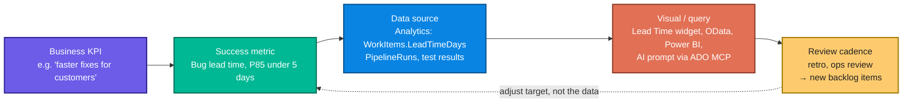
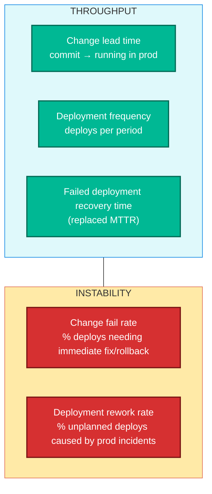
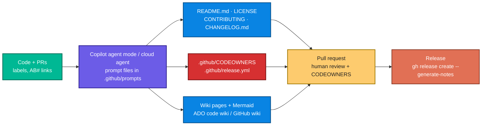

# Day 2 (Wed 25 Nov 2026): Success metrics, Analytics/OData & docs-as-code with Copilot

**Domain 1: Design and implement processes and communications (15–20%)**
Study-guide bullets covered today ([source](https://learn.microsoft.com/en-us/credentials/certifications/resources/study-guides/az-401)):
- Translate business KPIs into success metrics and standards for project planning, development, testing, delivery, operations, and security
- Implement queries to evaluate success metrics for DevOps by using AI-assisted tools
- Document a project, including wikis, readmes, change logs, releases, licenses, code owners, and process diagrams, by using AI-assisted tools

Time box: about 2.5 h (30 min concepts, 90 min lab, 30 min cheat sheet + questions).
Lab assets reused from Day 1: Azure DevOps project **`az401-lab`** (Agile process, repo `az401-lab`) and GitHub repo **`vijayraavi/az401-lab-app`** ([Day 1 lesson](../day-01/lesson.md)).

---

## 1. Concepts

### 1.1 KPI → metric → query/widget

A business **KPI** ("customers get fixes faster") isn't measurable by itself. Turn it into a **success metric** with a definition, a data source, and a target or standard, then show it on a **widget, report or query** that the team reviews regularly.



The study guide lists six areas. Here's one way to map them to metrics you can actually pull from Azure DevOps or GitHub:

| Area | Example KPI → metric | Where the data comes from |
|---|---|---|
| Planning | Predictable delivery → **velocity** (completed points per sprint), planned vs completed | Velocity widget ([docs](https://learn.microsoft.com/en-us/azure/devops/report/dashboards/team-velocity?view=azure-devops)) |
| Development | Flow efficiency → **cycle time**, WIP per column | Cycle Time widget, CFD ([cycle/lead](https://learn.microsoft.com/en-us/azure/devops/report/dashboards/cycle-time-and-lead-time?view=azure-devops), [CFD](https://learn.microsoft.com/en-us/azure/devops/report/dashboards/cumulative-flow?view=azure-devops)) |
| Testing | Quality → test **pass rate**, flaky tests, test duration | Test Results Trend (Advanced) widget, Pipelines Analytics ([widgets](https://learn.microsoft.com/en-us/azure/devops/report/dashboards/analytics-widgets?view=azure-devops), [sample reports](https://learn.microsoft.com/en-us/azure/devops/report/extend-analytics/quick-ref?view=azure-devops)) |
| Delivery | Speed and stability → **DORA** deployment frequency, change lead time, change fail rate | Pipeline runs / deployments ([DORA](https://dora.dev/guides/dora-metrics/), [PipelineRuns sample](https://learn.microsoft.com/en-us/azure/devops/report/powerbi/sample-pipelines-outcome-summary?view=azure-devops)) |
| Operations | Resilience → **failed deployment recovery time**, bug lead time | Incidents/bugs in Boards, Azure Monitor (Day 15–16) |
| Security | Exposure → open alerts by severity, time to remediate | GitHub security overview / GHAS ([docs](https://docs.github.com/en/code-security/security-overview/about-security-overview)) (Day 14) |

Velocity is for capacity planning. Microsoft's docs say not to confuse it with a KPI ([velocity docs](https://learn.microsoft.com/en-us/azure/devops/report/dashboards/team-velocity?view=azure-devops)). DORA warns against setting a metric itself as the goal (Goodhart's law), using one metric for everything, and comparing very different apps ([DORA pitfalls](https://dora.dev/guides/dora-metrics/)).

### 1.2 DORA: now **five** software delivery metrics

DORA moved from the original *four keys* to a **five-metric model**, and replaced MTTR with **failed deployment recovery time** ([DORA metrics guide](https://dora.dev/guides/dora-metrics/), last updated 5 Jan 2026). Many exam items and older docs still say "four keys", so know both.



- Speed and stability **aren't a trade-off**: top performers do well on all five ([DORA](https://dora.dev/guides/dora-metrics/)).
- Measure **per application/service**. Don't blend teams or compare a mobile app with a mainframe ([DORA](https://dora.dev/guides/dora-metrics/)).
- To set a baseline quickly, use the **DORA Quick Check** ([quickcheck](https://dora.dev/quickcheck/)). The usual first improvement is **smaller batch sizes** ([DORA](https://dora.dev/guides/dora-metrics/)).
- **Exam trap:** DORA *change lead time* starts at **commit**. The Azure Boards *Lead Time* widget starts when the **work item is created**. They're different metrics.

### 1.3 Flow metrics in Azure Boards (Analytics widgets)

| Widget | What it shows | Key facts |
|---|---|---|
| **Lead Time** | Created → Completed state category | Scatter plot. Shows average, moving average (window N = 20% of the days shown, rounded down to an odd number) and a std-dev band ([docs](https://learn.microsoft.com/en-us/azure/devops/report/dashboards/cycle-time-and-lead-time?view=azure-devops)) |
| **Cycle Time** | **First** entry into In Progress (or Resolved) → **final** Completed | Reactivated items: the clock covers the whole span, including time spent closed ([docs](https://learn.microsoft.com/en-us/azure/devops/report/dashboards/cycle-time-and-lead-time?view=azure-devops)) |
| **CFD** | Count of items per board column over time | Shows bottlenecks and WIP. The in-context report always uses the blue-green theme ([docs](https://learn.microsoft.com/en-us/azure/devops/report/dashboards/cumulative-flow?view=azure-devops)) |
| **Velocity** | Completed work per sprint (count or sum of points/effort/size) | Credit goes to the sprint where the item was **completed**, not where it was planned ([docs](https://learn.microsoft.com/en-us/azure/devops/report/dashboards/team-velocity?view=azure-devops)) |
| Burndown / Burnup / Sprint Burndown | Remaining or completed work over time | Analytics-based, across teams and sprints ([docs](https://learn.microsoft.com/en-us/azure/devops/report/dashboards/analytics-widgets?view=azure-devops)) |

Prerequisites: Lead/Cycle widgets only let you pick work item types that are **on a backlog**. To add one to a team dashboard you must be a **team member**. If **Boards is disabled**, no work-tracking Analytics widgets appear ([docs](https://learn.microsoft.com/en-us/azure/devops/report/dashboards/cycle-time-and-lead-time?view=azure-devops)). You can also add these widgets with the Dashboard Widgets REST API ([same doc](https://learn.microsoft.com/en-us/azure/devops/report/dashboards/cycle-time-and-lead-time?view=azure-devops)).

### 1.4 Analytics: OData, Analytics views, Power BI, AI-assisted queries

- **Endpoint:** `https://analytics.dev.azure.com/{org}/{project}/_odata/{version}/{EntitySet}`. Leave out `/{project}` to query across projects ([wit-analytics](https://learn.microsoft.com/en-us/azure/devops/report/extend-analytics/wit-analytics?view=azure-devops)).
- **Versions:** `v1.0`, `v2.0` (latest **released**), `v3.0-preview`, `v4.0-preview` (latest preview). Preview versions can include breaking changes ([versioning](https://learn.microsoft.com/en-us/azure/devops/report/extend-analytics/odata-api-version?view=azure-devops)). Microsoft's lead/cycle samples use `v3.0-preview` ([sample](https://learn.microsoft.com/en-us/azure/devops/report/powerbi/sample-boards-leadcycletime?view=azure-devops)).
- **Entity sets you'll meet:** `WorkItems` (has `LeadTimeDays`, `CycleTimeDays`, set only for **Completed** items), `WorkItemBoardSnapshot` (CFD), `PipelineRuns` (outcome counts) ([lead/cycle sample](https://learn.microsoft.com/en-us/azure/devops/report/powerbi/sample-boards-leadcycletime?view=azure-devops), [aggregation](https://learn.microsoft.com/en-us/azure/devops/report/extend-analytics/aggregated-data-analytics?view=azure-devops), [PipelineRuns](https://learn.microsoft.com/en-us/azure/devops/report/powerbi/sample-pipelines-outcome-summary?view=azure-devops)).
- **Aggregation:** `$apply=filter(...)/groupby((Field), aggregate(X with sum|min|max|average|countdistinct as Alias))`, plus `compute(... div ...)` for ratios. Aggregating on the server keeps Power BI refreshes small ([aggregation](https://learn.microsoft.com/en-us/azure/devops/report/extend-analytics/aggregated-data-analytics?view=azure-devops)).
- **Analytics views:** **Boards data only** (work items), a **flat list** with no hierarchy, **no pipelines**. **Stakeholder** users can't use them. Default views come in Today / Last 30 days / Last 26 weeks / All history by month ([about views](https://learn.microsoft.com/en-us/azure/devops/report/powerbi/what-are-analytics-views?view=azure-devops)).
- **Power BI:** use the *Azure DevOps (Boards only)* data connector for Analytics views, or an **OData feed** for anything else (pipelines, tests, aggregations). In the OData feed, set `[Implementation="2.0",OmitValues = ODataOmitValues.Nulls,ODataVersion = 4]` so nulls don't trigger extra requests and throttling ([OData + Power BI](https://learn.microsoft.com/en-us/azure/devops/report/powerbi/odataquery-connect?view=azure-devops), [connector](https://learn.microsoft.com/en-us/azure/devops/report/powerbi/data-connector-connect?view=azure-devops)).
- **AI-assisted queries:** with the **Azure DevOps MCP Server** in Copilot **agent mode**, you can ask things like *"Compare the average cycle time for user stories versus bugs over the last 90 days"* or *"Write an OData query that counts work items grouped by work item type"*. Microsoft's docs include these prompts ([cycle/lead AI prompts](https://learn.microsoft.com/en-us/azure/devops/report/dashboards/cycle-time-and-lead-time?view=azure-devops), [OData AI prompts](https://learn.microsoft.com/en-us/azure/devops/report/extend-analytics/wit-analytics?view=azure-devops)). The remote server (`https://mcp.dev.azure.com/{org}`, GA) supports toolsets `repos, advsec, wit, pipelines, wiki, work, testplan, elm` and `X-MCP-Readonly` ([remote MCP](https://learn.microsoft.com/en-us/azure/devops/mcp-server/remote-mcp-server?view=azure-devops), [Sprint 278 GA notes](https://learn.microsoft.com/en-us/azure/devops/release-notes/2026/sprint-278-update)). The MCP server is free ([overview](https://learn.microsoft.com/en-us/azure/devops/mcp-server/mcp-server-overview?view=azure-devops)).
- **Auth for scripts:** use a short-lived Entra token rather than a PAT: `az account get-access-token --resource 499b84ac-1321-427f-aa17-267ca6975798` (that's the Azure DevOps application ID, not a URI). The token lasts about an hour ([Entra tokens with Azure CLI](https://learn.microsoft.com/en-us/azure/devops/cli/entra-tokens?view=azure-devops)).

### 1.5 Documenting a project with AI assistance (docs-as-code)



| Artefact | Facts the exam can test | Source |
|---|---|---|
| **CODEOWNERS** | Location `.github/`, root, or `docs/`, searched **in that order** (first one wins). Must be on the PR's **base branch**. **Last matching pattern wins**. Several owners must go on the **same line**. Owners need **write** access. Invalid lines are skipped. Max size 3 MB. No `!` negation or `[ ]` ranges. Draft PRs don't auto-request owners. *Require review from Code Owners* needs approval from **any one** owner. Protect the file with `/.github/CODEOWNERS @owner` | [about code owners](https://docs.github.com/en/repositories/managing-your-repositorys-settings-and-features/customizing-your-repository/about-code-owners) |
| ADO equivalent | Branch policy **Automatically included reviewers** with `--path-filter` (`az repos policy required-reviewer create`) | [CLI](https://learn.microsoft.com/en-us/cli/azure/repos/policy/required-reviewer?view=azure-cli-latest) |
| **Release notes** | *Generate release notes* lists merged PRs, contributors, and a full-changelog link. Customise with **`.github/release.yml`**: `changelog.exclude.labels/authors`, `categories[*].title` + `labels` (required), `"*"` catch-all | [auto release notes](https://docs.github.com/en/repositories/releasing-projects-on-github/automatically-generated-release-notes) |
| CLI | `gh release create <tag> --generate-notes` (`--notes` text is **prepended**, `--notes-start-tag`, `--draft`, `--prerelease`, `--fail-on-no-commits`) | `gh release create --help` (gh 2.103.0) |
| **LICENSE** | Put `LICENSE`/`LICENSE.md` in the root. With no license, default copyright applies (all rights reserved). The license picker only appears **at repo creation**. Licensee detects it | [licensing a repo](https://docs.github.com/en/repositories/managing-your-repositorys-settings-and-features/customizing-your-repository/licensing-a-repository) |
| **GitHub wiki** | **Public** repos on GitHub Free; **private** repos need Pro/Team/Enterprise. Renders Mermaid. Soft limit 5,000 files. Search engines index it only with 500+ stars and public editing off | [about wikis](https://docs.github.com/en/communities/documenting-your-project-with-wikis/about-wikis), [diagrams](https://docs.github.com/en/get-started/writing-on-github/working-with-advanced-formatting/creating-diagrams) |
| **ADO wiki** | **Provisioned** (project wiki, one per project, revert in the UI) vs **published as code** (several wikis, **versioned** by branch, page order set by a **`.order`** file, edits go through PRs) | [provisioned vs code](https://learn.microsoft.com/en-us/azure/devops/project/wiki/provisioned-vs-published-wiki?view=azure-devops), [publish repo](https://learn.microsoft.com/en-us/azure/devops/project/wiki/publish-repo-to-wiki?view=azure-devops) |
| ADO wiki Mermaid | `::: mermaid` … `:::` **or** a ```` ```mermaid ```` fence. Limited syntax: use **`graph`** instead of `flowchart`, no `---->`, most HTML tags unsupported | [wiki Markdown guidance](https://learn.microsoft.com/en-us/azure/devops/project/wiki/markdown-guidance?view=azure-devops) |
| **Copilot for docs** | **Prompt files** (`.github/prompts/*.prompt.md`, run as `/name` in VS Code, preview); repo **custom instructions** (`.github/copilot-instructions.md`); **cloud agent** (formerly "coding agent"): assign an issue to Copilot → it opens a PR and asks you for review. It only sees comments made **before** assignment | [prompt files](https://docs.github.com/en/copilot/tutorials/customization-library/prompt-files/create-readme), [custom instructions](https://docs.github.com/en/copilot/how-tos/configure-custom-instructions/add-repository-instructions), [cloud agent](https://docs.github.com/en/copilot/how-tos/use-copilot-agents/cloud-agent/use-cloud-agent-on-github) |
| CHANGELOG | No GitHub-mandated format. *Keep a Changelog* is a common convention: `## [Unreleased]`, then Added/Changed/Deprecated/Removed/Fixed/Security | [keepachangelog.com](https://keepachangelog.com/en/1.1.0/) |

---

## 2. Hands-on lab (about 90 min, about ₹0)

> **Cost notes.** Everything today runs inside free tiers. Azure DevOps Analytics, dashboards, widgets, wiki and the MCP server cost nothing extra for Basic users (first 5 Basic users free) ([billing FAQ](https://learn.microsoft.com/en-us/azure/devops/organizations/billing/billing-faq?view=azure-devops), [MCP overview](https://learn.microsoft.com/en-us/azure/devops/mcp-server/mcp-server-overview?view=azure-devops)). Nothing is deployed to Azure. `az account get-access-token` only signs you in. **Power BI Desktop** is a free download if you try the optional step. On GitHub, releases, CODEOWNERS and labels are free. Copilot Chat / agent mode use your Copilot plan. The optional **cloud agent** step consumes premium requests, and its sandbox compute now comes from your Actions entitlement ([GitHub changelog 28 Oct 2026](https://github.blog/changelog/2026-10-28-work-from-anywhere-with-a-new-connected-copilot-cloud-experience/)), so skip it if you're near your limits.

Replace `<org>` with your Azure DevOps org (Entra-backed, as on Day 1).

### Shell setup

Same as [Day 1](../day-01/lesson.md#shell-setup): commands are shown for **Windows PowerShell** (PowerShell 7 recommended) and **Ubuntu (bash)**. Identical commands are marked **works in both**. If the tools are already installed, skip the install and sign in in Lab A. Otherwise:

**PowerShell**
```powershell
winget install -e --id Microsoft.AzureCLI
winget install -e --id GitHub.cli
winget install -e --id Git.Git
az extension add --name azure-devops
```

**Ubuntu (bash)**
```bash
curl -sL https://aka.ms/InstallAzureCLIDeb | sudo bash
sudo apt update && sudo apt install -y gh git jq
# If apt cannot find gh, follow https://github.com/cli/cli/blob/trunk/docs/install_linux.md
az extension add --name azure-devops
```

### Lab A: Generate flow data in `az401-lab` (10 min)
Lead/Cycle widgets only show **completed** items, so move a few user stories through the Agile states New → Active → Closed ([Agile workflow](https://learn.microsoft.com/en-us/azure/devops/boards/work-items/guidance/agile-process-workflow?view=azure-devops)).
**PowerShell**
```powershell
az login
az extension add --name azure-devops            # skip if already added on Day 1
az devops configure --defaults organization="https://dev.azure.com/<org>" project=az401-lab

foreach ($t in "Add /metrics endpoint", "Write CHANGELOG", "Add CODEOWNERS", "Fix login typo") {
  $id = (az boards work-item create --type "User Story" --title $t --query id -o tsv).Trim()
  az boards work-item update --id $id --state Active -o none
  Write-Output "created + activated $id"
}
az boards work-item create --type Bug --title "Health check returns 500" --query id -o tsv

# Close two stories now. Close the rest later today or tomorrow so the chart has spread.
az boards query --wiql "SELECT [System.Id],[System.Title],[System.State] FROM WorkItems `
  WHERE [System.TeamProject]='az401-lab' AND [System.WorkItemType]='User Story' `
  AND [System.State]='Active' ORDER BY [System.Id]" -o table
az boards work-item update --id "<ID1>" --state Closed -o none
az boards work-item update --id "<ID2>" --state Closed -o none
```

**Ubuntu (bash)**
```bash
az login
az extension add --name azure-devops            # skip if already added on Day 1
az devops configure --defaults organization=https://dev.azure.com/<org> project=az401-lab

for t in "Add /metrics endpoint" "Write CHANGELOG" "Add CODEOWNERS" "Fix login typo"; do
  ID=$(az boards work-item create --type "User Story" --title "$t" --query id -o tsv)
  az boards work-item update --id $ID --state Active -o none
  echo "created + activated $ID"
done
az boards work-item create --type Bug --title "Health check returns 500" --query id -o tsv

# Close two stories now. Close the rest later today or tomorrow so the chart has spread.
az boards query --wiql "SELECT [System.Id],[System.Title],[System.State] FROM WorkItems \
  WHERE [System.TeamProject]='az401-lab' AND [System.WorkItemType]='User Story' \
  AND [System.State]='Active' ORDER BY [System.Id]" -o table
az boards work-item update --id <ID1> --state Closed -o none
az boards work-item update --id <ID2> --state Closed -o none
```
([az boards work-item](https://learn.microsoft.com/en-us/cli/azure/boards/work-item?view=azure-cli-latest), [az boards query](https://learn.microsoft.com/en-us/cli/azure/boards?view=azure-cli-latest)). Same-day items show `CycleTimeDays = 0`, which is expected ([sample notes](https://learn.microsoft.com/en-us/azure/devops/report/powerbi/sample-boards-leadcycletime?view=azure-devops)). Analytics data can take a few minutes to appear.

### Lab B: Flow dashboard with widgets (15 min, UI)
1. **Overview → Dashboards → New dashboard** → name it `Flow metrics`, type **Team dashboard** (team `az401-lab Team`) ([dashboards](https://learn.microsoft.com/en-us/azure/devops/report/dashboards/dashboards?view=azure-devops)).
2. **Edit → Add widget** ([add a widget](https://learn.microsoft.com/en-us/azure/devops/report/dashboards/add-widget-to-dashboard?view=azure-devops)) and add:
   - **Cycle Time**: Team = az401-lab Team, Work items = *Stories* backlog, Time period = *Rolling 30 days*.
   - **Lead Time**: same settings, plus a second copy with work item type = **Bug**, to show bug lead time against a target.
   - **Cumulative Flow Diagram**: Stories backlog, rolling 30 days. Look for columns that keep widening.
   - **Velocity**: only works if you've set iterations. Skip it if you haven't.
3. Hover a dot on the Cycle Time chart to see which work items it represents. Click a legend type to filter ([widget docs](https://learn.microsoft.com/en-us/azure/devops/report/dashboards/cycle-time-and-lead-time?view=azure-devops)).
4. **KPI exercise (5 min):** write down one KPI → metric → target for each of the six study-guide areas, using the table in 1.1. Add the list to the wiki page in Lab D.

### Lab C: Analytics OData query with an Entra token (15 min)
**PowerShell**
```powershell
$org = "<org>"
$proj = "az401-lab"
$token = (az account get-access-token --resource 499b84ac-1321-427f-aa17-267ca6975798 `
          --query accessToken -o tsv).Trim()
$headers = @{ Authorization = "Bearer $token" }

# 1) Per-item lead and cycle time for completed user stories
# Single-quoted fragments keep OData $filter / $select / $apply / $count literal.
$base = "https://analytics.dev.azure.com/$org/$proj/_odata/v3.0-preview/WorkItems"
$filter = "WorkItemType eq 'User Story' and StateCategory eq 'Completed' and CompletedDate ge 2026-11-01Z"
$select = "WorkItemId,Title,State,LeadTimeDays,CycleTimeDays,CompletedDateSK"
$uri = '{0}?$filter={1}&$select={2}' -f $base, [uri]::EscapeDataString($filter), [uri]::EscapeDataString($select)
(Invoke-RestMethod -Uri $uri -Headers $headers).value

# 2) Server-side aggregation: average lead/cycle time by work item type
$apply = 'filter(StateCategory eq ''Completed'' and CompletedDate ge 2026-11-01Z)/groupby((WorkItemType), aggregate($count as Done, LeadTimeDays with average as AvgLeadDays, CycleTimeDays with average as AvgCycleDays))'
$uri = '{0}?$apply={1}' -f $base, [uri]::EscapeDataString($apply)
(Invoke-RestMethod -Uri $uri -Headers $headers).value

# 3) DORA-style proxy: pipeline run outcomes since 1 Nov (works once you have pipelines, Day 6+)
$runs = "https://analytics.dev.azure.com/$org/$proj/_odata/v3.0-preview/PipelineRuns"
$apply = 'filter(CompletedDate ge 2026-11-01Z)/aggregate($count as TotalCount, SucceededCount with sum as SucceededCount, FailedCount with sum as FailedCount)'
$uri = '{0}?$apply={1}' -f $runs, [uri]::EscapeDataString($apply)
(Invoke-RestMethod -Uri $uri -Headers $headers).value
Remove-Variable token, headers -ErrorAction SilentlyContinue
```

**Ubuntu (bash)**
```bash
ORG=<org>; PROJ=az401-lab
TOKEN=$(az account get-access-token --resource 499b84ac-1321-427f-aa17-267ca6975798 \
        --query accessToken -o tsv)

# 1) Per-item lead and cycle time for completed user stories
curl -sG "https://analytics.dev.azure.com/$ORG/$PROJ/_odata/v3.0-preview/WorkItems" \
  -H "Authorization: Bearer $TOKEN" \
  --data-urlencode "\$filter=WorkItemType eq 'User Story' and StateCategory eq 'Completed' and CompletedDate ge 2026-11-01Z" \
  --data-urlencode "\$select=WorkItemId,Title,State,LeadTimeDays,CycleTimeDays,CompletedDateSK" \
  | jq '.value'

# 2) Server-side aggregation: average lead/cycle time by work item type
curl -sG "https://analytics.dev.azure.com/$ORG/$PROJ/_odata/v3.0-preview/WorkItems" \
  -H "Authorization: Bearer $TOKEN" \
  --data-urlencode "\$apply=filter(StateCategory eq 'Completed' and CompletedDate ge 2026-11-01Z)/groupby((WorkItemType), aggregate(\$count as Done, LeadTimeDays with average as AvgLeadDays, CycleTimeDays with average as AvgCycleDays))" \
  | jq '.value'

# 3) DORA-style proxy: pipeline run outcomes since 1 Nov (works once you have pipelines, Day 6+)
curl -sG "https://analytics.dev.azure.com/$ORG/$PROJ/_odata/v3.0-preview/PipelineRuns" \
  -H "Authorization: Bearer $TOKEN" \
  --data-urlencode "\$apply=filter(CompletedDate ge 2026-11-01Z)/aggregate(\$count as TotalCount, SucceededCount with sum as SucceededCount, FailedCount with sum as FailedCount)" \
  | jq '.value'
unset TOKEN
```
Query shapes come from Microsoft's samples ([lead/cycle](https://learn.microsoft.com/en-us/azure/devops/report/powerbi/sample-boards-leadcycletime?view=azure-devops), [aggregation](https://learn.microsoft.com/en-us/azure/devops/report/extend-analytics/aggregated-data-analytics?view=azure-devops), [PipelineRuns](https://learn.microsoft.com/en-us/azure/devops/report/powerbi/sample-pipelines-outcome-summary?view=azure-devops)). On Ubuntu, install `jq` first if you don't have it (`sudo apt install -y jq`). In PowerShell, `Invoke-RestMethod` already parses JSON, so `jq` is not required. You can also paste query 1 straight into a browser where you're signed in to Azure DevOps (no token needed):
`https://analytics.dev.azure.com/<org>/az401-lab/_odata/v3.0-preview/WorkItems?$filter=WorkItemType eq 'User Story' and StateCategory eq 'Completed'&$select=WorkItemId,Title,LeadTimeDays,CycleTimeDays`

Pipeline failures are only a *proxy* for DORA change fail rate. DORA counts deployments to production that need immediate intervention ([DORA](https://dora.dev/guides/dora-metrics/)).

**Optional, Power BI Desktop:** *Get data → OData feed* → paste query 1 as a single line → *Transform data → Advanced Editor* → replace `[Implementation="2.0"]` with `[Implementation="2.0",OmitValues = ODataOmitValues.Nulls,ODataVersion = 4]` ([docs](https://learn.microsoft.com/en-us/azure/devops/report/powerbi/odataquery-connect?view=azure-devops)).

**AI-assisted query (10 min):** in VS Code, reuse Day 1's `.vscode/mcp.json` (remote ADO MCP with `X-MCP-Toolsets: wit,work` and `X-MCP-Readonly: true`) ([remote MCP](https://learn.microsoft.com/en-us/azure/devops/mcp-server/remote-mcp-server?view=azure-devops)). In Copilot Chat **agent mode**, ask:
- *"List the user stories closed in az401-lab in the last 7 days with their state change dates, and estimate cycle time for each. Do not use previously fetched data."*
- *"Write an Analytics OData v3.0-preview query that returns average CycleTimeDays grouped by WorkItemType for completed items in az401-lab since 2026-11-01."* Run what it gives you with the curl or Invoke-RestMethod pattern above and compare the numbers to the widget.

These prompts are adapted from the Microsoft docs ([AI prompts](https://learn.microsoft.com/en-us/azure/devops/report/dashboards/cycle-time-and-lead-time?view=azure-devops), [MCP overview tip on stale data](https://learn.microsoft.com/en-us/azure/devops/mcp-server/mcp-server-overview?view=azure-devops)). Always check AI-written OData against the metadata. Copilot can invent field names.

### Lab D: Azure DevOps wiki-as-code with Mermaid (15 min)
**PowerShell**
```powershell
git clone "https://dev.azure.com/<org>/az401-lab/_git/az401-lab"   # or reuse Day 1 clone
Set-Location az401-lab
git checkout main
git pull
New-Item -ItemType Directory -Force -Path docs | Out-Null
@'
# Flow metrics for az401-lab

::: mermaid
graph LR
  A[Created] --> B[Active] --> C[Closed]
  A -. lead time .-> C
  B -. cycle time .-> C
:::

| Area | KPI | Metric | Target |
|---|---|---|---|
| Development | Faster flow | Cycle time (stories) | < 3 days |
'@ | Set-Content -Path docs/Flow-Metrics.md -Encoding utf8
Set-Content -Path docs/.order -Value "Flow-Metrics" -Encoding utf8
git checkout -b docs/flow-metrics
git add docs
git commit -m "Docs: flow metrics wiki page"
git push -u origin docs/flow-metrics
az repos pr create --source-branch docs/flow-metrics --target-branch main `
  --title "Docs: flow metrics" --work-items "<ID1>"     # Day 1 policy requires a linked work item
# after completing the PR:
az devops wiki create --name az401-docs --type codewiki --repository az401-lab `
  --version main --mapped-path /docs
az devops wiki list -o table
```

**Ubuntu (bash)**
```bash
git clone https://dev.azure.com/<org>/az401-lab/_git/az401-lab && cd az401-lab   # or reuse Day 1 clone
git checkout main && git pull
mkdir -p docs && cat > docs/Flow-Metrics.md <<'MD'
# Flow metrics for az401-lab

::: mermaid
graph LR
  A[Created] --> B[Active] --> C[Closed]
  A -. lead time .-> C
  B -. cycle time .-> C
:::

| Area | KPI | Metric | Target |
|---|---|---|---|
| Development | Faster flow | Cycle time (stories) | < 3 days |
MD
printf "Flow-Metrics\n" > docs/.order
git checkout -b docs/flow-metrics && git add docs && git commit -m "Docs: flow metrics wiki page"
git push -u origin docs/flow-metrics
az repos pr create --source-branch docs/flow-metrics --target-branch main \
  --title "Docs: flow metrics" --work-items <ID1>     # Day 1 policy requires a linked work item
# after completing the PR:
az devops wiki create --name az401-docs --type codewiki --repository az401-lab \
  --version main --mapped-path /docs
az devops wiki list -o table
```
([az devops wiki](https://learn.microsoft.com/en-us/cli/azure/devops/wiki?view=azure-cli-latest), [.order file / code wiki](https://learn.microsoft.com/en-us/azure/devops/project/wiki/provisioned-vs-published-wiki?view=azure-devops), [Mermaid in ADO wiki](https://learn.microsoft.com/en-us/azure/devops/project/wiki/markdown-guidance?view=azure-devops)). Open **Wiki → az401-docs** and check the diagram renders. Notice the ADO wiki uses `graph`, not `flowchart`.

Optional, Copilot: in agent mode with the ADO MCP `wiki` toolset (not read-only), ask *"Summarise the az401-docs wiki page Flow-Metrics and suggest two more KPIs."* That adds `search_wiki`/wiki tools to the agent ([remote MCP toolsets](https://learn.microsoft.com/en-us/azure/devops/mcp-server/remote-mcp-server?view=azure-devops)).

### Lab E: GitHub docs-as-code in `vijayraavi/az401-lab-app` (25 min)
**PowerShell**
```powershell
Set-Location az401-lab-app
git checkout main
git pull
git checkout -b docs/governance
New-Item -ItemType Directory -Force -Path .github/prompts | Out-Null
```

**Ubuntu (bash)**
```bash
cd az401-lab-app && git checkout main && git pull
git checkout -b docs/governance
mkdir -p .github/prompts
```
1. **`.github/CODEOWNERS`** (you're the only collaborator, so you own everything; the structure is what matters):
```text
# Default owner for everything
*                     @vijayraavi
# Docs
/docs/                @vijayraavi
*.md                  @vijayraavi
# CI/CD and governance files: protect CODEOWNERS itself
/.github/             @vijayraavi
/.github/CODEOWNERS   @vijayraavi
```
Order matters: the **last matching pattern wins**. Owners need write access ([about code owners](https://docs.github.com/en/repositories/managing-your-repositorys-settings-and-features/customizing-your-repository/about-code-owners)). Copilot prompt to try first: *"Generate a .github/CODEOWNERS for this repo: @vijayraavi owns everything, with explicit entries for /docs/, *.md and /.github/, and protect the CODEOWNERS file itself. Explain the precedence rules in comments."* Compare its output to the file above.

2. **`.github/release.yml`**:
```yaml
changelog:
  exclude:
    labels:
      - ignore-for-release
      - dependencies        # Dependabot PRs carry this label, as in GitHub's docs example
  categories:
    - title: "Breaking changes 🛠"
      labels: [breaking-change]
    - title: "Features 🎉"
      labels: [enhancement]
    - title: "Fixes 🐛"
      labels: [bug]
    - title: "Docs 📚"
      labels: [documentation]
    - title: "Other changes"
      labels: ["*"]
```
([config options](https://docs.github.com/en/repositories/releasing-projects-on-github/automatically-generated-release-notes))

3. **CHANGELOG prompt file**, `.github/prompts/changelog.prompt.md` (prompt files are in preview; run it as `/changelog` in VS Code Copilot Chat) ([prompt file format](https://docs.github.com/en/copilot/tutorials/customization-library/prompt-files/create-readme), [VS Code prompt files](https://code.visualstudio.com/docs/copilot/customization/prompt-files)):
```markdown
---
agent: 'agent'
description: 'Create or update CHANGELOG.md from git history and merged PRs'
---
You maintain CHANGELOG.md using the Keep a Changelog 1.1.0 format.
1. Run `git log --oneline --no-merges $(git describe --tags --abbrev=0 2>/dev/null || git rev-list --max-parents=0 HEAD)..HEAD`
   and, if the GitHub MCP server is available, list PRs merged since the last tag.
2. Group entries under ## [Unreleased] → Added, Changed, Fixed, Security (omit empty groups).
3. One line per change, imperative mood, end with the PR number (#12) and any AB#<id>.
4. Do not invent changes that are not in the history. Do not touch other files.
```
Run `/changelog` in agent mode, review the diff, and keep only accurate lines. Then commit:
**Works in both**
```
git add .github CHANGELOG.md
git commit -m "Docs: CODEOWNERS, release.yml, CHANGELOG (Copilot-assisted) AB#<ID2>"
git push -u origin docs/governance
gh label create documentation --color 0075ca --description "Docs changes" --force
gh pr create --title "Docs: governance files" --body "Fixes AB#<ID2>" --label documentation
gh pr merge --squash --delete-branch
```
On the PR page, the CODEOWNERS file is now active on `main`. Future PRs that touch `*.md` will auto-request `@vijayraavi`. **Don't** turn on *Require review from Code Owners* in a solo repo today. Rulesets come on Day 4.

4. **LICENSE**: list licenses with `gh repo license list`, view one with `gh repo license view MIT`. In the browser, *Add file → Create new file → `LICENSE`* gives you the **Choose a license template** picker ([licensing](https://docs.github.com/en/repositories/managing-your-repositorys-settings-and-features/customizing-your-repository/licensing-a-repository)). The repo is private, so a license is optional; this is just practice.

5. **Release with generated notes**:
**PowerShell**
```powershell
git checkout main
git pull
gh release create v0.1.0 --generate-notes --notes "First AZ-401 lab release" --target main
gh release view v0.1.0
```

**Ubuntu (bash)**
```bash
git checkout main && git pull
gh release create v0.1.0 --generate-notes --notes "First AZ-401 lab release" --target main
gh release view v0.1.0
```
`--notes` text is **prepended** to the generated notes. Check that the PR shows up under **Docs 📚** (from `release.yml`) ([gh release create --help](https://cli.github.com/manual/gh_release_create), [auto notes](https://docs.github.com/en/repositories/releasing-projects-on-github/automatically-generated-release-notes)).

6. **Delivery metric from GitHub (2 min):** `gh run list --limit 20 --json workflowName,conclusion,createdAt,event` gives you a quick look at run outcomes (Day 1's `traceability-gate` runs). Same idea as the PipelineRuns query.

7. *(Optional, uses premium requests)* **Copilot cloud agent:** `gh issue create --title "Add CONTRIBUTING.md and a Mermaid architecture diagram to README" --body "Keep it short. Use a mermaid flowchart with classDef colours."`. Then in the browser, **Assignees → Copilot**. It opens a PR and requests your review. Comment `@copilot` on the PR to iterate ([cloud agent](https://docs.github.com/en/copilot/how-tos/use-copilot-agents/cloud-agent/use-cloud-agent-on-github)).

### Cleanup (run these yourself when you're done; nothing here is deleted for you)
Keep `az401-lab` and `az401-lab-app` for Days 3–5. Everything below is free to keep. If you want to tidy up:
**Works in both**
```
az devops wiki delete --wiki az401-docs --yes            # unpublishes the code wiki; docs/ stays in the repo
gh release delete v0.1.0 --yes --cleanup-tag -R vijayraavi/az401-lab-app
# Work items from Lab A: leave them (they feed the widgets). To remove one:
# az boards work-item delete --id <ID> --yes             # goes to the Recycle Bin (add --destroy to purge)
```
Also delete the `Flow metrics` dashboard (**Dashboards → … → Delete**) if you don't want it. No Azure resources were created today, so there's nothing to remove from your subscription.

---

## 3. Key takeaways
1. KPI → **metric with a definition, source, and target** → widget/query → review cadence. Don't make a metric the goal (Goodhart).
2. DORA now has **five** metrics. Throughput: change lead time, deployment frequency, failed deployment recovery time. Instability: change fail rate, deployment rework rate.
3. Boards **lead time** = created → completed. **Cycle time** = first In Progress → final Completed. DORA change lead time = commit → prod.
4. Analytics OData: `analytics.dev.azure.com/{org}/{project}/_odata/v{n}/`, `$apply` aggregation, `v2.0` released / `v4.0-preview` latest. **Analytics views = Boards only**. Power BI OData needs `ODataOmitValues.Nulls`.
5. AI-assisted queries: ADO MCP server (read-only, toolsets) in agent mode. Always check the generated OData.
6. CODEOWNERS: `.github/` → root → `docs/`, base branch, last match wins, write access, protect the file itself.
7. Releases: `.github/release.yml` categories by label, `gh release create --generate-notes`. ADO code wiki uses `.order` and versioning, and its Mermaid needs `graph`.

## Sources
- AZ-401 study guide: https://learn.microsoft.com/en-us/credentials/certifications/resources/study-guides/az-401
- DORA metrics: https://dora.dev/guides/dora-metrics/ · Quick Check: https://dora.dev/quickcheck/
- Lead/Cycle Time widgets: https://learn.microsoft.com/en-us/azure/devops/report/dashboards/cycle-time-and-lead-time?view=azure-devops
- Analytics widgets: https://learn.microsoft.com/en-us/azure/devops/report/dashboards/analytics-widgets?view=azure-devops
- CFD: https://learn.microsoft.com/en-us/azure/devops/report/dashboards/cumulative-flow?view=azure-devops · Velocity: https://learn.microsoft.com/en-us/azure/devops/report/dashboards/team-velocity?view=azure-devops
- OData basics: https://learn.microsoft.com/en-us/azure/devops/report/extend-analytics/wit-analytics?view=azure-devops
- OData aggregation: https://learn.microsoft.com/en-us/azure/devops/report/extend-analytics/aggregated-data-analytics?view=azure-devops
- OData versions: https://learn.microsoft.com/en-us/azure/devops/report/extend-analytics/odata-api-version?view=azure-devops
- Lead/Cycle sample queries: https://learn.microsoft.com/en-us/azure/devops/report/powerbi/sample-boards-leadcycletime?view=azure-devops
- PipelineRuns sample: https://learn.microsoft.com/en-us/azure/devops/report/powerbi/sample-pipelines-outcome-summary?view=azure-devops
- Analytics views: https://learn.microsoft.com/en-us/azure/devops/report/powerbi/what-are-analytics-views?view=azure-devops
- Power BI + OData: https://learn.microsoft.com/en-us/azure/devops/report/powerbi/odataquery-connect?view=azure-devops
- Entra tokens with Azure CLI: https://learn.microsoft.com/en-us/azure/devops/cli/entra-tokens?view=azure-devops
- ADO MCP overview: https://learn.microsoft.com/en-us/azure/devops/mcp-server/mcp-server-overview?view=azure-devops · Remote: https://learn.microsoft.com/en-us/azure/devops/mcp-server/remote-mcp-server?view=azure-devops
- ADO Sprint 278 (remote MCP GA): https://learn.microsoft.com/en-us/azure/devops/release-notes/2026/sprint-278-update
- ADO wiki: https://learn.microsoft.com/en-us/azure/devops/project/wiki/provisioned-vs-published-wiki?view=azure-devops · Markdown/Mermaid: https://learn.microsoft.com/en-us/azure/devops/project/wiki/markdown-guidance?view=azure-devops
- `az devops wiki`: https://learn.microsoft.com/en-us/cli/azure/devops/wiki?view=azure-cli-latest · `az repos policy required-reviewer`: https://learn.microsoft.com/en-us/cli/azure/repos/policy/required-reviewer?view=azure-cli-latest
- CODEOWNERS: https://docs.github.com/en/repositories/managing-your-repositorys-settings-and-features/customizing-your-repository/about-code-owners
- Auto-generated release notes: https://docs.github.com/en/repositories/releasing-projects-on-github/automatically-generated-release-notes
- Licensing: https://docs.github.com/en/repositories/managing-your-repositorys-settings-and-features/customizing-your-repository/licensing-a-repository
- GitHub wikis: https://docs.github.com/en/communities/documenting-your-project-with-wikis/about-wikis · Mermaid on GitHub: https://docs.github.com/en/get-started/writing-on-github/working-with-advanced-formatting/creating-diagrams
- Copilot prompt files: https://docs.github.com/en/copilot/tutorials/customization-library/prompt-files/create-readme · Custom instructions: https://docs.github.com/en/copilot/how-tos/configure-custom-instructions/add-repository-instructions
- Copilot cloud agent: https://docs.github.com/en/copilot/how-tos/use-copilot-agents/cloud-agent/use-cloud-agent-on-github · Changelog 28 Oct 2026: https://github.blog/changelog/2026-10-28-work-from-anywhere-with-a-new-connected-copilot-cloud-experience/
- Keep a Changelog: https://keepachangelog.com/en/1.1.0/
