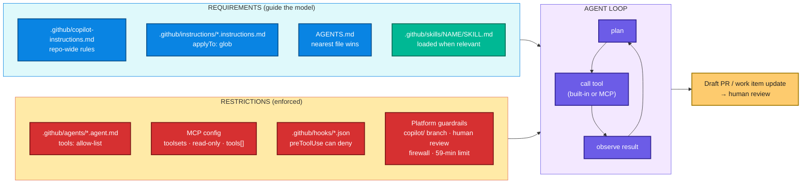
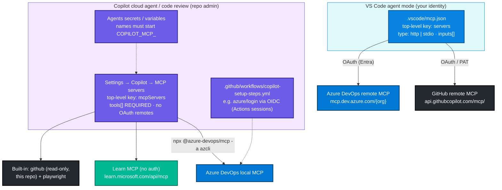
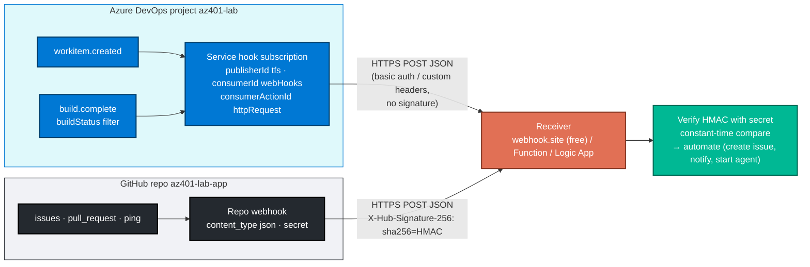

# Day 3 (Thu 26 Nov 2026): Agentic collaboration, MCP servers, webhooks & service hooks

**Domain 1: Design and implement processes and communications (15–20%)**
Study-guide bullets covered today, all under *Configure collaboration and communication* ([source](https://learn.microsoft.com/en-us/credentials/certifications/resources/study-guides/az-401)):
- Specify requirements and restrictions for agentic development, including agents, skills, and loops
- Configure MCP servers, including Azure DevOps MCP server and GitHub MCP server
- Configure integration by using webhooks, MCP servers, and skills
- Configure integration between Azure Boards and GitHub repositories by using MCP

Time box: about 2.5–3 h (30 min concepts, 2 h labs, 30 min cheat sheet + questions).
Lab assets reused from Day 1: Azure DevOps project **`az401-lab`** (Agile process, repo `az401-lab`) in your Entra-backed org, and private GitHub repo **`vijayraavi/az401-lab-app`** with the Azure Boards app connection, the `traceability-gate` workflow (job `require-ab-link`) and the `main-traceability` ruleset ([Day 1 lesson](../day-01/lesson.md)).

---

## 1. Concepts

### 1.1 Requirements and restrictions for agents, skills and loops

An AI agent works in a **loop**: read the context, plan, call a tool, look at the result, and repeat until it's done or it hits a limit. Your job as the agentic DevOps engineer is to write down **what the agent should know** (requirements) and **what it may do** (restrictions), as files in the repo where you can review them in a PR.



| Building block | Where it lives | What it does | Exam-relevant facts |
|---|---|---|---|
| **Repository custom instructions** | `.github/copilot-instructions.md` | Natural-language rules added to every request in the repo | Personal instructions have the highest priority, then repository, then organization, but all relevant sets are sent ([docs](https://docs.github.com/en/copilot/how-tos/configure-custom-instructions/add-repository-instructions)) |
| **Path-specific instructions** | `.github/instructions/NAME.instructions.md` with `applyTo:` glob front matter | Rules only for matching files (for example `**/*.yml`) | Used together with the repo-wide file when the path matches. `excludeAgent: "code-review"` or `"cloud-agent"` hides a file from one of them. On GitHub.com they're supported by the cloud agent and code review ([docs](https://docs.github.com/en/copilot/how-tos/configure-custom-instructions/add-repository-instructions)) |
| **`AGENTS.md`** | Anywhere in the repo, one or more | Agent instructions (build, test, boundaries) | The **nearest** `AGENTS.md` in the directory tree takes precedence. A single root `CLAUDE.md` or `GEMINI.md` is an alternative ([docs](https://docs.github.com/en/copilot/how-tos/configure-custom-instructions/add-repository-instructions), [agents.md](https://agents.md)) |
| **Custom agent (agent profile)** | `.github/agents/NAME.agent.md` (org/enterprise: `agents/` in `.github-private`) | A specialist persona with its own prompt, **`tools`** allow-list and optional **`mcp-servers`** | `description` is **required**. Omitting `tools` (or `["*"]`) = all tools; `tools: []` = none. MCP tools are named `server/tool` or `server/*`. Prompt up to 30,000 characters. `mcp-servers` and `metadata` are ignored by IDE agents ([reference](https://docs.github.com/en/copilot/reference/custom-agents-configuration)) |
| **Agent skill** | `.github/skills/NAME/SKILL.md` (also `.claude/skills`, `.agents/skills`; personal `~/.copilot/skills`) | A folder of instructions, scripts and resources that Copilot loads **only when relevant** | Front matter `name` (lowercase, hyphens) and `description` are required. Works with cloud agent, code review, Copilot CLI, the Copilot app and VS Code agent mode ([docs](https://docs.github.com/en/copilot/how-tos/copilot-on-github/customize-copilot/customize-cloud-agent/add-skills)) |
| **Hooks** | `.github/hooks/*.json` (`"version": 1`) | Run *your* commands at points such as `sessionStart`, `preToolUse`, `postToolUse` | Unlike instructions, hooks **run code**. `preToolUse` can approve or deny a tool call. The cloud agent supports only a subset of events ([docs](https://docs.github.com/en/copilot/concepts/agents/hooks)) |

**Exam trap: instructions are not a security boundary.** VS Code's docs say it plainly: *"Instructions guide the model. They don't guarantee compliance. A 'do not edit' instruction alone is not a permission boundary."* Restrict the **tools** instead ([VS Code custom agents](https://code.visualstudio.com/docs/copilot/customization/custom-agents)).

**Built-in restrictions on the Copilot cloud agent loop** ([risks and mitigations](https://docs.github.com/en/copilot/concepts/agents/cloud-agent/risks-and-mitigations), [about](https://docs.github.com/en/copilot/concepts/agents/cloud-agent/about-cloud-agent)):
- Only users with **write access** can trigger it. It pushes to a single `copilot/` branch (or the PR branch it was mentioned on), and it's subject to branch protections and required checks.
- Its PRs are drafts that a **human must review and merge**. It can't approve or merge, and the person who asked for the PR can't approve it.
- **Actions workflows don't run** on its PRs until someone with write access clicks **Approve and run workflows** (unless you opt out).
- Internet access goes through a **firewall** (recommended allowlist on by default). Hidden characters such as HTML comments in issues are filtered out to reduce prompt injection.
- A session on GitHub Actions can run for at most **59 minutes**. A ruleset can block Copilot from creating PRs unless you add a bypass for Copilot.

**New in Nov 2026 (governance):** enterprise admins can use the `strictPluginOnlyCustomization` managed setting to require that skills, custom agents, hooks, MCP servers and extensions come from approved plugins or managed settings only ([changelog 16 Nov 2026](https://github.blog/changelog/2026-11-16-control-where-github-copilot-customizations-come-from/)).

### 1.2 The Azure DevOps MCP Server (remote is GA; local is still supported)

| | **Remote** (recommended) | **Local** (`@azure-devops/mcp`) |
|---|---|---|
| Endpoint / install | `https://mcp.dev.azure.com/{organization}`, streamable HTTP, nothing to install | `npx -y @azure-devops/mcp {organization}`, `stdio`, Node.js 20+ |
| Auth | **Microsoft Entra ID (OAuth)** only. Needs an **Entra-backed org**; MSA-only orgs aren't supported | Interactive (default), `azcli`, `env`, `envvar` (`ADO_MCP_AUTH_TOKEN`), `pat` via `--authentication`/`-a` |
| Narrowing | Headers: `X-MCP-Toolsets` (`repos`, `wit`, `pipelines`, `wiki`, `work`, `testplan`, `advsec`, `elm`), `X-MCP-Tools` (don't combine with toolsets), `X-MCP-Readonly: true`, `X-MCP-Insiders` | `-d` domains: `core`, `work`, `work-items`, `search`, `test-plans`, `repositories`, `wiki`, `pipelines`, `advanced-security` |
| Clients | VS Code + Copilot, Visual Studio, Microsoft Foundry, Copilot Studio, Copilot CLI, the Copilot app. Cursor and Claude Code need a custom Entra app registration | Any `stdio` client, for example Claude Desktop and Codex, which can't do the Entra flow the remote server needs |

Sources: [remote server](https://learn.microsoft.com/en-us/azure/devops/mcp-server/remote-mcp-server?view=azure-devops), [overview](https://learn.microsoft.com/en-us/azure/devops/mcp-server/mcp-server-overview?view=azure-devops), [GA blog, 5 Aug 2026](https://devblogs.microsoft.com/devops/azure-devops-remote-mcp-server-ga/), [local server README](https://github.com/microsoft/azure-devops-mcp), [auth options](https://github.com/microsoft/azure-devops-mcp/blob/main/docs/GETTINGSTARTED.md).

- The MCP Server is **free**. Normal Azure DevOps pricing applies, and the AI client may cost extra. It needs the assistant to run in **agent mode** ([overview](https://learn.microsoft.com/en-us/azure/devops/mcp-server/mcp-server-overview?view=azure-devops)).
- Remote tools are **consolidated dispatchers** with an `action` parameter. For example, `wit_work_item` (`get`, `get_batch`, `list_comments`, `my`, …) is read-only, while `wit_work_item_write` (`create`, `update`, `add_child`, …), `wit_work_item_comment_write` and `wit_work_item_link_write` (`link`, `link_to_pull_request`, `add_artifact_link`) write ([tool list](https://learn.microsoft.com/en-us/azure/devops/mcp-server/remote-mcp-server?view=azure-devops#available-tools)).
- **OAuth scopes vs headers:** headers only filter which tools are *visible*. They don't grant permissions. Scope families (`wit.read`, `wit.write`, `repos.write`, `pipelines.manage`, …) authorize custom Entra clients. The legacy `Ado.Mcp.Tools` scope grants everything. Either way, the user's own Azure DevOps permissions still apply ([OAuth scopes](https://learn.microsoft.com/en-us/azure/devops/mcp-server/remote-mcp-server?view=azure-devops#oauth-scopes)).

### 1.3 The GitHub MCP Server

- Remote URL: `https://api.githubcopilot.com/mcp/`, authenticated with **OAuth or a PAT**. Remote MCP and OAuth need **VS Code 1.101+** ([README](https://github.com/github/github-mcp-server)).
- With no toolsets specified you get the **default** toolsets: `context`, `repos`, `issues`, `pull_requests`, `users`. Other toolsets include `actions`, `code_security`, `secret_protection`, `dependabot`, `projects`, `labels` and more, and the remote server also has `copilot_spaces` and `github_support_docs_search` ([README](https://github.com/github/github-mcp-server), [remote-server.md](https://github.com/github/github-mcp-server/blob/main/docs/remote-server.md)).
- Narrow it with the **URL path** (`/readonly`, `/x/{toolset}`, `/x/{toolset}/readonly`, `/x/all`, `/insiders`; only one toolset per path) or with **headers** (`X-MCP-Toolsets: repos,issues`, `X-MCP-Tools`, `X-MCP-Readonly`, `X-MCP-Lockdown`, `X-MCP-Insiders`) ([remote-server.md](https://github.com/github/github-mcp-server/blob/main/docs/remote-server.md)).
- Only the remote server has `create_pull_request_with_copilot`, which hands a task to the Copilot coding agent ([remote-server.md](https://github.com/github/github-mcp-server/blob/main/docs/remote-server.md)). Issue tools include `issue_read`, `issue_write`, `list_issues` and `search_issues`. `assign_copilot_to_issue` is also available ([README tools](https://github.com/github/github-mcp-server)).

### 1.4 Where MCP is configured (exam favourite)



| Question | Answer | Source |
|---|---|---|
| JSON shape in VS Code? | `{"servers": {...}, "inputs": [...]}` in `.vscode/mcp.json` (workspace) or the user-profile `mcp.json`. `type` is `stdio`, `http` or `sse`. Use `${input:id}` with `"password": true` inputs for secrets | [VS Code MCP reference](https://code.visualstudio.com/docs/agents/reference/mcp-configuration) |
| JSON shape for the cloud agent? | `{"mcpServers": {...}}` in **repo Settings → Copilot → MCP servers**. `tools` is **required** for each server (allow-list specific read-only tools, or `"*"`). `type` is `local`/`stdio`/`http`/`sse` | [configure MCP for a repo](https://docs.github.com/en/copilot/how-tos/copilot-on-github/customize-copilot/configure-mcp-servers) |
| Secrets for the cloud agent? | **Agents** secrets or variables whose names start with **`COPILOT_MCP_`**, referenced as `$COPILOT_MCP_X` or `${COPILOT_MCP_X}` | same |
| Does the cloud agent ask before using an MCP tool? | **No.** It uses configured tools autonomously, and it supports **tools only** (not resources or prompts). It also **doesn't support remote servers that use OAuth**, so the Entra-only remote Azure DevOps MCP can't be used there. Use the local server with `azure/login` (OIDC) in `copilot-setup-steps.yml` instead | same |
| Built-in servers in the cloud agent? | **GitHub MCP** (read-only, token scoped to the current repo) and **Playwright** are on by default. Repo settings are processed **last** and override the custom-agent and built-in configs | [custom agents config](https://docs.github.com/en/copilot/reference/custom-agents-configuration) |
| Firewall? | The agent firewall covers processes started by the agent's Bash tool (and the built-in Playwright MCP in cloud sandboxes). It **doesn't apply directly to other MCP servers** | [firewall](https://docs.github.com/en/copilot/how-tos/use-copilot-agents/cloud-agent/customize-the-agent-firewall) |

### 1.5 Boards ↔ GitHub via MCP, and the native Boards → Copilot integration

- **Via MCP (agent mode):** one prompt can read a Boards item (`wit_work_item`), create a GitHub issue (`issue_write`) whose body has `AB#<id>`, then write the issue URL back as a work-item comment (`wit_work_item_comment_write`). `AB#` in an **issue description**, PR description or commit message creates the Boards link through the Azure Boards app ([AB# linking](https://learn.microsoft.com/en-us/azure/devops/boards/github/link-to-from-github?view=azure-devops)).
- **Native integration (GA):** on a work item, choose **GitHub icon → Create a pull request with GitHub Copilot**. This needs GitHub repos (**not Azure Repos**), **GitHub App** authentication for the Boards connection (**PATs aren't supported**), an active Copilot subscription and the cloud agent enabled. It sends the large text fields and comments, creates a branch and a **draft PR** linked to the item, and shows **In Progress / Ready for Review / Error** on the item and card ([docs](https://learn.microsoft.com/en-us/azure/devops/boards/github/work-item-integration-github-copilot?view=azure-devops), [GA blog](https://devblogs.microsoft.com/devops/github-copilot-for-azure-boards/)).

### 1.6 Webhooks: Azure DevOps service hooks vs GitHub webhooks



| | Azure DevOps service hook (Web Hooks consumer) | GitHub repository webhook |
|---|---|---|
| Who can create it | **Project Administrators** or Project Collection Administrators ([webhooks](https://learn.microsoft.com/en-us/azure/devops/service-hooks/services/webhooks?view=azure-devops)) | Repo **admin**. A fine-grained token needs **Webhooks: write** ([REST](https://docs.github.com/en/rest/repos/webhooks)) |
| API | `POST https://dev.azure.com/{org}/_apis/hooks/subscriptions?api-version=7.1` ([REST](https://learn.microsoft.com/en-us/rest/api/azure/devops/hooks/subscriptions/create?view=azure-devops-rest-7.1)). There's **no** `az devops service-hooks` command group, so use REST or the portal ([az devops](https://learn.microsoft.com/en-us/cli/azure/devops?view=azure-cli-latest)) | `POST /repos/{owner}/{repo}/hooks` with `name: web`, `config.url`, `config.content_type` (`json` or `form`, **default `form`**), `config.secret`, `events` (default `["push"]`) ([REST](https://docs.github.com/en/rest/repos/webhooks)) |
| Body fields | `publisherId: tfs`, `eventType`, `resourceVersion` (pin it, e.g. `1.0`), `consumerId: webHooks`, `consumerActionId: httpRequest`, `publisherInputs` (`projectId`, filters), `consumerInputs` (`url`, `httpHeaders`, `basicAuthCredentials`, `resourceDetailsToSend`, …) ([create](https://learn.microsoft.com/en-us/azure/devops/service-hooks/create-subscription?view=azure-devops), [consumers](https://learn.microsoft.com/en-us/azure/devops/service-hooks/consumers?view=azure-devops)) | |
| Filters | `workitem.created`: `areaPath`, `workItemType`, `linksChanged`, `tag`. `build.complete`: `definitionName`, `buildStatus` (`Succeeded`, `PartiallySucceeded`, `Failed`, `Stopped`) ([events](https://learn.microsoft.com/en-us/azure/devops/service-hooks/events?view=azure-devops)) | Choose events (`issues`, `pull_request`, …) ([events](https://docs.github.com/en/webhooks/webhook-events-and-payloads)) |
| Authenticity | HTTPS only. Optional basic auth (needs HTTPS) and custom `httpHeaders`. Header values are **visible to anyone who can see the subscription**. You can set Resource details to send to **Minimal** or **None** so the receiver calls back with its own permissions ([webhooks](https://learn.microsoft.com/en-us/azure/devops/service-hooks/services/webhooks?view=azure-devops)) | `X-Hub-Signature-256: sha256=<HMAC-SHA256 hex of the raw body with the secret>`. Compare in **constant time**, never with plain `==`. `X-Hub-Signature` (SHA-1) is legacy ([validate](https://docs.github.com/en/webhooks/using-webhooks/validating-webhook-deliveries)) |
| Targets not allowed | `localhost`/loopback and special-range IPs. Use HTTPS (HTTP can leak data) ([webhooks](https://learn.microsoft.com/en-us/azure/devops/service-hooks/services/webhooks?view=azure-devops)) | `insecure_ssl: 0` (default) verifies TLS ([REST](https://docs.github.com/en/rest/repos/webhooks)) |
| Test / history | Portal **Test** button. `POST _apis/hooks/testnotifications`. `GET …/subscriptions/{id}/notifications` lists recent notifications ([notifications](https://learn.microsoft.com/en-us/rest/api/azure/devops/hooks/notifications/list?view=azure-devops-rest-7.1)) | `POST …/hooks/{id}/pings`, `GET …/hooks/{id}/deliveries`, redeliver via `…/deliveries/{id}/attempts` ([REST](https://docs.github.com/en/rest/repos/webhooks)) |
| Cost | Azure DevOps doesn't charge for service hooks ([webhooks](https://learn.microsoft.com/en-us/azure/devops/service-hooks/services/webhooks?view=azure-devops)) | Free |

---

## 2. Hands-on lab (about 2 h, about ₹0)

> **Cost notes.** Nothing today creates Azure resources, so your subscription isn't billed. The Azure DevOps MCP Server is free ([overview](https://learn.microsoft.com/en-us/azure/devops/mcp-server/mcp-server-overview?view=azure-devops)), service hooks are free ([webhooks](https://learn.microsoft.com/en-us/azure/devops/service-hooks/services/webhooks?view=azure-devops)), GitHub webhooks are free, and the Microsoft Learn MCP Server is free with no authentication ([Learn MCP](https://learn.microsoft.com/en-us/training/support/mcp)). **webhook.site** is a free third-party test receiver: payloads you send there are visible to anyone with the URL, so send only lab data. Copilot **agent mode** uses your Copilot plan. **Lab C** (cloud agent) consumes premium requests, and its compute comes from your monthly GitHub Actions/cloud allowance ([about Copilot in the cloud](https://docs.github.com/en/copilot/concepts/agents/cloud-agent/about-cloud-agent)). Skip Lab C if you're near your limits.

Replace `<org>` with your Azure DevOps org (Entra-backed, as on Day 1) everywhere.

### Prerequisites

Today reuses the Day 1 lab assets. If you deleted `az401-lab` or `az401-lab-app`, re-run Day 1 Labs B and C before starting.

#### Accounts and licences

| Account | What you need | Why |
|---|---|---|
| **Azure subscription** | The Day 1 subscription, in the **same Entra tenant** as the Azure DevOps org. No resources are created today. | `az login` provides the Entra token for the service-hook REST calls (Lab D) and the `azcli` auth for the optional local ADO MCP server ([Entra tokens](https://learn.microsoft.com/en-us/azure/devops/cli/entra-tokens?view=azure-devops)). |
| **Azure DevOps organization** | **Entra-backed** org with project `az401-lab` (Agile). **Basic** access level. | The remote MCP server doesn't support MSA-only orgs ([remote MCP](https://learn.microsoft.com/en-us/azure/devops/mcp-server/remote-mcp-server?view=azure-devops)). |
| **GitHub account** | Owner of `vijayraavi/az401-lab-app` (private). | Labs A, B, C and E run here. |
| **GitHub Copilot** | A plan with **agent mode** (Labs A and B). For Lab C: **Copilot Pro, Pro+, Business or Enterprise** with the cloud agent enabled. It's on by default for Pro/Pro+, while Business/Enterprise admins must enable it ([Boards + Copilot GA blog](https://devblogs.microsoft.com/devops/github-copilot-for-azure-boards/)). | Custom agents, MCP tools and the cloud agent. |
| **webhook.site** (free, no sign-up) | Two unique HTTPS URLs (one for Azure DevOps, one for GitHub). | Labs D and E. Azure DevOps rejects `localhost`/loopback targets, so you need a public HTTPS receiver ([webhooks](https://learn.microsoft.com/en-us/azure/devops/service-hooks/services/webhooks?view=azure-devops)). |

#### Tools and minimum versions

| Tool | Minimum | Notes |
|---|---|---|
| **Azure CLI** | 2.0.69 or later, plus the **azure-devops** extension (latest) | `az boards`, `az devops`, `az account get-access-token`. |
| **GitHub CLI (`gh`)** | Current 2.x (this lab was checked against 2.103.0). `gh agent-task` (preview) and `--assignee "@copilot"` need a recent build | `gh api` for webhooks, `gh agent-task create` for Lab C ([gh agent-task create](https://cli.github.com/manual/gh_agent-task_create), [gh api](https://cli.github.com/manual/gh_api)). |
| **Git** | 2.x | Commits in the Day 1 clone of `az401-lab-app`. |
| **VS Code + GitHub Copilot Chat** | **1.101 or later** (remote MCP + OAuth) | Labs A and B ([GitHub MCP prerequisites](https://github.com/github/github-mcp-server)). |
| **Node.js** (optional) | **20+** | Only for the optional local `@azure-devops/mcp` server ([local server](https://github.com/microsoft/azure-devops-mcp)). |
| **PowerShell 7** (Windows) | 7.0+ | `Invoke-RestMethod`, `[Convert]::ToHexString` and `CryptographicOperations` (used in Lab E) need .NET 5+, so use PowerShell 7. |
| **jq + openssl** (Ubuntu) | jq 1.6+, OpenSSL 1.1+ | JSON output in Lab D. `openssl rand` / `openssl dgst -hmac` in Lab E. |

#### Permissions and roles

| Surface | Role you need | Why |
|---|---|---|
| **ADO project `az401-lab`** | **Contributors** (create/update work items) | Labs A and B. |
| **ADO service hooks (Lab D)** | **Project Administrators** (or Project Collection Administrators). You created the project on Day 1, so you have it. | Required to create webhook subscriptions ([webhooks](https://learn.microsoft.com/en-us/azure/devops/service-hooks/services/webhooks?view=azure-devops)). |
| **ADO remote MCP (Lab B)** | Project membership plus access to the resources you query. MCP can't do more than your own permissions allow. | ([remote MCP](https://learn.microsoft.com/en-us/azure/devops/mcp-server/remote-mcp-server?view=azure-devops)) |
| **GitHub `az401-lab-app`** | **Admin** (repo owner): MCP settings (Lab C), Agents secrets, webhooks (Lab E) | Repo MCP configuration needs a repository administrator ([configure MCP](https://docs.github.com/en/copilot/how-tos/copilot-on-github/customize-copilot/configure-mcp-servers)). Webhooks need admin, or a fine-grained token with Webhooks write ([REST](https://docs.github.com/en/rest/repos/webhooks)). |
| **`gh` token scopes** | The default `gh auth login` token has the `repo` scope, which already includes repository hooks. `admin:repo_hook` is the narrower scope if you use a separate token for hooks only | ([OAuth scopes](https://docs.github.com/en/apps/oauth-apps/building-oauth-apps/scopes-for-oauth-apps)) |

#### Sign-in and environment

- `az login` with the Entra identity that's a member of the org, then `az devops configure --defaults organization="https://dev.azure.com/<org>" project=az401-lab`.
- `gh auth login` (github.com). The default `repo` scope covers issues, PRs, Agents secrets and repo webhooks.
- In VS Code: sign in to GitHub Copilot. The ADO remote MCP server triggers a Microsoft Entra sign-in when it first starts.

| Variable (PowerShell / bash) | Set in | Meaning |
|---|---|---|
| `$org` / `ORG` | Verify block | Azure DevOps org name (replace `<org>`). |
| `$proj` / `PROJ` | Verify block | `az401-lab`. |
| `$repo` / `REPO` | Verify block | `vijayraavi/az401-lab-app`. |
| `$wi` / `WI` | Lab A, step 1 | ID of the "Define agent requirements" user story (satisfies the `AB#` gate). |
| `$token`, `$projId` / `TOKEN`, `PROJ_ID` | Lab D | Entra token for Azure DevOps (about 1 h) and the project GUID. |
| `$adoHookUrl` / `ADO_HOOK_URL`, `$ghHookUrl` / `GH_HOOK_URL` | Labs D, E | Your two webhook.site URLs. |
| `$secret` / `SECRET`, `$hookId` / `HOOK_ID` | Lab E | Webhook HMAC secret (never commit it) and the created hook ID. |

#### Earlier lab outputs this day depends on

| From | Used today |
|---|---|
| Day 1: project **`az401-lab`** (Agile) | Labs A, B, D |
| Day 1: **`vijayraavi/az401-lab-app`** + Azure Boards app connection | `AB#` links in Labs A and B |
| Day 1: `traceability-gate` workflow (job `require-ab-link`) + `main-traceability` ruleset (PR required, 0 approvals) | Lab A's PR must contain `AB#<id>` in the **description** |
| Day 1 Lab D (optional): read-only `.vscode/mcp.json` | Replaced by today's write-enabled, toolset-scoped version in Lab B |
| Day 1 Lab B step 8 (optional): UI webhook to webhook.site | Lab D creates the same kind of subscription **programmatically** |

#### Verify prerequisites

Replace `<org>` first.

**PowerShell**
```powershell
# Lab-wide variables. Replace <org> with your Entra-backed Azure DevOps org name.
$org = "<org>"; $proj = "az401-lab"; $repo = "vijayraavi/az401-lab-app"
# Azure CLI version (need 2.0.69+) and the azure-devops extension version.
az version
# Signed-in identity and subscription; the tenant must be the one connected to the ADO org.
az account show --query '{user:user.name, tenant:tenantId}' -o table
# Day 1 project still exists (also proves the org name and sign-in are right).
az devops project show --organization "https://dev.azure.com/$org" -p $proj --query '{name:name, id:id}' -o table
# gh is signed in, and the Day 1 repo exists. --json picks fields; visibility should be PRIVATE.
gh auth status
gh repo view $repo --json name,visibility,defaultBranchRef
# The Day 1 ruleset is still active (name main-traceability).
gh api "repos/$repo/rulesets" --jq '.[] | {name, enforcement}'
# PowerShell 7 (needed for ToHexString / FixedTimeEquals in Lab E) and Git.
$PSVersionTable.PSVersion; git --version
# Optional: Node.js 20+ for the local ADO MCP server.
node --version
```

**Ubuntu (bash)**
```bash
# Lab-wide variables. Replace <org> with your Entra-backed Azure DevOps org name.
ORG="<org>"; PROJ=az401-lab; REPO=vijayraavi/az401-lab-app
# Azure CLI version (need 2.0.69+) and the azure-devops extension version.
az version
# Signed-in identity and subscription; the tenant must be the one connected to the ADO org.
az account show --query '{user:user.name, tenant:tenantId}' -o table
# Day 1 project still exists (also proves the org name and sign-in are right).
az devops project show --organization "https://dev.azure.com/$ORG" -p "$PROJ" --query '{name:name, id:id}' -o table
# gh is signed in, and the Day 1 repo exists. --json picks fields; visibility should be PRIVATE.
gh auth status
gh repo view "$REPO" --json name,visibility,defaultBranchRef
# The Day 1 ruleset is still active (name main-traceability).
gh api "repos/$REPO/rulesets" --jq '.[] | {name, enforcement}'
# Git, jq and openssl (Lab D/E), optional Node.js 20+ for the local ADO MCP server.
git --version; jq --version; openssl version; node --version
```

**Expected result:** The project row shows `az401-lab`, `gh repo view` returns `"visibility":"PRIVATE"`, and the ruleset output shows `"name": "main-traceability"` with `"enforcement": "active"`. If `az devops project show` fails, fix `<org>`/`az login` or re-run Day 1 Lab B. If the repo returns 404, re-run Day 1 Lab C. `node` missing only matters for the optional local MCP step.

### Shell setup

Same as [Day 1](../day-01/lesson.md#shell-setup). Skip this if the tools are installed.

**PowerShell**
```powershell
# Install Azure CLI, GitHub CLI, Git, PowerShell 7 and (optional) Node.js LTS. -e = exact match, --id = package ID.
winget install -e --id Microsoft.AzureCLI
winget install -e --id GitHub.cli
winget install -e --id Git.Git
winget install -e --id Microsoft.PowerShell
winget install -e --id OpenJS.NodeJS.LTS
# Adds az boards / az devops commands used in Labs A, B and D.
az extension add --name azure-devops
```

**Ubuntu (bash)**
```bash
# Microsoft's Azure CLI installer for Debian/Ubuntu. -sL = silent, follow redirects.
curl -sL https://aka.ms/InstallAzureCLIDeb | sudo bash
# GitHub CLI, Git, jq and openssl from apt. -y auto-confirms. (If apt has no gh: https://github.com/cli/cli/blob/trunk/docs/install_linux.md)
sudo apt update && sudo apt install -y gh git jq openssl
# Adds az boards / az devops commands used in Labs A, B and D.
az extension add --name azure-devops
```

---

### Lab A: Write agent requirements as code in `az401-lab-app` (25 min)

**Lab-specific prerequisites:** Verify block passed. The Day 1 clone of `az401-lab-app` exists locally (or you can clone it). The `main-traceability` ruleset requires a PR whose **description** contains `AB#<id>`. VS Code with Copilot Chat for the verification step.

#### Step 1: Sign in, pin defaults and create the tracking story

**Goal:** Get a Boards work item ID so today's PRs pass the Day 1 `AB#` gate.
**Why:** Traceability applies to agent configuration too. Changing what agents may do is a change that should be linked to a work item and reviewed in a PR (study guide: *specify requirements and restrictions for agentic development*).

**PowerShell**
```powershell
# Sign in (browser/WAM). Needed for az boards and later for the Entra token in Lab D.
az login
# Pin org + project so later az boards/devops commands can omit --organization/--project.
az devops configure --defaults organization="https://dev.azure.com/$org" project=$proj
# Create the story. --query id -o tsv returns only the new ID; .Trim() drops the trailing newline.
$wi = (az boards work-item create --type "User Story" --title "Define agent requirements and MCP integration" `
  --description "Copilot instructions, AGENTS.md, custom agents, skill, MCP config, service hooks and webhooks (Day 3)." `
  --query id -o tsv).Trim()
# Print it - you reuse $wi in Labs A, C and E.
Write-Output "Tracking story: $wi"
```

**Ubuntu (bash)**
```bash
# Sign in (browser/device code). Needed for az boards and later for the Entra token in Lab D.
az login
# Pin org + project so later az boards/devops commands can omit --organization/--project.
az devops configure --defaults organization="https://dev.azure.com/$ORG" project="$PROJ"
# Create the story. --query id -o tsv returns only the new ID.
WI=$(az boards work-item create --type "User Story" --title "Define agent requirements and MCP integration" \
  --description "Copilot instructions, AGENTS.md, custom agents, skill, MCP config, service hooks and webhooks (Day 3)." \
  --query id -o tsv)
# Print it - you reuse $WI in Labs A, C and E.
echo "Tracking story: $WI"
```

**Expected result:** `Tracking story: 57` (your number will differ).
**Portal path:** **Boards → Work items → New Work Item → User Story**.
**Common errors:** `TF401019`/project not found means `$org`/`ORG` is wrong. Quote `"User Story"` because of the space.

#### Step 2: Update the clone and create a branch

**Goal:** Work on a feature branch, because the ruleset blocks direct pushes to `main`.
**Why:** Agent configuration follows the same PR workflow as code. Copilot also reads instructions and skills from the **head branch** during code review, so you can test changes to them in the PR itself ([docs](https://docs.github.com/en/copilot/how-tos/configure-custom-instructions/add-repository-instructions)).

**PowerShell**
```powershell
# Clone the Day 1 repo if it isn't on disk yet (skip if the folder exists), then enter it.
if (-not (Test-Path az401-lab-app)) { gh repo clone $repo }
Set-Location az401-lab-app
# Get the latest main (Day 2 merged CODEOWNERS/release.yml), then branch. -b creates and switches.
git checkout main; git pull --ff-only
git checkout -b feature/agent-requirements
```

**Ubuntu (bash)**
```bash
# Clone the Day 1 repo if it isn't on disk yet (skip if the folder exists), then enter it.
[ -d az401-lab-app ] || gh repo clone "$REPO"
cd az401-lab-app
# Get the latest main (Day 2 merged CODEOWNERS/release.yml), then branch. -b creates and switches.
git checkout main && git pull --ff-only
git checkout -b feature/agent-requirements
```

**Expected result:** `Switched to a new branch 'feature/agent-requirements'`.
**Common errors:** `fatal: Not possible to fast-forward` means you have local commits on `main`. Run `git status` and stash or push them first.

#### Step 3: Repo-wide and path-specific custom instructions

**Goal:** Write `.github/copilot-instructions.md` (every request) and `.github/instructions/workflows.instructions.md` (only workflow YAML).
**Why:** Repo-wide instructions apply to every request in the repo. A `NAME.instructions.md` file with an `applyTo` glob adds rules only when Copilot works on matching paths, and both sets are used together ([docs](https://docs.github.com/en/copilot/how-tos/configure-custom-instructions/add-repository-instructions)). The ADO MCP README recommends a line that tells Copilot to check the Azure DevOps MCP tools first ([README](https://github.com/microsoft/azure-devops-mcp)).

**PowerShell**
```powershell
# Create the folders. -Force means no error if they already exist; Out-Null hides the listing.
New-Item -ItemType Directory -Force -Path .github/instructions | Out-Null
# Repo-wide instructions. @'...'@ is a literal here-string (no $ expansion). -Encoding utf8 = UTF-8 without BOM in PowerShell 7.
@'
# Copilot instructions for az401-lab-app

This repository is a study app. Work is tracked in Azure Boards (project `az401-lab`).
This project uses Azure DevOps. Always check whether the Azure DevOps MCP server has a tool relevant to the user's request.

- Every pull request **description** must reference a work item as `AB#<id>`. The `require-ab-link` check fails without it.
- Use `Fixes AB#<id>` only when merging should move the work item to Resolved. Otherwise write `AB#<id>` alone.
- Use the Azure DevOps MCP server for work items and the GitHub MCP server for issues and pull requests. Don't guess IDs or URLs.
- Never put secrets, tokens, webhook secrets or PATs in files, issues, comments or pull request text.
- Keep changes small: one work item per pull request.
'@ | Set-Content -Path .github/copilot-instructions.md -Encoding utf8
# Path-specific instructions: applyTo is a glob. These rules load only for workflow files.
@'
---
applyTo: ".github/workflows/**/*.yml,.github/workflows/**/*.yaml"
---
- Always declare a top-level `permissions:` block with least privilege (start from `contents: read`).
- Authenticate to Azure with OpenID Connect (`id-token: write` + `azure/login`), never with stored client secrets.
- Pass untrusted event data (PR titles/bodies, issue text) through `env:`; never inline `${{ }}` inside `run:`.
- Do not edit or remove the `require-ab-link` job in `traceability.yml`.
'@ | Set-Content -Path .github/instructions/workflows.instructions.md -Encoding utf8
```

**Ubuntu (bash)**
```bash
# Create the folder. -p = no error if it already exists, creates parents.
mkdir -p .github/instructions
# Repo-wide instructions. Quoted heredoc ('MD') keeps $ and backticks literal.
cat > .github/copilot-instructions.md <<'MD'
# Copilot instructions for az401-lab-app

This repository is a study app. Work is tracked in Azure Boards (project `az401-lab`).
This project uses Azure DevOps. Always check whether the Azure DevOps MCP server has a tool relevant to the user's request.

- Every pull request **description** must reference a work item as `AB#<id>`. The `require-ab-link` check fails without it.
- Use `Fixes AB#<id>` only when merging should move the work item to Resolved. Otherwise write `AB#<id>` alone.
- Use the Azure DevOps MCP server for work items and the GitHub MCP server for issues and pull requests. Don't guess IDs or URLs.
- Never put secrets, tokens, webhook secrets or PATs in files, issues, comments or pull request text.
- Keep changes small: one work item per pull request.
MD
# Path-specific instructions: applyTo is a glob. These rules load only for workflow files.
cat > .github/instructions/workflows.instructions.md <<'MD'
---
applyTo: ".github/workflows/**/*.yml,.github/workflows/**/*.yaml"
---
- Always declare a top-level `permissions:` block with least privilege (start from `contents: read`).
- Authenticate to Azure with OpenID Connect (`id-token: write` + `azure/login`), never with stored client secrets.
- Pass untrusted event data (PR titles/bodies, issue text) through `env:`; never inline `${{ }}` inside `run:`.
- Do not edit or remove the `require-ab-link` job in `traceability.yml`.
MD
```

**Expected result:** `git status` shows two new files under `.github/`.
**Common errors:** The file name must end in `.instructions.md` and sit **within or below `.github/instructions`**. Separate multiple globs with commas ([docs](https://docs.github.com/en/copilot/how-tos/configure-custom-instructions/add-repository-instructions)).

#### Step 4: `AGENTS.md` at the repo root

**Goal:** Give any agent (Copilot, or another `AGENTS.md`-aware tool) build/test commands, boundaries and a definition of done.
**Why:** `AGENTS.md` is the cross-agent format. When there are several, the **nearest** one in the directory tree wins ([GitHub docs](https://docs.github.com/en/copilot/how-tos/configure-custom-instructions/add-repository-instructions), [agents.md](https://agents.md)).

**PowerShell**
```powershell
# AGENTS.md at the root: project facts, commands, boundaries and done criteria for agents.
@'
# AGENTS.md

## Project
- Study app for AZ-401. Work items live in Azure Boards `az401-lab`; code lives here on GitHub.

## Commands
- There is no build yet. Validate workflow YAML by reading it carefully; don't add new tooling without a work item.

## Boundaries (the agent must not)
- Push to `main`, change rulesets, or edit `.github/workflows/traceability.yml`.
- Create more than one issue or pull request per work item.
- Retry a failing tool call more than twice. Stop and report the error instead.

## Definition of done
- A draft pull request whose description contains `AB#<id>`, with a short summary of what changed and why.
'@ | Set-Content -Path AGENTS.md -Encoding utf8
```

**Ubuntu (bash)**
```bash
# AGENTS.md at the root: project facts, commands, boundaries and done criteria for agents.
cat > AGENTS.md <<'MD'
# AGENTS.md

## Project
- Study app for AZ-401. Work items live in Azure Boards `az401-lab`; code lives here on GitHub.

## Commands
- There is no build yet. Validate workflow YAML by reading it carefully; don't add new tooling without a work item.

## Boundaries (the agent must not)
- Push to `main`, change rulesets, or edit `.github/workflows/traceability.yml`.
- Create more than one issue or pull request per work item.
- Retry a failing tool call more than twice. Stop and report the error instead.

## Definition of done
- A draft pull request whose description contains `AB#<id>`, with a short summary of what changed and why.
MD
```

**Expected result:** `AGENTS.md` exists at the repo root.
**Common errors:** None in particular. Remember these are guidance, not enforcement. The "retry at most twice" rule limits the agent **loop** but doesn't guarantee it, which is why Step 5 also restricts **tools**.

#### Step 5: Two custom agent profiles (`.github/agents/*.agent.md`)

**Goal:** Create `boards-triage` (Boards → GitHub issue via MCP, no file edits) for Lab B and `docs-writer` (writes `docs/` using the Learn MCP server) for Lab C.
**Why:** An agent profile is where you **restrict** an agent: `description` is required, and `tools` is an allow-list. Built-in aliases are `read`, `edit`, `search`, `execute`, … and MCP tools are `server/tool` or `server/*`. Unknown tool names are ignored, so one file works in VS Code and in the cloud ([reference](https://docs.github.com/en/copilot/reference/custom-agents-configuration), [VS Code reference](https://code.visualstudio.com/docs/agents/reference/custom-agent-file-reference)). The server names `ado` and `github` match the `.vscode/mcp.json` you write in Lab B. `learn` matches the repo MCP config in Lab C.

**PowerShell**
```powershell
# Folder for repository-level custom agents.
New-Item -ItemType Directory -Force -Path .github/agents | Out-Null
# boards-triage: read Boards via ado/*, create linked issue via github/*. No edit/execute tools = can't change files or run commands.
@'
---
name: boards-triage
description: Turns an Azure Boards work item into one well-scoped GitHub issue linked with AB#<id> and reports back on the work item. Never edits files.
tools: ["read", "search", "ado/*", "github/*"]
---
You are the triage agent for vijayraavi/az401-lab-app. Work items live in Azure Boards project az401-lab.

When you are given an Azure Boards work item ID:
1. Read the work item (title, description, acceptance criteria) with the Azure DevOps MCP tools.
2. Search open issues in vijayraavi/az401-lab-app for a duplicate first.
3. If there is no duplicate, create exactly one issue. The body must start with `AB#<id>` and list acceptance criteria as a checklist.
4. Add a comment to the work item containing the new issue URL.
5. Reply with the work item ID, the issue number and the issue URL.

Rules: do not edit files, run commands, or change work item state. If a tool call fails twice, stop and report the error.
'@ | Set-Content -Path .github/agents/boards-triage.agent.md -Encoding utf8
# docs-writer: may edit, but only gets two read-only Learn MCP tools (repo MCP config in Lab C provides "learn").
@'
---
name: docs-writer
description: Writes short, cited Markdown pages under docs/ using the Microsoft Learn MCP server. Only edits files in docs/.
tools: ["read", "search", "edit", "learn/microsoft_docs_search", "learn/microsoft_docs_fetch"]
---
You write concise Markdown documentation for this repository.

- Only create or edit files under `docs/`. Never touch `.github/` or workflows.
- Every factual statement must cite a learn.microsoft.com or docs.github.com URL that you fetched with the learn tools.
- Copy the `AB#<id>` reference from the task into the pull request description.
- Stop when the page is written. Do not refactor anything else.
'@ | Set-Content -Path .github/agents/docs-writer.agent.md -Encoding utf8
```

**Ubuntu (bash)**
```bash
# Folder for repository-level custom agents.
mkdir -p .github/agents
# boards-triage: read Boards via ado/*, create linked issue via github/*. No edit/execute tools = can't change files or run commands.
cat > .github/agents/boards-triage.agent.md <<'MD'
---
name: boards-triage
description: Turns an Azure Boards work item into one well-scoped GitHub issue linked with AB#<id> and reports back on the work item. Never edits files.
tools: ["read", "search", "ado/*", "github/*"]
---
You are the triage agent for vijayraavi/az401-lab-app. Work items live in Azure Boards project az401-lab.

When you are given an Azure Boards work item ID:
1. Read the work item (title, description, acceptance criteria) with the Azure DevOps MCP tools.
2. Search open issues in vijayraavi/az401-lab-app for a duplicate first.
3. If there is no duplicate, create exactly one issue. The body must start with `AB#<id>` and list acceptance criteria as a checklist.
4. Add a comment to the work item containing the new issue URL.
5. Reply with the work item ID, the issue number and the issue URL.

Rules: do not edit files, run commands, or change work item state. If a tool call fails twice, stop and report the error.
MD
# docs-writer: may edit, but only gets two read-only Learn MCP tools (repo MCP config in Lab C provides "learn").
cat > .github/agents/docs-writer.agent.md <<'MD'
---
name: docs-writer
description: Writes short, cited Markdown pages under docs/ using the Microsoft Learn MCP server. Only edits files in docs/.
tools: ["read", "search", "edit", "learn/microsoft_docs_search", "learn/microsoft_docs_fetch"]
---
You write concise Markdown documentation for this repository.

- Only create or edit files under `docs/`. Never touch `.github/` or workflows.
- Every factual statement must cite a learn.microsoft.com or docs.github.com URL that you fetched with the learn tools.
- Copy the `AB#<id>` reference from the task into the pull request description.
- Stop when the page is written. Do not refactor anything else.
MD
```

The YAML front matter of `boards-triage.agent.md` on its own (same in both shells):

```yaml
# Custom agent profile front matter. description is required; tools is an allow-list (omit = all tools, [] = none).
name: boards-triage
description: Turns an Azure Boards work item into one well-scoped GitHub issue linked with AB#<id> and reports back on the work item. Never edits files.
tools: ["read", "search", "ado/*", "github/*"]   # server/* = every tool from that MCP server
```

**Expected result:** Two files in `.github/agents/`. The file name (before `.agent.md`) may only contain `.`, `-`, `_`, `a-z`, `A-Z`, `0-9` ([create custom agents](https://docs.github.com/en/enterprise-cloud@latest/copilot/how-tos/use-copilot-agents/coding-agent/create-custom-agents)).
**Common errors:** A missing `description` makes the profile invalid. On GitHub.com the agent appears only **after the file is merged into the default branch** ([create custom agents](https://docs.github.com/en/enterprise-cloud@latest/copilot/how-tos/use-copilot-agents/coding-agent/create-custom-agents)). `mcp-servers:` in a profile is ignored by VS Code ([reference](https://docs.github.com/en/copilot/reference/custom-agents-configuration)).

#### Step 6 (optional): An agent skill

**Goal:** Add `.github/skills/ab-link-check/SKILL.md`, a reusable procedure Copilot loads only when it's about to open or edit a PR or issue.
**Why:** Skills are the "skills" in the study-guide bullet. Unlike custom instructions, they're loaded **on demand**, can bundle scripts or resources, and work in the cloud agent, code review, Copilot CLI, the Copilot app and VS Code agent mode ([add skills](https://docs.github.com/en/copilot/how-tos/copilot-on-github/customize-copilot/customize-cloud-agent/add-skills), [concepts](https://docs.github.com/en/copilot/concepts/customizations/agent-skills)).

**PowerShell**
```powershell
# One folder per skill; folder name lowercase-with-hyphens, file name must be exactly SKILL.md.
New-Item -ItemType Directory -Force -Path .github/skills/ab-link-check | Out-Null
@'
---
name: ab-link-check
description: Checks that a pull request or issue description links an Azure Boards work item with AB#<id>. Use this when creating or editing pull requests or issues in this repository.
---
Before you open or edit a pull request or issue in this repository:

1. Make sure the **description** (not only the title) contains `AB#<id>` for an existing Azure Boards work item. Read the item with the Azure DevOps MCP tools to confirm it exists.
2. Use `Fixes AB#<id>` only if merging to the default branch should move the work item to Resolved. Otherwise write `AB#<id>` alone.
3. A title such as `Docs AB#12` does not create a link and does not satisfy the `require-ab-link` check.
'@ | Set-Content -Path .github/skills/ab-link-check/SKILL.md -Encoding utf8
```

**Ubuntu (bash)**
```bash
# One folder per skill; folder name lowercase-with-hyphens, file name must be exactly SKILL.md.
mkdir -p .github/skills/ab-link-check
cat > .github/skills/ab-link-check/SKILL.md <<'MD'
---
name: ab-link-check
description: Checks that a pull request or issue description links an Azure Boards work item with AB#<id>. Use this when creating or editing pull requests or issues in this repository.
---
Before you open or edit a pull request or issue in this repository:

1. Make sure the **description** (not only the title) contains `AB#<id>` for an existing Azure Boards work item. Read the item with the Azure DevOps MCP tools to confirm it exists.
2. Use `Fixes AB#<id>` only if merging to the default branch should move the work item to Resolved. Otherwise write `AB#<id>` alone.
3. A title such as `Docs AB#12` does not create a link and does not satisfy the `require-ab-link` check.
MD
```

**Expected result:** `.github/skills/ab-link-check/SKILL.md` exists.
**Common errors:** `name` must be lowercase with hyphens. The file must be named `SKILL.md` exactly ([add skills](https://docs.github.com/en/copilot/how-tos/copilot-on-github/customize-copilot/customize-cloud-agent/add-skills)).

#### Step 7: Commit, open a PR with `AB#`, wait for the gate, merge

**Goal:** Get the requirements onto `main` through the Day 1 gate.
**Why:** Custom agents only show up on GitHub.com from the default branch. The PR shows that agent rules are reviewed like code. `AB#<id>` (without `Fixes`) links without changing state ([AB# linking](https://learn.microsoft.com/en-us/azure/devops/boards/github/link-to-from-github?view=azure-devops)).

**PowerShell**
```powershell
# Stage all new agent files and commit. AB# in the commit message also links the commit to the story.
git add .github AGENTS.md
git commit -m "Agent requirements: instructions, AGENTS.md, custom agents, skill AB#$wi"
# -u sets upstream for the new branch.
git push -u origin feature/agent-requirements
# The body (description) must contain AB#<id> for the require-ab-link check.
gh pr create --title "Agent requirements for Copilot" --body "Adds custom instructions, AGENTS.md, two custom agents and a skill. AB#$wi"
# Wait until checks finish (--watch polls; exits non-zero if a check fails).
gh pr checks --watch
# Squash-merge into main and delete the branch (local + remote).
gh pr merge --squash --delete-branch
```

**Ubuntu (bash)**
```bash
# Stage all new agent files and commit. AB# in the commit message also links the commit to the story.
git add .github AGENTS.md
git commit -m "Agent requirements: instructions, AGENTS.md, custom agents, skill AB#$WI"
# -u sets upstream for the new branch.
git push -u origin feature/agent-requirements
# The body (description) must contain AB#<id> for the require-ab-link check.
gh pr create --title "Agent requirements for Copilot" --body "Adds custom instructions, AGENTS.md, two custom agents and a skill. AB#$WI"
# Wait until checks finish (--watch polls; exits non-zero if a check fails).
gh pr checks --watch
# Squash-merge into main and delete the branch (local + remote).
gh pr merge --squash --delete-branch
```

**Expected result:** `require-ab-link` is green and the PR is merged. The story's **Development** section lists the commit and PR. Its state is unchanged (no `Fixes`).
**Portal path:** GitHub → **Pull requests** → the PR → **Checks**. Azure DevOps → **Boards → Work items** → the story → **Development**.
**Common errors:** If `gh pr checks --watch` says *no checks reported*, the workflow hasn't started yet. Wait about 10 seconds and run it again. The check fails if `$wi`/`$WI` is empty (new shell), so re-set it from Step 1's output. Merge blocked by approvals means Day 1's ruleset must have **0** required approvals.

#### Verify Lab A

**PowerShell**
```powershell
# List the agent-related files now on main via the REST contents API (--jq prints names only).
gh api "repos/$repo/contents/.github/agents" --jq '.[].name'
gh api "repos/$repo/contents/.github/skills/ab-link-check" --jq '.[].name'
```

**Ubuntu (bash)**
```bash
# List the agent-related files now on main via the REST contents API (--jq prints names only).
gh api "repos/$REPO/contents/.github/agents" --jq '.[].name'
gh api "repos/$REPO/contents/.github/skills/ab-link-check" --jq '.[].name'
```

**Expected result:** `boards-triage.agent.md`, `docs-writer.agent.md` and `SKILL.md` (the second call returns 404 if you skipped the optional skill). On **github.com/copilot/agents**, choose the repo in the prompt box; `boards-triage` and `docs-writer` appear in the agent dropdown (refresh if needed). In VS Code (`git pull` first), the **Agent** dropdown in Chat lists both. Ask any question and expand the references: `.github/copilot-instructions.md` is listed ([docs](https://docs.github.com/en/copilot/how-tos/configure-custom-instructions/add-repository-instructions)).

---

### Lab B: `.vscode/mcp.json` with the Azure DevOps and GitHub MCP servers, then Boards ↔ GitHub via MCP (30 min)

**Lab-specific prerequisites:** Lab A merged and pulled. VS Code 1.101+ with Copilot Chat signed in. Entra-backed org. You're a member of `az401-lab` (Contributors). Agent mode available on your Copilot plan.

#### Step 1: Write `.vscode/mcp.json`

**Goal:** Wire the **remote** Azure DevOps MCP server and the **remote** GitHub MCP server into VS Code, scoped by toolsets.
**Why:** This is the exam bullet *Configure MCP servers, including Azure DevOps MCP server and GitHub MCP server*. Remote first means nothing to install. Use toolsets for least privilege: `wit` and `work` for Boards, plus `repos` for linking PRs on the ADO side; `context`, `issues`, `pull_requests` and `repos` on GitHub. Write access is needed today because the agent creates items. Day 1 used the read-only variant ([ADO remote](https://learn.microsoft.com/en-us/azure/devops/mcp-server/remote-mcp-server?view=azure-devops), [GitHub remote](https://github.com/github/github-mcp-server/blob/main/docs/remote-server.md), [VS Code format](https://code.visualstudio.com/docs/agents/reference/mcp-configuration)).

The file content (JSON can't hold comments; the fields are explained below):

```json
{
  "servers": {
    "ado": {
      "type": "http",
      "url": "https://mcp.dev.azure.com/<org>",
      "headers": { "X-MCP-Toolsets": "wit,work,repos" }
    },
    "github": {
      "type": "http",
      "url": "https://api.githubcopilot.com/mcp/",
      "headers": { "X-MCP-Toolsets": "context,issues,pull_requests,repos" }
    }
  },
  "inputs": []
}
```

- `servers.<name>`: the name becomes the tool prefix (`ado/*`, `github/*`) that the Lab A agent profile allows.
- `type: http`: remote streamable-HTTP transport. Auth is OAuth: Entra for `ado`, your GitHub sign-in for `github`.
- `X-MCP-Toolsets`: limits which tools are exposed. It doesn't grant permissions; your own ADO/GitHub permissions still apply.

**PowerShell** (inside `az401-lab-app`)
```powershell
# Make sure main has the Lab A files, then create the .vscode folder.
git checkout main; git pull --ff-only
New-Item -ItemType Directory -Force -Path .vscode | Out-Null
# Double-quoted here-string @"..."@ expands $org into the URL; there are no other $ signs in the JSON.
@"
{
  "servers": {
    "ado": {
      "type": "http",
      "url": "https://mcp.dev.azure.com/$org",
      "headers": { "X-MCP-Toolsets": "wit,work,repos" }
    },
    "github": {
      "type": "http",
      "url": "https://api.githubcopilot.com/mcp/",
      "headers": { "X-MCP-Toolsets": "context,issues,pull_requests,repos" }
    }
  },
  "inputs": []
}
"@ | Set-Content -Path .vscode/mcp.json -Encoding utf8
# Validate the JSON locally (throws if malformed) and open the folder in VS Code.
Get-Content .vscode/mcp.json -Raw | ConvertFrom-Json | Out-Null; code .
```

**Ubuntu (bash)** (inside `az401-lab-app`)
```bash
# Make sure main has the Lab A files, then create the .vscode folder.
git checkout main && git pull --ff-only
mkdir -p .vscode
# Unquoted heredoc (EOF without quotes) expands $ORG into the URL; there are no other $ signs in the JSON.
cat > .vscode/mcp.json <<EOF
{
  "servers": {
    "ado": {
      "type": "http",
      "url": "https://mcp.dev.azure.com/$ORG",
      "headers": { "X-MCP-Toolsets": "wit,work,repos" }
    },
    "github": {
      "type": "http",
      "url": "https://api.githubcopilot.com/mcp/",
      "headers": { "X-MCP-Toolsets": "context,issues,pull_requests,repos" }
    }
  },
  "inputs": []
}
EOF
# Validate the JSON locally (jq exits non-zero if malformed) and open the folder in VS Code.
jq . .vscode/mcp.json > /dev/null && code .
```

**Expected result:** VS Code opens with `.vscode/mcp.json`. The editor shows **Start** code-lens links above each server.
**Common errors:** The URL must be `https://mcp.dev.azure.com/{organization}`, so check `<org>` ([troubleshooting](https://learn.microsoft.com/en-us/azure/devops/mcp-server/remote-mcp-server?view=azure-devops#troubleshooting)). Don't add `X-MCP-Tools` together with `X-MCP-Toolsets` on the ADO server ([docs](https://learn.microsoft.com/en-us/azure/devops/mcp-server/remote-mcp-server?view=azure-devops)). Leave this file uncommitted today. It has no secrets, so you can commit it later in a PR if teammates should share it.

#### Step 2: Start both servers and sign in

**Goal:** Both servers running, with their tools listed.
**Why:** The remote ADO server authenticates with Microsoft Entra on first start. VS Code then lists the available tools ([VS Code steps](https://learn.microsoft.com/en-us/azure/devops/mcp-server/remote-mcp-server?view=azure-devops#visual-studio-code)).

1. Command Palette (**Ctrl+Shift+P**) → **MCP: List Servers** → `ado` → **Start Server**. Pick the Entra account that belongs to the org.
2. Repeat for `github` and approve the GitHub sign-in.
3. Open Chat, switch to **Agent** mode, select the **tools** icon, and confirm that tools such as `wit_work_item`, `wit_work_item_write` (ado) and `issue_write`, `list_issues` (github) are listed.

**Expected result:** Both servers show **Running**.
**Common errors:** "Authentication fails" means you used the wrong Entra account or the org isn't Entra-backed. "No data returned" later means a missing project permission ([troubleshooting](https://learn.microsoft.com/en-us/azure/devops/mcp-server/remote-mcp-server?view=azure-devops#troubleshooting)). If the GitHub server won't start, check VS Code is **1.101+** ([README](https://github.com/github/github-mcp-server)).

#### Step 3: Read Boards through MCP (AI-assisted query)

**Goal:** Ask a question that only the ADO MCP tools can answer.
**Why:** It shows the read path (`wit_work_item`, `wit_backlog`, `search_workitem`) and helps you spot made-up answers. Microsoft suggests adding *"Do not use previously fetched data"* to avoid stale results ([overview](https://learn.microsoft.com/en-us/azure/devops/mcp-server/mcp-server-overview?view=azure-devops)).

In **Agent** mode (default agent), send:

> List the User Stories in project az401-lab that are not Closed, with ID, title and state. Use the Azure DevOps MCP tools. Do not use previously fetched data.

**Expected result:** The chat shows tool calls to the `ado` server, and the list includes the Lab A story `<wi>`.
**Common errors:** If the agent answers without calling a tool, enable the `ado` tools in the tool picker and ask again.

#### Step 4: Create a work item through MCP

**Goal:** Use a write tool (`wit_work_item_write`, action `create`) from chat.
**Why:** It shows that MCP authorization follows your identity, and that write tools need your approval in the IDE (unlike the cloud agent, which never asks) ([tool list](https://learn.microsoft.com/en-us/azure/devops/mcp-server/remote-mcp-server?view=azure-devops#available-tools), [configure MCP for a repo](https://docs.github.com/en/copilot/how-tos/copilot-on-github/customize-copilot/configure-mcp-servers)).

Send:

> In az401-lab create a User Story titled "Add /version endpoint" with description "Return app version and git SHA as JSON." and acceptance criteria "GET /version returns 200 with version and sha". Reply with only the new ID.

Review the tool-confirmation prompt (it should be `wit_work_item_write` on the `ado` server) and choose **Allow**. Note the returned ID as `<NEW_ID>`.

**Verify in the shell:**

**PowerShell**
```powershell
# Replace <NEW_ID> with the ID Copilot returned. Quotes stop PowerShell treating < as redirection.
az boards work-item show --id "<NEW_ID>" --fields System.Title,System.State --query fields -o json
```

**Ubuntu (bash)**
```bash
# Replace <NEW_ID> with the ID Copilot returned. Quotes stop bash treating < as redirection.
az boards work-item show --id "<NEW_ID>" --fields System.Title,System.State --query fields -o json
```

**Expected result:** `{"System.State": "New", "System.Title": "Add /version endpoint"}`.
**Portal path:** **Boards → Work items → Recently created**.
**Common errors:** If the agent can't find a write tool, your `mcp.json` has `X-MCP-Readonly` set (the Day 1 version). Remove it and restart the server.

#### Step 5: Boards → GitHub issue → back to Boards with the `boards-triage` custom agent

**Goal:** One prompt that reads Boards, creates a linked GitHub issue and writes back to the work item.
**Why:** This is the exam bullet *Configure integration between Azure Boards and GitHub repositories by using MCP*. The `AB#<id>` in the **issue description** makes the Azure Boards app create the link, and the agent's `tools` allow-list keeps it to read/search plus the two MCP servers ([AB#](https://learn.microsoft.com/en-us/azure/devops/boards/github/link-to-from-github?view=azure-devops), [custom agents](https://docs.github.com/en/copilot/reference/custom-agents-configuration)).

1. In the Chat **Agent** dropdown, select **boards-triage**.
2. Send: `Triage Azure Boards work item <NEW_ID>.`
3. Approve the `issue_write` (github) and `wit_work_item_comment_write` (ado) tool calls when prompted.

**Verify in the shell:**

**PowerShell**
```powershell
# The new issue: body should start with AB#<NEW_ID>. --search filters with GitHub search syntax.
gh issue list -R $repo --search "AB#<NEW_ID> in:body" --json number,title,url
# The work item should now have an ArtifactLink to the GitHub issue (added by the Boards app).
az boards work-item relation show --id "<NEW_ID>" --query 'relations[].{rel:rel, url:url}' -o table
```

**Ubuntu (bash)**
```bash
# The new issue: body should start with AB#<NEW_ID>. --search filters with GitHub search syntax.
gh issue list -R "$REPO" --search "AB#<NEW_ID> in:body" --json number,title,url
# The work item should now have an ArtifactLink to the GitHub issue (added by the Boards app).
az boards work-item relation show --id "<NEW_ID>" --query 'relations[].{rel:rel, url:url}' -o table
```

**Expected result:** One issue `#N` with an acceptance-criteria checklist. The work item has a GitHub Issue link under **Development**, and its **Discussion** has a comment with the issue URL. The agent made no file edits; its tool list has no `edit`.
**Portal path:** Azure DevOps → the work item → **Development** and **Discussion**. GitHub → **Issues**.
**Common errors:** No link in Boards means the Day 1 Azure Boards app connection to this repo is missing (re-run Day 1 Lab C step 2). Two issues created means the duplicate-check instruction was ignored, which is exactly why instructions aren't enforcement. Close the extra one.

#### Step 6 (optional): Local Azure DevOps MCP server

**Goal:** See the `stdio` alternative for clients that can't do the Entra OAuth flow.
**Why:** Exam scenarios with Claude Desktop/Codex, or a cloud agent that needs `azcli` auth, require the **local** server. `-d` limits domains (`core` should always be included) and `--authentication azcli` reuses `az login` ([README](https://github.com/microsoft/azure-devops-mcp), [auth options](https://github.com/microsoft/azure-devops-mcp/blob/main/docs/GETTINGSTARTED.md)).

Add this server next to the others in `.vscode/mcp.json` (Node.js 20+ required), or use it on its own:

```json
{
  "servers": {
    "ado-local": {
      "type": "stdio",
      "command": "npx",
      "args": ["-y", "@azure-devops/mcp", "<org>", "-d", "core", "work", "work-items", "--authentication", "azcli"]
    }
  }
}
```

**Expected result:** `ado-local` starts without a browser prompt (it uses your `az login`), and `List ADO projects` returns `az401-lab`.
**Common errors:** `npx` not found means Node.js isn't on the PATH. Remove `ado-local` again after the test so you don't have two ADO servers with overlapping tools.

#### Verify Lab B

The chat history shows tool calls from **both** servers. The work item `<NEW_ID>` exists, links to GitHub issue `#N`, and has a comment with the issue URL.

---

### Lab C: Configure MCP for the Copilot cloud agent and run a custom agent (20 min, uses premium requests)

**Lab-specific prerequisites:** Lab A merged (the `docs-writer` profile is on `main`). You're the repo **admin**. Your Copilot plan includes the cloud agent (Pro/Pro+ on by default; Business/Enterprise need admin enablement). You have premium requests and Actions/cloud allowance left. `$wi`/`$WI` is set (Lab A Step 1).

#### Step 1: Look at the repository MCP settings page

**Goal:** Find where the cloud agent's MCP servers are configured and what's on by default.
**Why:** The exam contrasts IDE config (`.vscode/mcp.json`, your identity, you approve tools) with **repository** config for the cloud agent and code review (admin-managed JSON, tools run **without** approval). The built-in **GitHub** (read-only, current repo) and **Playwright** servers are on by default ([configure MCP](https://docs.github.com/en/copilot/how-tos/copilot-on-github/customize-copilot/configure-mcp-servers)).

**Portal path:** `https://github.com/vijayraavi/az401-lab-app` → **Settings** → sidebar **Code, planning, and automation** → **Copilot** → **MCP servers**.

**Expected result:** The **MCP configuration** box is empty, or holds a config you added earlier.
**Common errors:** No **Settings** tab means you're not an admin of the repo. No **Copilot** entry means Copilot cloud features aren't available on your plan or are disabled for the repo.

#### Step 2: Add the Microsoft Learn MCP server with an explicit tools allow-list

**Goal:** Give the cloud agent a free, unauthenticated docs server, limited to two read-only tools.
**Why:** The repo config uses `mcpServers` (not `servers`), and **`tools` is required**. GitHub recommends allow-listing specific read-only tools because the agent uses them autonomously. The cloud agent doesn't support **OAuth** remote servers, so a no-auth server (or one using `COPILOT_MCP_` secrets in headers) is what works here ([configure MCP](https://docs.github.com/en/copilot/how-tos/copilot-on-github/customize-copilot/configure-mcp-servers)). The Learn MCP endpoint is `https://learn.microsoft.com/api/mcp`, with no authentication and no charge. Its tools are `microsoft_docs_search`, `microsoft_docs_fetch` and `microsoft_code_sample_search` ([Learn MCP](https://learn.microsoft.com/en-us/training/support/mcp)).

Paste into **MCP configuration** and select **Save MCP configuration** (GitHub validates the syntax):

```json
{
  "mcpServers": {
    "learn": {
      "type": "http",
      "url": "https://learn.microsoft.com/api/mcp",
      "tools": ["microsoft_docs_search", "microsoft_docs_fetch"]
    }
  }
}
```

**Expected result:** The page saves without a validation error.
**Common errors:** "Invalid configuration" usually means a missing `tools` array or a top-level key of `servers` (the VS Code format). To reuse a VS Code config here, add `tools`, and replace `inputs`/`envFile` with `env` ([reusing VS Code config](https://docs.github.com/en/copilot/how-tos/copilot-on-github/customize-copilot/configure-mcp-servers)).

#### Step 3: Start a cloud agent task with the `docs-writer` custom agent

**Goal:** Delegate a docs task. The agent should call `learn/*` tools and open a draft PR.
**Why:** It shows the loop under platform restrictions: the agent works on its own `copilot/` branch, can only use the tools in its profile, and opens a **draft** PR that a human must review. Workflows don't run until you approve them ([risks and mitigations](https://docs.github.com/en/copilot/concepts/agents/cloud-agent/risks-and-mitigations)). `--custom-agent` selects the profile from `.github/agents/` ([gh agent-task create](https://cli.github.com/manual/gh_agent-task_create)).

**PowerShell**
```powershell
# Create a cloud agent task (preview command). -a/--custom-agent picks docs-writer.agent.md; -R targets the repo.
# The description includes AB#<id> so the PR can pass the require-ab-link gate.
gh agent-task create "AB#$wi Write docs/mcp-notes.md: a 10-line summary of the Azure DevOps remote MCP Server (URL, auth, X-MCP-Toolsets, X-MCP-Readonly) with a citation for each line." `
  --custom-agent docs-writer -R $repo
# List your recent agent tasks with state and PR number (JSON fields from gh agent-task list --help).
gh agent-task list --json name,state,pullRequestNumber,pullRequestUrl
```

**Ubuntu (bash)**
```bash
# Create a cloud agent task (preview command). -a/--custom-agent picks docs-writer.agent.md; -R targets the repo.
# The description includes AB#<id> so the PR can pass the require-ab-link gate.
gh agent-task create "AB#$WI Write docs/mcp-notes.md: a 10-line summary of the Azure DevOps remote MCP Server (URL, auth, X-MCP-Toolsets, X-MCP-Readonly) with a citation for each line." \
  --custom-agent docs-writer -R "$REPO"
# List your recent agent tasks with state and PR number (JSON fields from gh agent-task list --help).
gh agent-task list --json name,state,pullRequestNumber,pullRequestUrl
```

**Expected result:** A task URL is printed. Within a few minutes, a **draft PR** from a `copilot/…` branch appears with `docs/mcp-notes.md`.
**Portal path:** `https://github.com/copilot/agents` (choose the repo and the **docs-writer** agent from the dropdown), or the repo's **Agents** tab.
**Common errors:** `custom agent not found` means Lab A isn't merged to the default branch yet. The task fails to start means the cloud agent isn't enabled for your plan/repo, or you're out of premium requests.

#### Step 4: Check the MCP tools in the session log, then review the PR

**Goal:** Prove that the `learn` tools were loaded and called, and practise the human-review gate.
**Why:** The session log is the audit trail (*Copilot agent logs* come up again on Day 16). In Actions-based sessions, the **Start MCP Servers** step lists the tools of each server that started ([validate config](https://docs.github.com/en/copilot/how-tos/copilot-on-github/customize-copilot/configure-mcp-servers)).

**PowerShell**
```powershell
# Show the session log for the PR the agent opened (replace <PR> with its number). --log prints the log.
gh agent-task view "<PR>" -R $repo --log
```

**Ubuntu (bash)**
```bash
# Show the session log for the PR the agent opened (replace <PR> with its number). --log prints the log.
gh agent-task view "<PR>" -R "$REPO" --log
```

Then in the PR: check the description contains `AB#<wi>`, select **Approve and run workflows** so `require-ab-link` runs, and read the diff. Merging is optional (Cleanup closes the PR if you don't merge).

**Expected result:** The log shows `microsoft_docs_search`/`microsoft_docs_fetch` calls (or, for Actions sessions, a **Start MCP Servers** step listing them). The diff touches only `docs/`. Workflows stay pending until you approve them.
**Common errors:** `require-ab-link` red means the agent left `AB#` out of the PR description. Edit the description (`gh pr edit "<PR>" --body "AB#<wi> ..."`). That's a good example of why gates live in CI and not only in instructions.

#### Step 5 (optional, read-through): Azure DevOps MCP for the cloud agent

**Goal:** Know the documented pattern; you don't need to build it today.
**Why:** The remote ADO MCP server is Entra-OAuth-only, and the cloud agent doesn't support OAuth remotes. So GitHub documents the **local** server with `azcli` auth, after an **OIDC** `azure/login` step in `copilot-setup-steps.yml`. This applies only to sessions on GitHub Actions, not cloud sandboxes. You need an Entra app that trusts GitHub (federated credential, no secret) and has access to the ADO org, plus `AZURE_CLIENT_ID`/`AZURE_TENANT_ID` as **Agents** secrets ([Azure DevOps example](https://docs.github.com/en/copilot/how-tos/copilot-on-github/customize-copilot/configure-mcp-servers)).

`.github/workflows/copilot-setup-steps.yml` (from the GitHub docs; the action is pinned to a commit SHA):

```yaml
# Runs before the cloud agent starts (Actions-based sessions only). OIDC login, so no client secret is stored.
on:
  workflow_dispatch:
permissions:
  id-token: write   # lets the job request an OIDC token for azure/login
  contents: read
jobs:
  copilot-setup-steps:   # job name must be exactly this
    runs-on: ubuntu-latest
    permissions:
      id-token: write
      contents: read
    environment: copilot
    steps:
      - name: Azure login
        uses: azure/login@a457da9ea143d694b1b9c7c869ebb04ebe844ef5
        with:
          client-id: ${{ secrets.AZURE_CLIENT_ID }}
          tenant-id: ${{ secrets.AZURE_TENANT_ID }}
          allow-no-subscriptions: true   # ADO access doesn't need an Azure subscription
```

Repository MCP configuration (list only the tools you need; these consolidated names are from the current local [TOOLSET.md](https://github.com/microsoft/azure-devops-mcp/blob/main/docs/TOOLSET.md). The GitHub example still shows older names such as `wit_get_work_item`, so confirm the names in the **Start MCP Servers** log):

```json
{
  "mcpServers": {
    "ado": {
      "type": "local",
      "command": "npx",
      "args": ["-y", "@azure-devops/mcp", "<org>", "-a", "azcli", "-d", "core", "work-items"],
      "tools": ["wit_work_item", "search_workitem"]
    }
  }
}
```

The two Agents secrets (same command in both shells; `--app agents` targets Copilot agent secrets, and `gh` prompts for the value so it never lands in shell history) ([gh secret set](https://cli.github.com/manual/gh_secret_set)):

**Works in both**
```bash
# Store the Entra app (client) ID and tenant ID as Agents secrets; gh prompts for each value.
gh secret set AZURE_CLIENT_ID --app agents -R vijayraavi/az401-lab-app
gh secret set AZURE_TENANT_ID --app agents -R vijayraavi/az401-lab-app
```

**Expected result (if you build it):** The session log's MCP step lists `wit_work_item` and `search_workitem`.
**Common errors:** These two secrets don't need the `COPILOT_MCP_` prefix because the **workflow** reads them. Secrets referenced **inside the MCP JSON** must start with `COPILOT_MCP_` ([configure MCP](https://docs.github.com/en/copilot/how-tos/copilot-on-github/customize-copilot/configure-mcp-servers)).

#### Verify Lab C

**Settings → Copilot → MCP servers** shows the saved `learn` config. The agent session log shows Learn MCP tool calls. The draft PR came from a `copilot/` branch and needed your approval for workflows.

---

### Lab D: Azure DevOps service hooks → webhook via REST (20 min)

**Lab-specific prerequisites:** **Project Administrator** on `az401-lab`. Signed in with `az login` to the org's tenant. A webhook.site tab open: copy **Your unique URL** (HTTPS). `jq` on Ubuntu.

#### Step 1: Set the receiver URL, token and project ID

**Goal:** Collect what the Subscriptions API needs.
**Why:** The API needs the **project GUID** in `publisherInputs.projectId` and an Azure DevOps-scoped token. The Entra token for resource `499b84ac-1321-427f-aa17-267ca6975798` lasts about 1 h and is safer than a PAT ([create a subscription](https://learn.microsoft.com/en-us/azure/devops/service-hooks/create-subscription?view=azure-devops), [Entra tokens](https://learn.microsoft.com/en-us/azure/devops/cli/entra-tokens?view=azure-devops)).

**PowerShell**
```powershell
# Your webhook.site URL for Azure DevOps (HTTPS; localhost/loopback targets are rejected).
$adoHookUrl = "https://webhook.site/<your-uuid-for-ado>"
# ~1 h Entra token for Azure DevOps. --resource is the ADO app ID (not ARM). .Trim() drops the newline.
$token = (az account get-access-token --resource 499b84ac-1321-427f-aa17-267ca6975798 `
          --query accessToken -o tsv).Trim()
$headers = @{ Authorization = "Bearer $token" }
# Project GUID for publisherInputs.projectId.
$projId = (az devops project show -p $proj --query id -o tsv).Trim()
# Org-level Subscriptions endpoint (api-version 7.1).
$hooksApi = "https://dev.azure.com/$org/_apis/hooks/subscriptions?api-version=7.1"
```

**Ubuntu (bash)**
```bash
# Your webhook.site URL for Azure DevOps (HTTPS; localhost/loopback targets are rejected).
ADO_HOOK_URL="https://webhook.site/<your-uuid-for-ado>"
# ~1 h Entra token for Azure DevOps. --resource is the ADO app ID (not ARM).
TOKEN=$(az account get-access-token --resource 499b84ac-1321-427f-aa17-267ca6975798 \
        --query accessToken -o tsv)
# Project GUID for publisherInputs.projectId.
PROJ_ID=$(az devops project show -p "$PROJ" --query id -o tsv)
# Org-level Subscriptions endpoint (api-version 7.1).
HOOKS_API="https://dev.azure.com/$ORG/_apis/hooks/subscriptions?api-version=7.1"
```

**Expected result:** `$projId`/`$PROJ_ID` is a GUID. The token is a long string (don't paste it anywhere).
**Common errors:** If the token command fails, run `az login`. Later 401s mean a wrong tenant or expired token, so re-run the token line.

#### Step 2: Subscribe `workitem.created` → webhook

**Goal:** Create a Web Hooks subscription that POSTs JSON whenever a work item is created in `az401-lab`.
**Why:** It shows the exact body fields: `publisherId: tfs`, `eventType`, a pinned `resourceVersion`, `consumerId: webHooks`, `consumerActionId: httpRequest`, and `consumerInputs.url`. `httpHeaders` uses `key:value` lines, and its values are visible to anyone who can see the subscription, so never put secrets there ([create](https://learn.microsoft.com/en-us/azure/devops/service-hooks/create-subscription?view=azure-devops), [consumers](https://learn.microsoft.com/en-us/azure/devops/service-hooks/consumers?view=azure-devops), [REST](https://learn.microsoft.com/en-us/rest/api/azure/devops/hooks/subscriptions/create?view=azure-devops-rest-7.1)).

The request body (same in both shells; the variables are filled in by the commands below):

```json
{
  "publisherId": "tfs",
  "eventType": "workitem.created",
  "resourceVersion": "1.0",
  "consumerId": "webHooks",
  "consumerActionId": "httpRequest",
  "publisherInputs": { "projectId": "<project-guid>" },
  "consumerInputs": { "url": "https://webhook.site/<your-uuid-for-ado>", "httpHeaders": "X-Lab-Source:az401-day3" }
}
```

**PowerShell**
```powershell
# Build the body as a hashtable and convert to JSON (-Depth 5 keeps the nested objects).
$body = @{
  publisherId      = "tfs"
  eventType        = "workitem.created"
  resourceVersion  = "1.0"
  consumerId       = "webHooks"
  consumerActionId = "httpRequest"
  publisherInputs  = @{ projectId = $projId }
  consumerInputs   = @{ url = $adoHookUrl; httpHeaders = "X-Lab-Source:az401-day3" }
} | ConvertTo-Json -Depth 5
# POST creates the subscription. Keep the returned object; its .id is needed for cleanup.
$subWi = Invoke-RestMethod -Method Post -Uri $hooksApi -Headers $headers -ContentType "application/json" -Body $body
$subWi | Select-Object id, eventType, status
```

**Ubuntu (bash)**
```bash
# Build the body with jq -n; --arg injects shell values as properly escaped JSON strings.
BODY=$(jq -n --arg p "$PROJ_ID" --arg u "$ADO_HOOK_URL" \
  '{publisherId:"tfs", eventType:"workitem.created", resourceVersion:"1.0", consumerId:"webHooks", consumerActionId:"httpRequest", publisherInputs:{projectId:$p}, consumerInputs:{url:$u, httpHeaders:"X-Lab-Source:az401-day3"}}')
# POST creates the subscription; -s silent. jq -r .id keeps only the GUID for cleanup.
SUB_WI=$(curl -s -X POST "$HOOKS_API" -H "Authorization: Bearer $TOKEN" \
  -H "Content-Type: application/json" -d "$BODY" | jq -r '.id')
echo "workitem.created subscription: $SUB_WI"
```

**Expected result:** A GUID, with `status` `enabled`.
**Portal path:** **Project settings → Service hooks** (`https://dev.azure.com/<org>/az401-lab/_settings/serviceHooks`) lists a **Web Hooks** subscription for *Work item created*.
**Common errors:** HTTP 400 includes a message: check `projectId` is the GUID and not the name, and `eventType` is spelled exactly. 401/403 means the token expired or you're not a Project Administrator. `SUB_WI` = `null` means the POST failed, so re-run curl without `| jq` to see the error.

#### Step 3: Subscribe `build.complete` (failed builds only) → same webhook

**Goal:** A second subscription that filters on `buildStatus`.
**Why:** The exam likes **filters**: `build.complete` supports `definitionName` and `buildStatus` (`Succeeded`, `PartiallySucceeded`, `Failed`, `Stopped`). Sending only failures to an incident receiver is a typical feedback-loop design ([events](https://learn.microsoft.com/en-us/azure/devops/service-hooks/events?view=azure-devops)). There are no pipelines in `az401-lab` yet, so this fires once you add one (Day 6+), or when you use the portal **Test** button.

**PowerShell**
```powershell
# Same shape; eventType build.complete and a buildStatus filter in publisherInputs.
$body = @{
  publisherId      = "tfs"
  eventType        = "build.complete"
  resourceVersion  = "1.0"
  consumerId       = "webHooks"
  consumerActionId = "httpRequest"
  publisherInputs  = @{ projectId = $projId; buildStatus = "Failed" }
  consumerInputs   = @{ url = $adoHookUrl }
} | ConvertTo-Json -Depth 5
$subBuild = Invoke-RestMethod -Method Post -Uri $hooksApi -Headers $headers -ContentType "application/json" -Body $body
$subBuild | Select-Object id, eventType, status
```

**Ubuntu (bash)**
```bash
# Same shape; eventType build.complete and a buildStatus filter in publisherInputs.
BODY=$(jq -n --arg p "$PROJ_ID" --arg u "$ADO_HOOK_URL" \
  '{publisherId:"tfs", eventType:"build.complete", resourceVersion:"1.0", consumerId:"webHooks", consumerActionId:"httpRequest", publisherInputs:{projectId:$p, buildStatus:"Failed"}, consumerInputs:{url:$u}}')
SUB_BUILD=$(curl -s -X POST "$HOOKS_API" -H "Authorization: Bearer $TOKEN" \
  -H "Content-Type: application/json" -d "$BODY" | jq -r '.id')
echo "build.complete subscription: $SUB_BUILD"
```

**Expected result:** A second GUID. The portal shows *Build completed* with status **Failed** as a filter.
**Do it in the portal instead:** **Service hooks → + Create subscription → Web Hooks → Next → Trigger: Build completed, Build status: Failed → Next → URL → Test → Finish** ([webhooks](https://learn.microsoft.com/en-us/azure/devops/service-hooks/services/webhooks?view=azure-devops)).
**Common errors:** Same as Step 2. On the portal page, the **Test** button sends a sample payload even without real builds.

#### Step 4: Fire the event and read the delivery history

**Goal:** Create a work item and see the POST arrive, then confirm delivery through the API.
**Why:** It closes the loop. The notifications list (`…/subscriptions/{id}/notifications`) is how you troubleshoot failed deliveries without access to the receiver ([notifications list](https://learn.microsoft.com/en-us/rest/api/azure/devops/hooks/notifications/list?view=azure-devops-rest-7.1)).

**PowerShell**
```powershell
# Create a throwaway Task; this raises workitem.created. --query id -o tsv returns only the ID.
$testWi = (az boards work-item create --type Task --title "Service hook test" --query id -o tsv).Trim()
# Wait ~30 s, then list recent notifications for the subscription (status/result show success or failure).
Start-Sleep -Seconds 30
$nUri = "https://dev.azure.com/$org/_apis/hooks/subscriptions/$($subWi.id)/notifications?api-version=7.1"
(Invoke-RestMethod -Uri $nUri -Headers $headers).value | Select-Object id, status, result, createdDate
```

**Ubuntu (bash)**
```bash
# Create a throwaway Task; this raises workitem.created. --query id -o tsv returns only the ID.
TEST_WI=$(az boards work-item create --type Task --title "Service hook test" --query id -o tsv)
# Wait ~30 s, then list recent notifications for the subscription (status/result show success or failure).
sleep 30
curl -s "https://dev.azure.com/$ORG/_apis/hooks/subscriptions/$SUB_WI/notifications?api-version=7.1" \
  -H "Authorization: Bearer $TOKEN" | jq '.value[] | {id, status, result, createdDate}'
```

**Expected result:** webhook.site shows a POST with `"eventType": "workitem.created"`, the header `X-Lab-Source: az401-day3`, and a `message.text` like *Task #… (Service hook test) created by …*. The notifications list shows the attempt with `result` **succeeded**.
**Portal path:** **Project settings → Service hooks** → select the subscription → **History**.
**Common errors:** Nothing arrives? Check that the URL is the full webhook.site URL. A subscription whose receiver keeps failing can be put **on probation** or **disabled by the system** (`onProbation`, `disabledBySystem` statuses) ([REST status values](https://learn.microsoft.com/en-us/rest/api/azure/devops/hooks/subscriptions/create?view=azure-devops-rest-7.1)).

#### Step 5: List this project's webhook subscriptions

**Goal:** Inventory what you created, which you'll need for cleanup and audits.
**Why:** The list endpoint supports `publisherId`, `eventType` and `consumerId` filters ([list](https://learn.microsoft.com/en-us/rest/api/azure/devops/hooks/subscriptions/list?view=azure-devops-rest-7.1)).

**PowerShell**
```powershell
# consumerId=webHooks returns only web hook subscriptions. Single quotes keep & literal; $org is concatenated.
$listUri = "https://dev.azure.com/$org/_apis/hooks/subscriptions?" + 'consumerId=webHooks&api-version=7.1'
(Invoke-RestMethod -Uri $listUri -Headers $headers).value | Select-Object id, eventType, status
```

**Ubuntu (bash)**
```bash
# consumerId=webHooks returns only web hook subscriptions; -G + --data-urlencode builds the query string.
curl -sG "https://dev.azure.com/$ORG/_apis/hooks/subscriptions" -H "Authorization: Bearer $TOKEN" \
  --data-urlencode "consumerId=webHooks" --data-urlencode "api-version=7.1" | jq '.value[] | {id, eventType, status}'
```

**Expected result:** Your two subscriptions, plus Day 1's optional UI webhook if you kept it. **Don't delete** subscriptions you didn't create today.

#### Verify Lab D

webhook.site has at least one `workitem.created` POST with your custom header, and both subscriptions are `enabled`.

---

### Lab E: GitHub repository webhook with `gh api` and HMAC signature verification (20 min)

**Lab-specific prerequisites:** Repo admin on `az401-lab-app`. `gh` signed in (default `repo` scope covers hooks ([scopes](https://docs.github.com/en/apps/oauth-apps/building-oauth-apps/scopes-for-oauth-apps))). A **second** webhook.site URL. PowerShell 7 or OpenSSL.

#### Step 1: Generate a secret and set the receiver URL

**Goal:** A random 32-byte secret kept only in your shell.
**Why:** GitHub uses the secret as the HMAC key for `X-Hub-Signature-256`. Never hard-code it or commit it ([validate deliveries](https://docs.github.com/en/webhooks/using-webhooks/validating-webhook-deliveries)).

**PowerShell**
```powershell
# Second webhook.site URL, for GitHub.
$ghHookUrl = "https://webhook.site/<your-uuid-for-github>"
# 32 random bytes as lowercase hex (PowerShell 7 / .NET 5+ APIs). Keep it out of files and chat.
$secret = [Convert]::ToHexString([Security.Cryptography.RandomNumberGenerator]::GetBytes(32)).ToLowerInvariant()
```

**Ubuntu (bash)**
```bash
# Second webhook.site URL, for GitHub.
GH_HOOK_URL="https://webhook.site/<your-uuid-for-github>"
# 32 random bytes as hex from OpenSSL. Keep it out of files and chat.
SECRET=$(openssl rand -hex 32)
```

**Expected result:** `$secret.Length` / `${#SECRET}` is 64.

#### Step 2: Create the webhook for `issues` and `pull_request`

**Goal:** A JSON webhook with a secret, created with the REST API.
**Why:** The exam bullet *Configure integration by using webhooks*. `content_type` defaults to **`form`**, so set `json` explicitly. `events` defaults to `["push"]`, and `insecure_ssl: 0` keeps TLS verification on ([REST: create a repository webhook](https://docs.github.com/en/rest/repos/webhooks)). `gh api` builds nested JSON from `key[sub]=value` and arrays from `key[]=value`. `-f` sends strings and `-F` converts types such as `true` ([gh api](https://cli.github.com/manual/gh_api)).

**PowerShell**
```powershell
# POST repos/{owner}/{repo}/hooks. name must be "web"; -F active=true is a real boolean.
# --jq .id returns only the new hook ID. Quotes keep [ ] literal for PowerShell.
$hookId = gh api "repos/$repo/hooks" -X POST -f "name=web" -F "active=true" `
  -f "events[]=issues" -f "events[]=pull_request" `
  -f "config[url]=$ghHookUrl" -f "config[content_type]=json" `
  -f "config[secret]=$secret" -f "config[insecure_ssl]=0" --jq '.id'
Write-Output "hook id: $hookId"
```

**Ubuntu (bash)**
```bash
# POST repos/{owner}/{repo}/hooks. name must be "web"; -F active=true is a real boolean.
# --jq .id returns only the new hook ID. Quotes stop the shell from globbing [ ].
HOOK_ID=$(gh api "repos/$REPO/hooks" -X POST -f "name=web" -F "active=true" \
  -f "events[]=issues" -f "events[]=pull_request" \
  -f "config[url]=$GH_HOOK_URL" -f "config[content_type]=json" \
  -f "config[secret]=$SECRET" -f "config[insecure_ssl]=0" --jq '.id')
echo "hook id: $HOOK_ID"
```

**Expected result:** A numeric ID. GitHub immediately sends a **`ping`** event to webhook.site.
**Portal path:** Repo **Settings → Webhooks** shows the hook with a green tick after the ping.
**Common errors:** `HTTP 404` means you're not an admin, or the token lacks hook access. `HTTP 422 Hook already exists` means you created the same config before, so reuse that ID (`gh api repos/<repo>/hooks --jq '.[] | {id, config}'`).

#### Step 3: Trigger events and list deliveries

**Goal:** Send a real `issues` event and inspect deliveries from the API.
**Why:** Deliveries (with `status_code`, `event`, `action`) and **redelivery** are how you debug a receiver that was down ([REST deliveries](https://docs.github.com/en/rest/repos/webhooks)).

**PowerShell**
```powershell
# Ping again on demand (204 No Content = sent).
gh api -X POST "repos/$repo/hooks/$hookId/pings"
# Open a throwaway issue -> issues/opened delivery. AB# in the body also links it to the Lab A story.
gh issue create -R $repo --title "Webhook delivery test" --body "AB#$wi webhook delivery test"
# List recent deliveries: event, action and the HTTP status your receiver returned.
gh api "repos/$repo/hooks/$hookId/deliveries" --jq '.[] | {id, event, action, status_code}'
```

**Ubuntu (bash)**
```bash
# Ping again on demand (204 No Content = sent).
gh api -X POST "repos/$REPO/hooks/$HOOK_ID/pings"
# Open a throwaway issue -> issues/opened delivery. AB# in the body also links it to the Lab A story.
gh issue create -R "$REPO" --title "Webhook delivery test" --body "AB#$WI webhook delivery test"
# List recent deliveries: event, action and the HTTP status your receiver returned.
gh api "repos/$REPO/hooks/$HOOK_ID/deliveries" --jq '.[] | {id, event, action, status_code}'
```

**Expected result:** Deliveries for `ping` and `issues`/`opened`, each with `status_code` 200. webhook.site shows headers `X-GitHub-Event: issues`, `X-GitHub-Delivery` and **`X-Hub-Signature-256: sha256=…`**.
**Common errors:** If there's no `X-Hub-Signature-256` header, the hook has no secret. GitHub only sends it when a secret is configured ([troubleshooting](https://docs.github.com/en/webhooks/using-webhooks/validating-webhook-deliveries)).

#### Step 4: Verify the signature (test vector first, then a real delivery)

**Goal:** Compute HMAC-SHA256 over the **raw** body with your secret and compare it, in constant time, with the header.
**Why:** The signature is `sha256=` + the hex HMAC of the payload, keyed with the secret. You must use a constant-time comparison (not `==`) and must not modify the body before hashing. GitHub publishes a test vector: secret `It's a Secret to Everybody`, payload `Hello, World!` → `757107ea0eb2509fc211221cce984b8a37570b6d7586c22c46f4379c8b043e17` ([validate deliveries](https://docs.github.com/en/webhooks/using-webhooks/validating-webhook-deliveries)).

First, prove your code against the test vector:

**PowerShell**
```powershell
# HMACSHA256 keyed with the documented test secret; ToHexString + ToLowerInvariant gives GitHub's hex format.
$hmac = [System.Security.Cryptography.HMACSHA256]::new([Text.Encoding]::UTF8.GetBytes("It's a Secret to Everybody"))
"sha256=" + [Convert]::ToHexString($hmac.ComputeHash([Text.Encoding]::UTF8.GetBytes("Hello, World!"))).ToLowerInvariant()
```

**Ubuntu (bash)**
```bash
# printf '%s' avoids a trailing newline; -hmac sets the key; awk keeps only the hex digest.
printf '%s' 'Hello, World!' | openssl dgst -sha256 -hmac "It's a Secret to Everybody" | awk '{print "sha256=" $NF}'
```

**Expected result (both):** `sha256=757107ea0eb2509fc211221cce984b8a37570b6d7586c22c46f4379c8b043e17`.

Then verify the real `issues` delivery. In webhook.site, open the `issues` request, copy the **raw body** exactly into `payload.json` (no reformatting, no extra newline at the end), and copy the `X-Hub-Signature-256` header value:

**PowerShell**
```powershell
# Paste the header value from webhook.site.
$sigHeader = "sha256=<value-from-webhook.site>"
# HMAC over the exact bytes of the saved body, keyed with YOUR secret from Step 1.
$hmac = [System.Security.Cryptography.HMACSHA256]::new([Text.Encoding]::UTF8.GetBytes($secret))
$expected = "sha256=" + [Convert]::ToHexString($hmac.ComputeHash([IO.File]::ReadAllBytes("$PWD/payload.json"))).ToLowerInvariant()
# FixedTimeEquals = constant-time comparison (True = authentic and unmodified).
[System.Security.Cryptography.CryptographicOperations]::FixedTimeEquals(
  [Text.Encoding]::ASCII.GetBytes($expected), [Text.Encoding]::ASCII.GetBytes($sigHeader))
```

**Ubuntu (bash)**
```bash
# Paste the header value from webhook.site.
SIG_HEADER="sha256=<value-from-webhook.site>"
# HMAC over the exact bytes of payload.json, keyed with YOUR secret from Step 1.
EXPECTED="sha256=$(openssl dgst -sha256 -hmac "$SECRET" payload.json | awk '{print $NF}')"
# Plain string test is OK for this offline check; a real receiver must use a constant-time compare (e.g. Python hmac.compare_digest).
[ "$EXPECTED" = "$SIG_HEADER" ] && echo "signature OK" || echo "signature MISMATCH"
```

**Expected result:** `True` / `signature OK`. Change one character in `payload.json` and run it again: `False` / `MISMATCH`. That's what tampering detection looks like.
**Common errors:** A mismatch with an untouched payload almost always means the body changed while you copied it: an extra final newline, pretty-printing, or re-encoding. The docs give the same advice: handle the payload as UTF-8 and don't let proxies modify it ([troubleshooting](https://docs.github.com/en/webhooks/using-webhooks/validating-webhook-deliveries)). Using the wrong header (SHA-1 `X-Hub-Signature`) or a different secret also fails.

#### Verify Lab E

Settings → Webhooks shows a green tick on the recent deliveries. The deliveries API lists `ping` and `issues`. The test vector matches, and the real payload verifies `True`/`OK`.

---

### Cleanup (run these yourself; this removes only what today's labs created)

Keep `az401-lab`, `az401-lab-app` and the Lab A agent files: Day 4 builds on Copilot PR rules. Don't touch Day 1's optional UI webhook or anything else you didn't create today.

#### Step 1: Delete the GitHub webhook (Lab E) and close the test issue

**Why:** This stops deliveries of repo events to a public test receiver. `-X DELETE` on the hook ID returns 204 ([REST](https://docs.github.com/en/rest/repos/webhooks)). Closing the issue keeps the Boards links but removes the noise.

**PowerShell**
```powershell
# Delete only the hook created in Lab E (by ID).
gh api -X DELETE "repos/$repo/hooks/$hookId"
# Close the Lab E test issue and the Lab B triage issue (replace the numbers). -c adds a closing comment.
gh issue close "<lab-e-issue-number>" -R $repo -c "Day 3 lab cleanup"
gh issue close "<lab-b-issue-number>" -R $repo -c "Day 3 lab cleanup"
# Remove the secret from the session.
Remove-Variable secret
```

**Ubuntu (bash)**
```bash
# Delete only the hook created in Lab E (by ID).
gh api -X DELETE "repos/$REPO/hooks/$HOOK_ID"
# Close the Lab E test issue and the Lab B triage issue (replace the numbers). -c adds a closing comment.
gh issue close "<lab-e-issue-number>" -R "$REPO" -c "Day 3 lab cleanup"
gh issue close "<lab-b-issue-number>" -R "$REPO" -c "Day 3 lab cleanup"
# Remove the secret from the session.
unset SECRET
```

**Expected result:** **Settings → Webhooks** no longer lists the hook, and both issues are closed.

#### Step 2: Delete the two service hook subscriptions (Lab D)

**Why:** `DELETE …/_apis/hooks/subscriptions/{id}` removes a subscription ([delete](https://learn.microsoft.com/en-us/rest/api/azure/devops/hooks/subscriptions/delete?view=azure-devops-rest-7.1)). Only the two IDs from Lab D are used.

**PowerShell**
```powershell
# Refresh the token first (it lasts ~1 h).
$token = (az account get-access-token --resource 499b84ac-1321-427f-aa17-267ca6975798 --query accessToken -o tsv).Trim()
$headers = @{ Authorization = "Bearer $token" }
# Delete each subscription created in Lab D by its GUID.
foreach ($id in @($subWi.id, $subBuild.id)) {
  Invoke-RestMethod -Method Delete -Headers $headers `
    -Uri "https://dev.azure.com/$org/_apis/hooks/subscriptions/$($id)?api-version=7.1"
}
```

**Ubuntu (bash)**
```bash
# Refresh the token first (it lasts ~1 h).
TOKEN=$(az account get-access-token --resource 499b84ac-1321-427f-aa17-267ca6975798 --query accessToken -o tsv)
# Delete each subscription created in Lab D by its GUID. -w prints the HTTP status (expect 204).
for id in "$SUB_WI" "$SUB_BUILD"; do
  curl -s -o /dev/null -w "%{http_code}\n" -X DELETE -H "Authorization: Bearer $TOKEN" \
    "https://dev.azure.com/$ORG/_apis/hooks/subscriptions/$id?api-version=7.1"
done
```

**Expected result:** No error (PowerShell), or `204` twice (bash). **Project settings → Service hooks** no longer lists them.
**Do it in the portal instead:** **Project settings → Service hooks** → the subscription → **… → Delete**.

#### Step 3: Remove the Lab C MCP config and the agent PR (if not merged)

**Why:** The repo MCP config gives every future cloud-agent and code-review session these tools without approval, so remove what you only needed for the lab.

1. **Settings → Copilot → MCP servers** → delete the `learn` block (leave `{}` or your previous config) → **Save MCP configuration**.
2. If you didn't merge the agent's PR:

**PowerShell**
```powershell
# Close the Copilot draft PR and delete its copilot/ branch.
gh pr close "<PR>" -R $repo --delete-branch
```

**Ubuntu (bash)**
```bash
# Close the Copilot draft PR and delete its copilot/ branch.
gh pr close "<PR>" -R "$REPO" --delete-branch
```

If you set the optional Agents secrets in Lab C Step 5, remove them with `gh secret delete AZURE_CLIENT_ID --app agents -R vijayraavi/az401-lab-app` (and the same for `AZURE_TENANT_ID`). This works in both shells.

#### Step 4: Optionally delete the lab work items and the local MCP file

**Why:** The Lab B story `<NEW_ID>` and the Lab D Task were created only for the lab. `az boards work-item delete` moves them to the Recycle Bin (`--yes` skips the prompt) ([az boards work-item](https://learn.microsoft.com/en-us/cli/azure/boards/work-item?view=azure-cli-latest)). Keep the Lab A story `$wi`, since it anchors today's links.

**PowerShell**
```powershell
# Move the Lab B story and the Lab D test Task to the Recycle Bin.
az boards work-item delete --id "<NEW_ID>" --yes
az boards work-item delete --id $testWi --yes
# Remove the uncommitted local MCP config (run inside az401-lab-app). Keep it if you want to reuse it on later days.
Remove-Item .vscode/mcp.json
```

**Ubuntu (bash)**
```bash
# Move the Lab B story and the Lab D test Task to the Recycle Bin.
az boards work-item delete --id "<NEW_ID>" --yes
az boards work-item delete --id "$TEST_WI" --yes
# Remove the uncommitted local MCP config (run inside az401-lab-app). Keep it if you want to reuse it on later days.
rm .vscode/mcp.json
```

No Azure resources were created today, so there's nothing to remove from your subscription. webhook.site URLs need no cleanup. Just stop using them.

---

## 3. Key takeaways
1. **Requirements guide, restrictions enforce:** `.github/copilot-instructions.md`, `*.instructions.md` (`applyTo`) and `AGENTS.md` (nearest wins) guide the model. The custom agent `tools` allow-list, MCP toolsets/read-only, hooks (`preToolUse`) and branch rules actually restrict it.
2. **Custom agent profile:** `.github/agents/NAME.agent.md`, `description` required, `tools` omitted = all and `[]` = none, MCP tools as `server/tool` or `server/*`, active on GitHub.com once merged to the default branch.
3. **Skills:** `.github/skills/NAME/SKILL.md` with `name` + `description`, loaded only when relevant, and can bundle scripts.
4. **ADO MCP:** remote `https://mcp.dev.azure.com/{org}` (GA, Entra-only, Entra-backed orgs, `X-MCP-Toolsets`/`X-MCP-Readonly`) vs local `npx @azure-devops/mcp {org}` (`-d` domains, `-a azcli|pat|envvar…`) for clients without Entra OAuth.
5. **GitHub MCP:** `https://api.githubcopilot.com/mcp/`, default toolsets `context, repos, issues, pull_requests, users`, narrowed with `/readonly`, `/x/{toolset}` or `X-MCP-Toolsets`.
6. **Cloud agent MCP:** repo **Settings → Copilot → MCP servers**, `mcpServers` + required `tools`, `COPILOT_MCP_` secrets, no OAuth remotes, no approval prompts, tools only.
7. **Webhooks:** ADO service hook = `publisherId tfs` + `consumerId webHooks/httpRequest` via `_apis/hooks/subscriptions` (Project Admin, HTTPS, no payload signature). GitHub = `POST /repos/{o}/{r}/hooks` with `content_type json` + secret → verify `X-Hub-Signature-256` in constant time.

## Sources
- AZ-401 study guide: https://learn.microsoft.com/en-us/credentials/certifications/resources/study-guides/az-401
- Repository custom instructions (repo-wide, path-specific, AGENTS.md): https://docs.github.com/en/copilot/how-tos/configure-custom-instructions/add-repository-instructions
- AGENTS.md format: https://agents.md
- Custom agents configuration: https://docs.github.com/en/copilot/reference/custom-agents-configuration · Creating custom agents: https://docs.github.com/en/enterprise-cloud@latest/copilot/how-tos/use-copilot-agents/coding-agent/create-custom-agents
- VS Code custom agents: https://code.visualstudio.com/docs/copilot/customization/custom-agents · file reference: https://code.visualstudio.com/docs/agents/reference/custom-agent-file-reference
- Agent skills: https://docs.github.com/en/copilot/how-tos/copilot-on-github/customize-copilot/customize-cloud-agent/add-skills · https://docs.github.com/en/copilot/concepts/customizations/agent-skills
- Hooks for Copilot agents: https://docs.github.com/en/copilot/concepts/agents/hooks
- Copilot cloud agent (about, limits): https://docs.github.com/en/copilot/concepts/agents/cloud-agent/about-cloud-agent · risks and mitigations: https://docs.github.com/en/copilot/concepts/agents/cloud-agent/risks-and-mitigations · firewall: https://docs.github.com/en/copilot/how-tos/use-copilot-agents/cloud-agent/customize-the-agent-firewall
- Configure MCP servers for a repository (cloud agent / code review): https://docs.github.com/en/copilot/how-tos/copilot-on-github/customize-copilot/configure-mcp-servers
- Changelog 16 Nov 2026, control where customizations come from: https://github.blog/changelog/2026-11-16-control-where-github-copilot-customizations-come-from/
- Azure DevOps MCP Server overview: https://learn.microsoft.com/en-us/azure/devops/mcp-server/mcp-server-overview?view=azure-devops · remote server: https://learn.microsoft.com/en-us/azure/devops/mcp-server/remote-mcp-server?view=azure-devops · GA blog: https://devblogs.microsoft.com/devops/azure-devops-remote-mcp-server-ga/
- Local Azure DevOps MCP server: https://github.com/microsoft/azure-devops-mcp · auth: https://github.com/microsoft/azure-devops-mcp/blob/main/docs/GETTINGSTARTED.md · tools: https://github.com/microsoft/azure-devops-mcp/blob/main/docs/TOOLSET.md
- GitHub MCP server: https://github.com/github/github-mcp-server · remote server: https://github.com/github/github-mcp-server/blob/main/docs/remote-server.md
- VS Code MCP configuration reference: https://code.visualstudio.com/docs/agents/reference/mcp-configuration
- Microsoft Learn MCP Server: https://learn.microsoft.com/en-us/training/support/mcp
- Azure Boards + GitHub Copilot: https://learn.microsoft.com/en-us/azure/devops/boards/github/work-item-integration-github-copilot?view=azure-devops · GA blog: https://devblogs.microsoft.com/devops/github-copilot-for-azure-boards/
- AB# linking: https://learn.microsoft.com/en-us/azure/devops/boards/github/link-to-from-github?view=azure-devops
- Service hooks webhooks: https://learn.microsoft.com/en-us/azure/devops/service-hooks/services/webhooks?view=azure-devops · create programmatically: https://learn.microsoft.com/en-us/azure/devops/service-hooks/create-subscription?view=azure-devops · events: https://learn.microsoft.com/en-us/azure/devops/service-hooks/events?view=azure-devops · consumers: https://learn.microsoft.com/en-us/azure/devops/service-hooks/consumers?view=azure-devops
- Hooks REST (7.1): create https://learn.microsoft.com/en-us/rest/api/azure/devops/hooks/subscriptions/create?view=azure-devops-rest-7.1 · list https://learn.microsoft.com/en-us/rest/api/azure/devops/hooks/subscriptions/list?view=azure-devops-rest-7.1 · delete https://learn.microsoft.com/en-us/rest/api/azure/devops/hooks/subscriptions/delete?view=azure-devops-rest-7.1 · notifications https://learn.microsoft.com/en-us/rest/api/azure/devops/hooks/notifications/list?view=azure-devops-rest-7.1
- `az devops` command list (no service-hooks group; `invoke` exists): https://learn.microsoft.com/en-us/cli/azure/devops?view=azure-cli-latest
- Entra tokens for Azure DevOps CLI/REST: https://learn.microsoft.com/en-us/azure/devops/cli/entra-tokens?view=azure-devops
- GitHub repository webhooks REST: https://docs.github.com/en/rest/repos/webhooks · validating deliveries: https://docs.github.com/en/webhooks/using-webhooks/validating-webhook-deliveries · events/payloads: https://docs.github.com/en/webhooks/webhook-events-and-payloads · OAuth scopes: https://docs.github.com/en/apps/oauth-apps/building-oauth-apps/scopes-for-oauth-apps
- GitHub CLI: `gh api` https://cli.github.com/manual/gh_api · `gh agent-task create` https://cli.github.com/manual/gh_agent-task_create · `gh secret set` https://cli.github.com/manual/gh_secret_set
