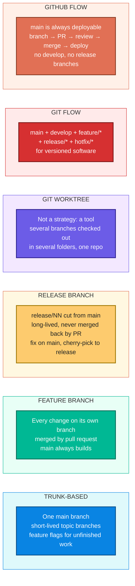
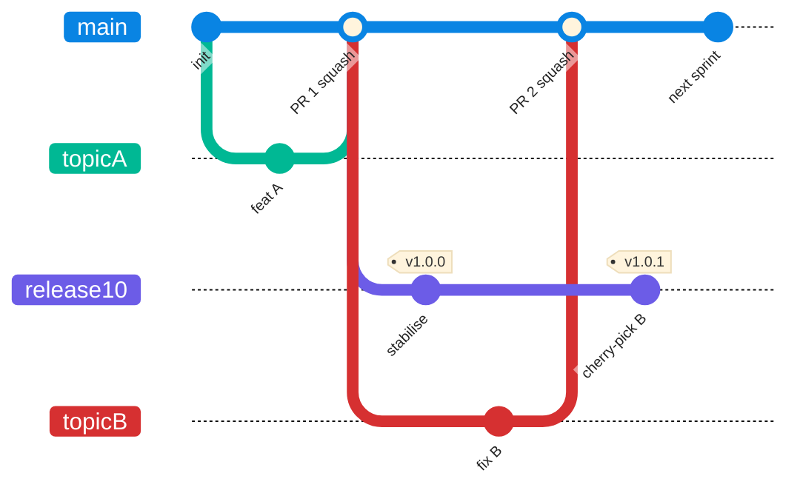
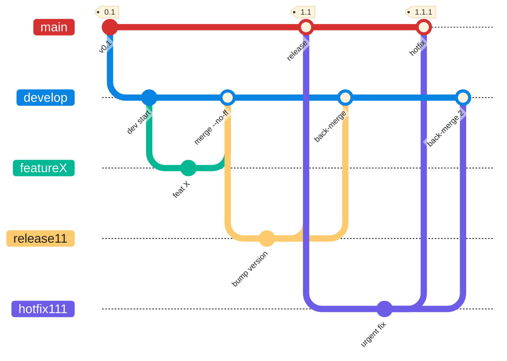
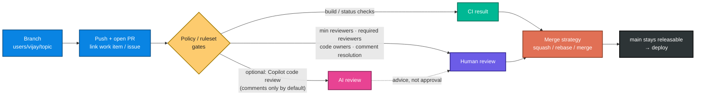
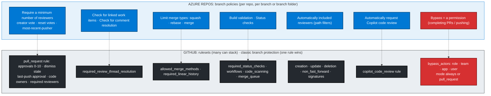
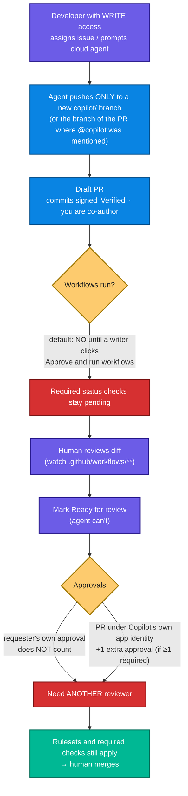

# Day 4 (Fri 27 Nov 2026): Branching strategies, PR workflows, branch policies vs rulesets & Copilot agent PR rules

**Domain 2: Design and implement a source control strategy (10–15%)**
Study-guide bullets covered today, all under *Design and implement branching strategies for Azure DevOps and GitHub* ([source](https://learn.microsoft.com/en-us/credentials/certifications/resources/study-guides/az-401)):
- Design a branch strategy, including trunk-based, feature branch, release branch, Git Worktree, Git flow, and GitHub flow
- Design and implement pull request workflows by using branch policies and branch protection rules
- Implement branch merging restrictions by using branch policies and branch protection rules
- Implement branch policies and branch protection rules for GitHub Copilot

Time box: about 3 h (30 min concepts, 2 h labs, 30 min cheat sheet + questions).
Lab assets reused from Days 1–3: Azure DevOps project **`az401-lab`** (Agile process, repo `az401-lab`, work-item-linking policy on `main` from Day 1) and private GitHub repo **`vijayraavi/az401-lab-app`** with the `traceability-gate` workflow (job `require-ab-link`), the `main-traceability` ruleset (PR required, 0 approvals) and the Day 3 custom agents ([Day 1 lesson](../day-01/lesson.md), [Day 3 lesson](../day-03/lesson.md)).

> **Note on the exam.** The study guide says most questions cover generally available features, with preview features possible if commonly used ([study guide](https://learn.microsoft.com/en-us/credentials/certifications/resources/study-guides/az-401)). Two items below are still labelled **public preview** in the GitHub docs: the *additional approval for unattributed Copilot pull requests* ruleset setting and the *code coverage* rule ([available rules](https://docs.github.com/en/repositories/configuring-branches-and-merges-in-your-repository/managing-rulesets/available-rules-for-rulesets)). Copilot code review for Azure Repos became generally available on 20 Nov 2026 ([announcement](https://devblogs.microsoft.com/devops/copilot-code-reviews-for-azure-repos-is-generally-available/)).

---

## 1. Concepts

### 1.1 Six branching strategies in one picture



| Strategy | Core idea | Pick it when | Watch out for | Source |
|---|---|---|---|---|
| **Feature branch** | Develop every feature and fix on a branch off `main` (topic branch). Merge only by pull request. Keep `main` high quality and current. | Default for almost every Git team. Microsoft's "keep it simple" guidance. | Long-lived feature branches delay integration. Use **feature flags** instead. | [Git branching guidance](https://learn.microsoft.com/en-us/azure/devops/repos/git/git-branching-guidance?view=azure-devops) |
| **Trunk-based** | Short-lived topic branches, PRs merge to the main integration branch, which stays buildable. Microsoft's "Release Flow" is trunk-based. | Many developers, frequent integration, strong automated tests. | Needs fast PR validation and feature flags. | [How Microsoft develops with DevOps](https://learn.microsoft.com/en-us/devops/develop/how-microsoft-develops-devops) |
| **Release branch** | Create `release/NN` from `main` near a release or sprint end. It is long-lived and is **not** merged back to `main` by PR. Bug fixes go to the release branch by PR. | You must support more than one shipped version, or stabilise a release. | Fixes must land in **both** places. Prefer fixing on `main`, then **cherry-pick** to the release branch. | [Git branching guidance](https://learn.microsoft.com/en-us/azure/devops/repos/git/git-branching-guidance?view=azure-devops) |
| **Git Worktree** | `git worktree add` attaches extra working trees to one repository so you can check out more than one branch at a time. | Review a PR, hotfix a release or run a long test while your feature work stays untouched. Each agent task can get its own folder. | It's a Git feature, not a branching model. Git's own manual says multiple checkout is still experimental, with incomplete submodule support. | [git-worktree](https://git-scm.com/docs/git-worktree) |
| **Git flow** | `main` (releases, tagged), `develop` (integration), `feature/*`, `release/*`, `hotfix/*`. Hotfixes merge to `main` **and** `develop` (or the open release branch). | Explicitly versioned software, several versions in the wild, manual QA before release. | Its author now recommends something simpler like GitHub flow for continuously delivered web apps. Microsoft says it isn't well suited to continuous delivery. | [nvie.com (2010, note of 2020)](https://nvie.com/posts/a-successful-git-branching-model/), [Microsoft Learn](https://learn.microsoft.com/en-us/archive/blogs/technet/devops/a-git-workflow-for-continuous-delivery) |
| **GitHub flow** | Lightweight: create a branch, make changes, open a PR, address review comments, merge, delete the branch. | Continuous delivery, one production version, good CI. | Needs reliable tests. Microsoft notes the original GitHub flow deploys the PR to production **before** merge, which doesn't scale to hundreds of PRs a day. | [GitHub flow](https://docs.github.com/en/get-started/using-github/github-flow), [Release Flow blog](https://devblogs.microsoft.com/devops/release-flow-how-we-do-branching-on-the-vsts-team/) |

#### Trunk-based with release branches (Microsoft Release Flow) and Git flow, side by side





**How to read it:** in Release Flow, `main` is the only long-lived integration branch and the release branch gets **cherry-picks**. In Git flow there are two long-lived branches (`main`, `develop`) and every release or hotfix is merged **twice**. That's why the Release Flow article says Git flow has two "trunks" and so is not really trunk-based ([Release Flow](https://devblogs.microsoft.com/devops/release-flow-how-we-do-branching-on-the-vsts-team/)).

**Exam shortcuts**
- "Keep it simple": feature branches for all work, PRs into `main`, a protected `main` ([guidance](https://learn.microsoft.com/en-us/azure/devops/repos/git/git-branching-guidance?view=azure-devops)).
- Release branches: name like `release/20`, don't merge back by PR, port fixes with **cherry-pick** into a feature branch and a second PR ([guidance](https://learn.microsoft.com/en-us/azure/devops/repos/git/git-branching-guidance?view=azure-devops)).
- Long-running work? Use **feature flags**, not long-lived branches ([guidance](https://learn.microsoft.com/en-us/azure/devops/repos/git/git-branching-guidance?view=azure-devops), [Release Flow](https://learn.microsoft.com/en-us/devops/develop/how-microsoft-develops-devops)).
- Environment branches such as `deploy/performance-test` are treated like release branches. With continuous deployment, promote builds from `main` with Azure Pipelines instead ([guidance](https://learn.microsoft.com/en-us/azure/devops/repos/git/git-branching-guidance?view=azure-devops)).
- Tags vs branches for releases: Microsoft prefers release **branches** because tags are pushed separately and are easy to forget ([guidance](https://learn.microsoft.com/en-us/azure/devops/repos/git/git-branching-guidance?view=azure-devops)). Day 5 covers tags in depth.

### 1.2 Git worktree in 60 seconds

`git worktree add ../hotfix release/1.0` checks out `release/1.0` in a **linked worktree** at `../hotfix`, while your main folder stays on its own branch. Without `-b` and without a branch name, Git creates a branch named after the last path component. `-b <name>` creates a new branch, `-d`/`--detach` makes a throwaway detached HEAD, `git worktree list` shows all, and `git worktree remove` cleans up ([git-worktree](https://git-scm.com/docs/git-worktree)). A branch can't be checked out in two worktrees at once by default (use `--force` only if you know why), so each agent or each review gets its own branch and folder.

### 1.3 Pull request workflow design



Microsoft's PR guidance: two reviewers is "an optimal number based on research", share reviewer duty across the team, write enough description to bring reviewers up to speed, and keep the PR build quick so it doesn't slow the review ([guidance](https://learn.microsoft.com/en-us/azure/devops/repos/git/git-branching-guidance?view=azure-devops)). GitHub flow adds: draft PRs for early feedback, link issues with keywords, resolve comments, delete the branch after merge ([GitHub flow](https://docs.github.com/en/get-started/using-github/github-flow)).

### 1.4 Azure DevOps branch policies vs GitHub rulesets and branch protection



| Topic | Azure Repos (branch policies) | GitHub (rulesets / branch protection) |
|---|---|---|
| **Effect** | You can't delete a branch with required policies, and all changes must go through PRs ([doc](https://learn.microsoft.com/en-us/azure/devops/repos/git/branch-policies?view=azure-devops)). | Branch protection blocks force pushes and deletion by default ([doc](https://docs.github.com/en/repositories/configuring-branches-and-merges-in-your-repository/managing-protected-branches/about-protected-branches)). |
| **Scope** | One branch, or a **folder** with `--branch-match-type prefix` (for example `release/`) ([doc](https://learn.microsoft.com/en-us/azure/devops/repos/git/branch-policies?view=azure-devops)). | `fnmatch` patterns such as `releases/**/*` ([about rulesets](https://docs.github.com/en/repositories/configuring-branches-and-merges-in-your-repository/managing-rulesets/about-rulesets)). |
| **Layering** | Policies are evaluated against the **target** branch of the PR, not the source branch ([Day 1](../day-01/lesson.md)). | Several rulesets can apply to one branch and are **aggregated**, with the **most restrictive** rule winning. Only a single branch protection rule applies at a time ([about rulesets](https://docs.github.com/en/repositories/configuring-branches-and-merges-in-your-repository/managing-rulesets/about-rulesets), [protected branches](https://docs.github.com/en/repositories/configuring-branches-and-merges-in-your-repository/managing-protected-branches/about-protected-branches)). |
| **Required vs optional** | Each policy is **Required** (blocking) or **Optional** (advisory) ([doc](https://learn.microsoft.com/en-us/azure/devops/repos/git/branch-policies?view=azure-devops)). | A rule is either enforced or not. A ruleset has an enforcement status: `active` or `disabled` (`evaluate` is Enterprise-only) ([REST](https://docs.github.com/en/rest/repos/rules), [about rulesets](https://docs.github.com/en/repositories/configuring-branches-and-merges-in-your-repository/managing-rulesets/about-rulesets)). |
| **Bypass** | Two permissions: *Bypass policies when completing pull requests* and *Bypass policies when pushing* ([doc](https://learn.microsoft.com/en-us/azure/devops/repos/git/branch-policies?view=azure-devops)). | `bypass_actors` (role, team, app, user) with mode `always`, `pull_request` or `exempt`. Classic rules don't apply to admins unless you tick the option ([REST](https://docs.github.com/en/rest/repos/rules), [protected branches](https://docs.github.com/en/repositories/configuring-branches-and-merges-in-your-repository/managing-protected-branches/about-protected-branches)). |
| **Visibility** | Needs repo access. | Anyone with read access can see active rulesets. Rulesets can be switched off without deleting ([about rulesets](https://docs.github.com/en/repositories/configuring-branches-and-merges-in-your-repository/managing-rulesets/about-rulesets)). |
| **CLI / API** | `az repos policy …` (approver-count, build, comment-required, file-size, merge-strategy, required-reviewer, work-item-linking, case-enforcement, plus `create/update --config` with a file) ([reference](https://learn.microsoft.com/en-us/cli/azure/repos/policy?view=azure-cli-latest)). | `gh api repos/{o}/{r}/rulesets` (REST), `gh ruleset list/view/check` ([REST](https://docs.github.com/en/rest/repos/rules), [gh ruleset check](https://cli.github.com/manual/gh_ruleset_check)). |

**Details worth knowing (all from [Set and manage branch policies](https://learn.microsoft.com/en-us/azure/devops/repos/git/branch-policies?view=azure-devops)):**
- *Minimum reviewers*: **Allow requestors to approve their own changes** off means the creator's Approve vote doesn't count. **Prohibit the most recent pusher from approving** gives segregation of duties. **Reset all approval votes** keeps reject/wait votes, **Reset all code reviewer votes** removes everything, both when the source branch changes.
- *Merge types*: squash gives a linear history; you can allow any combination of merge, squash, rebase and rebase-merge.
- *Build validation*: needs a build pipeline first; the trigger can be automatic or manual, and the **build expiration** controls what happens when the target branch moves.
- *Required reviewers path filters*: a filter that doesn't start with `/` or a wildcard has **no effect**.
- Requirements to edit policies: **Project Administrators**, or the repo-level **Edit policies** permission.

**GitHub ruleset rule details (from [available rules](https://docs.github.com/en/repositories/configuring-branches-and-merges-in-your-repository/managing-rulesets/available-rules-for-rulesets)):**
- *Require a pull request*: up to 10 approvals, optional dismiss-stale, code-owner review, **approval from someone other than the last pusher**, resolve all conversations, restrict merge types, and up to 15 *required reviewer* teams by file pattern (organisation-owned repos only).
- *Require status checks*: **strict** (branch must be up to date) vs **loose**; you can pin the expected GitHub App as the source.
- *Block force pushes* and *Restrict deletions* are selected by default in the UI.
- *Merge queue*: validates each PR against the latest base plus the PRs ahead of it, and your workflows must listen to the **`merge_group`** event ([merge queue](https://docs.github.com/en/repositories/configuring-branches-and-merges-in-your-repository/configuring-pull-request-merges/managing-a-merge-queue)). Not part of today's labs.
- *Copilot code review* is a ruleset rule (**Automatically request Copilot code review**) with optional *Review new pushes* and *Review draft pull requests* ([configure code review](https://docs.github.com/en/copilot/how-tos/copilot-on-github/set-up-copilot/configure-code-review)). In REST it's `{"type":"copilot_code_review","parameters":{"review_on_push":…,"review_draft_pull_requests":…}}` ([REST](https://docs.github.com/en/rest/repos/rules)).

### 1.5 Branch policies and protection rules for GitHub Copilot



Built-in protections of the Copilot cloud agent ([risks and mitigations](https://docs.github.com/en/copilot/concepts/agents/cloud-agent/risks-and-mitigations)):

| Rule | What it means for your branch protection design |
|---|---|
| **Only users with write access** can trigger the agent | Comments from users without write access are never shown to the agent. |
| **One branch only** | New `copilot/` branch, or the PR branch when you mention `@copilot` on an existing PR. The agent is **subject to branch protections and required checks**. Target `copilot/**` in a ruleset if you want extra rules for agent branches. |
| **Limited credentials** | It can only do simple pushes, not run `git push` or other Git commands itself. |
| **Human merges** | Draft PRs must be reviewed and merged by a human. The agent can't mark them ready, approve, or merge. |
| **Workflows wait for approval** | A writer must click **Approve and run workflows**. Repo admins can switch this off under **Settings → Copilot → cloud agent → Require approval for workflow runs**, but GitHub warns it may let unreviewed code reach write access or Actions secrets ([settings](https://docs.github.com/en/copilot/how-tos/use-copilot-agents/cloud-agent/configuring-agent-settings), [review output](https://docs.github.com/en/copilot/how-tos/copilot-on-github/use-copilot-agents/review-copilot-output)). Required checks from those workflows stay pending until then. |
| **Requester can't approve** | If PR approvals are required, another reviewer must approve ([review output](https://docs.github.com/en/copilot/how-tos/copilot-on-github/use-copilot-agents/review-copilot-output)). |
| **Extra approval for unattributed PRs** | When Copilot opens a PR under its own app identity (for example prompted from a shared Slack or Teams thread), one **more** approval than configured is required, if at least one is required. Default **on** in rulesets (**public preview**, admins can turn it off), **always** applies to classic branch protection. REST name: `require_extra_approval_for_unattributed_changes` ([available rules](https://docs.github.com/en/repositories/configuring-branches-and-merges-in-your-repository/managing-rulesets/available-rules-for-rulesets), [REST](https://docs.github.com/en/rest/repos/rules)). |
| **Traceable** | Commits are authored by Copilot with you as co-author, are signed (Verified), and link to the session log. |
| **Built-in validation** | By default the agent runs CodeQL, dependency checks against the GitHub Advisory Database and secret scanning, and gets a Copilot code review. This doesn't need a GitHub Advanced Security licence ([risks and mitigations](https://docs.github.com/en/copilot/concepts/agents/cloud-agent/risks-and-mitigations)). |

**Copilot code review is not an approval by default**, on either platform:
- GitHub: "By default, Copilot's reviews do not count toward required approvals." When Copilot approvals are enabled at repository, organisation and enterprise level, Copilot can submit an approving review that counts. A new push dismisses it ([Copilot code review](https://docs.github.com/en/copilot/concepts/agents/code-review)).
- Azure Repos: Copilot "always leaves a Comment review. It never approves the pull request or requests changes, so its review doesn't satisfy required-reviewer policies and doesn't block merging." It doesn't re-review on new commits automatically ([Learn](https://learn.microsoft.com/en-us/azure/devops/repos/git/copilot-code-reviews?view=azure-devops)). GA announcement: "Copilot does not approve pull requests or block merges" ([blog](https://devblogs.microsoft.com/devops/copilot-code-reviews-for-azure-repos-is-generally-available/)).
- Azure Repos setup: enable it under **Organization settings → Repos → Repositories** (Project Collection Administrator), then add the branch policy **Automatically request Copilot code review** on each target branch. Enabling the feature and the automatic policy are separate. Reviews run as Azure Pipelines jobs on the org's default agent pool, and self-hosted agents aren't supported ([Learn](https://learn.microsoft.com/en-us/azure/devops/repos/git/copilot-code-reviews?view=azure-devops), [blog](https://devblogs.microsoft.com/devops/copilot-code-reviews-for-azure-repos-is-generally-available/)).
- GitHub setup: repository **Settings → Rules → Rulesets → New branch ruleset → Automatically request Copilot code review** ([configure code review](https://docs.github.com/en/copilot/how-tos/copilot-on-github/set-up-copilot/configure-code-review)). A PR can qualify through user settings, repository rulesets or organisation rulesets; Copilot still posts a single review.

**What about agent PRs on Azure Repos?** The native *Boards → Copilot* integration needs **GitHub repos, not Azure Repos** ([Day 3 §1.5](../day-03/lesson.md), [docs](https://learn.microsoft.com/en-us/azure/devops/boards/github/work-item-integration-github-copilot?view=azure-devops)). So the agent-PR rules above are a GitHub topic; on Azure Repos you protect against any agent or person with the same branch policies.

**Design checklist for agent-ready repos (synthesis of the sources above):**
1. Protect the default branch with a PR rule (≥1 approval) and required status checks, so agent PRs follow the same path as human PRs.
2. Keep **Require approval for workflow runs** on, and add **CODEOWNERS / required reviewers** for `.github/workflows/**` so workflow edits get an owner's review.
3. Prefer `allowed_merge_methods: ["squash"]` so each agent PR becomes one commit.
4. Add the **Copilot code review** rule as a first pass, but keep a **human approval** as the gate.
5. Remember the requester can't approve, so plan a second reviewer (or a deliberate admin bypass in a solo repo).
6. Use `bypass_mode: pull_request` for admins when you need an emergency path, so bypass applies only through PRs and is auditable.

### 1.6 What changed recently (teach current features only)

- **20 Nov 2026**: Copilot code review for Azure Repos is GA, with org/project/repo enablement, custom instructions, effort levels (Lite or Balanced default) and the automatic-review branch policy ([blog](https://devblogs.microsoft.com/devops/copilot-code-reviews-for-azure-repos-is-generally-available/)).
- **Azure DevOps sprint 281**: Copilot code review audit-log events, including changes to the automatic-review branch policy ([release notes](https://learn.microsoft.com/en-us/azure/devops/release-notes/2026/sprint-281-update)).
- **28 Oct 2026**: the new *Copilot in the cloud* experience on GitHub.com is available to paid Copilot plans ([about Copilot on GitHub.com](https://docs.github.com/en/copilot/concepts/agents/cloud-agent/about-cloud-agent)). Agent tasks can run in a cloud sandbox or an Actions-based environment. The risk controls above are documented for the cloud agent.
- **GitHub REST API version** shown in the current rules docs: `X-GitHub-Api-Version: 2026-03-10` ([REST](https://docs.github.com/en/rest/repos/rules)). `gh api` works without it.
- **Rules you may see in the UI**: code quality, code coverage (preview), license compliance and secret-scanning merge protection ([available rules](https://docs.github.com/en/repositories/configuring-branches-and-merges-in-your-repository/managing-rulesets/available-rules-for-rulesets)).

---

## 2. Hands-on labs (about 2 h 10 min, about ₹0 plus optional Copilot usage)

Three labs: **A** practise the strategies locally (no accounts), **B** Azure DevOps branch policies with `az repos policy`, **C** GitHub rulesets with `gh api` plus a Copilot-authored PR review flow. Labs B and C only **create or change settings** on your own lab project and repo. Nothing creates a billable Azure resource, and nothing in the labs deletes one. Optional cleanup commands at the end remove today's policies, rulesets and branches. Run them yourself.

### Prerequisites

Today reuses the Day 1–3 assets. If you deleted `az401-lab` or `az401-lab-app`, re-run Day 1 Labs B and C first.

#### Accounts and licences

| Account | What you need | Why |
|---|---|---|
| **Azure DevOps organization** | The **Entra-backed** org from Day 1 with project `az401-lab` (Agile) and repo `az401-lab`. **Basic** access level. | Lab B. Branch policies are free. |
| **Azure subscription** | Your personal MCT-benefit subscription is only used to sign in (`az login`). **No Azure resources are created.** | The `az devops` commands use your Entra sign-in; the subscription isn't touched. |
| **GitHub account** | Owner of `vijayraavi/az401-lab-app` (private). Rulesets on a private repo need a plan that supports them. Your Day 1 ruleset proves yours does. | Lab C. |
| **GitHub Copilot** | A paid plan (Pro/Pro+/Business/Enterprise) with the cloud agent enabled, as in Day 3 Lab C. | Lab C steps 6–7 (cloud agent task and the Copilot code review rule). Skip those steps if you're out of premium requests. |

#### Tools and minimum versions

| Tool | Minimum | Check |
|---|---|---|
| **Git** | 2.23+ (`git switch`); worktrees need 2.5+ | `git --version` |
| **Azure CLI** | Current 2.x. The `az repos policy` reference notes "azure-devops extension for the Azure CLI (version 2.92.0 or higher)" ([reference](https://learn.microsoft.com/en-us/cli/azure/repos/policy?view=azure-cli-latest)). The extension installs on first use. | `az version` |
| **GitHub CLI (`gh`)** | A current release. `gh ruleset` and the Day 3 `gh agent-task` command must exist. | `gh --version` |
| **PowerShell** | 7.x (`pwsh`) on Windows | `$PSVersionTable.PSVersion` |
| **Ubuntu** | Bash, `jq` | `jq --version` |

#### Permissions and roles

| Where | Role | Needed for |
|---|---|---|
| ADO project `az401-lab` | **Project Administrators**, or repo-level **Edit policies** ([doc](https://learn.microsoft.com/en-us/azure/devops/repos/git/branch-policies?view=azure-devops)) | Creating and deleting branch policies (Lab B). **Contribute** + **Create branch** for the PR test. |
| ADO org | **Project Collection Administrator** (only for the optional Copilot code review switch) | Lab B step 6 ([Learn](https://learn.microsoft.com/en-us/azure/devops/repos/git/copilot-code-reviews?view=azure-devops)). |
| GitHub `az401-lab-app` | **Admin** (owner) | Creating rulesets and changing branch protection ([available rules](https://docs.github.com/en/repositories/configuring-branches-and-merges-in-your-repository/managing-rulesets/available-rules-for-rulesets)). Repo admins also set the workflow-approval policy for the agent. |

#### Sign-in and environment

- `az login` with the Entra identity that's a member of the org, then `az devops configure --defaults organization="https://dev.azure.com/<org>" project=az401-lab` so later commands can omit `--organization` and `--project` ([doc](https://learn.microsoft.com/en-us/azure/devops/repos/git/branch-policies?view=azure-devops)).
- `gh auth login` (github.com). Your Day 1 token already has `repo` and `workflow`. Managing rulesets over REST needs repo admin on that account.
- Set `git config user.name` and `git config user.email` once (global).

| Variable (PowerShell / bash) | Set in | Meaning |
|---|---|---|
| `$org` / `ORG` | Verify block | Azure DevOps org name (replace `<org>`). |
| `$proj` / `PROJ` | Verify block | `az401-lab`. |
| `$repo` / `REPO` | Verify block | `vijayraavi/az401-lab-app`. |
| `$repoId` / `REPO_ID` | Lab B, step 1 | GUID of the ADO repo (policy commands need the ID, not the name). |
| `$wi` / `WI` | Lab B, step 7 | ID of a user story for the `AB#` link and the ADO work-item-linking policy. |
| `$rsMain`, `$rsCopilot`, `$rsRelease` / `RS_MAIN`, `RS_COPILOT`, `RS_RELEASE` | Lab C, step 2 | IDs of the three GitHub rulesets you create. |

#### Earlier lab outputs this day depends on

| From | Used today |
|---|---|
| Day 1: project **`az401-lab`** with repo `az401-lab`, work-item-linking policy on `main` | Lab B (the policy list should already show it) |
| Day 1: **`vijayraavi/az401-lab-app`**, `traceability-gate` workflow, `main-traceability` ruleset (0 approvals, no bypass) | Lab C stacks new rulesets on top and shows layering. The PR body needs `AB#<id>` to pass `require-ab-link`. |
| Day 3: custom agents and `gh agent-task` | Lab C step 7 (Copilot-authored PR) |

#### Verify prerequisites

Replace `<org>` first.

**PowerShell**
```powershell
# Lab-wide variables. Replace <org> with your Entra-backed Azure DevOps org name.
$org = "<org>"; $proj = "az401-lab"; $repo = "vijayraavi/az401-lab-app"
# Tool versions: Git (2.23+), Azure CLI and the azure-devops extension, GitHub CLI.
git --version; az version --query '{cli:"azure-cli", ext:extensions}' -o json; gh --version
# Signed-in Azure identity and tenant (must be the tenant behind the ADO org).
az account show --query '{user:user.name, tenant:tenantId}' -o table
# Day 1 project and repo exist (also proves the org name and sign-in are right).
az repos list --organization "https://dev.azure.com/$org" --project $proj --query "[].{name:name, id:id}" -o table
# gh is signed in, and the Day 1 repo exists. Visibility should be PRIVATE.
gh repo view $repo --json nameWithOwner,visibility
# Day 1 ruleset is still there (name main-traceability, enforcement active).
gh api "repos/$repo/rulesets" --jq '.[] | {id, name, enforcement}'
# gh ruleset subcommand and agent-task exist (Day 3).
gh ruleset --help | Select-Object -First 3; gh agent-task --help | Select-Object -First 3
```

**Ubuntu (bash)**
```bash
# Lab-wide variables. Replace <org> with your Entra-backed Azure DevOps org name.
ORG="<org>"; PROJ=az401-lab; REPO=vijayraavi/az401-lab-app
# Tool versions: Git (2.23+), Azure CLI and the azure-devops extension, GitHub CLI.
git --version; az version --query '{cli:"azure-cli", ext:extensions}' -o json; gh --version
# Signed-in Azure identity and tenant (must be the tenant behind the ADO org).
az account show --query '{user:user.name, tenant:tenantId}' -o table
# Day 1 project and repo exist (also proves the org name and sign-in are right).
az repos list --organization "https://dev.azure.com/$ORG" --project "$PROJ" --query "[].{name:name, id:id}" -o table
# gh is signed in, and the Day 1 repo exists. Visibility should be PRIVATE.
gh repo view "$REPO" --json nameWithOwner,visibility
# Day 1 ruleset is still there (name main-traceability, enforcement active).
gh api "repos/$REPO/rulesets" --jq '.[] | {id, name, enforcement}'
# gh ruleset subcommand and agent-task exist (Day 3).
gh ruleset --help | head -3; gh agent-task --help | head -3
```

**Expected result:** Git 2.23 or newer, `az` and `gh` print versions, the repo list shows `az401-lab`, `gh repo view` shows `"visibility":"PRIVATE"`, and the ruleset list shows `main-traceability` with `"enforcement":"active"`. If `az repos list` fails, fix `<org>` and run `az login`. If `gh ruleset` is unknown, update `gh`.

---

### Lab A: Practise trunk, release branch, cherry-pick and worktree in a scratch repo (25 min, no accounts)

**Lab-specific prerequisites:** Git 2.23+ and a user name/email configured. Nothing is pushed anywhere. Everything lives in `az401-day4-scratch` under your home folder.

#### Step 1: Create a scratch trunk with one commit

**Goal:** Start a local repo whose default branch is `main`.
**Why:** The exam asks you to *design a branch strategy*. A scratch repo lets you see the shapes from §1.1 without risk ([Git branching guidance](https://learn.microsoft.com/en-us/azure/devops/repos/git/git-branching-guidance?view=azure-devops)).

**Works in both**
```bash
# Go to your home folder. "~" works in pwsh and bash.
cd ~
# git init creates missing parent folders. -b main names the first branch main (no master/main drift).
git init -b main az401-day4-scratch/trunk-demo
# Enter the new repo (forward slashes work in both shells).
cd az401-day4-scratch/trunk-demo
```

**PowerShell**
```powershell
# Create README.md as UTF-8 (PowerShell 7 default for Set-Content).
Set-Content -Path README.md -Value "# trunk-demo"
```

**Ubuntu (bash)**
```bash
# Create README.md. ">" overwrites the file.
echo "# trunk-demo" > README.md
```

**Works in both**
```bash
# Stage and commit the first commit on main.
git add README.md
git commit -m "init trunk"
```

**Expected result:** `[main (root-commit) …] init trunk`.
**Common errors:** "Please tell me who you are" means `user.name`/`user.email` aren't set. Run `git config --global user.name "Vijay Raavi"` and `git config --global user.email "<you@example.com>"`.

#### Step 2: Feature branch → squash merge (what a PR "squash" does)

**Goal:** Create a short-lived topic branch and land it on `main` as one commit.
**Why:** Feature branches plus a protected `main` are Microsoft's baseline. Squash merge is the same result as the PR option and gives a linear history ([branch policies: merge types](https://learn.microsoft.com/en-us/azure/devops/repos/git/branch-policies?view=azure-devops)).

**PowerShell**
```powershell
# New topic branch, named by convention feature/<name>. -c creates it and switches to it.
git switch -c feature/login
# Add a file on the branch.
Set-Content -Path login.txt -Value "login v1"
```

**Ubuntu (bash)**
```bash
# New topic branch, named by convention feature/<name>. -c creates it and switches to it.
git switch -c feature/login
# Add a file on the branch.
echo "login v1" > login.txt
```

**Works in both**
```bash
# Commit the work on the topic branch.
git add login.txt
git commit -m "feat: login"
# Return to trunk, then fold the branch in as ONE commit (--squash stages it, the commit records it).
git switch main
git merge --squash feature/login
git commit -m "feat: login (#1)"
# -D is required: after a squash Git can't tell the branch was merged, so -d refuses.
git branch -D feature/login
```

**Expected result:** `main` has two commits and `login.txt`. **Common errors:** `git branch -d` says "not fully merged": that's the squash. Use `-D` only after checking the content is on `main`.

#### Step 3: Cut a release branch and tag it

**Goal:** Create `release/1.0` from `main`.
**Why:** Release branches are long-lived and aren't merged back to `main` by PR ([guidance](https://learn.microsoft.com/en-us/azure/devops/repos/git/git-branching-guidance?view=azure-devops)). The tag marks the shipped commit.

**Works in both**
```bash
# Create the release branch from current main and switch to it.
git switch -c release/1.0
# Annotated tag (-a) with a message (-m) on the release commit.
git tag -a v1.0.0 -m "release 1.0.0"
# Back to trunk for ongoing work.
git switch main
```

**Expected result:** `git branch` lists `main` and `release/1.0`; `git tag` lists `v1.0.0`.

#### Step 4: Fix on `main` first, then cherry-pick into the release (using a worktree)

**Goal:** Ship a hotfix on `release/1.0` without leaving your `main` folder.
**Why:** The Release Flow rule is to fix the mainline, then **cherry-pick** to the release branch. A worktree gives the release its own folder ([guidance](https://learn.microsoft.com/en-us/azure/devops/repos/git/git-branching-guidance?view=azure-devops), [git-worktree](https://git-scm.com/docs/git-worktree)).

**PowerShell**
```powershell
# Topic branch for the fix.
git switch -c bugfix/null-check
# The fix.
Set-Content -Path fix.txt -Value "null check"
```

**Ubuntu (bash)**
```bash
# Topic branch for the fix.
git switch -c bugfix/null-check
# The fix.
echo "null check" > fix.txt
```

**Works in both**
```bash
# Commit, then squash-merge onto main like a PR would.
git add fix.txt
git commit -m "fix: null check"
git switch main
git merge --squash bugfix/null-check
git commit -m "fix: null check (#2)"
git branch -D bugfix/null-check
```

**PowerShell**
```powershell
# Remember the fix commit ID on main (git rev-parse HEAD prints it).
$fix = (git rev-parse HEAD).Trim()
```

**Ubuntu (bash)**
```bash
# Remember the fix commit ID on main (git rev-parse HEAD prints it).
FIX=$(git rev-parse HEAD)
```

**PowerShell**
```powershell
# Linked worktree: check out release/1.0 in a sibling folder. A branch can only be checked out in one worktree.
git worktree add ../trunk-demo-release release/1.0
# Go there, copy the fix with -x (adds "(cherry picked from commit …)" to the message for traceability).
Set-Location ../trunk-demo-release
git cherry-pick -x $fix
```

**Ubuntu (bash)**
```bash
# Linked worktree: check out release/1.0 in a sibling folder. A branch can only be checked out in one worktree.
git worktree add ../trunk-demo-release release/1.0
# Go there, copy the fix with -x (adds "(cherry picked from commit …)" to the message for traceability).
cd ../trunk-demo-release
git cherry-pick -x "$FIX"
```

**Works in both**
```bash
# Tag the patch release on the release branch.
git tag -a v1.0.1 -m "hotfix 1.0.1"
# Return to the main worktree and remove the linked one (only clean worktrees can be removed).
cd ../trunk-demo
git worktree remove ../trunk-demo-release
# Show the history of every branch as a graph with branch and tag names.
git log --oneline --graph --all --decorate
```

**Expected result:** The graph shows `main` with the fix, and `release/1.0` forking at the first release commit with its own copy of the fix tagged `v1.0.1`. `git worktree list` shows only the main folder after removal.
**Common errors:** "already checked out at …" means that branch is open in another worktree. Remove or move it, don't use `--force`. A conflict during `cherry-pick` means the release diverged. Fix, `git add`, then `git cherry-pick --continue`.

#### Step 5: One worktree per agent task

**Goal:** Give an AI agent (or a reviewer) a private folder on its own branch.
**Why:** Parallel tasks don't trample each other's working directory, and each branch maps to one PR. `-b` creates the branch in the same command ([git-worktree](https://git-scm.com/docs/git-worktree)).

**Works in both**
```bash
# New branch feature/agent-task checked out in a new sibling folder (-b creates the branch).
git worktree add -b feature/agent-task ../trunk-demo-agent
# List all worktrees with their branch and commit.
git worktree list
# Remove the worktree, then the branch (it holds no unique commits).
git worktree remove ../trunk-demo-agent
git branch -D feature/agent-task
```

#### Verify Lab A

**Works in both**
```bash
# Expect branches main and release/1.0, tags v1.0.0 and v1.0.1, and one worktree.
git branch; git tag; git worktree list
```

**Cleanup (local only):** run it after Lab C if you want to keep the repo to explore. It removes only the scratch folder.

**PowerShell**
```powershell
# Leave the repo, then delete the scratch folder. -Recurse -Force removes the folder and its .git; -Path is under your home folder only.
Set-Location ~
Remove-Item -Recurse -Force -Path ~/az401-day4-scratch
```

**Ubuntu (bash)**
```bash
# Leave the repo, then delete the scratch folder. -r recursive, -f no prompts; the path is under your home folder only.
cd ~
rm -rf ~/az401-day4-scratch
```

---

### Lab B: Azure DevOps branch policies with `az repos policy`, then prove them with a PR (45 min, ₹0)

**Lab-specific prerequisites:** ADO repo `az401-lab` has a `main` branch and the Day 1 **work-item-linking** policy. You're a Project Administrator (or have Edit policies). Run `az login` first.

#### Step 1: Sign in, pin defaults and read what's already on `main`

**Goal:** Know the repo ID and the current policy list before changing anything.
**Why:** The policy commands take `--repository-id` (a GUID). Listing first avoids duplicate-policy errors and shows the Day 1 policy ([policy list](https://learn.microsoft.com/en-us/azure/devops/repos/git/branch-policies?view=azure-devops)).

**PowerShell**
```powershell
# Sign in (browser). Needed for az repos / az boards.
az login
# Pin org and project so later commands can omit --organization / --project.
az devops configure --defaults organization="https://dev.azure.com/$org" project=$proj
# Repo GUID. --query id -o tsv prints only the ID; .Trim() removes the trailing newline.
$repoId = (az repos show --repository az401-lab --query id -o tsv).Trim()
# Show it.
Write-Output "REPO_ID=$repoId"
# Policies currently on main. --branch needs --repository-id. -o table is readable.
az repos policy list --repository-id $repoId --branch main -o table
```

**Ubuntu (bash)**
```bash
# Sign in (browser or device code). Needed for az repos / az boards.
az login
# Pin org and project so later commands can omit --organization / --project.
az devops configure --defaults organization="https://dev.azure.com/$ORG" project="$PROJ"
# Repo GUID. --query id -o tsv prints only the ID.
REPO_ID=$(az repos show --repository az401-lab --query id -o tsv)
# Show it.
echo "REPO_ID=$REPO_ID"
# Policies currently on main. --branch needs --repository-id. -o table is readable.
az repos policy list --repository-id "$REPO_ID" --branch main -o table
```

**Expected result:** A GUID, and a table with at least `Work item linking | True | True | … | refs/heads/main`.
**Portal path:** **Repos → Branches → … on `main` → Branch policies**, or **Project settings → Repositories → az401-lab → Policies → Branch Policies**.
**Common errors:** `az repos show` prompts for extension install: accept. "TF400813 not authorized": you signed in with a different tenant, use `az login --tenant <tenant-id>`.

#### Step 2: Require reviewers on `main` (approver-count policy)

**Goal:** Require 1 approval, reset approvals when new code is pushed, and keep the downvote behaviour off.
**Why:** *Require a minimum number of reviewers* is the core PR-workflow policy ([doc](https://learn.microsoft.com/en-us/azure/devops/repos/git/branch-policies?view=azure-devops)). `--creator-vote-counts true` lets you, a solo developer, satisfy it. In a team, set it to `false` so the author's vote doesn't count (the portal option *Allow requestors to approve their own changes*). `--reset-on-source-push true` is the CLI form of *Reset all approval votes*.

**PowerShell**
```powershell
# One approval is required. --blocking true = Required. --branch main with the default exact match.
# --creator-vote-counts true lets the author's own approval count (solo lab only).
# --reset-on-source-push true clears approve votes whenever the source branch changes.
az repos policy approver-count create `
  --repository-id $repoId --branch main `
  --blocking true --enabled true `
  --minimum-approver-count 1 --creator-vote-counts true `
  --allow-downvotes false --reset-on-source-push true
```

**Ubuntu (bash)**
```bash
# One approval is required. --blocking true = Required. --branch main with the default exact match.
# --creator-vote-counts true lets the author's own approval count (solo lab only).
# --reset-on-source-push true clears approve votes whenever the source branch changes.
az repos policy approver-count create \
  --repository-id "$REPO_ID" --branch main \
  --blocking true --enabled true \
  --minimum-approver-count 1 --creator-vote-counts true \
  --allow-downvotes false --reset-on-source-push true
```

**Expected result:** JSON with `"isBlocking": true`, `"isEnabled": true`, `"minimumApproverCount": 1`.
**Portal path:** Branch policies → **Require a minimum number of reviewers**.
**Common errors:** "policy already exists": use `az repos policy approver-count update --id <id> …` with the ID from the list. The "Prohibit the most recent pusher" option has no flag on this command. Set it in the portal or with `az repos policy update --config` ([reference](https://learn.microsoft.com/en-us/cli/azure/repos/policy?view=azure-cli-latest)).

#### Step 3: Require comment resolution and limit merge types to squash

**Goal:** Block completion while comments are open, and allow only squash merges.
**Why:** *Check for comment resolution* and *Limit merge types* are the two "merge restriction" policies the skill names. Squash gives a linear history ([doc](https://learn.microsoft.com/en-us/azure/devops/repos/git/branch-policies?view=azure-devops)).

**PowerShell**
```powershell
# Required comment-resolution policy on main.
az repos policy comment-required create --repository-id $repoId --branch main --blocking true --enabled true
# Merge-strategy policy: only squash allowed (other merge types default to not allowed).
az repos policy merge-strategy create --repository-id $repoId --branch main `
  --blocking true --enabled true --allow-squash true
```

**Ubuntu (bash)**
```bash
# Required comment-resolution policy on main.
az repos policy comment-required create --repository-id "$REPO_ID" --branch main --blocking true --enabled true
# Merge-strategy policy: only squash allowed (other merge types default to not allowed).
az repos policy merge-strategy create --repository-id "$REPO_ID" --branch main \
  --blocking true --enabled true --allow-squash true
```

**Expected result:** Two JSON documents, each with `"isBlocking": true`. The list shows *Comment requirements* and *Require a merge strategy*.
**Portal path:** **Check for comment resolution**, **Limit merge types**.

#### Step 4: One policy for every `release/` branch (prefix match)

**Goal:** Protect a whole branch folder with one policy.
**Why:** Release branches are long-lived, so they need protection too. `--branch-match-type prefix` applies a policy across a folder such as `release/`. Use `exact` for a single branch ([doc](https://learn.microsoft.com/en-us/azure/devops/repos/git/branch-policies?view=azure-devops)).

**PowerShell**
```powershell
# Two approvals on any branch under release/. prefix = folder match.
az repos policy approver-count create `
  --repository-id $repoId --branch release/ --branch-match-type prefix `
  --blocking true --enabled true `
  --minimum-approver-count 2 --creator-vote-counts false `
  --allow-downvotes false --reset-on-source-push true
```

**Ubuntu (bash)**
```bash
# Two approvals on any branch under release/. prefix = folder match.
az repos policy approver-count create \
  --repository-id "$REPO_ID" --branch release/ --branch-match-type prefix \
  --blocking true --enabled true \
  --minimum-approver-count 2 --creator-vote-counts false \
  --allow-downvotes false --reset-on-source-push true
```

**Expected result:** A policy whose `scope` shows the `release` folder with a prefix match. You won't open PRs to `release/` today, so it can't block you.
**Common errors:** If it's created as `Exact`, you omitted `--branch-match-type prefix`. Update it with `az repos policy approver-count update --id <id> --branch-match-type prefix`.

#### Step 5 (optional): Build validation

**Goal:** Require a passing pipeline for PRs into `main`.
**Why:** Build validation is how a PR proves it compiles and tests. It needs a pipeline definition first ([doc](https://learn.microsoft.com/en-us/azure/devops/repos/git/branch-policies?view=azure-devops)). The earlier days didn't create one, so skip this step if you have none. A new org may also need free parallel jobs granted before hosted agents run.

**PowerShell**
```powershell
# List pipelines to get a definition ID (empty list = skip this step).
az pipelines list --query "[].{id:id, name:name}" -o table
# Set the definition ID (replace <id>). --manual-queue-only false = automatic; --valid-duration 0 = expire when main changes.
$buildId = "<id>"
az repos policy build create --repository-id $repoId --branch main --blocking true --enabled true `
  --build-definition-id $buildId --display-name "PR build" `
  --manual-queue-only false --queue-on-source-update-only false --valid-duration 0
```

**Ubuntu (bash)**
```bash
# List pipelines to get a definition ID (empty list = skip this step).
az pipelines list --query "[].{id:id, name:name}" -o table
# Set the definition ID (replace <id>). --manual-queue-only false = automatic; --valid-duration 0 = expire when main changes.
BUILD_ID="<id>"
az repos policy build create --repository-id "$REPO_ID" --branch main --blocking true --enabled true \
  --build-definition-id "$BUILD_ID" --display-name "PR build" \
  --manual-queue-only false --queue-on-source-update-only false --valid-duration 0
```

**Expected result:** A *PR build* policy appears in the list.

#### Step 6 (optional, portal): Automatically request Copilot code review

**Goal:** Add GitHub Copilot as an automatic first reviewer on `main`.
**Why:** The exam skill covers branch policies *for GitHub Copilot*. In Azure Repos that's the **Automatically request Copilot code review** branch policy. Copilot's review is advisory only ([Learn](https://learn.microsoft.com/en-us/azure/devops/repos/git/copilot-code-reviews?view=azure-devops)). The `az repos policy` reference has no command for this policy, so use the portal.

1. As a Project Collection Administrator: **Organization settings → Repos → Repositories** → turn **Copilot Code Review** on for the org, project and repo (see the Learn page for the exact switches). Usage is billed. Check pricing before enabling.
2. **Repos → Branches → … on `main` → Branch policies → Automatically request Copilot code review → On**.
3. Open a PR later and look under **Reviewers** for *GitHub Copilot*.

**Expected result:** Each new PR gets a *GitHub Copilot* reviewer with a **Comment** review. It doesn't block completion or satisfy the reviewer policy.
**Common errors:** No Copilot reviewer appears if the feature is only enabled at one scope or the org lacks Copilot billing. Remember: enabling the feature and adding the branch policy are separate settings.

#### Step 7: Prove it: direct push fails, PR passes

**Goal:** Watch the policies work end to end.
**Why:** The exam tests the *effect* of policies: a direct push is rejected, a PR needs the linked work item, and completion follows the allowed merge type ([doc](https://learn.microsoft.com/en-us/azure/devops/repos/git/branch-policies?view=azure-devops)).

**PowerShell**
```powershell
# Create a story to link (policy: work item linking). --query id -o tsv gives only the ID.
$wi = (az boards work-item create --title "Day 4 policy test" --type "User Story" --query id -o tsv).Trim()
# Show it.
Write-Output "WI=$wi"
# Clone the ADO repo once (skip if the az401-lab folder exists), then enter it. Use ~/ so paths are predictable.
Set-Location ~
if (-not (Test-Path az401-lab)) { git clone "https://dev.azure.com/$org/$proj/_git/az401-lab" }
Set-Location az401-lab
# Make sure we start from the latest main.
git switch main; git pull
```

**Ubuntu (bash)**
```bash
# Create a story to link (policy: work item linking). --query id -o tsv gives only the ID.
WI=$(az boards work-item create --title "Day 4 policy test" --type "User Story" --query id -o tsv)
# Show it.
echo "WI=$WI"
# Clone the ADO repo once (skip if the az401-lab folder exists), then enter it. Use ~/ so paths are predictable.
cd ~
[ -d az401-lab ] || git clone "https://dev.azure.com/$ORG/$PROJ/_git/az401-lab"
cd az401-lab
# Make sure we start from the latest main.
git switch main && git pull
```

**Works in both**
```bash
# Try a direct push to main. An empty commit is harmless. Expect rejection (TF402455: pushes must use a pull request).
git commit --allow-empty -m "direct push test"
git push origin main
# Drop the local test commit whatever happened. HEAD~1 = the commit just made; --hard resets files too (nothing else is uncommitted).
git reset --hard HEAD~1
```

**Expected result:** The push is **rejected** with a message that the branch is protected by policy and you must use a PR. If it succeeds, your identity has *Bypass policies when pushing* (see **Project settings → Repositories → Security**). Revert with a PR, and use a test user to see the block.

**PowerShell**
```powershell
# Short-lived topic branch (users/<name>/<topic> is Microsoft's naming example).
git switch -c users/vijay/day4-policy-test
# A tiny change.
Set-Content -Path policy-test.md -Value "Day 4 policy test"
# Commit with AB# so the story is also linked from the commit message.
git add policy-test.md
git commit -m "docs: day 4 policy test AB#$wi"
git push -u origin users/vijay/day4-policy-test
# Create the PR. --work-items links the story (satisfies work-item-linking). --query pullRequestId -o tsv keeps only the ID.
$pr = (az repos pr create --source-branch users/vijay/day4-policy-test --target-branch main `
  --title "Day 4 policy test" --description "Tests branch policies" --work-items $wi `
  --query pullRequestId -o tsv).Trim()
# Show the PR and its policy evaluations (status shows queued/running/approved/rejected/notApplicable).
Write-Output "PR=$pr"
az repos pr policy list --id $pr -o table
```

**Ubuntu (bash)**
```bash
# Short-lived topic branch (users/<name>/<topic> is Microsoft's naming example).
git switch -c users/vijay/day4-policy-test
# A tiny change.
echo "Day 4 policy test" > policy-test.md
# Commit with AB# so the story is also linked from the commit message.
git add policy-test.md
git commit -m "docs: day 4 policy test AB#$WI"
git push -u origin users/vijay/day4-policy-test
# Create the PR. --work-items links the story (satisfies work-item-linking). --query pullRequestId -o tsv keeps only the ID.
PR=$(az repos pr create --source-branch users/vijay/day4-policy-test --target-branch main \
  --title "Day 4 policy test" --description "Tests branch policies" --work-items "$WI" \
  --query pullRequestId -o tsv)
# Show the PR and its policy evaluations (status shows queued/running/approved/rejected/notApplicable).
echo "PR=$PR"
az repos pr policy list --id "$PR" -o table
```

**Expected result:** The list shows *Work item linking* **approved**, *Minimum number of reviewers* **queued/running** (waiting for approval), *Comment requirements* **approved**.

**PowerShell**
```powershell
# Approve as yourself. This counts only because --creator-vote-counts was true in step 2.
az repos pr set-vote --id $pr --vote approve
# Complete with squash (the only allowed type) and delete the source branch.
az repos pr update --id $pr --status completed --squash true --delete-source-branch true
# Confirm the final state.
az repos pr show --id $pr --query "{status:status, mergeStatus:mergeStatus}" -o table
```

**Ubuntu (bash)**
```bash
# Approve as yourself. This counts only because --creator-vote-counts was true in step 2.
az repos pr set-vote --id "$PR" --vote approve
# Complete with squash (the only allowed type) and delete the source branch.
az repos pr update --id "$PR" --status completed --squash true --delete-source-branch true
# Confirm the final state.
az repos pr show --id "$PR" --query "{status:status, mergeStatus:mergeStatus}" -o table
```

**Expected result:** `status: completed`. In the portal, **Repos → Pull requests → Completed** shows the PR with a single squash commit on `main`.
**Common errors:** Completion fails with a policy message: run `az repos pr policy list --id <pr>` and fix the failing one. "Merge type not allowed": you passed no `--squash true`. Don't use `--bypass-policy` today, it defeats the lab.

#### Verify Lab B

**PowerShell**
```powershell
# Active policies on main. Expect: Work item linking, Minimum number of reviewers, Comment requirements, Require a merge strategy (+ PR build).
az repos policy list --repository-id $repoId --branch main -o table
# All policies in the project (the release/ prefix one shows branch refs/heads/release).
az repos policy list --repository-id $repoId -o table
```

**Ubuntu (bash)**
```bash
# Active policies on main. Expect: Work item linking, Minimum number of reviewers, Comment requirements, Require a merge strategy (+ PR build).
az repos policy list --repository-id "$REPO_ID" --branch main -o table
# All policies in the project (the release/ prefix one shows branch refs/heads/release).
az repos policy list --repository-id "$REPO_ID" -o table
```

---

### Lab C: GitHub rulesets with `gh api`, then review a Copilot-authored PR (60 min, ₹0 plus Copilot premium requests)

**Lab-specific prerequisites:** Admin on `vijayraavi/az401-lab-app`. The Day 1 ruleset `main-traceability` is active. For steps 6–7 you need Copilot with the cloud agent enabled (Day 3 Lab C). Run these from a clone of `az401-lab-app` (Day 1: `gh repo clone vijayraavi/az401-lab-app`). Set `$repo` / `REPO` as in the verify block.

> **Design for a solo repo.** One person can't approve their own PR, and the person who asked Copilot for a PR can't approve it either. So today's `main-pr-review` ruleset requires **1 approval** and lets the repository **Admin** role bypass **only through pull requests** (`bypass_mode: pull_request`). In a team you'd remove the bypass and use a second reviewer.

#### Step 1: Go to the clone, update `main`, and see the current rules

**Goal:** Start from a clean, current clone and read the active rules for `main`.
**Why:** `GET /repos/{o}/{r}/rules/branches/{branch}` returns **all active rules** that apply to a branch, whatever level they're configured at ([REST](https://docs.github.com/en/rest/repos/rules)). `gh ruleset check` shows the same in the terminal ([gh ruleset check](https://cli.github.com/manual/gh_ruleset_check)).

**PowerShell**
```powershell
# Enter the clone (create it if missing) and get the latest main. Use ~/ so the path is predictable.
Set-Location ~
if (-not (Test-Path az401-lab-app)) { gh repo clone $repo }
Set-Location az401-lab-app
git switch main; git pull
# Rules in force for main today. Expect the Day 1 deletion, non_fast_forward, pull_request and required_status_checks rules.
gh ruleset check main -R $repo
```

**Ubuntu (bash)**
```bash
# Enter the clone (create it if missing) and get the latest main. Use ~/ so the path is predictable.
cd ~
[ -d az401-lab-app ] || gh repo clone "$REPO"
cd az401-lab-app
git switch main && git pull
# Rules in force for main today. Expect the Day 1 deletion, non_fast_forward, pull_request and required_status_checks rules.
gh ruleset check main -R "$REPO"
```

**Expected result:** A list of rules sourced from `main-traceability`.
**Common errors:** `HTTP 404` means no admin or wrong repo name. `git pull` conflicts: you had local edits, stash them.

#### Step 2: Create the `main-pr-review` ruleset (PR rule with Copilot-aware settings)

**Goal:** Require 1 approval, dismiss stale approvals, require someone other than the last pusher to approve, require resolved conversations, allow squash only.
**Why:** This is the GitHub twin of the ADO policies in Lab B. `require_extra_approval_for_unattributed_changes` is the Copilot-specific setting (default on, public preview). It makes a PR that Copilot opens under its own identity need one **more** approval ([available rules](https://docs.github.com/en/repositories/configuring-branches-and-merges-in-your-repository/managing-rulesets/available-rules-for-rulesets), [REST](https://docs.github.com/en/rest/repos/rules)). Actor ID `5` is the **Admin** repository role ([provider docs](https://registry.terraform.io/providers/integrations/github/latest/docs/resources/repository_ruleset)), and `pull_request` mode means the bypass only works through a PR ([REST](https://docs.github.com/en/rest/repos/rules)). A second ruleset on the same branch **layers** with `main-traceability`, and the most restrictive version of each rule wins ([about rulesets](https://docs.github.com/en/repositories/configuring-branches-and-merges-in-your-repository/managing-rulesets/about-rulesets)).

**PowerShell**
```powershell
# Write the ruleset JSON. @'...'@ is a literal here-string: nothing inside is expanded. -Encoding utf8 = UTF-8 without BOM in PowerShell 7.
@'
{
  "name": "main-pr-review",
  "target": "branch",
  "enforcement": "active",
  "bypass_actors": [
    { "actor_id": 5, "actor_type": "RepositoryRole", "bypass_mode": "pull_request" }
  ],
  "conditions": { "ref_name": { "include": ["~DEFAULT_BRANCH"], "exclude": [] } },
  "rules": [
    {
      "type": "pull_request",
      "parameters": {
        "required_approving_review_count": 1,
        "dismiss_stale_reviews_on_push": true,
        "require_code_owner_review": false,
        "require_last_push_approval": true,
        "required_review_thread_resolution": true,
        "require_extra_approval_for_unattributed_changes": true,
        "allowed_merge_methods": ["squash"],
        "required_reviewers": []
      }
    }
  ]
}
'@ | Set-Content -Path ruleset-main-pr-review.json -Encoding utf8
# Create it. --method POST + --input sends the file as the JSON body. --jq .id prints only the new ruleset ID.
$rsMain = (gh api --method POST "repos/$repo/rulesets" --input ruleset-main-pr-review.json --jq .id).Trim()
# Show it.
Write-Output "RS_MAIN=$rsMain"
```

**Ubuntu (bash)**
```bash
# Write the ruleset JSON. The quoted heredoc ('JSON') keeps everything literal.
cat > ruleset-main-pr-review.json <<'JSON'
{
  "name": "main-pr-review",
  "target": "branch",
  "enforcement": "active",
  "bypass_actors": [
    { "actor_id": 5, "actor_type": "RepositoryRole", "bypass_mode": "pull_request" }
  ],
  "conditions": { "ref_name": { "include": ["~DEFAULT_BRANCH"], "exclude": [] } },
  "rules": [
    {
      "type": "pull_request",
      "parameters": {
        "required_approving_review_count": 1,
        "dismiss_stale_reviews_on_push": true,
        "require_code_owner_review": false,
        "require_last_push_approval": true,
        "required_review_thread_resolution": true,
        "require_extra_approval_for_unattributed_changes": true,
        "allowed_merge_methods": ["squash"],
        "required_reviewers": []
      }
    }
  ]
}
JSON
# Create it. --method POST + --input sends the file as the JSON body. --jq .id prints only the new ruleset ID.
RS_MAIN=$(gh api --method POST "repos/$REPO/rulesets" --input ruleset-main-pr-review.json --jq .id)
# Show it.
echo "RS_MAIN=$RS_MAIN"
```

**Expected result:** A numeric ID. In the portal: **Settings → Rules → Rulesets** lists `main-pr-review` (Active) next to `main-traceability`.
**Common errors:** `422 Validation Failed`: read the `errors` text. A typo in a rule parameter is the usual cause. A `403` or `422` that mentions your plan means rulesets aren't available for this private repo on your plan. `404`: not an admin. Don't commit the JSON files if you prefer to keep them local (they hold no secrets).

#### Step 3: Add the Copilot code review rule as its own ruleset

**Goal:** Ask Copilot to review every PR into `main` automatically.
**Why:** Keeping it separate lets you flip `enforcement` to `disabled` without touching the approval rules. The rule type is `copilot_code_review` with `review_on_push` and `review_draft_pull_requests` ([REST](https://docs.github.com/en/rest/repos/rules), [configure code review](https://docs.github.com/en/copilot/how-tos/copilot-on-github/set-up-copilot/configure-code-review)). Copilot's review doesn't count toward required approvals by default ([Copilot code review](https://docs.github.com/en/copilot/concepts/agents/code-review)).

**PowerShell**
```powershell
# JSON for the Copilot review rule. Review each new push, but not drafts (cheaper).
@'
{
  "name": "main-copilot-review",
  "target": "branch",
  "enforcement": "active",
  "bypass_actors": [],
  "conditions": { "ref_name": { "include": ["~DEFAULT_BRANCH"], "exclude": [] } },
  "rules": [
    { "type": "copilot_code_review",
      "parameters": { "review_on_push": true, "review_draft_pull_requests": false } }
  ]
}
'@ | Set-Content -Path ruleset-main-copilot-review.json -Encoding utf8
# Create it and keep the ID.
$rsCopilot = (gh api --method POST "repos/$repo/rulesets" --input ruleset-main-copilot-review.json --jq .id).Trim()
# Show it.
Write-Output "RS_COPILOT=$rsCopilot"
```

**Ubuntu (bash)**
```bash
# JSON for the Copilot review rule. Review each new push, but not drafts (cheaper).
cat > ruleset-main-copilot-review.json <<'JSON'
{
  "name": "main-copilot-review",
  "target": "branch",
  "enforcement": "active",
  "bypass_actors": [],
  "conditions": { "ref_name": { "include": ["~DEFAULT_BRANCH"], "exclude": [] } },
  "rules": [
    { "type": "copilot_code_review",
      "parameters": { "review_on_push": true, "review_draft_pull_requests": false } }
  ]
}
JSON
# Create it and keep the ID.
RS_COPILOT=$(gh api --method POST "repos/$REPO/rulesets" --input ruleset-main-copilot-review.json --jq .id)
# Show it.
echo "RS_COPILOT=$RS_COPILOT"
```

**Expected result:** An ID. The ruleset shows **Automatically request Copilot code review** with *Review new pushes* ticked.
**Common errors:** `422` on the rule type means your account or the API doesn't expose it yet. Create it in the portal instead (**New branch ruleset → Automatically request Copilot code review**). You need a Copilot plan on the PR author's account or the repo owner, otherwise nothing is requested. If it's too noisy, switch it off any time (step 9).

#### Step 4: A ruleset for the `release/**` branch folder

**Goal:** Protect release branches the way `release/` is protected in Lab B.
**Why:** Release branches are long-lived, so you stop people deleting or force-pushing them, and you restrict who creates them. Patterns use `fnmatch` syntax ([about rulesets](https://docs.github.com/en/repositories/configuring-branches-and-merges-in-your-repository/managing-rulesets/about-rulesets)). The Admin bypass uses `always` here because `pull_request` mode would stop even the admin from creating a branch (branch creation isn't a PR).

**PowerShell**
```powershell
# JSON: restrict creation, deletion and force pushes under release/. Admin can bypass to cut a release.
@'
{
  "name": "release-branches",
  "target": "branch",
  "enforcement": "active",
  "bypass_actors": [
    { "actor_id": 5, "actor_type": "RepositoryRole", "bypass_mode": "always" }
  ],
  "conditions": { "ref_name": { "include": ["refs/heads/release/**"], "exclude": [] } },
  "rules": [ { "type": "creation" }, { "type": "deletion" }, { "type": "non_fast_forward" } ]
}
'@ | Set-Content -Path ruleset-release.json -Encoding utf8
# Create it and keep the ID.
$rsRelease = (gh api --method POST "repos/$repo/rulesets" --input ruleset-release.json --jq .id).Trim()
# Show it, then ask which rules would apply to a release branch that doesn't exist yet.
Write-Output "RS_RELEASE=$rsRelease"
gh ruleset check release/1.0 -R $repo
```

**Ubuntu (bash)**
```bash
# JSON: restrict creation, deletion and force pushes under release/. Admin can bypass to cut a release.
cat > ruleset-release.json <<'JSON'
{
  "name": "release-branches",
  "target": "branch",
  "enforcement": "active",
  "bypass_actors": [
    { "actor_id": 5, "actor_type": "RepositoryRole", "bypass_mode": "always" }
  ],
  "conditions": { "ref_name": { "include": ["refs/heads/release/**"], "exclude": [] } },
  "rules": [ { "type": "creation" }, { "type": "deletion" }, { "type": "non_fast_forward" } ]
}
JSON
# Create it and keep the ID.
RS_RELEASE=$(gh api --method POST "repos/$REPO/rulesets" --input ruleset-release.json --jq .id)
# Show it, then ask which rules would apply to a release branch that doesn't exist yet.
echo "RS_RELEASE=$RS_RELEASE"
gh ruleset check release/1.0 -R "$REPO"
```

**Expected result:** `gh ruleset check release/1.0` lists creation, deletion and non-fast-forward rules (the branch doesn't have to exist, [gh ruleset check](https://cli.github.com/manual/gh_ruleset_check)).

#### Step 5: Prove the PR path (GitHub flow, human author)

**Goal:** Show that a direct push is rejected and a PR is blocked until review.
**Why:** The exam tests which rule blocks which action. The ruleset blocks direct pushes (a PR is required) and `reviewDecision` stays `REVIEW_REQUIRED` until an eligible approval arrives ([available rules](https://docs.github.com/en/repositories/configuring-branches-and-merges-in-your-repository/managing-rulesets/available-rules-for-rulesets)).

**PowerShell**
```powershell
# Fall back if $wi is not set (new shell): use your Lab B story ID.
if ([string]::IsNullOrWhiteSpace($wi)) { throw 'WI is not set. Set it to your Lab B story ID, for example: $wi = "900"' }
# Direct push to main: an empty commit is harmless. Expect GH013 "Repository rule violations found".
git commit --allow-empty -m "direct push test"
git push origin main
# Remove the local test commit (HEAD~1 = the commit just made).
git reset --hard HEAD~1
# GitHub-flow branch: short descriptive name.
git switch -c day4-branching-notes
# Content for the PR.
Set-Content -Path docs-day4.md -Value "Day 4 branching notes"
git add docs-day4.md
git commit -m "docs: day 4 branching notes AB#$wi"
git push -u origin day4-branching-notes
# Open the PR. The body is a placeholder; the Day 1 gate needs AB# in the body, set next via REST (not gh pr edit).
gh pr create --title "Day 4 branching notes" --body "No link yet" --base main --head day4-branching-notes
# PR number of the current branch.
$pr = (gh pr view --json number --jq .number).Trim()
# Set the body through the REST API (not gh pr edit). Quote the path so PowerShell doesn't parse {owner} as a script block.
# Double quotes expand $wi, so the body becomes "Fixes AB#<id>".
gh api --method PATCH "repos/{owner}/{repo}/pulls/$pr" -f "body=Fixes AB#$wi"
# Merge state: expect reviewDecision REVIEW_REQUIRED and mergeStateStatus BLOCKED.
gh pr view $pr --json reviewDecision,mergeStateStatus,isDraft
```

**Ubuntu (bash)**
```bash
# Fall back if WI is not set (new shell): use your Lab B story ID.
: "${WI:?WI not set. Set it to your Lab B story ID, for example: WI=900}"
# Direct push to main: an empty commit is harmless. Expect GH013 "Repository rule violations found".
git commit --allow-empty -m "direct push test"
git push origin main
# Remove the local test commit (HEAD~1 = the commit just made).
git reset --hard HEAD~1
# GitHub-flow branch: short descriptive name.
git switch -c day4-branching-notes
# Content for the PR.
echo "Day 4 branching notes" > docs-day4.md
git add docs-day4.md
git commit -m "docs: day 4 branching notes AB#$WI"
git push -u origin day4-branching-notes
# Open the PR. The body is a placeholder; the Day 1 gate needs AB# in the body, set next via REST (not gh pr edit).
gh pr create --title "Day 4 branching notes" --body "No link yet" --base main --head day4-branching-notes
# PR number of the current branch.
PR=$(gh pr view --json number --jq .number)
# Set the body through the REST API. Double quotes expand $WI so the body is "Fixes AB#<id>".
gh api --method PATCH "repos/{owner}/{repo}/pulls/$PR" -f "body=Fixes AB#$WI"
# Merge state: expect reviewDecision REVIEW_REQUIRED and mergeStateStatus BLOCKED.
gh pr view "$PR" --json reviewDecision,mergeStateStatus,isDraft
```

**Expected result:** The direct push fails with `GH013`. The PR shows required checks (`require-ab-link` goes green after the body edit) and **"Review required"**. If Copilot code review is available to you, a *Copilot* review appears shortly as a **Comment** review.
**Portal path:** PR → merge box. As repo admin you'll see **Merge without waiting for requirements to be met (bypass rules)**. That's the `pull_request` bypass.
**Common errors:** A direct push succeeds: the `main-pr-review` ruleset's target is wrong, or you have an old classic rule allowing it. The `gh api` path needs quotes in PowerShell so `{owner}` isn't parsed as a script block. The Known issue from Day 1 still applies: don't use `gh pr edit --body`.

**Optional admin merge** (only if you want to finish this PR yourself, this is a deliberate bypass and is logged):

**Works in both**
```bash
# --admin uses administrator rights to merge a PR that does not meet requirements; --squash is the only allowed method; --delete-branch removes the topic branch afterwards.
gh pr merge --squash --admin --delete-branch
```

#### Step 6: Review the Copilot cloud agent controls in Settings

**Goal:** See where the agent's workflow-approval policy lives.
**Why:** *Require approval for workflow runs* is the guard that stops unreviewed agent code from running privileged workflows. It's on by default, and turning it off is explicitly warned against ([settings](https://docs.github.com/en/copilot/how-tos/use-copilot-agents/cloud-agent/configuring-agent-settings)).

1. In the repo, open **Settings → Copilot → cloud agent** (under *Code, planning, and automation*).
2. In **Policies**, check that **Require approval for workflow runs** is **on**. Don't change it.
3. Note the security validation toggles (CodeQL, advisories, secret scanning) from [risks and mitigations](https://docs.github.com/en/copilot/concepts/agents/cloud-agent/risks-and-mitigations).

**Expected result:** The approval setting is on. **Common errors:** The page isn't visible without admin or without the cloud agent enabled for the repo.

#### Step 7: A Copilot-authored PR through the same rules

**Goal:** Watch a cloud-agent PR hit the draft, workflow-approval and approval gates.
**Why:** This is the exam scenario *branch policies and protection rules for GitHub Copilot*: the PR comes from a `copilot/` branch, is a **draft**, checks stay pending until a writer approves workflow runs, and your own approval doesn't count ([risks and mitigations](https://docs.github.com/en/copilot/concepts/agents/cloud-agent/risks-and-mitigations), [review output](https://docs.github.com/en/copilot/how-tos/copilot-on-github/use-copilot-agents/review-copilot-output)).

**PowerShell**
```powershell
# Start a cloud agent task (preview command from Day 3). The task text carries AB#<id> so the PR can pass require-ab-link.
gh agent-task create "AB#$wi Add docs/branching-notes.md: a 6-line summary of GitHub flow vs trunk-based development. Only touch docs/." -R $repo
# List your tasks with state and PR number. Repeat until pullRequestNumber is set (a few minutes).
gh agent-task list --json name,state,pullRequestNumber,pullRequestUrl
```

**Ubuntu (bash)**
```bash
# Start a cloud agent task (preview command from Day 3). The task text carries AB#<id> so the PR can pass require-ab-link.
gh agent-task create "AB#$WI Add docs/branching-notes.md: a 6-line summary of GitHub flow vs trunk-based development. Only touch docs/." -R "$REPO"
# List your tasks with state and PR number. Repeat until pullRequestNumber is set (a few minutes).
gh agent-task list --json name,state,pullRequestNumber,pullRequestUrl
```

Then inspect the PR (replace `<N>` with `pullRequestNumber`):

**PowerShell**
```powershell
# PR number of the agent PR.
$cpr = "<N>"
# Show author, head branch (expect copilot/...), draft flag, review decision and merge state.
gh pr view $cpr -R $repo --json author,headRefName,isDraft,reviewDecision,mergeStateStatus
# Checks: expect none or "pending/expected" until you approve workflow runs.
gh pr checks $cpr -R $repo
```

**Ubuntu (bash)**
```bash
# PR number of the agent PR.
CPR="<N>"
# Show author, head branch (expect copilot/...), draft flag, review decision and merge state.
gh pr view "$CPR" -R "$REPO" --json author,headRefName,isDraft,reviewDecision,mergeStateStatus
# Checks: expect none or "pending/expected" until you approve workflow runs.
gh pr checks "$CPR" -R "$REPO"
```

**Portal steps (these have no CLI equivalent in this lab):**
1. Open the PR. Read the diff. Look for any change under `.github/workflows/` (there should be none).
2. In the merge box click **Approve and run workflows**. The required `require-ab-link` check now runs.
3. The agent can't mark the PR ready. Mark it yourself:

**Works in both**
```bash
# Move the PR from draft to ready for review. Only a human can do this for an agent PR.
gh pr ready <N> -R vijayraavi/az401-lab-app
```

4. Try approving it yourself, then check the decision:

**PowerShell**
```powershell
# Approve as the person who requested the agent work. Expect it NOT to satisfy the required approval.
gh pr review $cpr -R $repo --approve
# Still REVIEW_REQUIRED / BLOCKED: the requester's approval doesn't count.
gh pr view $cpr -R $repo --json reviewDecision,mergeStateStatus
# Ask the agent for a change. @copilot on its PR gives it write access to that PR branch only.
gh pr comment $cpr -R $repo --body "@copilot please add a link to the GitHub flow doc at the end of the file"
```

**Ubuntu (bash)**
```bash
# Approve as the person who requested the agent work. Expect it NOT to satisfy the required approval.
gh pr review "$CPR" -R "$REPO" --approve
# Still REVIEW_REQUIRED / BLOCKED: the requester's approval doesn't count.
gh pr view "$CPR" -R "$REPO" --json reviewDecision,mergeStateStatus
# Ask the agent for a change. @copilot on its PR gives it write access to that PR branch only.
gh pr comment "$CPR" -R "$REPO" --body "@copilot please add a link to the GitHub flow doc at the end of the file"
```

**Expected result:** `isDraft: true` first, then `false` after `gh pr ready`. `headRefName` starts with `copilot/`. The author is a Copilot bot account. Required checks stay pending until you click **Approve and run workflows**. Your own approval leaves the PR blocked (another reviewer, or the admin bypass, is needed). A push by the agent after your approval dismisses stale approvals (the `dismiss_stale_reviews_on_push` setting).
**Common errors:** `gh agent-task create` fails: the agent isn't enabled for the repo, or you're out of premium requests. The task never opens a PR: open the session log (`gh agent-task view <N> -R <repo> --log`). If the PR author is you, not Copilot, the task ran from a personal context. The *extra approval* only applies when Copilot opens the PR under its **own** identity (for example from a shared Slack or Teams thread).

**What to do with the PR:** don't merge it (it's a lab PR). Cleanup closes it. If you do want it merged, use a second human reviewer or the admin bypass in the merge box.

#### Step 8 (optional): Compare with classic branch protection on a throw-away branch

**Goal:** See the older mechanism and why "only one rule applies".
**Why:** The exam names both *branch protection rules* and *branch policies*. Classic protection allows one rule per branch, doesn't apply to admins unless **Do not allow bypassing** is on, and always applies the Copilot extra-approval ([protected branches](https://docs.github.com/en/repositories/configuring-branches-and-merges-in-your-repository/managing-protected-branches/about-protected-branches), [risks and mitigations](https://docs.github.com/en/copilot/concepts/agents/cloud-agent/risks-and-mitigations)). Converting branch protection rules to rulesets is described in [About rulesets](https://docs.github.com/en/repositories/configuring-branches-and-merges-in-your-repository/managing-rulesets/about-rulesets).

**PowerShell**
```powershell
# Create a throw-away branch from main on the remote. refs/heads/legacy-demo is the full ref name.
git push origin main:refs/heads/legacy-demo
# Classic protection payload: all four top-level keys are required (null = not used).
@'
{
  "required_status_checks": null,
  "enforce_admins": false,
  "required_pull_request_reviews": { "required_approving_review_count": 1, "dismiss_stale_reviews": true },
  "restrictions": null
}
'@ | Set-Content -Path protection-legacy.json -Encoding utf8
# PUT the rule on legacy-demo, then read it back. --input sends the JSON file.
gh api --method PUT "repos/$repo/branches/legacy-demo/protection" --input protection-legacy.json --jq '{enforce_admins: .enforce_admins.enabled, approvals: .required_pull_request_reviews.required_approving_review_count}'
```

**Ubuntu (bash)**
```bash
# Create a throw-away branch from main on the remote. refs/heads/legacy-demo is the full ref name.
git push origin main:refs/heads/legacy-demo
# Classic protection payload: all four top-level keys are required (null = not used).
cat > protection-legacy.json <<'JSON'
{
  "required_status_checks": null,
  "enforce_admins": false,
  "required_pull_request_reviews": { "required_approving_review_count": 1, "dismiss_stale_reviews": true },
  "restrictions": null
}
JSON
# PUT the rule on legacy-demo, then read it back. --input sends the JSON file.
gh api --method PUT "repos/$REPO/branches/legacy-demo/protection" --input protection-legacy.json --jq '{enforce_admins: .enforce_admins.enabled, approvals: .required_pull_request_reviews.required_approving_review_count}'
```

**Expected result:** `{"enforce_admins":false,"approvals":1}`. Admins aren't bound (`enforce_admins:false`), which is a key difference from the ruleset's explicit `bypass_actors`.
**Portal path:** **Settings → Branches** (classic) vs **Settings → Rules → Rulesets**.

#### Verify Lab C

**PowerShell**
```powershell
# Three new rulesets plus Day 1's, all active.
gh api "repos/$repo/rulesets" --jq '.[] | {id, name, enforcement}'
# Effective rules on main: layered from main-traceability, main-pr-review and main-copilot-review.
gh api "repos/$repo/rules/branches/main" --jq '.[] | .type' | Sort-Object -Unique
# The pull_request rule: the most restrictive values win (1 approval, squash only).
gh api "repos/$repo/rules/branches/main" --jq '.[] | select(.type=="pull_request") | .parameters | {required_approving_review_count, allowed_merge_methods, require_extra_approval_for_unattributed_changes}'
```

**Ubuntu (bash)**
```bash
# Three new rulesets plus Day 1's, all active.
gh api "repos/$REPO/rulesets" --jq '.[] | {id, name, enforcement}'
# Effective rules on main: layered from main-traceability, main-pr-review and main-copilot-review.
gh api "repos/$REPO/rules/branches/main" --jq '.[] | .type' | sort -u
# The pull_request rule: the most restrictive values win (1 approval, squash only).
gh api "repos/$REPO/rules/branches/main" --jq '.[] | select(.type=="pull_request") | .parameters | {required_approving_review_count, allowed_merge_methods, require_extra_approval_for_unattributed_changes}'
```

**Expected result:** The rule list includes `copilot_code_review`, `deletion`, `non_fast_forward`, `pull_request`, `required_status_checks`. The `pull_request` output may list one entry per ruleset: the stricter one has `1` approval and `["squash"]`.

---

### Cleanup (run these yourself; this removes only what today's labs created)

Nothing today created an Azure resource. Skip any step you want to keep. Run Lab B and C cleanup **after** you've studied the results.

#### Step 1: Remove the ADO branch policies you created (Lab B)

**PowerShell**
```powershell
# List policies with IDs. Note the IDs of: Minimum number of reviewers (main and release), Comment requirements, Require a merge strategy, PR build. KEEP "Work item linking" (Day 1).
az repos policy list --repository-id $repoId -o table
# Delete one policy by ID (replace <id>). --id selects the policy. Repeat for each ID you created today. This changes settings only.
$policyId = "<id>"
az repos policy delete --id $policyId --yes
```

**Ubuntu (bash)**
```bash
# List policies with IDs. Note the IDs of: Minimum number of reviewers (main and release), Comment requirements, Require a merge strategy, PR build. KEEP "Work item linking" (Day 1).
az repos policy list --repository-id "$REPO_ID" -o table
# Delete one policy by ID (replace <id>). --id selects the policy. Repeat for each ID you created today. This changes settings only.
POLICY_ID="<id>"
az repos policy delete --id "$POLICY_ID" --yes
```

Also turn off **Automatically request Copilot code review** under **Branch policies** if you enabled it, and (optionally) delete the local clone folder `~/az401-lab`.

#### Step 2: Remove the GitHub rulesets and the classic rule (Lab C)

**PowerShell**
```powershell
# Delete each ruleset by ID. DELETE /repos/{o}/{r}/rulesets/{id}. Main-traceability (Day 1) is NOT touched.
foreach ($id in @($rsMain, $rsCopilot, $rsRelease)) { gh api --method DELETE "repos/$repo/rulesets/$id" }
# Remove the classic protection from legacy-demo, then delete that throw-away branch from the remote.
gh api --method DELETE "repos/$repo/branches/legacy-demo/protection"
git push origin --delete legacy-demo
```

**Ubuntu (bash)**
```bash
# Delete each ruleset by ID. DELETE /repos/{o}/{r}/rulesets/{id}. Main-traceability (Day 1) is NOT touched.
for id in "$RS_MAIN" "$RS_COPILOT" "$RS_RELEASE"; do gh api --method DELETE "repos/$REPO/rulesets/$id"; done
# Remove the classic protection from legacy-demo, then delete that throw-away branch from the remote.
gh api --method DELETE "repos/$REPO/branches/legacy-demo/protection"
git push origin --delete legacy-demo
```

#### Step 3: Close the agent PR and the topic branch, and clean local files

**PowerShell**
```powershell
# Close the Copilot PR without merging and delete its copilot/ branch (-d). Skip if you merged it.
gh pr close $cpr -R $repo --delete-branch
# Go back to main and delete the local topic branch (-D because it was squash merged or abandoned).
git switch main
git branch -D day4-branching-notes
# Remove the JSON payload files created in this lab.
Remove-Item ruleset-*.json, protection-legacy.json -ErrorAction SilentlyContinue
```

**Ubuntu (bash)**
```bash
# Close the Copilot PR without merging and delete its copilot/ branch (-d). Skip if you merged it.
gh pr close "$CPR" -R "$REPO" --delete-branch
# Go back to main and delete the local topic branch (-D because it was squash merged or abandoned).
git switch main
git branch -D day4-branching-notes
# Remove the JSON payload files created in this lab.
rm -f ruleset-*.json protection-legacy.json
```

**Low-cost notes:** Azure Repos branch policies and GitHub rulesets are free to configure. Copilot cloud agent tasks use Copilot premium requests and Actions minutes. Copilot code review for Azure Repos is billed usage and runs as Azure Pipelines jobs ([Azure DevOps announcement](https://devblogs.microsoft.com/devops/copilot-code-reviews-for-azure-repos-is-generally-available/)). Switch **both** Copilot review options off after the lab.

---

## 3. Key takeaways

- **Keep it simple:** feature branches for all work, PRs into a protected, always-buildable `main`. Use feature flags, not long-lived branches. Release branches are long-lived, **not** merged back by PR. Fix on `main`, **cherry-pick** to the release.
- **Trunk-based / Release Flow** (Microsoft) and **GitHub flow** are close cousins. **Git flow** has two long-lived branches and double merges, fine for versioned software, awkward for continuous delivery. **Worktree** is a tool, not a strategy.
- **Azure Repos policies** are per branch or folder (`--branch-match-type prefix`), **Required** or **Optional**, evaluated on the **target** branch, and bypassed with two **permissions**.
- **GitHub rulesets** stack (most restrictive wins), can be toggled `active/disabled`, and have `bypass_actors` with `always` or `pull_request` mode. **Classic branch protection**: one rule, doesn't bind admins by default.
- **Copilot agent PRs:** `copilot/` branch only, draft, human merge, **Approve and run workflows**, requester can't approve, **+1 approval** for unattributed Copilot PRs, signed commits with the requester as co-author.
- **Copilot code review** is advisory by default on both platforms (a Comment review). It's configured by a ruleset rule on GitHub and a branch policy on Azure Repos.

---

## Sources

- AZ-401 study guide: https://learn.microsoft.com/en-us/credentials/certifications/resources/study-guides/az-401
- Git branching guidance (Azure Repos): https://learn.microsoft.com/en-us/azure/devops/repos/git/git-branching-guidance?view=azure-devops
- How Microsoft develops with DevOps (Release Flow): https://learn.microsoft.com/en-us/devops/develop/how-microsoft-develops-devops · Release Flow blog: https://devblogs.microsoft.com/devops/release-flow-how-we-do-branching-on-the-vsts-team/
- A Git workflow for continuous delivery: https://learn.microsoft.com/en-us/archive/blogs/technet/devops/a-git-workflow-for-continuous-delivery · Git flow (nvie): https://nvie.com/posts/a-successful-git-branching-model/
- GitHub flow: https://docs.github.com/en/get-started/using-github/github-flow · git worktree: https://git-scm.com/docs/git-worktree
- Azure Repos branch policies: https://learn.microsoft.com/en-us/azure/devops/repos/git/branch-policies?view=azure-devops · `az repos policy`: https://learn.microsoft.com/en-us/cli/azure/repos/policy?view=azure-cli-latest
- Copilot code review for Azure Repos: https://learn.microsoft.com/en-us/azure/devops/repos/git/copilot-code-reviews?view=azure-devops · GA blog (20 Nov 2026): https://devblogs.microsoft.com/devops/copilot-code-reviews-for-azure-repos-is-generally-available/ · sprint 281 notes: https://learn.microsoft.com/en-us/azure/devops/release-notes/2026/sprint-281-update
- About rulesets: https://docs.github.com/en/repositories/configuring-branches-and-merges-in-your-repository/managing-rulesets/about-rulesets · available rules: https://docs.github.com/en/repositories/configuring-branches-and-merges-in-your-repository/managing-rulesets/available-rules-for-rulesets
- Rules REST API: https://docs.github.com/en/rest/repos/rules · about protected branches: https://docs.github.com/en/repositories/configuring-branches-and-merges-in-your-repository/managing-protected-branches/about-protected-branches · merge queue: https://docs.github.com/en/repositories/configuring-branches-and-merges-in-your-repository/configuring-pull-request-merges/managing-a-merge-queue
- Copilot cloud agent risks and mitigations: https://docs.github.com/en/copilot/concepts/agents/cloud-agent/risks-and-mitigations · settings: https://docs.github.com/en/copilot/how-tos/use-copilot-agents/cloud-agent/configuring-agent-settings · review output: https://docs.github.com/en/copilot/how-tos/copilot-on-github/use-copilot-agents/review-copilot-output · about: https://docs.github.com/en/copilot/concepts/agents/cloud-agent/about-cloud-agent
- Copilot code review: https://docs.github.com/en/copilot/concepts/agents/code-review · configure: https://docs.github.com/en/copilot/how-tos/copilot-on-github/set-up-copilot/configure-code-review
- Terraform provider ruleset docs (actor IDs): https://registry.terraform.io/providers/integrations/github/latest/docs/resources/repository_ruleset
- GitHub CLI: `gh ruleset check` https://cli.github.com/manual/gh_ruleset_check · `gh api` https://cli.github.com/manual/gh_api · `gh agent-task create` https://cli.github.com/manual/gh_agent-task_create
- Boards → Copilot integration (GitHub repos only): https://learn.microsoft.com/en-us/azure/devops/boards/github/work-item-integration-github-copilot?view=azure-devops
