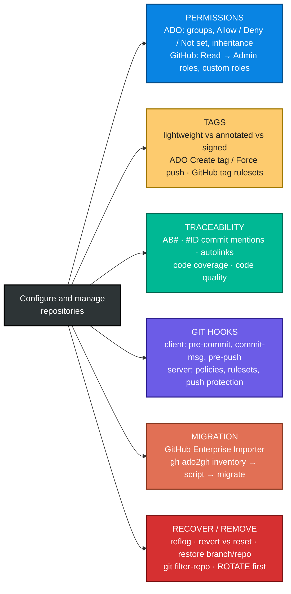
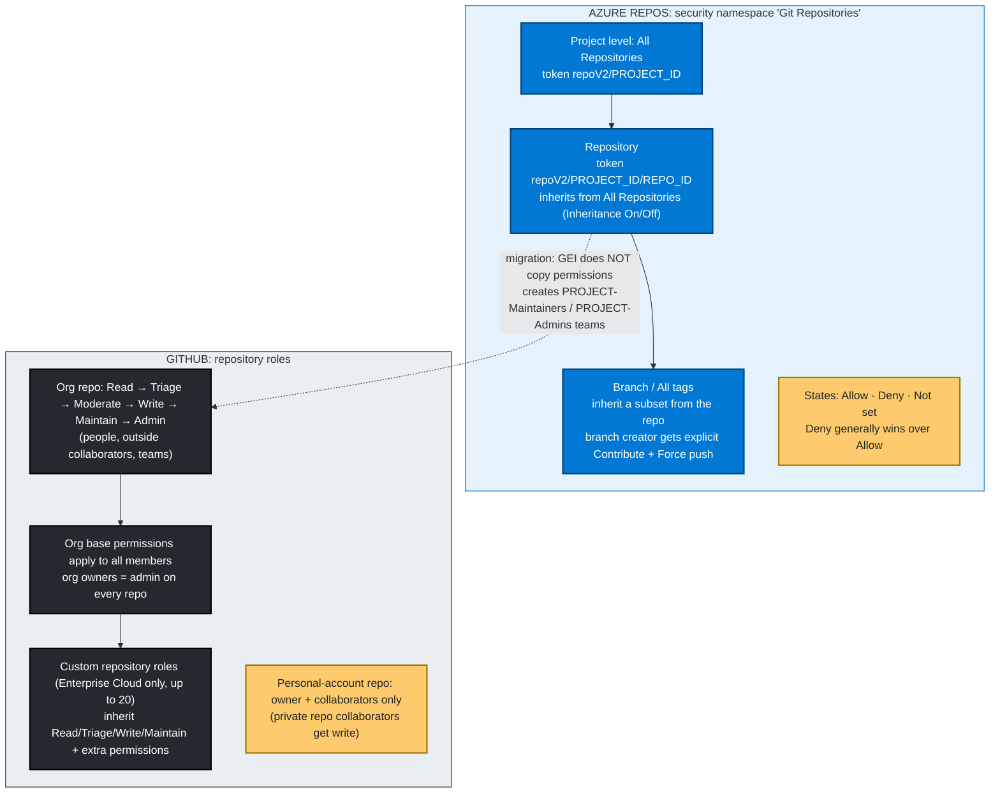
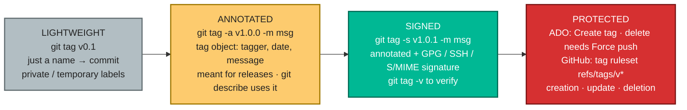
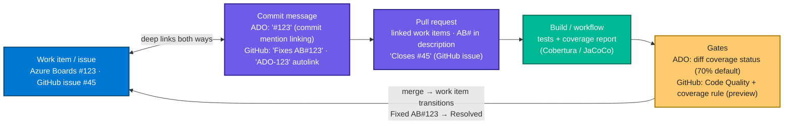
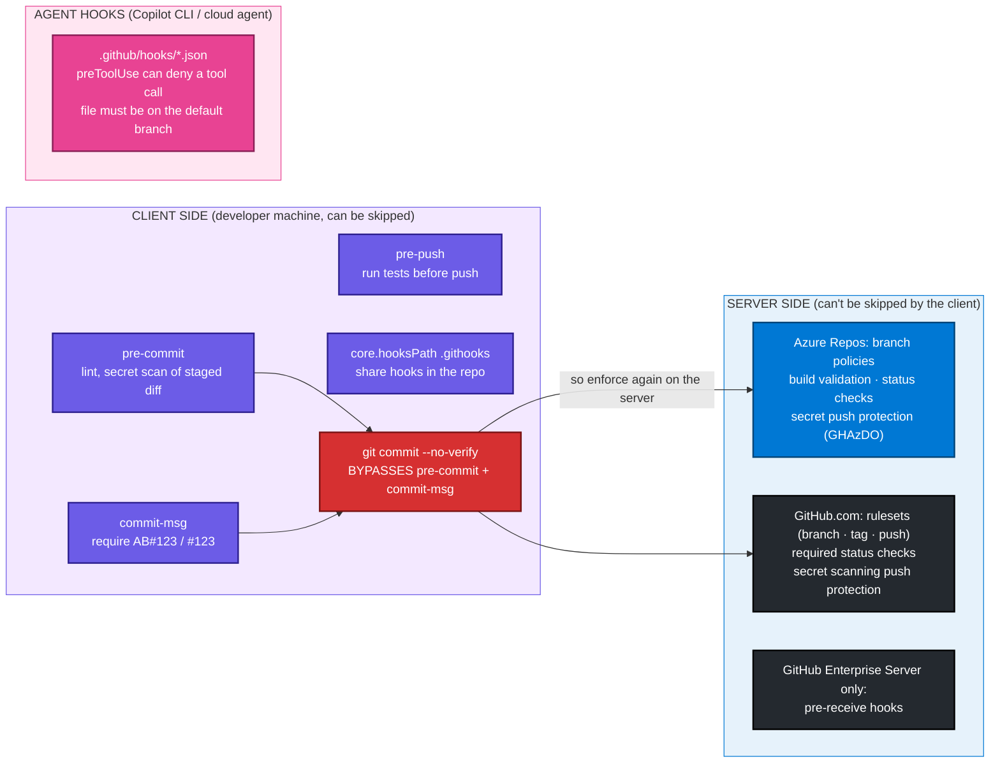
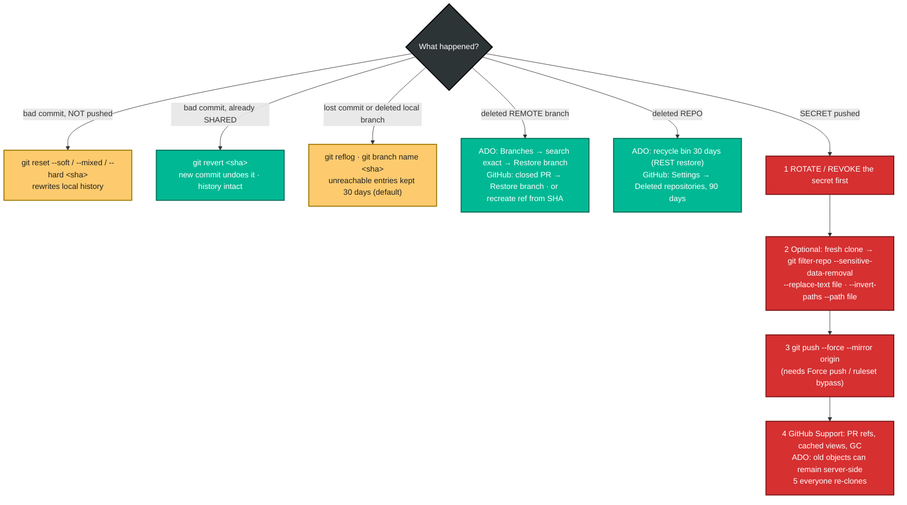

# Day 5 (Sat 28 Nov 2026): Repo permissions, tags, traceability, Git hooks, ADO→GitHub migration (GEI) & recovering/removing data

**Domain 2: Design and implement a source control strategy (10–15%)**
Study-guide bullets covered today, all under *Configure and manage repositories for Azure DevOps and GitHub* ([source](https://learn.microsoft.com/en-us/credentials/certifications/resources/study-guides/az-401)):
- Configure permissions
- Configure tags
- Implement traceability in repositories, including code quality, code coverage, and deep links to the work item or issue
- Create and configure Git hooks that automatically check code
- Perform a repository-to-repository migration from Azure DevOps to GitHub
- Recover or remove specific data by using Git commands

Time box: about 3–3.5 h (35 min concepts, 2 h 30 min labs, 25 min cheat sheet + questions).
Lab assets reused from Days 1–4: Azure DevOps project **`az401-lab`** (Agile process, repo `az401-lab`) in your Entra-backed org, and private GitHub repo **`vijayraavi/az401-lab-app`** with the Azure Boards connection and `AB#` traceability from Day 1 ([Day 1 lesson](../day-01/lesson.md), [Day 4 lesson](../day-04/lesson.md)). Every **destructive** step today (history rewrite, force push, branch and repo deletion) runs on **throwaway** repos created for this lab. Your real `vijayraavi/az401-lab-app` history is never rewritten.

> **Note on the exam.** The study guide says most questions cover generally available features, with preview features possible if commonly used ([study guide](https://learn.microsoft.com/en-us/credentials/certifications/resources/study-guides/az-401)). Items below still labelled **public preview** in the docs: the ruleset *Restrict code coverage* rule ([available rules](https://docs.github.com/en/repositories/configuring-branches-and-merges-in-your-repository/managing-rulesets/available-rules-for-rulesets)), push protection for AI-detected secrets ([push protection](https://docs.github.com/en/code-security/secret-scanning/introduction/about-push-protection)), the 40 GiB GEI repository limit and Enterprise Live Migrations for Azure DevOps ([about ADO migrations](https://docs.github.com/en/migrations/using-github-enterprise-importer/migrating-from-azure-devops-to-github-enterprise-cloud/about-migrations-from-azure-devops-to-github-enterprise-cloud)). Hooks for Copilot in VS Code are public preview too ([Copilot hooks](https://docs.github.com/en/copilot/concepts/agents/hooks)).

---

## 1. Concepts

### 1.1 Today's six skills on one map



### 1.2 Repository permissions: Azure Repos vs GitHub



**Azure Repos** ([set Git repository permissions](https://learn.microsoft.com/en-us/azure/devops/repos/git/set-git-repository-permissions?view=azure-devops), [branch permissions](https://learn.microsoft.com/en-us/azure/devops/repos/git/branch-permissions?view=azure-devops), [about permissions](https://learn.microsoft.com/en-us/azure/devops/organizations/security/about-permissions?view=azure-devops)):

| Permission | Readers | Contributors | Build Admins | Project Admins | Notes |
|---|---|---|---|---|---|
| Read (clone, fetch, explore), contribute to PRs | ✔️ | ✔️ | ✔️ | ✔️ | |
| Contribute, Create branch, **Create tag**, Manage notes | | ✔️ | ✔️ | ✔️ | Contributors can create tags by default |
| Create / Delete / Rename repository | | | | ✔️ | |
| Edit policies, Manage permissions, Remove others' locks | | | | ✔️ | Branch creators **don't** get Edit policies automatically (since sprint 224) |
| Bypass policies when completing PRs · Bypass policies when pushing · **Force push** (rewrite history, delete branches and tags) | | | | | **Not set for any group** by default |

- Set them at **All Repositories** (every repo in the project) or per repository. Repos inherit from the project-level entry, and you can switch **Inheritance** off per repo ([doc](https://learn.microsoft.com/en-us/azure/devops/repos/git/set-git-repository-permissions?view=azure-devops)).
- **Not set** neither grants nor denies. **Allow** grants unless an applicable **Deny** overrides it. At the same scope a Deny from one group generally beats an Allow from another. An explicit assignment on a child object can replace what it inherits ([about permissions](https://learn.microsoft.com/en-us/azure/devops/organizations/security/about-permissions?view=azure-devops)).
- The old *Exempt from policy enforcement* was split into **Bypass policies when completing pull requests** and **Bypass policies when pushing** ([doc](https://learn.microsoft.com/en-us/azure/devops/repos/git/set-git-repository-permissions?view=azure-devops)).
- A **branch creator** automatically gets explicit Contribute, **Force push**, Manage permissions (if the repo setting allows it) and Remove others' locks on that branch ([branch permissions](https://learn.microsoft.com/en-us/azure/devops/repos/git/branch-permissions?view=azure-devops)).
- **CLI:** `az devops security permission namespace list|show`, `list`, `show`, `update --allow-bit/--deny-bit`, `reset --permission-bit`, `reset-all`. `--subject` is a user email or group descriptor. These commands need **Project Collection Administrators** membership ([manage permissions with CLI](https://learn.microsoft.com/en-us/azure/devops/organizations/security/manage-tokens-namespaces?view=azure-devops), [reference](https://learn.microsoft.com/en-us/cli/azure/devops/security/permission?view=azure-cli-latest)). The **Git Repositories** namespace ID is `2e9eb7ed-3c0a-47d4-87c1-0ffdd275fd87`. Its actions include `GenericRead`, `GenericContribute`, `ForcePush`, `CreateBranch`, `CreateTag`, `EditPolicies`, `ManagePermissions`, `PullRequestContribute` and `PullRequestBypassPolicy`. Tokens are `repoV2/PROJECT_ID` and `repoV2/PROJECT_ID/REPO_ID` ([namespace reference](https://learn.microsoft.com/en-us/azure/devops/organizations/security/namespace-reference?view=azure-devops)).

**GitHub** ([repository roles](https://docs.github.com/en/organizations/managing-user-access-to-your-organizations-repositories/managing-repository-roles/repository-roles-for-an-organization), [custom roles](https://docs.github.com/en/organizations/managing-user-access-to-your-organizations-repositories/managing-repository-roles/about-custom-repository-roles), [personal account repos](https://docs.github.com/en/account-and-profile/reference/permission-levels-for-a-personal-account-repository)):

| Role | Recommended for |
|---|---|
| **Read** | Non-code contributors who view or discuss |
| **Triage** | Manage issues, discussions and PRs without write access |
| **Moderate** | Moderate and edit issues and discussions, manage PRs without write access |
| **Write** | People who push to the project |
| **Maintain** | Project managers: manage the repo without sensitive or destructive actions |
| **Admin** | Full access, including security settings and deleting the repo |

- **Custom repository roles** need **GitHub Enterprise Cloud**. You can create up to **20**. Each starts from an inherited role (Read, Triage, Write or Maintain) plus extra permissions such as *Manage webhooks*, *Push commits to protected branches* (base role must be Write, and branch protections still apply), *Create protected tags* and *Delete protected tags* ([custom roles](https://docs.github.com/en/organizations/managing-user-access-to-your-organizations-repositories/managing-repository-roles/about-custom-repository-roles)).
- Org owners set **base permissions** for all members, and they have admin on every org repo ([roles](https://docs.github.com/en/organizations/managing-user-access-to-your-organizations-repositories/managing-repository-roles/repository-roles-for-an-organization)).
- A **personal-account** repo has only the **owner** and **collaborators**. On a private personal repo, collaborators can only get write access ([doc](https://docs.github.com/en/account-and-profile/reference/permission-levels-for-a-personal-account-repository)). Your `vijayraavi/*` repos are in this model, so the role ladder above needs an organization.
- **Rulesets** can be viewed by anyone with read access. They can be created and edited by admins or by a custom role with **Edit repository rules** ([about rulesets](https://docs.github.com/en/repositories/configuring-branches-and-merges-in-your-repository/managing-rulesets/about-rulesets)).
- REST: `GET /repos/{owner}/{repo}/collaborators/{username}/permission` returns `permission` (legacy base role) and `role_name` (the role actually assigned, including custom roles). `PUT …/collaborators/{username}` with `{"permission":"triage"}` adds or changes a collaborator ([collaborators API](https://docs.github.com/en/rest/collaborators/collaborators)).
- **Deploy keys** are a back door: anyone holding the private key keeps read or write access even after they're removed from the org ([roles](https://docs.github.com/en/organizations/managing-user-access-to-your-organizations-repositories/managing-repository-roles/repository-roles-for-an-organization)).

### 1.3 Tags: lightweight, annotated, signed, protected



| Topic | Azure Repos | GitHub | Source |
|---|---|---|---|
| Kinds | Both annotated and lightweight. Web portal creates **annotated only**; lightweight needs the Git command line | Both. Releases can point at either | [ADO tags](https://learn.microsoft.com/en-us/azure/devops/repos/git/git-tags?view=azure-devops), [git-tag](https://git-scm.com/docs/git-tag) |
| Create | **Create tag** permission (Contributors and higher) | Write access, unless a tag ruleset restricts creation | [ADO tags](https://learn.microsoft.com/en-us/azure/devops/repos/git/git-tags?view=azure-devops), [available rules](https://docs.github.com/en/repositories/configuring-branches-and-merges-in-your-repository/managing-rulesets/available-rules-for-rulesets) |
| Delete / move | Needs **Force push** at repository or **All tags** level. The tag creator inherits Force push for that tag | Tag ruleset rules: **deletion**, **update** (only bypass actors), **non_fast_forward** | same |
| Protect | Permissions on **All tags** | **Tag rulesets** (`"target": "tag"`, `refs/tags/v*`). Legacy *tag protection rules* were sunset and auto-migrated to rulesets on 30 Aug 2024 | [sunset notice](https://github.blog/changelog/2024-05-29-sunset-notice-tag-protections/) |
| Signed | Git-level (`git tag -s`) | `git tag -s`, `git config tag.gpgsign true`, verify with `git tag -v`. GPG, SSH or S/MIME | [signing tags](https://docs.github.com/en/authentication/managing-commit-signature-verification/signing-tags) |
| Naming | No spaces, `~`, `:` or control characters. Lowercase with hyphens. ≤ 250 chars. Never 40 hex characters (looks like a SHA) | `git-check-ref-format` rules | [ADO tags](https://learn.microsoft.com/en-us/azure/devops/repos/git/git-tags?view=azure-devops) |

Git's own manual: annotated tags are meant for releases, and lightweight tags for private or temporary labels. `git describe` ignores lightweight tags by default ([git-tag](https://git-scm.com/docs/git-tag)). Deleting a pushed tag doesn't remove it from other people's clones ([ADO tags](https://learn.microsoft.com/en-us/azure/devops/repos/git/git-tags?view=azure-devops)). Day 4 reminder: Microsoft prefers **release branches** over tags for release management ([branching guidance](https://learn.microsoft.com/en-us/azure/devops/repos/git/git-branching-guidance?view=azure-devops)).

### 1.4 Traceability: deep links, code coverage and code quality



| Link type | How | Source |
|---|---|---|
| Azure Repos commit → work item | `#ID` in the commit message when repo setting **Commit mention linking** is on. **Commit mention work item resolution** completes linked work items when the PR completes | [repository settings](https://learn.microsoft.com/en-us/azure/devops/repos/git/repository-settings?view=azure-devops) |
| GitHub → Azure Boards | `AB#ID` in a commit message, PR **description** or issue description (not in comments or the PR title). `Fixes AB#123` moves it to the first *Resolved*-category state (or *Completed* if there's none); `Closed AB#123` moves it to *Closed* | [link GitHub to Boards](https://learn.microsoft.com/en-us/azure/devops/boards/github/link-to-from-github?view=azure-devops) |
| GitHub → anything else | **Autolink references**: prefix + URL template with `<num>`, alphanumeric or numeric. Available on Pro, Team and Enterprise. REST `POST /repos/{o}/{r}/autolinks` (`key_prefix`, `url_template`, `is_alphanumeric`). GEI's `gh ado2gh configure-autolink` sets this up for Azure Boards | [autolinks](https://docs.github.com/en/repositories/managing-your-repositorys-settings-and-features/managing-repository-settings/configuring-autolinks-to-reference-external-resources), [REST](https://docs.github.com/en/rest/repos/autolinks) |
| PR gating on links | ADO branch policy **Check for linked work items** (Day 1/4). GitHub: a required status check, such as the Day 1 `traceability-gate` | [branch policies](https://learn.microsoft.com/en-us/azure/devops/repos/git/branch-policies?view=azure-devops) |
| **Code coverage (ADO)** | Publish with **Publish Code Coverage Results v2** (Cobertura, JaCoCo and others). For PRs, Azure DevOps posts a **diff coverage** status (default **70 %** of changed lines). Tune it in `azurepipelines-coverage.yml` at the repo root. PR coverage works **only for Azure Repos**. In multistage YAML, coverage appears after the whole run finishes | [code coverage](https://learn.microsoft.com/en-us/azure/devops/pipelines/test/codecoverage-for-pullrequests?view=azure-devops) |
| **Code quality + coverage (GitHub)** | **GitHub Code Quality**: CodeQL-based findings on PRs with Copilot autofixes, and line-coverage metrics from an uploaded Cobertura XML. Ruleset rules can block merges on quality severity and (**preview**) on minimum coverage % or maximum coverage drop. Billed per active committer, plus AI credits and Actions minutes | [about Code Quality](https://docs.github.com/en/code-security/code-quality/concepts/about-code-quality), [available rules](https://docs.github.com/en/repositories/configuring-branches-and-merges-in-your-repository/managing-rulesets/available-rules-for-rulesets) |

The Azure Repos diff-coverage settings file (repo root, applies whichever pipeline publishes coverage) ([doc](https://learn.microsoft.com/en-us/azure/devops/pipelines/test/codecoverage-for-pullrequests?view=azure-devops)):

```yaml
# azurepipelines-coverage.yml: repository-level settings for the PR code coverage status in Azure Repos.
coverage:
  status:
    # comments: on posts per-file coverage details as a PR comment (off by default).
    comments: on
    diff:
      # Diff coverage = coverage of only the lines changed in the PR. Default target is 70%.
      target: 80%
```

### 1.5 Git hooks: client-side checks and their server-side equivalents



- **Client hooks** are executables in `$GIT_DIR/hooks/` or in the folder named by `core.hooksPath`. Non-executable hooks are ignored. `pre-commit` takes no parameters, and a non-zero exit aborts the commit. `commit-msg` gets the path of the message file and can reject or rewrite it. `pre-push` can stop a push. Both `pre-commit` and `commit-msg` **can be bypassed with `--no-verify`** ([githooks](https://git-scm.com/docs/githooks)). Hooks aren't cloned, so commit them to a folder such as `.githooks/` and have each developer run `git config core.hooksPath .githooks`. GitHub's docs recommend a pre-commit hook (or a tool such as git-secrets or gitleaks in one) and asking every collaborator to install it ([removing sensitive data](https://docs.github.com/en/authentication/keeping-your-account-and-data-secure/removing-sensitive-data-from-a-repository)).
- **Server-side equivalents.** Azure Repos and GitHub.com don't run your own server hooks. They enforce through **branch policies** (Day 4), **rulesets** and **push protection**. `pre-receive` hooks exist as a **GitHub Enterprise Server** appliance feature ([about pre-receive hooks](https://docs.github.com/en/enterprise-server@latest/admin/enforcing-policies/enforcing-policy-with-pre-receive-hooks/about-pre-receive-hooks)).
- **GitHub push rulesets** block pushes to a **private or internal** repo and its whole fork network based on file paths, path length, file extensions and file size (MB, Git LFS excluded). They need the **GitHub Team** plan or higher, and they need no branch targeting ([about rulesets](https://docs.github.com/en/repositories/configuring-branches-and-merges-in-your-repository/managing-rulesets/about-rulesets), [REST](https://docs.github.com/en/rest/repos/rules)).
- **GitHub secret scanning push protection** blocks partner, generic and custom patterns on the command line, web UI, file uploads and REST API. **For repositories** it requires **GitHub Secret Protection** (free on **public** repos), and anyone with write access can bypass by giving a reason, which creates an alert (or you can use delegated bypass). **For users** it's on by default and stops *you* pushing secrets to **public** repos ([push protection](https://docs.github.com/en/code-security/secret-scanning/introduction/about-push-protection), [enable secret scanning](https://docs.github.com/en/code-security/secret-scanning/enabling-secret-scanning-features/enabling-secret-scanning-for-your-repository)). Blocked pushes fail with `GH013: Repository rule violations found`. Fix the latest commit with `git commit --amend --all`, or fix older commits with `git rebase -i <first>~1` ([command line](https://docs.github.com/en/code-security/secret-scanning/working-with-secret-scanning-and-push-protection/working-with-push-protection-from-the-command-line)).
- **Azure Repos push protection** is built into Azure DevOps Git and needs **GitHub Advanced Security for Azure DevOps** or **GitHub Secret Protection for Azure DevOps**. You bypass it with `skip-secret-scanning:true` in the commit message, and an alert is still raised ([GHAzDO secret scanning](https://learn.microsoft.com/en-us/azure/devops/repos/security/github-advanced-security-secret-scanning?view=azure-devops)).
- **Copilot (agentic angle).** *Hooks for GitHub Copilot* aren't Git hooks. They run your commands at agent events (`sessionStart`, `preToolUse` (which can approve or deny a tool call), `postToolUse` and others) from `.github/hooks/*.json` (`"version": 1`). For the **cloud agent** the file must be on the **default branch**, and only a subset of events is supported ([Copilot hooks](https://docs.github.com/en/copilot/concepts/agents/hooks), [use hooks](https://docs.github.com/en/copilot/how-tos/use-copilot-agents/cloud-agent/use-hooks)). The cloud agent also runs secret scanning on code it generates, and its pushes stay subject to rulesets ([risks and mitigations](https://docs.github.com/en/copilot/concepts/agents/cloud-agent/risks-and-mitigations)). You can ask Copilot to draft a hook script, but review it like any other code.

### 1.6 Azure DevOps → GitHub with GitHub Enterprise Importer (GEI)

```mermaid
flowchart LR
    P0["1 Access<br/>GitHub PAT (classic) · ADO PAT<br/>migrator role · ruleset bypass:<br/>'Repository migrations'"]:::acc
    P1["2 Install<br/>gh extension install github/gh-ado2gh<br/>GH_PAT · ADO_PAT env vars"]:::inst
    P2["3 Plan<br/>gh ado2gh inventory-report<br/>orgs/team-projects/repos/pipelines.csv"]:::plan
    P3["4 Script<br/>gh ado2gh generate-script --all<br/>review migrate.ps1"]:::script
    P4["5 Trial run → production<br/>migrate-repo into a -sandbox org first<br/>halt work: no delta migrations"]:::mig
    P5["6 Follow-up<br/>migration log issue · visibility (private)<br/>reclaim mannequins · rewire pipelines<br/>integrate-boards · autolinks · lock ADO repo"]:::fu
    P0 --> P1 --> P2 --> P3 --> P4 --> P5
    classDef acc fill:#d63031,stroke:#7a1414,color:#fff,stroke-width:2px
    classDef inst fill:#6C5CE7,stroke:#2d1f8f,color:#fff,stroke-width:2px
    classDef plan fill:#0984E3,stroke:#064f8a,color:#fff,stroke-width:2px
    classDef script fill:#FDCB6E,stroke:#a07800,color:#222,stroke-width:2px
    classDef mig fill:#e17055,stroke:#8a3a22,color:#fff,stroke-width:2px
    classDef fu fill:#00B894,stroke:#006b56,color:#fff,stroke-width:2px
```



| Topic | Key facts | Source |
|---|---|---|
| Source / target | **Azure DevOps Cloud** (not Server: move to ADO Cloud first) → **GitHub Enterprise Cloud** (GitHub.com or GHE.com) | [about ADO migrations](https://docs.github.com/en/migrations/using-github-enterprise-importer/migrating-from-azure-devops-to-github-enterprise-cloud/about-migrations-from-azure-devops-to-github-enterprise-cloud) |
| Migrated | Git source and history, PRs, PR user history, **work item links on PRs**, PR attachments, **branch policies** (not user-scoped or cross-repo) | same |
| Not migrated / limits | **Permissions** (GEI creates `PROJECT-Maintainers` and `PROJECT-Admins` teams instead), **Git LFS objects** (push them afterwards), 400 MiB file and 2 GiB commit/push limits during migration, 40 GiB repo (preview). Org rulesets can make it fail | same, [prepare](https://docs.github.com/en/migrations/using-github-enterprise-importer/ado/prepare-for-your-migration-from-azure-devops-to-github) |
| Pipelines and Boards | Stay in Azure DevOps and are **re-connected** to GitHub: `rewire-pipeline` (needs a GitHub-app service connection; `--dry-run` rewires temporarily, builds, then rewires back), `integrate-boards`, `configure-autolink` | [follow-up tasks](https://docs.github.com/en/migrations/using-github-enterprise-importer/ado/follow-up-tasks), `gh ado2gh --help` (v1.36.0) |
| Tokens (**PATs required**) | GEI has no Entra or OIDC option. **GitHub PAT (classic)** only (fine-grained isn't supported): owner `repo, workflow, admin:org`, migrator `repo, workflow, read:org`. **ADO PAT**: Work Items (Read), Code (Read), Identity (Read); docs recommend **Full access** for `inventory-report` | [manage access](https://docs.github.com/en/migrations/using-github-enterprise-importer/ado/manage-access) |
| ADO PAT hygiene | Microsoft: avoid PATs when possible. If a tool needs one, use an **organization-scoped** PAT, minimum scopes, shortest lifetime. **Global PATs stop working on 27 Jan 2027** | [use PATs](https://learn.microsoft.com/en-us/azure/devops/organizations/accounts/use-personal-access-tokens-to-authenticate?view=azure-devops) |
| Script | `generate-script --github-org X --ado-org Y [--ado-team-project Z] --output migrate.ps1` writes a **PowerShell** script (use `pwsh` on Linux or macOS). Flags: `--sequential`, `--create-teams`, `--lock-ado-repos`, `--disable-ado-repos`, `--rewire-pipelines`, `--download-migration-logs`, `--all`, `--repo-list repos.csv`. Target repo name = `TEAMPROJECT-REPO`, visibility **private** | [migrate](https://docs.github.com/en/migrations/using-github-enterprise-importer/migrating-from-azure-devops-to-github-enterprise-cloud/migrating-repositories-from-azure-devops-to-github-enterprise-cloud), [gh-gei source](https://github.com/github/gh-gei/blob/main/src/ado2gh/Commands/GenerateScript/GenerateScriptCommandHandler.cs) |
| Single repo | `gh ado2gh migrate-repo --ado-org --ado-team-project --ado-repo --github-org --github-repo [--target-repo-visibility private] [--queue-only]`, then `wait-for-migration` | `gh ado2gh migrate-repo --help` (v1.36.0) |
| After | Status `Migration completed (ID: RM_…)! State: SUCCEEDED`. A **Migration Log** issue appears in the repo. Repos are **private**. Activity is attributed to **mannequins** until an **org owner** reclaims them (`reclaim-mannequin`, bulk via `--csv`). Remove the temporary IP allow-list entries | [follow-up tasks](https://docs.github.com/en/migrations/using-github-enterprise-importer/ado/follow-up-tasks), [mannequins](https://docs.github.com/en/migrations/using-github-enterprise-importer/completing-your-migration-with-github-enterprise-importer/reclaiming-mannequins-for-github-enterprise-importer) |
| Planning | Duration is driven by **PR count** more than repo count. Map one ADO org to one GitHub org; team projects don't exist on GitHub, so use teams. Run trial migrations in a `-sandbox` org | [prepare](https://docs.github.com/en/migrations/using-github-enterprise-importer/ado/prepare-for-your-migration-from-azure-devops-to-github), [migrate](https://docs.github.com/en/migrations/using-github-enterprise-importer/ado/migrate-your-repositories-from-azure-devops-to-github) |

### 1.7 Recovering and removing data



| Need | Command / place | Key facts | Source |
|---|---|---|---|
| Undo a **shared** commit | `git revert <sha>` (`--continue` / `--abort` on conflicts) | Creates a new commit. History still matches the remote | [ADO undo](https://learn.microsoft.com/en-us/azure/devops/repos/git/undo?view=azure-devops) |
| Undo **local** commits | `git reset --mixed` (default, keeps changes unstaged), `--soft` (keeps them staged), `--hard` (discards) | Don't reset past a commit that's been pushed and shared | same |
| Find "lost" commits | `git reflog`, `git log -g`, then `git branch rescue <sha>` | Reachable entries expire after 90 days, unreachable after **30 days** (`gc.reflogExpire`, `gc.reflogExpireUnreachable`) | [git-reflog](https://git-scm.com/docs/git-reflog) |
| Restore deleted branch (ADO) | **Repos → Branches → search exact name → "Search for exact match in deleted branches" → … → Restore branch**. CLI: `az repos ref create --name heads/<b> --object-id <sha>` | No retention limit. **Branch policies and permissions aren't restored** | [restore branch](https://learn.microsoft.com/en-us/azure/devops/repos/git/restore-deleted-branch?view=azure-devops), [az repos ref](https://learn.microsoft.com/en-us/cli/azure/repos/ref?view=azure-cli-latest) |
| Restore deleted branch (GitHub) | Closed PR → **Restore branch**, or the **Activity** view / `GET /repos/{o}/{r}/activity?activity_type=branch_deletion`, then `POST /repos/{o}/{r}/git/refs` | Branches of open PRs can't be deleted | [restore in PR](https://docs.github.com/en/repositories/configuring-branches-and-merges-in-your-repository/managing-branches-in-your-repository/deleting-and-restoring-branches-in-a-pull-request), [activity view](https://docs.github.com/en/repositories/viewing-activity-and-data-for-your-repository/using-the-activity-view-to-see-changes-to-a-repository), [REST](https://docs.github.com/en/rest/repos/repos) |
| Restore deleted repo | ADO: soft delete, **30 days**, REST `PATCH …/_apis/git/recycleBin/repositories/{id}` `{"deleted": false}`. GitHub: **90 days** (not if it was in a non-empty fork network), team permissions not restored | ADO can't delete a project's only repo | [ADO delete repo](https://learn.microsoft.com/en-us/azure/devops/repos/git/delete-existing-repo?view=azure-devops), [REST](https://learn.microsoft.com/en-us/rest/api/azure/devops/git/repositories/restore-repository-from-recycle-bin?view=azure-devops-rest-7.1), [GitHub restore](https://docs.github.com/en/repositories/creating-and-managing-repositories/restoring-a-deleted-repository) |
| **Purge a secret** | `git-filter-repo --sensitive-data-removal --invert-paths --path <file>` and/or `--replace-text ../passwords.txt` (literal lines, `regex:`/`glob:` prefixes, `==>` sets the replacement; default `***REMOVED***`) | **Rotate or revoke first**: that may be enough. Needs filter-repo **≥ 2.47** for `--sensitive-data-removal` (Git ≥ 2.36). Works only in a **fresh clone** (`--force` overrides). Rewrites every later SHA and **drops commit and tag signatures** | [GitHub: removing sensitive data](https://docs.github.com/en/authentication/keeping-your-account-and-data-secure/removing-sensitive-data-from-a-repository), [git-filter-repo manual](https://github.com/newren/git-filter-repo/blob/main/Documentation/git-filter-repo.txt) |
| After the rewrite (GitHub) | `git push --force --mirror origin` (the `refs/pull/*` refs fail, which is expected). Count affected PRs with `grep -c '^refs/pull/.*/head$' .git/filter-repo/changed-refs`. Ask **GitHub Support** to dereference or delete affected PRs, run GC and **remove cached views**. Give them the *First Changed Commit(s)*. Forks keep the data. Collaborators must **rebase, not merge**, or re-clone | Support helps only when **rotating can't mitigate** the risk. Temporarily lift force-push protections | same |
| After the rewrite (Azure Repos) | Needs **Force push** (preferred) or Admin on the repo. Freeze pushes first | Docs warn that removed files can still exist in repo history on the server. Rotation is the real fix | [ADO remove large files](https://learn.microsoft.com/en-us/azure/devops/repos/git/remove-binaries?view=azure-devops) |

### 1.8 What changed recently (teach current features only)

- **GitHub tag protection rules → tag rulesets**: sunset on 30 Aug 2024, with existing rules auto-migrated ([changelog](https://github.blog/changelog/2024-05-29-sunset-notice-tag-protections/)). Use `"target": "tag"` rulesets.
- **git-filter-repo 2.47** added `--sensitive-data-removal`, which reports *First Changed Commit(s)* and orphaned LFS objects. GitHub's guide now uses it instead of BFG or `filter-branch` ([GitHub docs](https://docs.github.com/en/authentication/keeping-your-account-and-data-secure/removing-sensitive-data-from-a-repository)).
- **gh-ado2gh v1.36.0** (current on 28 Nov 2026; updated weekly): `rewire-pipeline --dry-run`, `test-pipelines`, `--repo-list` from the inventory CSV ([install doc](https://docs.github.com/en/migrations/using-github-enterprise-importer/ado/install-and-configure-github-enterprise-importer), `gh ado2gh --help`).
- **Azure DevOps global PAT retirement** on 27 Jan 2027. Use org-scoped PATs or Entra tokens ([doc](https://learn.microsoft.com/en-us/azure/devops/organizations/accounts/use-personal-access-tokens-to-authenticate?view=azure-devops)).
- **GitHub Code Quality** with a coverage ruleset rule (preview), and **push protection for AI-detected secrets** (preview) ([Code Quality](https://docs.github.com/en/code-security/code-quality/concepts/about-code-quality), [push protection](https://docs.github.com/en/code-security/secret-scanning/introduction/about-push-protection)).
- **Copilot hooks** (`.github/hooks/*.json`) for Copilot CLI and the cloud agent ([Copilot hooks](https://docs.github.com/en/copilot/concepts/agents/hooks)).

---

## 2. Hands-on labs (about 2 h 30 min, about ₹0)

Four labs: **A** Git hooks, tags and recovery in a local scratch repo (no accounts). **B** Azure DevOps: repo permissions with `az devops security permission`, tags, commit-mention traceability, restoring a branch and a repo, and purging a secret from a **throwaway** repo. **C** GitHub: role check, tag ruleset, autolink, purging a secret, restoring a branch, and push protection on **throwaway** repos. **D** a GitHub Enterprise Importer **dry run** (`inventory-report` and `generate-script` only, no paid migration). Nothing creates or deletes an Azure resource. The cleanup at the end removes only what today's labs created, and you run it yourself.

### Prerequisites

#### Accounts and licences

| Account / plan | What you need | Used in |
|---|---|---|
| **Azure DevOps** | Your Entra-backed org from Day 1, **Basic** access, project `az401-lab`. You're the org owner, so you're in **Project Collection Administrators** (needed by `az devops security permission`). | Lab B, Lab D |
| **GitHub account** | `vijayraavi`. **GitHub Pro** (or higher) for rulesets and autolinks on **private** repos (your Day 1 ruleset proves you have it). Push protection on the **public** throwaway repo is free. | Lab C |
| **GitHub Enterprise Cloud** | **Not needed.** Today's GEI work is a dry run. A real `migrate-repo` needs a GHEC destination org ([about ADO migrations](https://docs.github.com/en/migrations/using-github-enterprise-importer/migrating-from-azure-devops-to-github-enterprise-cloud/about-migrations-from-azure-devops-to-github-enterprise-cloud)). | Lab D (read-only) |
| **Azure subscription** | Not needed. `az login` only gets an Entra token for Azure DevOps. | Lab B |

#### Tools and minimum versions

| Tool | Minimum | Check |
|---|---|---|
| **Git** | **2.36+** (needed by git-filter-repo). 2.34+ for SSH-signed tags | `git --version` |
| **Python** | 3.6+ (git-filter-repo). Windows: install from python.org or `winget install Python.Python.3.13`, not the Microsoft Store stub ([INSTALL.md](https://github.com/newren/git-filter-repo/blob/main/INSTALL.md)) | `python --version` / `python3 --version` |
| **git-filter-repo** | **2.47+** (has `--sensitive-data-removal`) ([GitHub docs](https://docs.github.com/en/authentication/keeping-your-account-and-data-secure/removing-sensitive-data-from-a-repository)). Install with `pipx install git-filter-repo`. Ubuntu's apt package may be older | `git filter-repo -h` lists `--sensitive-data-removal` |
| **Azure CLI** | Current 2.x with the `azure-devops` extension. The `az devops security permission` reference requires "version 2.92.0 or higher" of the extension, which installs on first use ([reference](https://learn.microsoft.com/en-us/cli/azure/devops/security/permission?view=azure-cli-latest)) | `az version` |
| **GitHub CLI (`gh`)** | **2.4.0+** for `gh-ado2gh` ([install GEI](https://docs.github.com/en/migrations/using-github-enterprise-importer/ado/install-and-configure-github-enterprise-importer)). Use a current release | `gh --version` |
| **gh-ado2gh extension** | Latest (v1.36.0 on 28 Nov 2026; updated weekly) | `gh ado2gh --version` |
| **PowerShell** | 7.x (`pwsh`) on Windows. **Also on Ubuntu** if you want to *open* `migrate.ps1`, because `generate-script` writes PowerShell ([migrate](https://docs.github.com/en/migrations/using-github-enterprise-importer/migrating-from-azure-devops-to-github-enterprise-cloud/migrating-repositories-from-azure-devops-to-github-enterprise-cloud)) | `$PSVersionTable.PSVersion` |
| **Ubuntu** | Bash, `jq`, `curl`, `pipx` (`sudo apt install pipx`) | `jq --version` |

#### Permissions and roles

| Where | Role | Needed for |
|---|---|---|
| ADO org | **Project Collection Administrators** | `az devops security permission` commands ([doc](https://learn.microsoft.com/en-us/azure/devops/organizations/security/manage-tokens-namespaces?view=azure-devops)) |
| ADO project `az401-lab` | **Project Administrators** (Create / Delete repository, Manage permissions) | Creating, deleting and restoring the throwaway repo `az401-day5-purge` ([delete repo](https://learn.microsoft.com/en-us/azure/devops/repos/git/delete-existing-repo?view=azure-devops)) |
| ADO throwaway repo | **Force push** on `main`. You get it automatically as the **branch creator** | The history-rewrite push in Lab B ([branch permissions](https://learn.microsoft.com/en-us/azure/devops/repos/git/branch-permissions?view=azure-devops)) |
| GitHub throwaway repos | **Owner / Admin** (you create them) | Rulesets, autolinks, secret scanning settings, force push, deletion |
| GitHub token for `gh` | Scopes `repo`, `workflow` (Day 1), plus **`delete_repo`** only for cleanup (`gh auth refresh -h github.com -s delete_repo`) | Lab C cleanup |
| ADO PAT (Lab D only) | Organization-scoped, **1-day** expiry. GEI documents Work Items (Read), Code (Read), Identity (Read) and recommends **Full access** for `inventory-report` ([manage access](https://docs.github.com/en/migrations/using-github-enterprise-importer/ado/manage-access)) | `gh ado2gh inventory-report`, `generate-script` |

#### Sign-in and environment

- `az login` with the Entra identity that's a member of the org, then `az devops configure --defaults organization="https://dev.azure.com/<org>" project=az401-lab` so later commands can omit `--organization` and `--project` ([CLI permissions doc](https://learn.microsoft.com/en-us/azure/devops/organizations/security/manage-tokens-namespaces?view=azure-devops)).
- For the Azure DevOps REST calls in Lab B, use a **Microsoft Entra token** from `az account get-access-token --resource 499b84ac-1321-427f-aa17-267ca6975798` (the Azure DevOps resource ID), not a PAT ([Entra OAuth](https://learn.microsoft.com/en-us/azure/devops/integrate/get-started/authentication/entra-oauth?view=azure-devops), [avoid PATs](https://learn.microsoft.com/en-us/azure/devops/organizations/accounts/use-personal-access-tokens-to-authenticate?view=azure-devops)).
- `gh auth login` (github.com). Git pushes to GitHub use the `gh` credential helper (`gh auth setup-git`, Day 1). Pushes to Azure Repos use Git Credential Manager (Day 1).
- Set `git config --global user.name` and `user.email` once.

| Variable (PowerShell / bash) | Set in | Meaning |
|---|---|---|
| `$org` / `ORG` | Verify block | Azure DevOps org name (replace `<org>`). |
| `$proj` / `PROJ` | Verify block | `az401-lab`. |
| `$me` / `ME` | Verify block | Your GitHub login (`vijayraavi`). |
| `$ghPurge` / `GH_PURGE` | Verify block | `vijayraavi/az401-day5-purge` (private throwaway, Lab C). |
| `$ghPP` / `GH_PP` | Verify block | `vijayraavi/az401-day5-pushprot` (public throwaway, Lab C step 6). |
| `$adoRepo` / `ADO_REPO` | Verify block | `az401-day5-purge` (throwaway Azure Repos repo, Lab B). |
| `$pw` / `PW` | Lab A step 6 | The **fake** password planted in history (built from two halves so this page holds no full secret). |
| `$upn`, `$projId`, `$adoRepoId`, `$ns`, `$tok` / `UPN`, `PROJ_ID`, `ADO_REPO_ID`, `NS`, `TOK` | Lab B steps 1–2 | Your sign-in name, project GUID, throwaway repo GUID, Git security namespace ID and permission token. |
| `$adoUrl` / `ADO_URL` | Lab B step 1 | HTTPS clone URL of the throwaway Azure Repos repo. |
| `$bitTag`, `$contrib` / `BIT_TAG`, `CONTRIB` | Lab B step 2 | Bit value of the **Create tag** permission and the Contributors group descriptor. |
| `$sha` / `SHA` | Lab B step 5 | Commit SHA used to restore the deleted branch. |
| `$adoTok` / `ADO_TOK` | Lab B step 7, Cleanup | Short-lived Entra access token for the Azure DevOps REST calls (never saved). |
| `$wi` / `WI` | Lab B step 4 | User story ID for commit-mention linking. |
| `$rsTag` / `RS_TAG` | Lab C step 2 | ID of the GitHub tag ruleset. |
| `$del` / `DEL_SHA` | Lab C step 5 | Branch-deletion activity event (`before` = SHA to restore). |
| `$dummy` / `DUMMY` | Lab C step 6 | GitHub's documented dummy token, assembled at run time from three parts. |
| `$env:ADO_PAT` / `ADO_PAT` | Lab D step 2 | Short-lived Azure DevOps PAT for GEI (masked input, removed in step 6). |

#### Earlier lab outputs this day depends on

| From | Used today |
|---|---|
| Day 1: project **`az401-lab`** (Agile) in your Entra-backed org, Git Credential Manager sign-in | Lab B (throwaway repo is created in this project), Lab D (inventory) |
| Day 1: `gh auth login` with `repo` + `workflow`, `gh auth setup-git` | Lab C |
| Day 1: Azure Boards ↔ `vijayraavi/az401-lab-app` connection (`AB#` links) | §1.4 recap. Lab C adds an autolink on the throwaway repo instead of touching the lab repo |
| Day 4: `git worktree`, squash merge, annotated tag basics | Lab A builds on them |

#### Verify prerequisites

Replace `<org>` first.

**PowerShell**
```powershell
# Lab-wide variables. Replace <org> with your Entra-backed Azure DevOps org name.
$org = "<org>"; $proj = "az401-lab"; $me = "vijayraavi"
$ghPurge = "$me/az401-day5-purge"; $ghPP = "$me/az401-day5-pushprot"; $adoRepo = "az401-day5-purge"
# Tool versions: Git (2.36+), Python (3.6+), Azure CLI + extensions, GitHub CLI (2.4.0+), PowerShell 7.
git --version; python --version; az version --query '{cli:"azure-cli", ext:extensions}' -o json; gh --version; $PSVersionTable.PSVersion
# git-filter-repo is installed and new enough: the help must mention --sensitive-data-removal (2.47+).
git filter-repo -h | Select-String "sensitive-data-removal"
# Signed-in Azure identity (tenant behind the ADO org) and the Day 1 project.
az account show --query '{user:user.name, tenant:tenantId}' -o table
az devops project show --project $proj --organization "https://dev.azure.com/$org" --query '{name:name, id:id}' -o table
# gh is signed in; the token scopes are listed. The throwaway repos must NOT exist yet (expect "Could not resolve").
gh auth status
gh repo view $ghPurge --json name 2>&1 | Select-Object -First 1
```

**Ubuntu (bash)**
```bash
# Lab-wide variables. Replace <org> with your Entra-backed Azure DevOps org name.
ORG="<org>"; PROJ=az401-lab; ME=vijayraavi
GH_PURGE="$ME/az401-day5-purge"; GH_PP="$ME/az401-day5-pushprot"; ADO_REPO=az401-day5-purge
# Tool versions: Git (2.36+), Python (3.6+), Azure CLI + extensions, GitHub CLI (2.4.0+), jq.
git --version; python3 --version; az version --query '{cli:"azure-cli", ext:extensions}' -o json; gh --version; jq --version
# git-filter-repo is installed and new enough: the help must mention --sensitive-data-removal (2.47+).
git filter-repo -h | grep -- "--sensitive-data-removal"
# Signed-in Azure identity (tenant behind the ADO org) and the Day 1 project.
az account show --query '{user:user.name, tenant:tenantId}' -o table
az devops project show --project "$PROJ" --organization "https://dev.azure.com/$ORG" --query '{name:name, id:id}' -o table
# gh is signed in; the token scopes are listed. The throwaway repos must NOT exist yet (expect "Could not resolve").
gh auth status
gh repo view "$GH_PURGE" --json name 2>&1 | head -1
```

If `git filter-repo` is missing or old, install it ([INSTALL.md](https://github.com/newren/git-filter-repo/blob/main/INSTALL.md)):

**PowerShell**
```powershell
# Install pipx for your user, add its folder to PATH, then install git-filter-repo as an isolated tool. Open a new terminal afterwards.
python -m pip install --user pipx
python -m pipx ensurepath
pipx install git-filter-repo
```

**Ubuntu (bash)**
```bash
# pipx from apt (avoids the PEP 668 "externally managed" pip error), then git-filter-repo. Open a new terminal afterwards.
sudo apt-get update && sudo apt-get install -y pipx
pipx ensurepath
pipx install git-filter-repo
```

**Expected result:** Git 2.36 or newer, `az` and `gh` print versions, the filter-repo line shows `--sensitive-data-removal`, the project shows `az401-lab` with a GUID, and `gh repo view` says it could not resolve the throwaway repo. If `az devops project show` fails, fix `<org>` and run `az login`.

---

### Lab A: Git hooks, tags and recovery in a scratch repo (30 min, no accounts)

**Lab-specific prerequisites:** Git 2.36+, user name and email configured, and git-filter-repo installed (step 6 only builds the leaky repo; Labs B and C purge it). Nothing is pushed. Everything lives in `~/az401-day5-scratch`.

#### Step 1: Create the scratch repo

**Goal:** A local repo with `main` and one commit.
**Why:** Hooks, tags and the reflog are all per-repository Git features. A scratch repo lets you break things safely ([githooks](https://git-scm.com/docs/githooks)).

**Works in both**
```bash
# Go home ("~" works in pwsh and bash), create the repo (-b main names the first branch) and enter it.
cd ~
git init -b main az401-day5-scratch/hooks-demo
cd az401-day5-scratch/hooks-demo
```

**PowerShell**
```powershell
# README as UTF-8 (PowerShell 7 default), then the first commit. "AB#1" is just a sample work item reference.
Set-Content -Path README.md -Value "# hooks-demo"
git add README.md
git commit -m "init AB#1"
```

**Ubuntu (bash)**
```bash
# README, then the first commit. "AB#1" is just a sample work item reference.
echo "# hooks-demo" > README.md
git add README.md
git commit -m "init AB#1"
```

**Expected result:** `[main (root-commit) …] init AB#1`.
**Common errors:** "Please tell me who you are": set `git config --global user.name "Vijay Raavi"` and `git config --global user.email "<you@example.com>"`.

#### Step 2: Write a pre-commit and a commit-msg hook and share them through `core.hooksPath`

**Goal:** A `pre-commit` hook that blocks staged lines that look like secrets, and a `commit-msg` hook that requires a work item reference.
**Why:** The exam skill is *create and configure Git hooks that automatically check code*. `pre-commit` runs before the message is collected, `commit-msg` receives the message file, and a non-zero exit aborts the commit. `core.hooksPath` points Git at a committed folder so the team shares the hooks ([githooks](https://git-scm.com/docs/githooks)). GitHub recommends exactly this kind of pre-commit secret check ([removing sensitive data](https://docs.github.com/en/authentication/keeping-your-account-and-data-secure/removing-sensitive-data-from-a-repository)). The scripts are POSIX `sh`. Git for Windows runs hooks with its bundled shell, so **one script works on both platforms**, as long as it has **LF** line endings.

**PowerShell**
```powershell
# Folder for shared hooks (committed with the repo, unlike .git/hooks).
New-Item -ItemType Directory -Force -Path .githooks | Out-Null
# pre-commit body. @'...'@ is a literal here-string: $ and quotes stay as written.
$preCommit = @'
#!/bin/sh
# pre-commit: block staged lines that look like secrets. Bypass: git commit --no-verify (server rules still apply).
pattern='(AccountKey=|password[[:space:]]*[:=]|PRIVATE KEY-----|ghp_[A-Za-z0-9]{20,})'
added=$(git diff --cached -U0 --no-color | grep '^+' | grep -v '^+++')
if printf '%s\n' "$added" | grep -Eiq "$pattern"; then
  echo "pre-commit: possible secret in staged changes:" >&2
  printf '%s\n' "$added" | grep -Ein "$pattern" >&2
  echo "Remove it and use Key Vault / GitHub secrets instead." >&2
  exit 1
fi
exit 0
'@
# commit-msg body. $1 is the path of the file holding the proposed message.
$commitMsg = @'
#!/bin/sh
# commit-msg: require a work item reference. $1 = file with the proposed message.
if ! grep -Eq '(AB)?#[0-9]+' "$1"; then
  echo "commit-msg: add a work item link, e.g. AB#123 (GitHub to Boards) or #123 (Azure Repos)." >&2
  exit 1
fi
exit 0
'@
# Write both with LF line endings (CRLF breaks "#!/bin/sh"). WriteAllText writes UTF-8 without BOM.
[IO.File]::WriteAllText((Join-Path $PWD ".githooks/pre-commit"), $preCommit.Replace("`r`n", "`n"))
[IO.File]::WriteAllText((Join-Path $PWD ".githooks/commit-msg"), $commitMsg.Replace("`r`n", "`n"))
```

**Ubuntu (bash)**
```bash
# Folder for shared hooks (committed with the repo, unlike .git/hooks).
mkdir -p .githooks
# pre-commit. The quoted heredoc ('EOF') keeps $ and quotes literal.
cat > .githooks/pre-commit <<'EOF'
#!/bin/sh
# pre-commit: block staged lines that look like secrets. Bypass: git commit --no-verify (server rules still apply).
pattern='(AccountKey=|password[[:space:]]*[:=]|PRIVATE KEY-----|ghp_[A-Za-z0-9]{20,})'
added=$(git diff --cached -U0 --no-color | grep '^+' | grep -v '^+++')
if printf '%s\n' "$added" | grep -Eiq "$pattern"; then
  echo "pre-commit: possible secret in staged changes:" >&2
  printf '%s\n' "$added" | grep -Ein "$pattern" >&2
  echo "Remove it and use Key Vault / GitHub secrets instead." >&2
  exit 1
fi
exit 0
EOF
# commit-msg. $1 is the path of the file holding the proposed message.
cat > .githooks/commit-msg <<'EOF'
#!/bin/sh
# commit-msg: require a work item reference. $1 = file with the proposed message.
if ! grep -Eq '(AB)?#[0-9]+' "$1"; then
  echo "commit-msg: add a work item link, e.g. AB#123 (GitHub to Boards) or #123 (Azure Repos)." >&2
  exit 1
fi
exit 0
EOF
# Git ignores hooks without the executable bit on Linux.
chmod +x .githooks/pre-commit .githooks/commit-msg
```

**Works in both**
```bash
# Tell Git (this repo only) to run hooks from .githooks instead of .git/hooks.
git config core.hooksPath .githooks
# Stage the hooks. --chmod=+x records mode 100755 in the index so Linux/macOS clones get executable hooks (needed when you commit from Windows).
git add --chmod=+x .githooks/pre-commit .githooks/commit-msg
# This commit already passes through the hooks: the message has AB#1 and nothing looks like a secret.
git commit -m "chore: add shared client-side hooks AB#1"
# Mode 100755 = executable in the index.
git ls-files -s .githooks
```

**Expected result:** The commit succeeds and both files show `100755`.
**Common errors:** On Linux, `hint: The '.githooks/pre-commit' hook was ignored because it's not set as executable` means you skipped `chmod +x`. `/bin/sh^M: bad interpreter` means CRLF line endings: rewrite the file with the PowerShell `Replace` line above.

#### Step 3: Prove the hooks, then prove why they're not enough

**Goal:** See both hooks block, then bypass them with `--no-verify`.
**Why:** `pre-commit` and `commit-msg` **can be bypassed with `--no-verify`** ([githooks](https://git-scm.com/docs/githooks)). That's why the exam pairs client hooks with **server-side** enforcement: branch policies, rulesets and push protection (§1.5).

**PowerShell**
```powershell
# 1) No work item reference: commit-msg rejects it.
Set-Content -Path a.txt -Value "x"
git add a.txt
git commit -m "no link"
# 2) Same change with a reference: accepted.
git commit -m "feat: a AB#2"
# 3) A fake password in a config file: pre-commit rejects it and prints the offending line.
Set-Content -Path app.yml -Value "db:`n  password: Day5-NotReal!"
git add app.yml
git commit -m "add config AB#3"
```

**Ubuntu (bash)**
```bash
# 1) No work item reference: commit-msg rejects it.
echo "x" > a.txt
git add a.txt
git commit -m "no link"
# 2) Same change with a reference: accepted.
git commit -m "feat: a AB#2"
# 3) A fake password in a config file: pre-commit rejects it and prints the offending line.
printf 'db:\n  password: Day5-NotReal!\n' > app.yml
git add app.yml
git commit -m "add config AB#3"
```

**Works in both**
```bash
# 4) --no-verify skips pre-commit and commit-msg: the "secret" gets committed anyway.
git commit --no-verify -m "bypass AB#3"
git log --oneline -3
# Undo that local, unpushed commit and discard app.yml (HEAD~1 = parent of the bypass commit; --hard also resets files).
git reset --hard HEAD~1
```

**Expected result:** (1) `commit-msg: add a work item link…` and no commit. (2) a commit. (3) `pre-commit: possible secret in staged changes:` followed by `2:+  password: Day5-NotReal!`. (4) the bypass commit appears, then `HEAD is now at … feat: a AB#2`.
**Common errors:** If (3) commits, `core.hooksPath` isn't set (`git config --get core.hooksPath` should print `.githooks`) or the hook isn't executable.

#### Step 4: Lightweight, annotated and (optionally) signed tags

**Goal:** Create each kind of tag and see how Git stores it.
**Why:** *Configure tags*: annotated tags are tag **objects** with a tagger, date and message, meant for releases. Lightweight tags are just names for a commit, and `git describe` ignores them ([git-tag](https://git-scm.com/docs/git-tag)). Azure Repos shows both, but its web portal only **creates** annotated tags ([ADO tags](https://learn.microsoft.com/en-us/azure/devops/repos/git/git-tags?view=azure-devops)).

**Works in both**
```bash
# Lightweight tag: no -a/-s/-m, just a ref pointing at HEAD.
git tag v0.1-lw
# Annotated tag: -a creates a tag object, -m sets its message.
git tag -a v1.0.0 -m "release 1.0.0 AB#2"
# cat-file -t prints the object type the tag ref points to: "commit" (lightweight) vs "tag" (annotated).
git cat-file -t v0.1-lw
git cat-file -t v1.0.0
# describe uses the nearest ANNOTATED tag. for-each-ref lists every tag with its object type and tagger.
git describe
git for-each-ref refs/tags --format="%(refname:short) %(objecttype) %(taggername)"
```

**Expected result:** `commit`, `tag`, `v1.0.0`, then `v0.1-lw commit` and `v1.0.0 tag Vijay Raavi`.

*Optional: SSH-signed tag* ([signing tags](https://docs.github.com/en/authentication/managing-commit-signature-verification/signing-tags), [git-tag](https://git-scm.com/docs/git-tag)). Use your existing SSH key (`~/.ssh/id_ed25519.pub`), or create one with `ssh-keygen -t ed25519`.

**PowerShell**
```powershell
# Trust file for verification: "<email> namespaces="git" <public key>". Kept outside the repo.
$pub = Get-Content "$HOME/.ssh/id_ed25519.pub"
Set-Content -Path "$HOME/.ssh/allowed_signers" -Value "$(git config user.email) namespaces=`"git`" $pub"
# -c sets config for this one command: SSH signing format and the key. -s = signed annotated tag.
git -c gpg.format=ssh -c user.signingkey="$HOME/.ssh/id_ed25519.pub" tag -s v1.0.1 -m "signed 1.0.1"
# -v verifies the signature against the allowed signers file.
git -c gpg.ssh.allowedSignersFile="$HOME/.ssh/allowed_signers" tag -v v1.0.1
```

**Ubuntu (bash)**
```bash
# Trust file for verification: "<email> namespaces="git" <public key>". Kept outside the repo.
echo "$(git config user.email) namespaces=\"git\" $(cat ~/.ssh/id_ed25519.pub)" > ~/.ssh/allowed_signers
# -c sets config for this one command: SSH signing format and the key. -s = signed annotated tag.
git -c gpg.format=ssh -c user.signingkey="$HOME/.ssh/id_ed25519.pub" tag -s v1.0.1 -m "signed 1.0.1"
# -v verifies the signature against the allowed signers file.
git -c gpg.ssh.allowedSignersFile="$HOME/.ssh/allowed_signers" tag -v v1.0.1
```

**Expected result:** `Good "git" signature for <email> with ED25519 key SHA256:…`. GitHub shows **Verified** on a pushed signed tag only after you add the same public key to your account as a **signing** key.

#### Step 5: Recover with the reflog; revert vs reset

**Goal:** Bring back a deleted branch and a "lost" commit, and see revert vs reset.
**Why:** *Recover or remove specific data by using Git commands*. `git reflog` records where HEAD and branches pointed. Unreachable entries are kept for 30 days by default ([git-reflog](https://git-scm.com/docs/git-reflog)). Use `git revert` for shared commits and `git reset` only for local ones ([ADO undo](https://learn.microsoft.com/en-us/azure/devops/repos/git/undo?view=azure-devops)).

**PowerShell**
```powershell
# A branch with one commit, then delete it (-D = force, because it isn't merged).
git switch -c feature/x
Set-Content -Path f.txt -Value "f"
git add f.txt
git commit -m "feat: f AB#4"
git switch main
git branch -D feature/x
# The reflog still has the commit. HEAD@{1} = where HEAD was one move ago (the tip of feature/x).
git reflog -n 5
$lost = (git rev-parse "HEAD@{1}").Trim()
# Recreate the branch at that commit.
git branch feature/x $lost
git log --oneline -1 feature/x
```

**Ubuntu (bash)**
```bash
# A branch with one commit, then delete it (-D = force, because it isn't merged).
git switch -c feature/x
echo "f" > f.txt
git add f.txt
git commit -m "feat: f AB#4"
git switch main
git branch -D feature/x
# The reflog still has the commit. HEAD@{1} = where HEAD was one move ago (the tip of feature/x).
git reflog -n 5
LOST=$(git rev-parse 'HEAD@{1}')
# Recreate the branch at that commit.
git branch feature/x "$LOST"
git log --oneline -1 feature/x
```

**Works in both**
```bash
# Merge it, then undo the merge the SHARED-SAFE way: revert adds a new commit (--no-edit keeps the default message).
git merge --ff-only feature/x
git revert --no-edit HEAD
# History keeps both the commit and its revert: nothing was rewritten.
git log --oneline -3
# Now the LOCAL-ONLY way: reset --hard moves main back two commits and discards both (fine because nothing was pushed).
git reset --hard HEAD~2
# The reflog shows the reset, so even this can be undone with: git reset --hard HEAD@{1}
git reflog -n 3
```

**Expected result:** `git branch -D` prints `Deleted branch feature/x (was <sha>)`, and the recreated branch shows `feat: f AB#4`. After the revert, the log shows `Revert "feat: f AB#4"` above `feat: f AB#4`. After the reset, `main` is back at `feat: a AB#2`.
**Common errors:** In PowerShell, quote `"HEAD@{1}"`, because unquoted `{}` is a script block.

#### Step 6: Build a "leaky" repo for Labs B and C (fake secret in history)

**Goal:** A repo whose **history** contains a fake connection-string password and a `secrets.env` file, even though the latest commit "fixes" it.
**Why:** This is the classic exam scenario. Removing the secret in a new commit doesn't remove it from history ([GitHub: removing sensitive data](https://docs.github.com/en/authentication/keeping-your-account-and-data-secure/removing-sensitive-data-from-a-repository), [ADO remove large files](https://learn.microsoft.com/en-us/azure/devops/repos/git/remove-binaries?view=azure-devops)). Hooks are **not** enabled in this repo, which simulates a developer without them.

**PowerShell**
```powershell
# New repo next to hooks-demo. No core.hooksPath here, so nothing blocks the leak.
cd ~/az401-day5-scratch
git init -b main purge-demo
cd purge-demo
# The fake password, built from two halves so no full "secret" string sits in this lesson.
$pw = "Day5-" + "NotReal-Passw0rd"
Set-Content -Path README.md -Value "# purge-demo"
git add README.md
git commit -m "init AB#1"
# Commit 2: the leak (connection string + .env file).
Set-Content -Path appsettings.json -Value ('{ "ConnectionStrings": { "Db": "Server=tcp:demo.local;Password=' + $pw + '" } }')
Set-Content -Path secrets.env -Value "API_KEY=$pw"
git add appsettings.json secrets.env
git commit -m "add config AB#2"
# Commit 3: unrelated work on top.
Set-Content -Path feature.txt -Value "feature"
git add feature.txt
git commit -m "feat AB#3"
# Commit 4: the "fix" (placeholder + delete .env). The secret is still in commit 2.
Set-Content -Path appsettings.json -Value '{ "ConnectionStrings": { "Db": "Server=tcp:demo.local;Password=__from_key_vault__" } }'
git rm -q secrets.env
git commit -am "fix: remove secret AB#4"
# Annotated release tag on the tip (it will be rewritten too).
git tag -a v1.0.0 -m "v1.0.0"
```

**Ubuntu (bash)**
```bash
# New repo next to hooks-demo. No core.hooksPath here, so nothing blocks the leak.
cd ~/az401-day5-scratch
git init -b main purge-demo
cd purge-demo
# The fake password, built from two halves so no full "secret" string sits in this lesson.
PW="Day5-""NotReal-Passw0rd"
echo "# purge-demo" > README.md
git add README.md
git commit -m "init AB#1"
# Commit 2: the leak (connection string + .env file).
printf '{ "ConnectionStrings": { "Db": "Server=tcp:demo.local;Password=%s" } }\n' "$PW" > appsettings.json
printf 'API_KEY=%s\n' "$PW" > secrets.env
git add appsettings.json secrets.env
git commit -m "add config AB#2"
# Commit 3: unrelated work on top.
echo "feature" > feature.txt
git add feature.txt
git commit -m "feat AB#3"
# Commit 4: the "fix" (placeholder + delete .env). The secret is still in commit 2.
printf '{ "ConnectionStrings": { "Db": "Server=tcp:demo.local;Password=__from_key_vault__" } }\n' > appsettings.json
git rm -q secrets.env
git commit -am "fix: remove secret AB#4"
# Annotated release tag on the tip (it will be rewritten too).
git tag -a v1.0.0 -m "v1.0.0"
```

**PowerShell**
```powershell
# -S = "pickaxe": commits whose diff adds or removes the string. Expect 2 (the leak and the fix).
git log --all --oneline -S $pw
# Every commit that touched secrets.env (add + delete).
git log --all --oneline -- secrets.env
```

**Ubuntu (bash)**
```bash
# -S = "pickaxe": commits whose diff adds or removes the string. Expect 2 (the leak and the fix).
git log --all --oneline -S "$PW"
# Every commit that touched secrets.env (add + delete).
git log --all --oneline -- secrets.env
```

**Expected result:** Four commits. The pickaxe search lists `fix: remove secret AB#4` and `add config AB#2`, and `secrets.env` appears in two commits. **Keep this folder** for Labs B and C.

#### Verify Lab A

**PowerShell**
```powershell
# hooks-demo: hooksPath set, hooks executable in the index, tags of both kinds.
cd ~/az401-day5-scratch/hooks-demo
git config --get core.hooksPath
git ls-files -s .githooks
git for-each-ref refs/tags --format="%(refname:short) %(objecttype)"
# purge-demo: the leak is still in history (2 commits). Re-create $pw if this is a new shell.
cd ../purge-demo
if (-not $pw) { $pw = "Day5-" + "NotReal-Passw0rd" }
git log --all --oneline -S $pw
```

**Ubuntu (bash)**
```bash
# hooks-demo: hooksPath set, hooks executable in the index, tags of both kinds.
cd ~/az401-day5-scratch/hooks-demo
git config --get core.hooksPath
git ls-files -s .githooks
git for-each-ref refs/tags --format="%(refname:short) %(objecttype)"
# purge-demo: the leak is still in history (2 commits). Re-create PW if this is a new shell.
cd ../purge-demo
PW="${PW:-Day5-""NotReal-Passw0rd}"
git log --all --oneline -S "$PW"
```

**Expected result:** `.githooks`, two `100755` entries, `v0.1-lw commit`, `v1.0.0 tag` (plus `v1.0.1 tag` if you signed), and two pickaxe hits.

---

### Lab B: Azure DevOps: permissions, tags, commit links, restore, purge a secret (50 min, ₹0)

**Lab-specific prerequisites:** the Verify block above passed, Lab A step 6 (`~/az401-day5-scratch/purge-demo`) exists, and you're a Project Collection Administrator (org owner). Everything destructive happens in a **new throwaway repo `az401-day5-purge`** in project `az401-lab`. The Day 1 repo `az401-lab` isn't touched.

#### Step 1: Sign in, pin defaults and create the throwaway repo

**Goal:** Get the IDs that permission tokens need, and create `az401-day5-purge`.
**Why:** Git permission tokens are `repoV2/PROJECT_ID/REPO_ID`, so you need GUIDs, not names ([namespace reference](https://learn.microsoft.com/en-us/azure/devops/organizations/security/namespace-reference?view=azure-devops)). Creating a repo needs **Create repository** (Project Administrators) ([permissions](https://learn.microsoft.com/en-us/azure/devops/repos/git/set-git-repository-permissions?view=azure-devops)).

**PowerShell**
```powershell
# Sign in (browser) and pin org + project so later az commands can omit --organization/--project.
az login
az devops configure --defaults organization="https://dev.azure.com/$org" project=$proj
# Your sign-in name (used as --subject) and the project GUID. .Trim() drops the trailing newline.
$upn = (az account show --query user.name -o tsv).Trim()
$projId = (az devops project show --project $proj --query id -o tsv).Trim()
# Create the throwaway repo and keep its GUID and clone URL.
$adoRepoId = (az repos create --name $adoRepo --query id -o tsv).Trim()
$adoUrl = (az repos show --repository $adoRepoId --query remoteUrl -o tsv).Trim()
Write-Output "UPN=$upn PROJ_ID=$projId ADO_REPO_ID=$adoRepoId URL=$adoUrl"
```

**Ubuntu (bash)**
```bash
# Sign in (browser or device code) and pin org + project so later az commands can omit --organization/--project.
az login
az devops configure --defaults organization="https://dev.azure.com/$ORG" project="$PROJ"
# Your sign-in name (used as --subject) and the project GUID.
UPN=$(az account show --query user.name -o tsv)
PROJ_ID=$(az devops project show --project "$PROJ" --query id -o tsv)
# Create the throwaway repo and keep its GUID and clone URL.
ADO_REPO_ID=$(az repos create --name "$ADO_REPO" --query id -o tsv)
ADO_URL=$(az repos show --repository "$ADO_REPO_ID" --query remoteUrl -o tsv)
echo "UPN=$UPN PROJ_ID=$PROJ_ID ADO_REPO_ID=$ADO_REPO_ID URL=$ADO_URL"
```

**Expected result:** Four values. The URL looks like `https://<org>@dev.azure.com/<org>/az401-lab/_git/az401-day5-purge`.
**Portal path:** **Project settings → Repositories** lists `az401-day5-purge`.
**Common errors:** `TF400813` / `401`: wrong tenant. Run `az login --tenant <tenant-id>`. `A Git repository with the name … already exists`: delete the leftover or pick another name.

#### Step 2: Read repository permissions with `az devops security permission`

**Goal:** List the Git permission bits, then show your own and the Contributors group's effective permissions.
**Why:** *Configure permissions*. The CLI works on a **namespace** plus a **token** plus a **subject**. Defaults: Contributors get Contribute, Create branch and **Create tag**; **Force push** and the two **Bypass** permissions aren't set for any group ([set repo permissions](https://learn.microsoft.com/en-us/azure/devops/repos/git/set-git-repository-permissions?view=azure-devops), [CLI how-to](https://learn.microsoft.com/en-us/azure/devops/organizations/security/manage-tokens-namespaces?view=azure-devops)).

**PowerShell**
```powershell
# Git Repositories namespace ID (from the namespace reference).
$ns = "2e9eb7ed-3c0a-47d4-87c1-0ffdd275fd87"
# Every permission in the namespace with its bit (CreateTag, ForcePush, PullRequestBypassPolicy, ...).
az devops security permission namespace show --namespace-id $ns -o table
# Keep the CreateTag bit for step 3 (JMESPath picks the action named CreateTag).
$bitTag = (az devops security permission namespace show --namespace-id $ns --query "[0].actions[?name=='CreateTag'].bit | [0]" -o tsv).Trim()
# Repository-level token for the throwaway repo.
$tok = "repoV2/$projId/$adoRepoId"
# Your permissions on it (subject = your email). Effective values come from your groups (Project/Collection Administrators).
az devops security permission show --namespace-id $ns --subject $upn --token $tok -o table
# The project Contributors group descriptor, then its permissions at the All Repositories level (token without repo ID).
$contrib = (az devops security group list --project $proj --query "graphGroups[?displayName=='Contributors'].descriptor | [0]" -o tsv).Trim()
az devops security permission show --namespace-id $ns --subject $contrib --token "repoV2/$projId" -o table
```

**Ubuntu (bash)**
```bash
# Git Repositories namespace ID (from the namespace reference).
NS=2e9eb7ed-3c0a-47d4-87c1-0ffdd275fd87
# Every permission in the namespace with its bit (CreateTag, ForcePush, PullRequestBypassPolicy, ...).
az devops security permission namespace show --namespace-id "$NS" -o table
# Keep the CreateTag bit for step 3 (JMESPath picks the action named CreateTag).
BIT_TAG=$(az devops security permission namespace show --namespace-id "$NS" --query "[0].actions[?name=='CreateTag'].bit | [0]" -o tsv)
# Repository-level token for the throwaway repo.
TOK="repoV2/$PROJ_ID/$ADO_REPO_ID"
# Your permissions on it (subject = your email). Effective values come from your groups (Project/Collection Administrators).
az devops security permission show --namespace-id "$NS" --subject "$UPN" --token "$TOK" -o table
# The project Contributors group descriptor, then its permissions at the All Repositories level (token without repo ID).
CONTRIB=$(az devops security group list --project "$PROJ" --query "graphGroups[?displayName=='Contributors'].descriptor | [0]" -o tsv)
az devops security permission show --namespace-id "$NS" --subject "$CONTRIB" --token "repoV2/$PROJ_ID" -o table
```

**Expected result:** The namespace table lists names such as `GenericContribute`, `ForcePush`, `CreateBranch`, `CreateTag`, `EditPolicies`, `PullRequestBypassPolicy` with bits. `$bitTag` / `BIT_TAG` is usually `32`. Your own entries show **Allow (inherited)** for most bits. Contributors show **Allow** for *Contribute*, *Create branch*, *Create tag* and *Manage notes*, and **Not set** for *Force push* and the *Bypass* permissions.
**Portal path:** **Project settings → Repositories → az401-day5-purge → Security** (same data, same three states).
**Common errors:** `You are not authorized`: these commands need **Project Collection Administrators** ([doc](https://learn.microsoft.com/en-us/azure/devops/organizations/security/manage-tokens-namespaces?view=azure-devops)). `Multiple entries found in acesDictionary`: the token is wrong. Rebuild it from the GUIDs.

#### Step 3: Push the leaky history, then Deny "Create tag" for yourself and watch the tag push fail

**Goal:** Prove a repository-level **Deny** blocks tag creation, then reset it and push an annotated tag.
**Why:** *Configure permissions* and *Configure tags*. Creating a tag needs **Create tag**. A Deny generally overrides an Allow inherited from your groups ([ADO tags](https://learn.microsoft.com/en-us/azure/devops/repos/git/git-tags?view=azure-devops), [about permissions](https://learn.microsoft.com/en-us/azure/devops/organizations/security/about-permissions?view=azure-devops)). Explicit Deny is a precise tool, so reset it right afterwards.

**PowerShell**
```powershell
# Push the Lab A purge-demo history (main only, no tags yet) to the new ADO repo as remote "ado".
cd ~/az401-day5-scratch/purge-demo
git remote add ado $adoUrl
git push ado main
# Explicit Deny of Create tag for YOU on this repo only. --deny-bit takes the bit from step 2.
az devops security permission update --namespace-id $ns --subject $upn --token $tok --deny-bit $bitTag -o table
# Try to push the annotated tag: expect a TF401027 "CreateTag" permission error.
git push ado v1.0.0
# Remove the explicit Deny (back to Not set / inherited Allow) for that one bit.
az devops security permission reset --namespace-id $ns --subject $upn --token $tok --permission-bit $bitTag -o table
# Push again: works now. Then list the tag refs on the server.
git push ado v1.0.0
az repos ref list --repository $adoRepoId --filter tags -o table
```

**Ubuntu (bash)**
```bash
# Push the Lab A purge-demo history (main only, no tags yet) to the new ADO repo as remote "ado".
cd ~/az401-day5-scratch/purge-demo
git remote add ado "$ADO_URL"
git push ado main
# Explicit Deny of Create tag for YOU on this repo only. --deny-bit takes the bit from step 2.
az devops security permission update --namespace-id "$NS" --subject "$UPN" --token "$TOK" --deny-bit "$BIT_TAG" -o table
# Try to push the annotated tag: expect a TF401027 "CreateTag" permission error.
git push ado v1.0.0
# Remove the explicit Deny (back to Not set / inherited Allow) for that one bit.
az devops security permission reset --namespace-id "$NS" --subject "$UPN" --token "$TOK" --permission-bit "$BIT_TAG" -o table
# Push again: works now. Then list the tag refs on the server.
git push ado v1.0.0
az repos ref list --repository "$ADO_REPO_ID" --filter tags -o table
```

**Expected result:** After `update`, *Create tag* shows **Deny**. The first tag push is rejected with `TF401027: You need the Git 'CreateTag' permission to perform this action`. After `reset` it shows inherited Allow, the second push prints `* [new tag] v1.0.0 -> v1.0.0`, and the ref list shows `refs/tags/v1.0.0`.
**Portal path:** **Repos → Tags** (select `az401-day5-purge`). Annotated tags show the tagger, date and message ([ADO tags](https://learn.microsoft.com/en-us/azure/devops/repos/git/git-tags?view=azure-devops)).
**Common errors:** If the first tag push **succeeds**, your effective permission still resolved to Allow (check **Security** in the portal for an explicit Allow on the repo or **All tags**). The lesson still stands: inspect *effective* permissions, not just one assignment. Deleting a pushed tag needs **Force push**, which as its creator you inherit for that tag ([ADO tags](https://learn.microsoft.com/en-us/azure/devops/repos/git/git-tags?view=azure-devops)).

#### Step 4: Traceability: link a commit to a work item with `#ID`

**Goal:** Create a user story and link a commit to it just by writing `#<id>` in the message.
**Why:** *Implement traceability… deep links to the work item*. With **Commit mention linking** on, a `#ID` in an Azure Repos commit message links the commit to the work item ([repository settings](https://learn.microsoft.com/en-us/azure/devops/repos/git/repository-settings?view=azure-devops)). Step 6 will show the side effect of rewriting history: the link points at the **old** commit SHA ([GitHub: side effects](https://docs.github.com/en/authentication/keeping-your-account-and-data-secure/removing-sensitive-data-from-a-repository)).

**PowerShell**
```powershell
# Create a user story (Agile process) and keep its ID.
$wi = (az boards work-item create --type "User Story" --title "Day 5 traceability demo" --query id -o tsv).Trim()
# A commit whose message mentions the work item with #ID (Azure Repos syntax), pushed to ADO.
Set-Content -Path TRACE.md -Value "Traceability demo for work item $wi"
git add TRACE.md
git commit -m "docs: traceability demo #$wi"
git push ado main
# The work item's relations: expect an ArtifactLink named "Fixed in Commit" whose URL ends with the commit SHA.
az boards work-item show --id $wi --expand relations --query "relations[].{name:attributes.name, url:url}" -o table
```

**Ubuntu (bash)**
```bash
# Create a user story (Agile process) and keep its ID.
WI=$(az boards work-item create --type "User Story" --title "Day 5 traceability demo" --query id -o tsv)
# A commit whose message mentions the work item with #ID (Azure Repos syntax), pushed to ADO.
echo "Traceability demo for work item $WI" > TRACE.md
git add TRACE.md
git commit -m "docs: traceability demo #$WI"
git push ado main
# The work item's relations: expect an ArtifactLink named "Fixed in Commit" whose URL ends with the commit SHA.
az boards work-item show --id "$WI" --expand relations --query "relations[].{name:attributes.name, url:url}" -o table
```

**Expected result:** A relation named **Fixed in Commit** with a `vstfs:///Git/Commit/…` URL. Links can take a few seconds to appear; rerun the `show` if it's empty.
**Portal path:** **Boards → Work items → your story → Development** section shows the commit. **Project settings → Repositories → az401-day5-purge → Settings → Commit mention linking** must be **On**.
**Common errors:** No link: the setting is off, or `#ID` refers to a work item in another org. On GitHub, the equivalent is `AB#ID` through the Azure Boards app ([link GitHub to Boards](https://learn.microsoft.com/en-us/azure/devops/boards/github/link-to-from-github?view=azure-devops)).

#### Step 5: Delete a branch on the server and restore it

**Goal:** Delete `day5-temp` in Azure Repos and bring it back, in the portal or by recreating the ref.
**Why:** *Recover … specific data*. Azure Repos keeps deleted branches with **no retention limit**. Restore recreates the branch at its last commit, but **not** its policies or permissions ([restore deleted branch](https://learn.microsoft.com/en-us/azure/devops/repos/git/restore-deleted-branch?view=azure-devops)). `az repos ref create/delete` work on any ref ([az repos ref](https://learn.microsoft.com/en-us/cli/azure/repos/ref?view=azure-cli-latest)).

**PowerShell**
```powershell
# The commit the temp branch will point at (current main).
$sha = (git rev-parse HEAD).Trim()
# Create the branch on the server. --name uses the heads/ prefix; --object-id = commit SHA.
az repos ref create --name heads/day5-temp --object-id $sha --repository $adoRepoId -o table
# Delete it (deleting a branch needs Force push; you are its creator so you have it).
az repos ref delete --name heads/day5-temp --object-id $sha --repository $adoRepoId -o table
# Now restore it in the portal (Portal path below), OR recreate it from the remembered SHA:
az repos ref create --name heads/day5-temp --object-id $sha --repository $adoRepoId -o table
az repos ref list --repository $adoRepoId --filter heads -o table
```

**Ubuntu (bash)**
```bash
# The commit the temp branch will point at (current main).
SHA=$(git rev-parse HEAD)
# Create the branch on the server. --name uses the heads/ prefix; --object-id = commit SHA.
az repos ref create --name heads/day5-temp --object-id "$SHA" --repository "$ADO_REPO_ID" -o table
# Delete it (deleting a branch needs Force push; you are its creator so you have it).
az repos ref delete --name heads/day5-temp --object-id "$SHA" --repository "$ADO_REPO_ID" -o table
# Now restore it in the portal (Portal path below), OR recreate it from the remembered SHA:
az repos ref create --name heads/day5-temp --object-id "$SHA" --repository "$ADO_REPO_ID" -o table
az repos ref list --repository "$ADO_REPO_ID" --filter heads -o table
```

**Expected result:** The final list shows `refs/heads/day5-temp` and `refs/heads/main`.
**Portal path (the exam answer):** **Repos → Branches → Search all branches** → type `day5-temp` → **Search for exact match in deleted branches** → `…` → **Restore branch**. The list shows who deleted it and when. If you reused a branch name, check the **Pushes** page for the full history ([doc](https://learn.microsoft.com/en-us/azure/devops/repos/git/restore-deleted-branch?view=azure-devops)).
**Common errors:** If you already restored it in the portal, the second `ref create` fails because the ref exists. That's fine.

#### Step 6: Purge the secret from the Azure Repos history with `git filter-repo`

**Goal:** Remove `secrets.env` from every commit and replace the password text everywhere, then force-push the rewritten history.
**Why:** *Recover or remove specific data*. **Rotate the secret first**: once it's revoked it can't be used, and rewriting may not even be needed ([GitHub: removing sensitive data](https://docs.github.com/en/authentication/keeping-your-account-and-data-secure/removing-sensitive-data-from-a-repository)). (Here it's fake, so there's nothing to rotate. In real life, rotate in Key Vault or with the provider now.) Rewriting a shared Azure Repos branch needs **Force push** (preferred) or Admin, and the team must stop pushing first ([ADO remove large files](https://learn.microsoft.com/en-us/azure/devops/repos/git/remove-binaries?view=azure-devops)). filter-repo insists on a **fresh clone** ([manual](https://github.com/newren/git-filter-repo/blob/main/Documentation/git-filter-repo.txt)).

**PowerShell**
```powershell
# Fresh clone of the ADO repo into its own folder (filter-repo refuses to run in a non-fresh clone).
cd ~/az401-day5-scratch
git clone $adoUrl ado-clean
cd ado-clean
# Replacement rules OUTSIDE the repo: one literal per line; matches become ***REMOVED***.
Set-Content -Path ../replacements.txt -Value $pw
# --sensitive-data-removal: fetch all refs, report First Changed Commit(s).
# --replace-text: rewrite matching text in every blob. --invert-paths --path: drop secrets.env from every commit.
git filter-repo --sensitive-data-removal --replace-text ../replacements.txt --invert-paths --path secrets.env
# Check locally: no commit adds/removes the password, no commit touches secrets.env, and the old config is redacted.
git log --all --oneline -S $pw
git log --all --oneline -- secrets.env
git log --all -p -- appsettings.json | Select-String "Password="
# Overwrite every branch and tag on the server (--mirror; --force is implied but written as a reminder).
git push --force --mirror origin
```

**Ubuntu (bash)**
```bash
# Fresh clone of the ADO repo into its own folder (filter-repo refuses to run in a non-fresh clone).
cd ~/az401-day5-scratch
git clone "$ADO_URL" ado-clean
cd ado-clean
# Replacement rules OUTSIDE the repo: one literal per line; matches become ***REMOVED***.
printf '%s\n' "$PW" > ../replacements.txt
# --sensitive-data-removal: fetch all refs, report First Changed Commit(s).
# --replace-text: rewrite matching text in every blob. --invert-paths --path: drop secrets.env from every commit.
git filter-repo --sensitive-data-removal --replace-text ../replacements.txt --invert-paths --path secrets.env
# Check locally: no commit adds/removes the password, no commit touches secrets.env, and the old config is redacted.
git log --all --oneline -S "$PW"
git log --all --oneline -- secrets.env
git log --all -p -- appsettings.json | grep "Password="
# Overwrite every branch and tag on the server (--mirror; --force is implied but written as a reminder).
git push --force --mirror origin
```

**Expected result:** filter-repo prints `You rewrote N (of N) commits`, `NOTE: First Changed Commit(s) is/are: <sha>` and *NEXT STEPS FOR YOUR SENSITIVE DATA REMOVAL*. Both `git log` searches print nothing, and the diff shows `Password=***REMOVED***`. The push shows `+ … main -> main (forced update)`, plus forced updates for `day5-temp` and `v1.0.0`.
**Common errors:** `Aborting: Refusing to destructively overwrite repo history since this does not look like a fresh clone`: clone again (don't use `--force` on a repo with local-only work). `TF401027 … ForcePush`: someone else created the branch, so an admin must grant **Force push** temporarily (Lab B step 2 commands with `--allow-bit` for the `ForcePush` bit), then reset it. A branch policy on `main` also blocks pushes unless you hold **Bypass policies when pushing**.

**Look at the side effects** (the reason Microsoft says to rotate first):

**PowerShell**
```powershell
# The work item still links to the OLD commit SHA from step 4, which no branch contains any more.
az boards work-item show --id $wi --expand relations --query "relations[].url" -o tsv
# Your old purge-demo clone still has the secret: anyone with an old clone can re-push it. Old clones must be discarded.
cd ~/az401-day5-scratch/purge-demo
git log --all --oneline -S $pw
```

**Ubuntu (bash)**
```bash
# The work item still links to the OLD commit SHA from step 4, which no branch contains any more.
az boards work-item show --id "$WI" --expand relations --query "relations[].url" -o tsv
# Your old purge-demo clone still has the secret: anyone with an old clone can re-push it. Old clones must be discarded.
cd ~/az401-day5-scratch/purge-demo
git log --all --oneline -S "$PW"
```

**Expected result:** The commit link URL ends with the **pre-rewrite** SHA. The old clone still finds 2 commits. Azure Repos docs also warn that removed files can remain in the repository's history on the server ([remove large files](https://learn.microsoft.com/en-us/azure/devops/repos/git/remove-binaries?view=azure-devops)). That's why **rotation** is the real fix.

#### Step 7: Delete the repo, then restore it from the recycle bin (REST, Entra token)

**Goal:** Soft-delete `az401-day5-purge` and restore it with the REST API, authenticating with an Entra token instead of a PAT.
**Why:** Deleted Azure Repos repos stay in a recycle bin for **30 days** and are restored through **Restore Repository From Recycle Bin** ([delete repo](https://learn.microsoft.com/en-us/azure/devops/repos/git/delete-existing-repo?view=azure-devops), [REST](https://learn.microsoft.com/en-us/rest/api/azure/devops/git/repositories/restore-repository-from-recycle-bin?view=azure-devops-rest-7.1)). Microsoft recommends Entra tokens over PATs ([use PATs](https://learn.microsoft.com/en-us/azure/devops/organizations/accounts/use-personal-access-tokens-to-authenticate?view=azure-devops)).

**PowerShell**
```powershell
# Entra access token for Azure DevOps (resource ID 499b84ac-…). It lives about an hour; nothing is stored.
$adoTok = (az account get-access-token --resource 499b84ac-1321-427f-aa17-267ca6975798 --query accessToken -o tsv).Trim()
$h = @{ Authorization = "Bearer $adoTok" }
# Soft-delete the throwaway repo (--yes skips the prompt). This is the lab's own repo only.
az repos delete --id $adoRepoId --yes
# List the recycle bin for the project.
(Invoke-RestMethod -Uri "https://dev.azure.com/$org/$proj/_apis/git/recycleBin/repositories?api-version=7.1" -Headers $h).value | Select-Object id, name, deletedDate
# Restore: PATCH the recycle-bin entry with {"deleted": false}. $($adoRepoId) is needed before the "?".
Invoke-RestMethod -Method Patch -Uri "https://dev.azure.com/$org/$proj/_apis/git/recycleBin/repositories/$($adoRepoId)?api-version=7.1" `
  -Headers $h -ContentType "application/json" -Body '{"deleted": false}' | Select-Object id, name
# It's back, with its history.
az repos show --repository $adoRepoId --query "{name:name, id:id}" -o table
```

**Ubuntu (bash)**
```bash
# Entra access token for Azure DevOps (resource ID 499b84ac-…). It lives about an hour; nothing is stored.
ADO_TOK=$(az account get-access-token --resource 499b84ac-1321-427f-aa17-267ca6975798 --query accessToken -o tsv)
# Soft-delete the throwaway repo (--yes skips the prompt). This is the lab's own repo only.
az repos delete --id "$ADO_REPO_ID" --yes
# List the recycle bin for the project.
curl -s -H "Authorization: Bearer $ADO_TOK" \
  "https://dev.azure.com/$ORG/$PROJ/_apis/git/recycleBin/repositories?api-version=7.1" | jq '.value[] | {id, name, deletedDate}'
# Restore: PATCH the recycle-bin entry with {"deleted": false}.
curl -s -X PATCH -H "Authorization: Bearer $ADO_TOK" -H "Content-Type: application/json" \
  -d '{"deleted": false}' \
  "https://dev.azure.com/$ORG/$PROJ/_apis/git/recycleBin/repositories/$ADO_REPO_ID?api-version=7.1" | jq '{id, name}'
# It's back, with its history.
az repos show --repository "$ADO_REPO_ID" --query "{name:name, id:id}" -o table
```

**Expected result:** The recycle bin lists `az401-day5-purge` with a `deletedDate`. The PATCH returns its `id` and `name`, and `az repos show` finds it again.
**Common errors:** `401`: the token came from the wrong tenant (`az login --tenant …`). `404` on PATCH: wrong project name or ID in the URL. You can't delete a project's **only** repo, but `az401-lab` is still there.

#### Verify Lab B

**PowerShell**
```powershell
# Create tag is back to inherited (no explicit Deny) for you on the throwaway repo.
az devops security permission show --namespace-id $ns --subject $upn --token $tok --query "[0].acesDictionary.*.resolvedPermissions[] | [?name=='CreateTag']" -o table
# Branches and tags on the server after the rewrite.
az repos ref list --repository $adoRepoId -o table
# A brand-new clone has no trace of the password.
cd ~/az401-day5-scratch
git clone $adoUrl ado-verify
git -C ado-verify log --all --oneline -S $pw
```

**Ubuntu (bash)**
```bash
# Create tag is back to inherited (no explicit Deny) for you on the throwaway repo.
az devops security permission show --namespace-id "$NS" --subject "$UPN" --token "$TOK" --query "[0].acesDictionary.*.resolvedPermissions[] | [?name=='CreateTag']" -o table
# Branches and tags on the server after the rewrite.
az repos ref list --repository "$ADO_REPO_ID" -o table
# A brand-new clone has no trace of the password.
cd ~/az401-day5-scratch
git clone "$ADO_URL" ado-verify
git -C ado-verify log --all --oneline -S "$PW"
```

**Expected result:** *Create tag* is **Allow (inherited)**, the refs show `heads/main`, `heads/day5-temp` and `tags/v1.0.0`, and the pickaxe prints nothing.

---

### Lab C: GitHub: role check, tag ruleset, autolinks, purge a secret, restore a branch, push protection (50 min, ₹0)

**Lab-specific prerequisites:** `gh` signed in as `vijayraavi` with `repo` scope, GitHub Pro (rulesets and autolinks on private repos), Lab A step 6 done. Two **new throwaway repos** are created: private `az401-day5-purge` and public `az401-day5-pushprot`. `vijayraavi/az401-lab-app` isn't touched.

#### Step 1: Create the private throwaway repo from the leaky history

**Goal:** Put the Lab A `purge-demo` history (secret included) on GitHub as `vijayraavi/az401-day5-purge`.
**Why:** It gives the purge, tag and restore steps a real remote without risking a real repo. `gh repo create --source --push` creates the repo, adds the remote and pushes in one go ([gh repo create](https://cli.github.com/manual/gh_repo_create)).

**PowerShell**
```powershell
# From the OLD purge-demo clone (still has the secret in history). Remote name "gh".
cd ~/az401-day5-scratch/purge-demo
gh repo create $ghPurge --private --source . --remote gh --push
# --push only sends the current branch; send the tag too.
git push gh --tags
gh repo view $ghPurge --json nameWithOwner,visibility
```

**Ubuntu (bash)**
```bash
# From the OLD purge-demo clone (still has the secret in history). Remote name "gh".
cd ~/az401-day5-scratch/purge-demo
gh repo create "$GH_PURGE" --private --source . --remote gh --push
# --push only sends the current branch; send the tag too.
git push gh --tags
gh repo view "$GH_PURGE" --json nameWithOwner,visibility
```

**Expected result:** `"visibility":"PRIVATE"`, with `main` and `v1.0.0` on GitHub.
**Common errors:** `Name already exists`: delete the leftover from a previous run first (cleanup step 3).

#### Step 2: Check your repository role, then add a tag ruleset

**Goal:** Read your role through the REST API, then protect `v*` tags from deletion and moving.
**Why:** *Configure permissions* and *Configure tags*. `role_name` shows the role actually assigned (including custom roles), and `permission` shows the legacy base role ([collaborators API](https://docs.github.com/en/rest/collaborators/collaborators)). Personal repos only have owner and collaborators ([doc](https://docs.github.com/en/account-and-profile/reference/permission-levels-for-a-personal-account-repository)). Tag rulesets replaced the sunset tag protection rules ([changelog](https://github.blog/changelog/2024-05-29-sunset-notice-tag-protections/)). `deletion`, `update` and `non_fast_forward` restrict deleting, moving and force-pushing matching refs to bypass actors ([available rules](https://docs.github.com/en/repositories/configuring-branches-and-merges-in-your-repository/managing-rulesets/available-rules-for-rulesets), [REST](https://docs.github.com/en/rest/repos/rules)). No bypass actor is set, so even you, the admin, are blocked.

**PowerShell**
```powershell
# Your role on the repo: expect permission=admin, role_name=admin (owner of a personal repo).
gh api "repos/$ghPurge/collaborators/$me/permission" --jq '{permission, role_name}'
# Tag ruleset JSON. @'...'@ is literal. "target": "tag" + refs/tags/v* pattern. No bypass_actors = nobody bypasses.
@'
{
  "name": "protect-release-tags",
  "target": "tag",
  "enforcement": "active",
  "conditions": { "ref_name": { "include": ["refs/tags/v*"], "exclude": [] } },
  "rules": [
    { "type": "deletion" },
    { "type": "update" },
    { "type": "non_fast_forward" }
  ]
}
'@ | Set-Content -Path ../ruleset-tags.json -Encoding utf8
# Create it and keep the ID (--input sends the file as the JSON body).
$rsTag = (gh api --method POST "repos/$ghPurge/rulesets" --input ../ruleset-tags.json --jq .id).Trim()
# List only tag rulesets (targets filter).
gh api "repos/$ghPurge/rulesets?targets=tag" --jq '.[] | {id, name, target, enforcement}'
```

**Ubuntu (bash)**
```bash
# Your role on the repo: expect permission=admin, role_name=admin (owner of a personal repo).
gh api "repos/$GH_PURGE/collaborators/$ME/permission" --jq '{permission, role_name}'
# Tag ruleset JSON. Quoted heredoc = literal. "target": "tag" + refs/tags/v* pattern. No bypass_actors = nobody bypasses.
cat > ../ruleset-tags.json <<'JSON'
{
  "name": "protect-release-tags",
  "target": "tag",
  "enforcement": "active",
  "conditions": { "ref_name": { "include": ["refs/tags/v*"], "exclude": [] } },
  "rules": [
    { "type": "deletion" },
    { "type": "update" },
    { "type": "non_fast_forward" }
  ]
}
JSON
# Create it and keep the ID (--input sends the file as the JSON body).
RS_TAG=$(gh api --method POST "repos/$GH_PURGE/rulesets" --input ../ruleset-tags.json --jq .id)
# List only tag rulesets (targets filter).
gh api "repos/$GH_PURGE/rulesets?targets=tag" --jq '.[] | {id, name, target, enforcement}'
```

**Works in both**
```bash
# Try to delete the protected tag on GitHub: expect GH013 "Cannot delete this tag".
git push gh --delete v1.0.0
# Creating a NEW v* tag is still allowed (we didn't add the "creation" rule).
git tag -a v1.1.0 -m "v1.1.0"
git push gh v1.1.0
```

**Expected result:** `{"permission":"admin","role_name":"admin"}`, then a ruleset with `"target":"tag"`. The delete fails with `remote: error: GH013: Repository rule violations found for refs/tags/v1.0.0` and `Cannot delete this tag`. `v1.1.0` is accepted.
**Portal path:** **Settings → Rules → Rulesets → protect-release-tags** (Tag ruleset).
**Common errors:** `422`/`403` mentioning your plan: rulesets on private repos need Pro, Team or Enterprise ([about rulesets](https://docs.github.com/en/repositories/configuring-branches-and-merges-in-your-repository/managing-rulesets/about-rulesets)).

#### Step 3: Traceability: an autolink from GitHub to Azure Boards work items

**Goal:** Make `ADO-<id>` in commits, PRs and issues a link to your Azure Boards work item.
**Why:** *Deep links to the work item or issue*. Autolinks turn a prefix plus `<num>` into a URL. They're available on Pro, Team and Enterprise, and admins configure them ([autolinks](https://docs.github.com/en/repositories/managing-your-repositorys-settings-and-features/managing-repository-settings/configuring-autolinks-to-reference-external-resources), [REST](https://docs.github.com/en/rest/repos/autolinks)). GEI's `gh ado2gh configure-autolink` does the same after a migration. `AB#` (Day 1) is different: it comes from the Azure Boards app and also creates the **backlink** on the work item ([link GitHub to Boards](https://learn.microsoft.com/en-us/azure/devops/boards/github/link-to-from-github?view=azure-devops)).

**PowerShell**
```powershell
# Autolink: key_prefix + url_template (<num> = the number after the prefix). -F sends is_alphanumeric as a real boolean.
gh api --method POST "repos/$ghPurge/autolinks" -f key_prefix="ADO-" -f url_template="https://dev.azure.com/$org/$proj/_workitems/edit/<num>" -F is_alphanumeric=false --jq '{id, key_prefix, url_template}'
# A commit that references the Lab B story as ADO-<id>, pushed to GitHub.
Add-Content -Path TRACE.md -Value "See ADO-$wi"
git commit -am "docs: link ADO-$wi"
git push gh main
# Web page of that commit: the ADO-<id> text is a link to the work item.
gh browse (git rev-parse HEAD).Trim() -R $ghPurge
```

**Ubuntu (bash)**
```bash
# Autolink: key_prefix + url_template (<num> = the number after the prefix). -F sends is_alphanumeric as a real boolean.
gh api --method POST "repos/$GH_PURGE/autolinks" -f key_prefix="ADO-" -f url_template="https://dev.azure.com/$ORG/$PROJ/_workitems/edit/<num>" -F is_alphanumeric=false --jq '{id, key_prefix, url_template}'
# A commit that references the Lab B story as ADO-<id>, pushed to GitHub.
echo "See ADO-$WI" >> TRACE.md
git commit -am "docs: link ADO-$WI"
git push gh main
# Web page of that commit: the ADO-<id> text is a link to the work item.
gh browse "$(git rev-parse HEAD)" -R "$GH_PURGE"
```

**Expected result:** The autolink JSON echoes back. In the browser the commit message shows **ADO-&lt;id&gt;** as a link to `dev.azure.com/…/_workitems/edit/<id>`.
**Portal path:** **Settings → Autolink references**.
**Common errors:** `422 key_prefix already exists`: it's already configured. If `$wi` is empty (new shell), set it to your Lab B story ID.

#### Step 4: Purge the secret from GitHub history (tag ruleset gets in the way, on purpose)

**Goal:** Rewrite the GitHub history exactly as GitHub documents it, and handle the protection that blocks it.
**Why:** GitHub's procedure is to **rotate or revoke** first, then use a fresh clone and `git-filter-repo --sensitive-data-removal`, count affected PRs, and run `git push --force --mirror origin`. If protections block force pushes, **turn them off temporarily** ([removing sensitive data](https://docs.github.com/en/authentication/keeping-your-account-and-data-secure/removing-sensitive-data-from-a-repository)). A ruleset can be switched to `disabled` without deleting it ([about rulesets](https://docs.github.com/en/repositories/configuring-branches-and-merges-in-your-repository/managing-rulesets/about-rulesets)).

**PowerShell**
```powershell
# Fresh clone from GitHub (origin = GitHub) into its own folder.
cd ~/az401-day5-scratch
gh repo clone $ghPurge gh-clean
cd gh-clean
# Same rewrite as Lab B: replace the password text, drop secrets.env from every commit.
git filter-repo --sensitive-data-removal --replace-text ../replacements.txt --invert-paths --path secrets.env
# How many PRs this rewrite affects (they're the refs/pull/*/head lines). Expect 0 here; on a real repo give this number to GitHub Support.
(Select-String -Path .git/filter-repo/changed-refs -Pattern '^refs/pull/.*/head$' -ErrorAction SilentlyContinue).Count
# Force-push everything. Expect main to update but the v* tags to be REJECTED by the tag ruleset (update rule).
git push --force --mirror origin
# Temporarily disable the ruleset (keeps its config), push again, then re-enable it.
gh api --method PUT "repos/$ghPurge/rulesets/$rsTag" -f enforcement=disabled --jq .enforcement
git push --force --mirror origin
gh api --method PUT "repos/$ghPurge/rulesets/$rsTag" -f enforcement=active --jq .enforcement
```

**Ubuntu (bash)**
```bash
# Fresh clone from GitHub (origin = GitHub) into its own folder.
cd ~/az401-day5-scratch
gh repo clone "$GH_PURGE" gh-clean
cd gh-clean
# Same rewrite as Lab B: replace the password text, drop secrets.env from every commit.
git filter-repo --sensitive-data-removal --replace-text ../replacements.txt --invert-paths --path secrets.env
# How many PRs this rewrite affects (they're the refs/pull/*/head lines). Expect 0 here; on a real repo give this number to GitHub Support.
grep -c '^refs/pull/.*/head$' .git/filter-repo/changed-refs
# Force-push everything. Expect main to update but the v* tags to be REJECTED by the tag ruleset (update rule).
git push --force --mirror origin
# Temporarily disable the ruleset (keeps its config), push again, then re-enable it.
gh api --method PUT "repos/$GH_PURGE/rulesets/$RS_TAG" -f enforcement=disabled --jq .enforcement
git push --force --mirror origin
gh api --method PUT "repos/$GH_PURGE/rulesets/$RS_TAG" -f enforcement=active --jq .enforcement
```

**Expected result:** filter-repo reports the *First Changed Commit(s)*. The PR count is `0`. The first push shows `+ … main -> main (forced update)` and `! [remote rejected] v1.0.0 -> v1.0.0 (push declined due to repository rule violations)`, and the same for `v1.1.0`. After `disabled`, the second push force-updates both tags, and the last command prints `active`.
**Common errors:** If `replacements.txt` is missing (you skipped Lab B), recreate it as in Lab B step 6. Pushes of `refs/pull/*` always fail on GitHub because they're read-only. That's expected and is what Support handles ([doc](https://docs.github.com/en/authentication/keeping-your-account-and-data-secure/removing-sensitive-data-from-a-repository)).

**What would come next on a real repo** (no action today: the repo is private, has no PRs or forks, and the "secret" is fake):
1. Open a ticket at the **GitHub Support portal** with the repo name, the number of affected PRs and the *First Changed Commit(s)*. Support can dereference or delete affected PRs, run garbage collection and **remove cached views**. It only helps when rotation can't mitigate the risk ([doc](https://docs.github.com/en/authentication/keeping-your-account-and-data-secure/removing-sensitive-data-from-a-repository)).
2. **Forks** keep the data. Their owners must clean up.
3. Collaborators **rebase** (never merge) old branches, or re-clone.

#### Step 5: Delete a PR branch and restore it

**Goal:** Close a PR with `--delete-branch`, then restore the branch (button, or REST from the Activity log).
**Why:** You can restore the head branch of a closed PR with **Restore branch** ([deleting and restoring branches](https://docs.github.com/en/repositories/configuring-branches-and-merges-in-your-repository/managing-branches-in-your-repository/deleting-and-restoring-branches-in-a-pull-request)). The **activity** API lists `branch_deletion` events with the old SHA ([repos REST](https://docs.github.com/en/rest/repos/repos), [activity view](https://docs.github.com/en/repositories/viewing-activity-and-data-for-your-repository/using-the-activity-view-to-see-changes-to-a-repository)), and `POST /git/refs` recreates a ref ([git refs REST](https://docs.github.com/en/rest/git/refs)).

**PowerShell**
```powershell
# Topic branch with one commit, pushed to GitHub (we're still in gh-clean).
git switch -c day5-temp
Set-Content -Path temp.txt -Value "temp"
git add temp.txt
git commit -m "temp work"
git push -u origin day5-temp
# PR from day5-temp, then close it AND delete the branch (remote and local).
gh pr create -R $ghPurge --base main --head day5-temp --title "Day 5 temp PR" --body "restore-branch demo"
gh pr close day5-temp -R $ghPurge --delete-branch
# The deletion event: "before" is the SHA the branch pointed to.
$del = gh api "repos/$ghPurge/activity?activity_type=branch_deletion" --jq '.[0] | {ref, before}' | ConvertFrom-Json
$del
# Recreate the branch at that SHA (same result as the PR's "Restore branch" button).
gh api --method POST "repos/$ghPurge/git/refs" -f ref="refs/heads/day5-temp" -f sha="$($del.before)" --jq .ref
```

**Ubuntu (bash)**
```bash
# Topic branch with one commit, pushed to GitHub (we're still in gh-clean).
git switch -c day5-temp
echo "temp" > temp.txt
git add temp.txt
git commit -m "temp work"
git push -u origin day5-temp
# PR from day5-temp, then close it AND delete the branch (remote and local).
gh pr create -R "$GH_PURGE" --base main --head day5-temp --title "Day 5 temp PR" --body "restore-branch demo"
gh pr close day5-temp -R "$GH_PURGE" --delete-branch
# The deletion event: "before" is the SHA the branch pointed to.
DEL_SHA=$(gh api "repos/$GH_PURGE/activity?activity_type=branch_deletion" --jq '.[0].before')
echo "$DEL_SHA"
# Recreate the branch at that SHA (same result as the PR's "Restore branch" button).
gh api --method POST "repos/$GH_PURGE/git/refs" -f ref="refs/heads/day5-temp" -f sha="$DEL_SHA" --jq .ref
```

**Expected result:** The PR closes with `Deleted branch day5-temp`. The activity record shows `"ref":"refs/heads/day5-temp"` with a SHA, and the POST prints `refs/heads/day5-temp`.
**Portal path:** **Pull requests → Closed → Day 5 temp PR → Restore branch** (try it instead of the POST). Or **Code → Activity**, filtered to *Branch deletions*.
**Common errors:** `422 Reference already exists`: you already clicked **Restore branch**. An empty activity list: wait a few seconds and retry.

#### Step 6: Secret scanning push protection on a public throwaway repo

**Goal:** Turn on repository push protection and watch it block GitHub's documented **dummy** token.
**Why:** Push protection blocks secrets **before** they land. On **public** repos, secret scanning is free and repo admins can enable it ([enable secret scanning](https://docs.github.com/en/code-security/secret-scanning/enabling-secret-scanning-features/enabling-secret-scanning-for-your-repository), [push protection](https://docs.github.com/en/code-security/secret-scanning/introduction/about-push-protection)). GitHub publishes a dummy token for exactly this exercise ([storing secrets safely](https://docs.github.com/en/get-started/learning-to-code/storing-your-secrets-safely)). The REST fields are `security_and_analysis.secret_scanning` and `secret_scanning_push_protection` ([repos REST](https://docs.github.com/en/rest/repos/repos)).

**PowerShell**
```powershell
# Public throwaway repo with a README, cloned into the current folder's parent.
cd ~/az401-day5-scratch
gh repo create $ghPP --public --add-readme --clone
cd az401-day5-pushprot
# Enable secret scanning + push protection (free on public repos).
@'
{ "security_and_analysis": { "secret_scanning": { "status": "enabled" }, "secret_scanning_push_protection": { "status": "enabled" } } }
'@ | Set-Content -Path ../pp.json -Encoding utf8
gh api --method PATCH "repos/$ghPP" --input ../pp.json --jq .security_and_analysis
# GitHub's documented DUMMY token, assembled from three parts so this lesson doesn't contain it.
$dummy = "secret_scanning_" + "ab85fc6f8d7638cf1c11da812da308d43" + "_abcde"
Set-Content -Path leak-test.yml -Value "GH_TOKEN: `"$dummy`""
git add leak-test.yml
git commit -m "test push protection"
# Expect GH013 ... Push cannot contain secrets.
git push origin main
```

**Ubuntu (bash)**
```bash
# Public throwaway repo with a README, cloned into the current folder's parent.
cd ~/az401-day5-scratch
gh repo create "$GH_PP" --public --add-readme --clone
cd az401-day5-pushprot
# Enable secret scanning + push protection (free on public repos).
cat > ../pp.json <<'JSON'
{ "security_and_analysis": { "secret_scanning": { "status": "enabled" }, "secret_scanning_push_protection": { "status": "enabled" } } }
JSON
gh api --method PATCH "repos/$GH_PP" --input ../pp.json --jq .security_and_analysis
# GitHub's documented DUMMY token, assembled from three parts so this lesson doesn't contain it.
DUMMY="secret_scanning_""ab85fc6f8d7638cf1c11da812da308d43""_abcde"
echo "GH_TOKEN: \"$DUMMY\"" > leak-test.yml
git add leak-test.yml
git commit -m "test push protection"
# Expect GH013 ... Push cannot contain secrets.
git push origin main
```

**Expected result:** The PATCH output shows both features `"enabled"`. The push fails with:
```text
remote: error: GH013: Repository rule violations found for refs/heads/main.
remote: - GITHUB PUSH PROTECTION
remote:     - Push cannot contain secrets
remote:       —— GitHub Secret Scanning ——
remote:        (?) To push, remove secret from commit(s) or follow this URL to allow the secret.
 ! [remote rejected] main -> main (push declined due to repository rule violations)
```
Don't open the unblock URL. Bypassing would create an alert, and a real secret would then be public ([push protection](https://docs.github.com/en/code-security/secret-scanning/introduction/about-push-protection)).

Now fix it the documented way: remove the secret, then **amend** the commit that introduced it ([resolve a blocked push](https://docs.github.com/en/code-security/secret-scanning/working-with-secret-scanning-and-push-protection/working-with-push-protection-from-the-command-line)).

**PowerShell**
```powershell
# Reference a secret store instead of a literal ('...' keeps ${{ }} literal).
Set-Content -Path leak-test.yml -Value 'GH_TOKEN: "${{ secrets.GH_TOKEN }}"'
# --amend --all rewrites the unpushed commit so it never contained the token; --no-edit keeps the message.
git commit --amend --all --no-edit
git push origin main
```

**Ubuntu (bash)**
```bash
# Reference a secret store instead of a literal (single quotes keep ${{ }} literal).
echo 'GH_TOKEN: "${{ secrets.GH_TOKEN }}"' > leak-test.yml
# --amend --all rewrites the unpushed commit so it never contained the token; --no-edit keeps the message.
git commit --amend --all --no-edit
git push origin main
```

**Expected result:** The push succeeds. If the secret were in an **older** unpushed commit, you'd use `git rebase -i <first-commit>~1`, mark it `edit`, fix it, `git commit --amend` and `git rebase --continue` ([doc](https://docs.github.com/en/code-security/secret-scanning/working-with-secret-scanning-and-push-protection/working-with-push-protection-from-the-command-line)).
**Common errors:** If the first push **isn't** blocked, check the PATCH output, and make sure the token string is exactly GitHub's dummy value. Even with repo push protection off, **push protection for users** (on by default) still blocks you on public repos ([push protection](https://docs.github.com/en/code-security/secret-scanning/introduction/about-push-protection)).

#### Step 7 (read-only unless you have a GitHub Team org): push rulesets

**Goal:** Know what a **push ruleset** looks like, the server-side twin of a "block large or secret files" pre-commit hook.
**Why:** Push rulesets restrict file paths, path length, extensions and size for every push to a **private or internal** repo and its fork network. They need **GitHub Team** or higher ([about rulesets](https://docs.github.com/en/repositories/configuring-branches-and-merges-in-your-repository/managing-rulesets/about-rulesets), [available rules](https://docs.github.com/en/repositories/configuring-branches-and-merges-in-your-repository/managing-rulesets/available-rules-for-rulesets)). Your personal repos can't use them, so this is the JSON only. With a Team org, POST it to `repos/<org>/<repo>/rulesets` as in step 2.

```json
{
  "name": "block-secrets-and-binaries",
  "target": "push",
  "enforcement": "active",
  "rules": [
    { "type": "file_path_restriction", "parameters": { "restricted_file_paths": ["**/*.env", "**/secrets/**"] } },
    { "type": "file_extension_restriction", "parameters": { "restricted_file_extensions": ["*.pfx", "*.pem"] } },
    { "type": "max_file_size", "parameters": { "max_file_size": 10 } }
  ]
}
```

(`max_file_size` is in **MB** and doesn't apply to Git LFS ([REST](https://docs.github.com/en/rest/repos/rules)).)

#### Verify Lab C

**PowerShell**
```powershell
# Tag ruleset active; autolink present; day5-temp restored; push protection on.
gh api "repos/$ghPurge/rulesets?targets=tag" --jq '.[] | {name, enforcement}'
gh api "repos/$ghPurge/autolinks" --jq '.[] | {key_prefix, url_template}'
gh api "repos/$ghPurge/branches" --jq '.[].name'
gh api "repos/$ghPP" --jq '.security_and_analysis.secret_scanning_push_protection.status'
# A brand-new clone of the purged repo has no trace of the password.
cd ~/az401-day5-scratch
gh repo clone $ghPurge gh-verify
git -C gh-verify log --all --oneline -S $pw
```

**Ubuntu (bash)**
```bash
# Tag ruleset active; autolink present; day5-temp restored; push protection on.
gh api "repos/$GH_PURGE/rulesets?targets=tag" --jq '.[] | {name, enforcement}'
gh api "repos/$GH_PURGE/autolinks" --jq '.[] | {key_prefix, url_template}'
gh api "repos/$GH_PURGE/branches" --jq '.[].name'
gh api "repos/$GH_PP" --jq '.security_and_analysis.secret_scanning_push_protection.status'
# A brand-new clone of the purged repo has no trace of the password.
cd ~/az401-day5-scratch
gh repo clone "$GH_PURGE" gh-verify
git -C gh-verify log --all --oneline -S "$PW"
```

**Expected result:** `protect-release-tags` is `active`, `ADO-` is listed, the branches are `day5-temp` and `main`, push protection is `enabled`, and the pickaxe prints nothing.

---

### Lab D: GitHub Enterprise Importer dry run with `gh ado2gh` (25 min, ₹0, no migration)

**Lab-specific prerequisites:** `gh` 2.4.0+, PowerShell 7 if you want to read the generated `.ps1` on Ubuntu, and Lab B's project. You'll create a short-lived **Azure DevOps PAT**, because GEI only supports PATs. There's no Entra or OIDC option ([manage access](https://docs.github.com/en/migrations/using-github-enterprise-importer/ado/manage-access)). **You don't need a GitHub Enterprise Cloud org.** `inventory-report` and `generate-script` only read from Azure DevOps (only `ADO_PAT` is required, per `gh ado2gh --help`), and you won't run the generated script.

#### Step 1: Install or upgrade the ADO2GH extension

**Goal:** A current `gh ado2gh` on your machine.
**Why:** GEI is a set of GitHub CLI extensions. ADO2GH is updated weekly, so upgrade before each use ([install and configure GEI](https://docs.github.com/en/migrations/using-github-enterprise-importer/ado/install-and-configure-github-enterprise-importer)).

**Works in both**
```bash
# Install (first time) or upgrade (later) the ADO2GH extension, then show its version and command list.
gh extension install github/gh-ado2gh
gh extension upgrade github/gh-ado2gh
gh ado2gh --version
gh ado2gh --help
```

**Expected result:** A version such as `1.36.0+…`, and commands including `inventory-report`, `generate-script`, `migrate-repo`, `wait-for-migration`, `rewire-pipeline`, `integrate-boards`, `configure-autolink`, `lock-ado-repo`, `reclaim-mannequin`.
**Common errors:** `already installed`: fine, the upgrade line handles it. `unknown command "extension"`: your `gh` is too old.

#### Step 2: Create a short-lived, org-scoped ADO PAT and load it without echoing it

**Goal:** Put a PAT in the `ADO_PAT` environment variable for this terminal only.
**Why:** The tool reads `ADO_PAT` (and `GH_PAT` for a real migration) from the environment ([install and configure](https://docs.github.com/en/migrations/using-github-enterprise-importer/ado/install-and-configure-github-enterprise-importer)). GEI documents Work Items (Read), Code (Read) and Identity (Read), and recommends **Full access** so `inventory-report` works ([manage access](https://docs.github.com/en/migrations/using-github-enterprise-importer/ado/manage-access)). Microsoft's rule: an **organization-scoped** PAT, minimum scopes, shortest practical lifetime. **Global** PATs stop working on 27 Jan 2027 ([use PATs](https://learn.microsoft.com/en-us/azure/devops/organizations/accounts/use-personal-access-tokens-to-authenticate?view=azure-devops)).

**Portal path:** `https://dev.azure.com/<org>` → **User settings** (person icon, top right) → **Personal access tokens** → **+ New Token**. Name `gei-dryrun-day5`. **Organization: your org** (not *All accessible organizations*). **Expiration: Custom defined → tomorrow**. Scopes: **Full access** (as the GEI docs recommend for the inventory), or **Custom defined** with **Code: Read**, **Work Items: Read** and **Identity: Read** (under *Show all scopes*) if you only run `generate-script`. **Create**, then copy the token.

**PowerShell**
```powershell
# Prompt for the PAT with masked input (PowerShell 7.1+). It lives only in this process's environment.
$env:ADO_PAT = Read-Host -Prompt "Paste ADO PAT" -MaskInput
# Confirm it's set without printing it.
"ADO_PAT length: $($env:ADO_PAT.Length)"
```

**Ubuntu (bash)**
```bash
# Prompt for the PAT silently (-s) and export it to child processes (gh). Not written to shell history.
read -rsp "Paste ADO PAT: " ADO_PAT && export ADO_PAT && echo
# Confirm it's set without printing it.
echo "ADO_PAT length: ${#ADO_PAT}"
```

**Expected result:** A length of about 52–84 characters.
**Common errors:** If the length is 0, paste again. Never put the PAT in a file inside a repo, or on the command line with `--ado-pat`, where it lands in history.

#### Step 3: Take inventory (`inventory-report`)

**Goal:** Generate the CSV inventory for your project.
**Why:** Migration time depends mostly on the **number of PRs**, so the inventory comes first. `repos.csv` includes PR counts ([prepare](https://docs.github.com/en/migrations/using-github-enterprise-importer/ado/prepare-for-your-migration-from-azure-devops-to-github)). `--ado-team-project` limits it to one project and requires `--ado-org` (`gh ado2gh inventory-report --help`).

**PowerShell**
```powershell
# Separate folder for the GEI output files.
New-Item -ItemType Directory -Force -Path ~/az401-day5-scratch/gei | Out-Null
cd ~/az401-day5-scratch/gei
# Inventory one team project. Writes orgs.csv, team-projects.csv, repos.csv, pipelines.csv in the current folder.
gh ado2gh inventory-report --ado-org $org --ado-team-project $proj
# Show the repo inventory as a table.
Import-Csv repos.csv | Format-Table
```

**Ubuntu (bash)**
```bash
# Separate folder for the GEI output files.
mkdir -p ~/az401-day5-scratch/gei
cd ~/az401-day5-scratch/gei
# Inventory one team project. Writes orgs.csv, team-projects.csv, repos.csv, pipelines.csv in the current folder.
gh ado2gh inventory-report --ado-org "$ORG" --ado-team-project "$PROJ"
# Show the repo inventory as a table (column aligns the comma-separated fields).
column -s, -t < repos.csv
```

**Expected result:** `orgs.csv generated`, `team-projects.csv generated`, `repos.csv generated`, `pipelines.csv generated`. `repos.csv` lists `az401-lab` and `az401-day5-purge` (if Lab B's repo still exists) with columns such as last push date, PR count and compressed size.
**Common errors:** `401 Unauthorized`: the PAT is for another org, or lacks scopes. Recreate it with Full access. Add `--minimal` if it's slow.

#### Step 4: Generate the migration script and read it (don't run it)

**Goal:** See exactly what a migration would do, as a reviewable PowerShell script.
**Why:** `generate-script` writes one `migrate-repo` command per repo. You review or edit names and visibility before running it, and you do a **trial run** in a `-sandbox` org first ([migrate](https://docs.github.com/en/migrations/using-github-enterprise-importer/migrating-from-azure-devops-to-github-enterprise-cloud/migrating-repositories-from-azure-devops-to-github-enterprise-cloud), [migrate (ADO guide)](https://docs.github.com/en/migrations/using-github-enterprise-importer/ado/migrate-your-repositories-from-azure-devops-to-github)). `--github-org` is only written into the script, so a placeholder name works.

**PowerShell**
```powershell
# Basic script for this project. --github-org is the (future) GHEC destination; here just a placeholder.
gh ado2gh generate-script --ado-org $org --ado-team-project $proj --github-org "$me-sandbox" --output migrate.ps1
# The migrate-repo lines: target repo name = <team project>-<repo>, private visibility, queued.
Select-String -Path migrate.ps1 -Pattern "migrate-repo"
# Same with --all: adds create-team / add-team-to-repo, lock-ado-repo, disable-ado-repo, download-logs, and pipeline rewiring when possible.
gh ado2gh generate-script --ado-org $org --ado-team-project $proj --github-org "$me-sandbox" --all --output migrate-all.ps1
Select-String -Path migrate-all.ps1 -Pattern "gh ado2gh [a-z-]+" -AllMatches | ForEach-Object { $_.Matches.Value } | Sort-Object -Unique
```

**Ubuntu (bash)**
```bash
# Basic script for this project. --github-org is the (future) GHEC destination; here just a placeholder.
gh ado2gh generate-script --ado-org "$ORG" --ado-team-project "$PROJ" --github-org "$ME-sandbox" --output migrate.ps1
# The migrate-repo lines: target repo name = <team project>-<repo>, private visibility, queued.
grep "migrate-repo" migrate.ps1
# Same with --all: adds create-team / add-team-to-repo, lock-ado-repo, disable-ado-repo, download-logs, and pipeline rewiring when possible.
gh ado2gh generate-script --ado-org "$ORG" --ado-team-project "$PROJ" --github-org "$ME-sandbox" --all --output migrate-all.ps1
grep -o "gh ado2gh [a-z-]*" migrate-all.ps1 | sort -u
```

**Expected result:** `migrate.ps1` contains lines like `gh ado2gh migrate-repo --ado-org "<org>" --ado-team-project "az401-lab" --ado-repo "az401-lab" --github-org "vijayraavi-sandbox" --github-repo "az401-lab-az401-lab" --queue-only --target-repo-visibility private`, followed by a `wait-for-migration` section. `migrate-all.ps1` also lists `create-team`, `add-team-to-repo`, `lock-ado-repo`, `disable-ado-repo` and `download-logs`. You'll probably see the warning `CANNOT FIND GITHUB APP SERVICE CONNECTION IN ADO ORGANIZATION … You must install the Pipelines app in GitHub and connect it…`, which means pipeline rewiring is skipped. That's expected ([gh-gei source](https://github.com/github/gh-gei/blob/main/src/ado2gh/Commands/GenerateScript/GenerateScriptCommandHandler.cs)).
**Common errors:** `No repos found`: wrong project name, or the PAT can't see it.

#### Step 5: What a real migration would add (reference only: needs GHEC, don't run)

**Goal:** Connect today's dry run to the full exam flow.
**Why:** The exam expects you to know the sequence and the follow-ups ([follow-up tasks](https://docs.github.com/en/migrations/using-github-enterprise-importer/ado/follow-up-tasks), [manage access](https://docs.github.com/en/migrations/using-github-enterprise-importer/ado/manage-access)).

1. **Destination**: a **GitHub Enterprise Cloud** org (plus a `-sandbox` org for trials). An org owner, or a user granted the **migrator role** (`gh ado2gh grant-migrator-role`), runs it. Add **Repository migrations** to the bypass list of org rulesets.
2. **Tokens**: `GH_PAT` = **classic** PAT (`repo, workflow, admin:org` for owners; `repo, workflow, read:org` for migrators). `ADO_PAT` as above. Add the GEI IP ranges to any IP allow list.
3. **Run**: freeze pushes (no delta migrations), then `.\migrate.ps1` (pwsh). Or migrate one repo with the reference command below.
4. **After**: check `State: SUCCEEDED`, read the **Migration Log** issue, set visibility (it defaults to **private**), add people to the `<project>-Maintainers` / `<project>-Admins` teams, have an org owner **reclaim mannequins**, push **LFS objects**, `rewire-pipeline` (try `--dry-run` first), `integrate-boards`, `configure-autolink`, and `lock-ado-repo` or `disable-ado-repo` on the source.

**Works in both** (reference syntax from `gh ado2gh migrate-repo --help` v1.36.0; do **not** run without a GHEC org)
```bash
# Single-repo migration: required --ado-org/--ado-team-project/--ado-repo/--github-org/--github-repo; visibility defaults to private.
gh ado2gh migrate-repo --ado-org "<org>" --ado-team-project "az401-lab" --ado-repo "az401-lab" --github-org "<ghec-org>" --github-repo "az401-lab-az401-lab" --target-repo-visibility private
```

#### Step 6: Revoke the PAT and clear the variable

**Goal:** Leave no usable credential behind.
**Why:** Microsoft's guidance is to revoke PATs you no longer need ([use PATs](https://learn.microsoft.com/en-us/azure/devops/organizations/accounts/use-personal-access-tokens-to-authenticate?view=azure-devops)).

**PowerShell**
```powershell
# Remove the PAT from this session's environment.
Remove-Item Env:ADO_PAT
```

**Ubuntu (bash)**
```bash
# Remove the PAT from this shell's environment.
unset ADO_PAT
```

**Portal path:** **User settings → Personal access tokens → gei-dryrun-day5 → Revoke**.
**Expected result:** The token shows as revoked, and `$env:ADO_PAT` / `$ADO_PAT` is empty.

#### Verify Lab D

**PowerShell**
```powershell
# The four inventory CSVs and two scripts exist; count migrate-repo commands (one per repo).
Get-ChildItem ~/az401-day5-scratch/gei -Name
(Select-String -Path ~/az401-day5-scratch/gei/migrate.ps1 -Pattern "migrate-repo").Count
```

**Ubuntu (bash)**
```bash
# The four inventory CSVs and two scripts exist; count migrate-repo commands (one per repo).
ls ~/az401-day5-scratch/gei
grep -c "migrate-repo" ~/az401-day5-scratch/gei/migrate.ps1
```

**Expected result:** `migrate-all.ps1`, `migrate.ps1`, `orgs.csv`, `pipelines.csv`, `repos.csv`, `team-projects.csv`, and a count equal to the number of repos in `az401-lab`.

---

### Cleanup (run these yourself; this removes only what today's labs created)

Nothing today created an Azure resource. Every item below was created by these labs. Skip any step you want to keep for revision.

#### Step 1: Delete the two GitHub throwaway repos (Lab C)

**PowerShell**
```powershell
# Deleting repos needs the delete_repo scope; this opens a browser to add it to your gh token.
gh auth refresh -h github.com -s delete_repo
# Delete ONLY the two Day 5 throwaway repos (--yes skips the prompt). Rulesets and autolinks go with them. Restorable for 90 days.
gh repo delete $ghPurge --yes
gh repo delete $ghPP --yes
```

**Ubuntu (bash)**
```bash
# Deleting repos needs the delete_repo scope; this opens a browser to add it to your gh token.
gh auth refresh -h github.com -s delete_repo
# Delete ONLY the two Day 5 throwaway repos (--yes skips the prompt). Rulesets and autolinks go with them. Restorable for 90 days.
gh repo delete "$GH_PURGE" --yes
gh repo delete "$GH_PP" --yes
```

#### Step 2: Delete the Azure DevOps throwaway repo and the demo work item (Lab B)

**PowerShell**
```powershell
# Soft-delete the throwaway repo (recycle bin for 30 days). Never run this against az401-lab.
az repos delete --id $adoRepoId --yes
# Optional: purge it from the recycle bin now (permanent). Uses a fresh Entra token.
$adoTok = (az account get-access-token --resource 499b84ac-1321-427f-aa17-267ca6975798 --query accessToken -o tsv).Trim()
Invoke-RestMethod -Method Delete -Uri "https://dev.azure.com/$org/$proj/_apis/git/recycleBin/repositories/$($adoRepoId)?api-version=7.1" -Headers @{ Authorization = "Bearer $adoTok" }
# Delete the demo user story (goes to the work item recycle bin; add --destroy to delete permanently).
az boards work-item delete --id $wi --yes
```

**Ubuntu (bash)**
```bash
# Soft-delete the throwaway repo (recycle bin for 30 days). Never run this against az401-lab.
az repos delete --id "$ADO_REPO_ID" --yes
# Optional: purge it from the recycle bin now (permanent). Uses a fresh Entra token.
ADO_TOK=$(az account get-access-token --resource 499b84ac-1321-427f-aa17-267ca6975798 --query accessToken -o tsv)
curl -s -X DELETE -H "Authorization: Bearer $ADO_TOK" \
  "https://dev.azure.com/$ORG/$PROJ/_apis/git/recycleBin/repositories/$ADO_REPO_ID?api-version=7.1"
# Delete the demo user story (goes to the work item recycle bin; add --destroy to delete permanently).
az boards work-item delete --id "$WI" --yes
```

The explicit **Deny** from Lab B step 3 was already reset. If you skipped that, deleting the repo removes its permissions anyway ([REST: delete from recycle bin](https://learn.microsoft.com/en-us/rest/api/azure/devops/git/repositories/delete-repository-from-recycle-bin?view=azure-devops-rest-7.1)).

#### Step 3: Revoke the Lab D PAT (if you didn't in Lab D step 6) and remove local files

**PowerShell**
```powershell
# Leave the folder first, then delete the whole Day 5 scratch tree (clones, CSVs, scripts, JSON, replacements.txt). -Recurse -Force removes .git folders too.
cd ~
Remove-Item -Recurse -Force ~/az401-day5-scratch
# Remove the allowed_signers file ONLY if you created it for this lab (your SSH keys are not touched).
Remove-Item ~/.ssh/allowed_signers -ErrorAction SilentlyContinue
```

**Ubuntu (bash)**
```bash
# Leave the folder first, then delete the whole Day 5 scratch tree (clones, CSVs, scripts, JSON, replacements.txt). -r recursive, -f no prompts.
cd ~
rm -rf ~/az401-day5-scratch
# Remove the allowed_signers file ONLY if you created it for this lab (your SSH keys are not touched).
rm -f ~/.ssh/allowed_signers
```

Portal: **User settings → Personal access tokens → gei-dryrun-day5 → Revoke** (if it's still active). Keep the `gh-ado2gh` extension for later days, or remove it with `gh extension remove ado2gh` (works in both).

**Low-cost notes:** Repo permissions, tags, tag rulesets, autolinks, Azure Repos repos and the recycle bins are free. Secret scanning and push protection are **free on public repos**. Private or internal repos need **GitHub Secret Protection** (paid), and Azure Repos push protection needs **GHAS for Azure DevOps** or **Secret Protection for Azure DevOps** (paid) ([enable secret scanning](https://docs.github.com/en/code-security/secret-scanning/enabling-secret-scanning-features/enabling-secret-scanning-for-your-repository), [GHAzDO](https://learn.microsoft.com/en-us/azure/devops/repos/security/github-advanced-security-secret-scanning?view=azure-devops)). Push rulesets need **GitHub Team**. GitHub Code Quality is billed per active committer, plus AI credits and Actions minutes ([Code Quality](https://docs.github.com/en/code-security/code-quality/concepts/about-code-quality)). A real GEI migration needs **GitHub Enterprise Cloud**. Today's dry run costs nothing.

---

## 3. Key takeaways

- **Permissions:** Azure Repos uses Allow / Deny / Not set with inheritance from **All Repositories** → repo → branch or tag. **Force push** and the two **Bypass** permissions aren't granted to any group by default. Branch creators get Force push on their branch. GitHub uses the **Read → Triage → Moderate → Write → Maintain → Admin** ladder. **Custom roles** are Enterprise Cloud only (up to 20). Personal repos have owner + collaborators only.
- **Tags:** annotated tags (tag objects) are for releases, lightweight ones for local labels, and signed tags are verified with `git tag -v`. ADO: **Create tag** to create, **Force push** to delete. GitHub: **tag rulesets** (the old tag protection was sunset in 2024).
- **Traceability:** `#ID` (Azure Repos commit mention), `AB#ID` (GitHub → Boards, in commits, PR descriptions and issues, with `Fixes`/`Closed` transitions), **autolinks** for anything else. Coverage: ADO **diff coverage** status (70 % default, `azurepipelines-coverage.yml`, Azure Repos only). GitHub **Code Quality** + coverage rule (preview).
- **Hooks:** client hooks (`pre-commit`, `commit-msg`, `pre-push`, shared through `core.hooksPath`) are skippable with `--no-verify`. Enforce on the server with **branch policies**, **rulesets** (including **push rulesets** on Team) and **push protection**. `pre-receive` hooks are a GHES feature. Copilot hooks (`.github/hooks/*.json`) are agent guardrails, not Git hooks.
- **GEI:** ADO **Cloud** → **GHEC** only. **PATs required** (GitHub **classic**). Run `inventory-report` → `generate-script` → trial in a `-sandbox` org → `migrate-repo` → follow-ups (mannequins, private visibility, teams, rewire pipelines, integrate Boards, autolinks, lock ADO repo). Permissions and LFS objects **aren't** migrated. PRs, work item links and branch policies **are**.
- **Recover/remove:** `revert` for shared commits, `reset` for local ones, `reflog` for "lost" commits. Restore deleted branches (ADO: no time limit, policies not restored; GitHub: closed PR → Restore branch). Deleted repos: ADO 30 days, GitHub 90 days. For secrets: **rotate first**, then `git filter-repo --sensitive-data-removal` in a fresh clone and `git push --force --mirror` (temporarily lifting protections). Then GitHub Support (PR refs, cached views) and re-cloning.

---

## Sources

- AZ-401 study guide: https://learn.microsoft.com/en-us/credentials/certifications/resources/study-guides/az-401
- Azure Repos permissions: https://learn.microsoft.com/en-us/azure/devops/repos/git/set-git-repository-permissions?view=azure-devops · branch permissions: https://learn.microsoft.com/en-us/azure/devops/repos/git/branch-permissions?view=azure-devops · about permissions: https://learn.microsoft.com/en-us/azure/devops/organizations/security/about-permissions?view=azure-devops
- Security namespaces and tokens: https://learn.microsoft.com/en-us/azure/devops/organizations/security/namespace-reference?view=azure-devops · CLI how-to: https://learn.microsoft.com/en-us/azure/devops/organizations/security/manage-tokens-namespaces?view=azure-devops · `az devops security permission`: https://learn.microsoft.com/en-us/cli/azure/devops/security/permission?view=azure-cli-latest
- Azure Repos tags: https://learn.microsoft.com/en-us/azure/devops/repos/git/git-tags?view=azure-devops · repository settings (commit mention linking): https://learn.microsoft.com/en-us/azure/devops/repos/git/repository-settings?view=azure-devops
- Restore deleted branch: https://learn.microsoft.com/en-us/azure/devops/repos/git/restore-deleted-branch?view=azure-devops · delete repo / recycle bin: https://learn.microsoft.com/en-us/azure/devops/repos/git/delete-existing-repo?view=azure-devops · REST restore: https://learn.microsoft.com/en-us/rest/api/azure/devops/git/repositories/restore-repository-from-recycle-bin?view=azure-devops-rest-7.1 · `az repos ref`: https://learn.microsoft.com/en-us/cli/azure/repos/ref?view=azure-cli-latest
- Undo changes (revert/reset): https://learn.microsoft.com/en-us/azure/devops/repos/git/undo?view=azure-devops · remove large files from history: https://learn.microsoft.com/en-us/azure/devops/repos/git/remove-binaries?view=azure-devops
- Code coverage for PRs: https://learn.microsoft.com/en-us/azure/devops/pipelines/test/codecoverage-for-pullrequests?view=azure-devops · GHAzDO secret scanning: https://learn.microsoft.com/en-us/azure/devops/repos/security/github-advanced-security-secret-scanning?view=azure-devops
- PATs: https://learn.microsoft.com/en-us/azure/devops/organizations/accounts/use-personal-access-tokens-to-authenticate?view=azure-devops · Entra tokens: https://learn.microsoft.com/en-us/azure/devops/integrate/get-started/authentication/entra-oauth?view=azure-devops · Boards ↔ GitHub links: https://learn.microsoft.com/en-us/azure/devops/boards/github/link-to-from-github?view=azure-devops
- GitHub repository roles: https://docs.github.com/en/organizations/managing-user-access-to-your-organizations-repositories/managing-repository-roles/repository-roles-for-an-organization · custom roles: https://docs.github.com/en/organizations/managing-user-access-to-your-organizations-repositories/managing-repository-roles/about-custom-repository-roles · personal repos: https://docs.github.com/en/account-and-profile/reference/permission-levels-for-a-personal-account-repository · collaborators API: https://docs.github.com/en/rest/collaborators/collaborators
- Rulesets: https://docs.github.com/en/repositories/configuring-branches-and-merges-in-your-repository/managing-rulesets/about-rulesets · available rules: https://docs.github.com/en/repositories/configuring-branches-and-merges-in-your-repository/managing-rulesets/available-rules-for-rulesets · REST: https://docs.github.com/en/rest/repos/rules · tag protection sunset: https://github.blog/changelog/2024-05-29-sunset-notice-tag-protections/
- Push protection: https://docs.github.com/en/code-security/secret-scanning/introduction/about-push-protection · command line: https://docs.github.com/en/code-security/secret-scanning/working-with-secret-scanning-and-push-protection/working-with-push-protection-from-the-command-line · enable: https://docs.github.com/en/code-security/secret-scanning/enabling-secret-scanning-features/enabling-secret-scanning-for-your-repository · dummy token: https://docs.github.com/en/get-started/learning-to-code/storing-your-secrets-safely
- Removing sensitive data: https://docs.github.com/en/authentication/keeping-your-account-and-data-secure/removing-sensitive-data-from-a-repository · git-filter-repo manual: https://github.com/newren/git-filter-repo/blob/main/Documentation/git-filter-repo.txt · install: https://github.com/newren/git-filter-repo/blob/main/INSTALL.md
- Restoring branches in PRs: https://docs.github.com/en/repositories/configuring-branches-and-merges-in-your-repository/managing-branches-in-your-repository/deleting-and-restoring-branches-in-a-pull-request · activity view: https://docs.github.com/en/repositories/viewing-activity-and-data-for-your-repository/using-the-activity-view-to-see-changes-to-a-repository · restoring repos: https://docs.github.com/en/repositories/creating-and-managing-repositories/restoring-a-deleted-repository · signing tags: https://docs.github.com/en/authentication/managing-commit-signature-verification/signing-tags · autolinks: https://docs.github.com/en/repositories/managing-your-repositorys-settings-and-features/managing-repository-settings/configuring-autolinks-to-reference-external-resources
- GitHub Code Quality: https://docs.github.com/en/code-security/code-quality/concepts/about-code-quality · Copilot hooks: https://docs.github.com/en/copilot/concepts/agents/hooks · Copilot cloud agent risks and mitigations: https://docs.github.com/en/copilot/concepts/agents/cloud-agent/risks-and-mitigations · GHES pre-receive hooks: https://docs.github.com/en/enterprise-server@latest/admin/enforcing-policies/enforcing-policy-with-pre-receive-hooks/about-pre-receive-hooks
- GEI from Azure DevOps (six-part guide): https://docs.github.com/en/migrations/using-github-enterprise-importer/migrating-from-azure-devops-to-github-enterprise-cloud · understand: https://docs.github.com/en/migrations/using-github-enterprise-importer/migrating-from-azure-devops-to-github-enterprise-cloud/about-migrations-from-azure-devops-to-github-enterprise-cloud · manage access: https://docs.github.com/en/migrations/using-github-enterprise-importer/ado/manage-access · install: https://docs.github.com/en/migrations/using-github-enterprise-importer/ado/install-and-configure-github-enterprise-importer · prepare: https://docs.github.com/en/migrations/using-github-enterprise-importer/ado/prepare-for-your-migration-from-azure-devops-to-github · migrate: https://docs.github.com/en/migrations/using-github-enterprise-importer/ado/migrate-your-repositories-from-azure-devops-to-github · follow-up: https://docs.github.com/en/migrations/using-github-enterprise-importer/ado/follow-up-tasks · mannequins: https://docs.github.com/en/migrations/using-github-enterprise-importer/completing-your-migration-with-github-enterprise-importer/reclaiming-mannequins-for-github-enterprise-importer · gh-gei source: https://github.com/github/gh-gei
- Git manuals: githooks https://git-scm.com/docs/githooks · git-tag https://git-scm.com/docs/git-tag · git-reflog https://git-scm.com/docs/git-reflog
